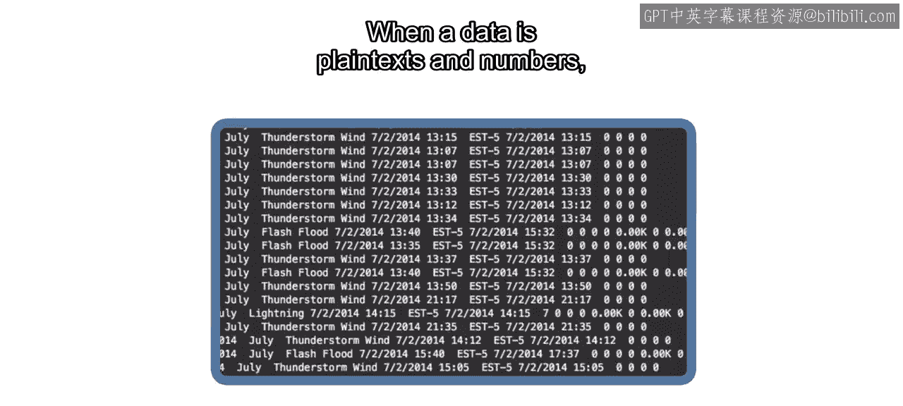
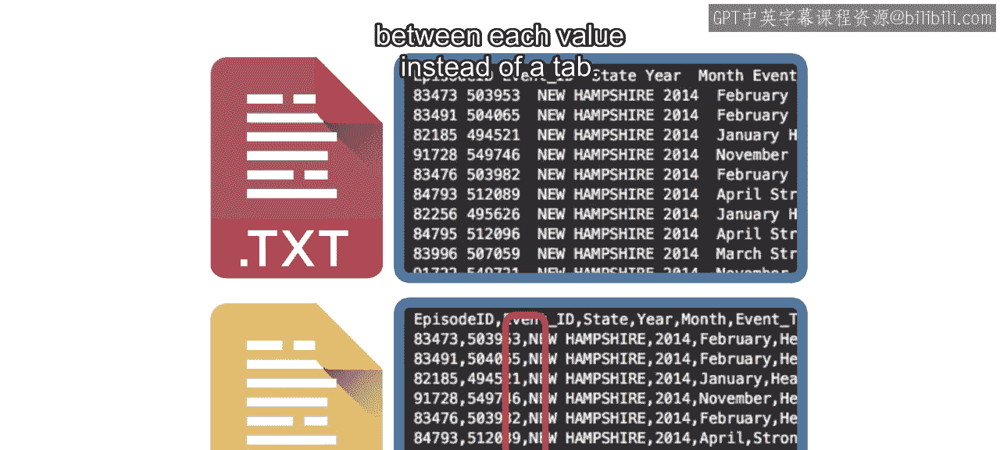
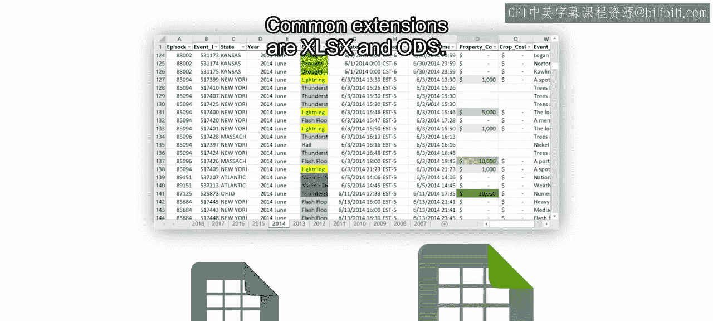

# Mathworks《实用数据科学与MATLAB（数据探索、特征工程、机器学习、毕业项目）｜Practical Data Science with MATLAB》 p13 12_数据的存储方式.zh_en [BV1Jr421w7wL_p13]

🎼，So far， you've learned the data is all around us and the data scientists analyze this data to identify and answer questions to help improve the world。

In this lesson， you will learn how data is stored digitally and practice importing a sample data set into MATLB on your own。

Data is commonly stored as text， numbers， images， videos， and audio。

 but it could be anything you need to analyze。Data is stored digitally in files。

Each file has a unique name， followed by an extension。

This extension indicates the format used to store the data。

When the data is plain text in numbers， it can be stored in a text file which has the extension TXT。

If you open a text file， you will see it contains multiple values on each row。In this file。

 values in a row are separated from each other by a tab。

It can be hard to identify which column each value belongs to when visualizing the data this way。

 but a computer knows exactly how to read it。Is this consistent across all file types？

Open a CSV file in a text editor to compare。 Do you notice anything different？

This file format places a comma between each value instead of a tab。

CSV actually stands for comma separated values。Any character can be used to indicate columns in a data file。

The character used to separate each column is called a delimiter。

The most common delimiters are comma， space and tab。

Organizing data into rows and columns is so common that software programs have been designed just for this purpose。

 this makes spreadsheet software a popular choice for storing data。

The file extension depends on which program you're using， Commonmon extensions are XLSX and ODS。

These files use more complicated formats to store additional information specific to the program。

The data can therefore only be accessed by programs that can interpret the file format。Similarly。

 different types of data are also stored using custom file formats。

 consider an image or a sound file。

If you open these files in a text editor， the contents would be unrecognizable。

These files store data as a series of unlimitedlimited numeric values。

MatLb can extract data from common file types， including image， video and audio files。In summary。

 all data scientists work with data。 However， the type and format of that data varies。

 no matter the format， the data is still just numbers and text。

 You can use Matlab to load it and analyze it。Now you're ready to learn how your data is organized when it's brought into MATLb。

