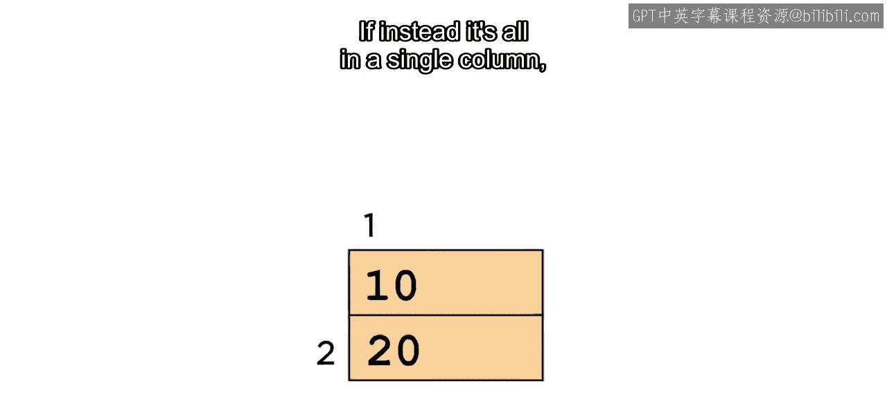
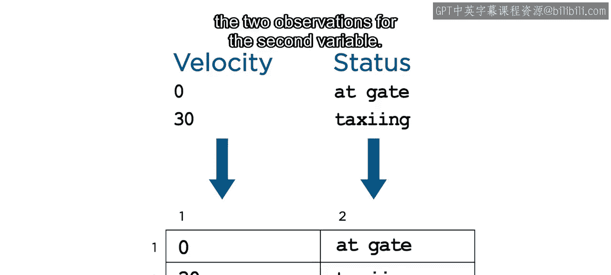
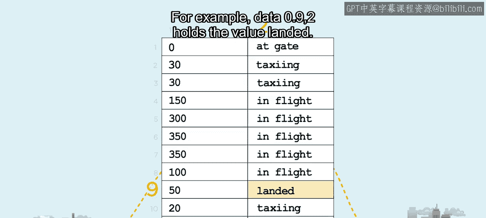
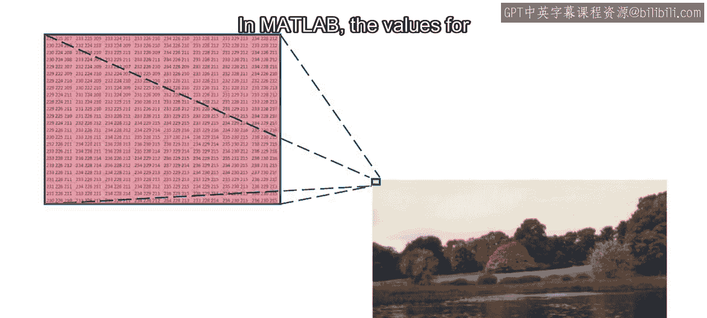
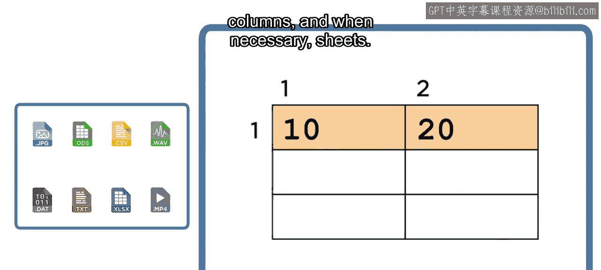
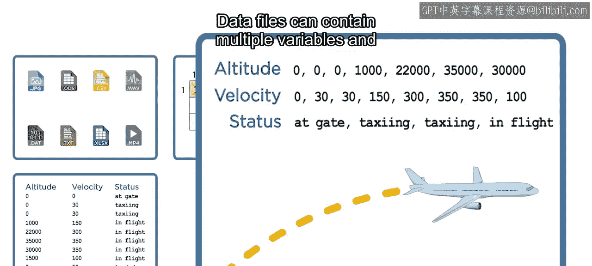

# Mathworks《实用数据科学与MATLAB（数据探索、特征工程、机器学习、毕业项目）｜Practical Data Science with MATLAB》 p14 13_MATLAB如何表示数据.zh_en [BV1Jr421w7wL_p14]

🎼。

As you've just seen， computers use a variety of file formats to store data digitally as numbers and text。

You can use MATLb to load data from many common file types。

But when you extract data from its original file format， how is it organized。

 understanding that will better equip you to work with it。

In MatTLab data is organized into rows and columns。If our data was a single value。

 it would occupy a single row and a single column。Its size is one by one。

 meaning it's one row long and one column wide。If a second value was stored in the second column。

 the size would increase to one by two because the data is now one row long and two columns wide。

When all the data is in a single row， it's called a row vector。

If instead it's all in a single column， it's called a column vector。

A vector typically contains observations for a single measured variable。

It's common for a data file to contain observations for multiple variables and therefore contain multiple vectors。

These vectors may contain a combination of numbers and text representing unique。

 spatial or temporal information。For example， if you were tracking an airline flight。

 you might record the plane's altitude as well as its velocity and perhaps the flight status。

As before， MatTlab places each observation in its own row and column。

The default behavior is to assume each variable is a column vector with each observation in its own row。

For example， if the data consisted of two variables with two observations each。

 the first column would contain the two observations for the first variable。

 and the second column would contain the two observations for the second variable。

With the data organized into rows and columns， you can refer to a specific value using its row and column indices。

For example， data point9 comma 2 holds the value landed。

When indexing the first number indicates the row， the second number indicates the column。

The data we have considered so far could be organized into a two dimensional matrix of rows and columns。

 However， some variables contain multiple values for each observation。Consider an image file。

Here， the rows and columns preserve the spatial distribution of the pixels in the image。

 each row and column pair in the data represents a unique pixel location。

 but there are three color values associated with each pixel， which indicate the corresponding red。

 green， and blue intensities。In MATLab， the values for each color are placed on their own sheet。

Each sheet has the same number of rows and columns which indicate the height and width and pixels of the image。

The sheets are stacked on top of each other， first red， then green， then blue。

 along a third dimension。The size is rows by columns by3， where three indicates the number of sheets。

In summary， MatLB can load data from many common file types， the loaded data is organized into rows。

 columns， and when necessary sheets。

By default， the observations in each column are considered to all belong to a unique variable。

Data files can contain multiple variables and the observations can be text or numeric values。

You'll next learn how to bring your data into MatTLb。Once loaded。

 you'll be able to use the powerful analysis capabilities of MATLAB to find answers to the questions you're asking。

