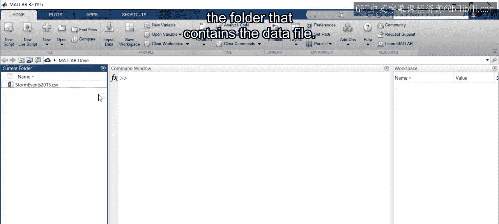
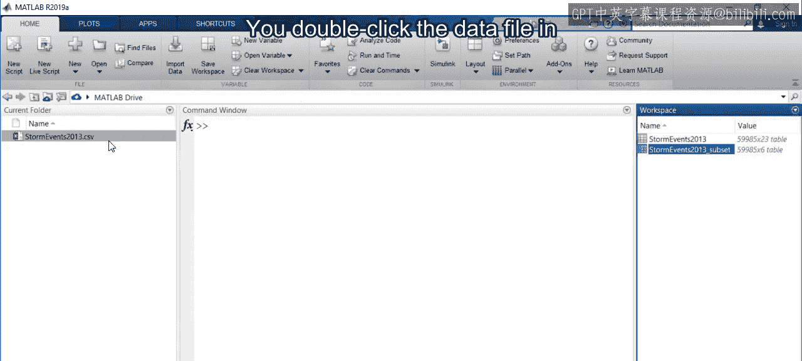
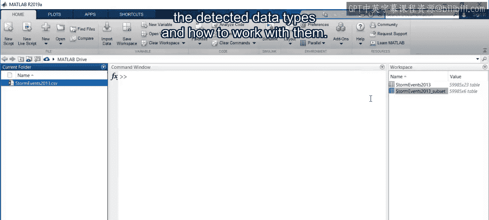

# Mathworks《实用数据科学与MATLAB（数据探索、特征工程、机器学习、毕业项目）｜Practical Data Science with MATLAB》 p15 14_如何使用导入工具.zh_en [BV1Jr421w7wL_p15]

🎼，Hello and welcome back In a previous lesson you saw how MatTLAb represents data Now you'll learn how to import data into MATLAb。

Let's start by navigating to the folder that contains the data file。

 Double click the file to open a second window called the import tool。

Here you see several import options， as well as a preview of how the data will look in MATLap。

In this case， you're importing a CSV file， which stands for comma separated values。

MatLab automatically detects the correct delimiter， the comma。

 but you can also manually select a different delimiter if you need to。Also， notice the output type。

After you import the data， it will be represented by a table。As you've already learned。

 Matlab works with data organized in rows and columns。

Each column here already has a name such as state or year。

Which makes it much easier to understand the data。The line directly below the column name shows the data type for each column。

Although these data types are automatically detected。

 you should still verify that the detected type is appropriate for your purpose。In a later video。

 you'll learn more about the types of data you see here， such as text， number， categories。

 dates and times， as well as tables。Your table also has a name。

 MatLb automatically provides it for you based on the name of your file。

When you click import selection， the data is imported into your workspace。 Well， that was easy。

 You just double click the file name， click import selection， and you're ready to go。

Let's look at the imported table， Stm Events 2013。It looks just like the preview from the import tool。

 You see the variable names， as well as the different data types sorted in rows and columns。

You also have scroll bars that you can use to fully explore the table。 And as you can see。

 this is a lot of data。What if you don't need all of the columns？

Let's go back to the import tool and select parts of the data instead of the whole data set。

Did you notice that the entire table is highlighted in blue。

 blue indicates the data that will be imported。To select a subset。

 hold the control key and click the columns you would like to include in the table。

When selecting the range， make sure to exclude the header line because you only want the data。

Let's change the table name so you don't overwrite the existing table and import the selection。

Now you have a smaller subset of data that contains only the table variables you are interested in。

This makes it much easier to work with， it also saves time because you're not loading as much data as before。

So let's recap。 You double click the data file in Matlab to open the import tool there。

 you decided if you wanted all the data or just a subset。

Then you reviewed the automatically selected data types for your variables。Finally。

 you imported your selection to the MATLb Workspace。In upcoming lessons。

 you will learn more about the detected data types and how to work with them。

