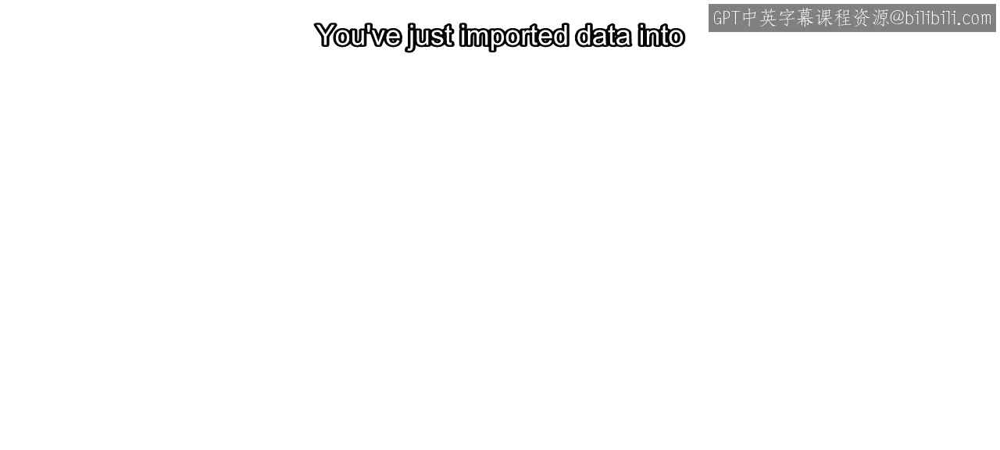
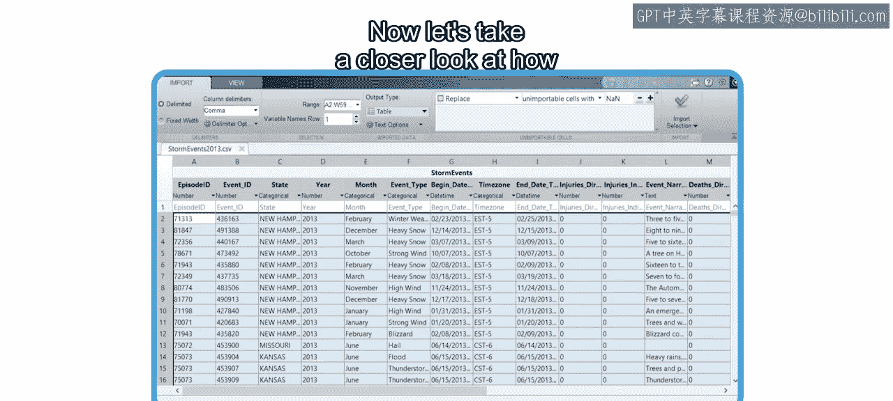
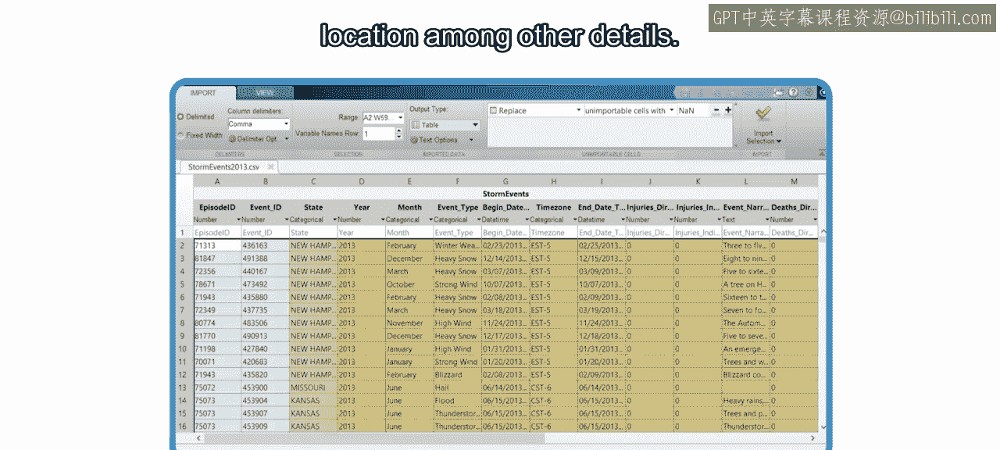
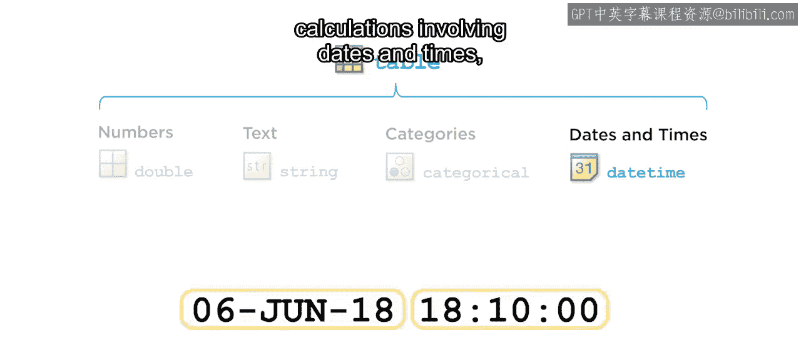
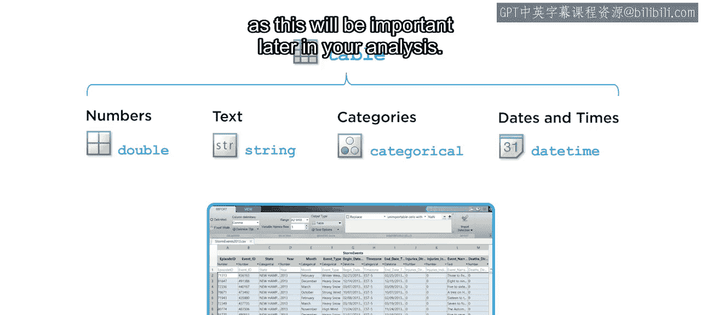

# Mathworks《实用数据科学与MATLAB（数据探索、特征工程、机器学习、毕业项目）｜Practical Data Science with MATLAB》 p16 15_MATLAB数据类型.zh_en [BV1Jr421w7wL_p16]

🎼。

You've just imported data into MATLb using the import tool。

Now let's take a closer look at how the data is represented in MATLAP。

The data set contains a list of weather observations and information about the time and location。

 among other details。

A common way to organize this data is with a table。

Matlab uses this common representation where each row represents an observation made at a specific time。

 Each column holds a different part of your data。 For example， the date and time。

 the category of the weather event or its geographical location。 These are called table variables。

As you see， the variables already have names contained within the data set。

Directly below each variable name， you see the variable's data type。

 which is determined by how you intend to use the data。When importing data。

 you need to think about how you will analyze it。 Once in Matlab。

 each variable has a type that categorizes the data based on how you plan to use it。For example。

 data represented by numbers may be useful for visualizations or calculations。

 whereas data consisting primarily of text may be useful for classification or labeling。

Let's take a look at the different data types and what kind of data they represent。

The first label you will likely notice is a number。

 which is commonly represented by the data type double。If you're unfamiliar with this name。

 don't worry， it's a common way that computers represent real numbers。

Your table has several table variables with this data type。 for example， geographic location。

You also see text that provides additional information。 The data type for text data is called string。

The data set also has text data that's not identified as text， but rather as categorical。

For this type of data， there's a limited set of defined values or categories that the variable can take on。

This is useful for grouping data。Finally， you see dates and times when the weather events took place there represented by the data type date time。

So let's take a closer look at each of these data types。Nummeric data can be a single value。

 a vector or matrix。You can picture a vector as several values arranged in a row or column and a matrix as an array of vectors。

Strings are used for text data， such as the description of the weather event or the region where the event happened。

 They can contain one or more words。Categorical data might look like text data at first。

 but it's a little different。Look at the variable state， for example。

 You see that there are several entries with the same value。

 and you likely also know that there is a finite set of possible values。

Categorical data can be used to obtain additional insights into weather events， for example。

 by analyzing and visualizing events by state。The date time data type is convenient for working with dates and times。

It represents a point in time here， 6 June in 2018，10 minutes past 6 in the evening。

This data type enables you to easily change the display format when you visualize your data。

It also enables you to easily perform calculations involving dates and times。

And with that， you know all the data types that are being used in your table。

 The table itself is also a data type called table。So let's recap what you know。

 A table consists of rows and column oriented variables。

 Each variable is identified by a unique name and can have a different data type， such as double。

 string， categorical or date time。Look for these data types when importing your data。

 as this will be important later in your analysis。

