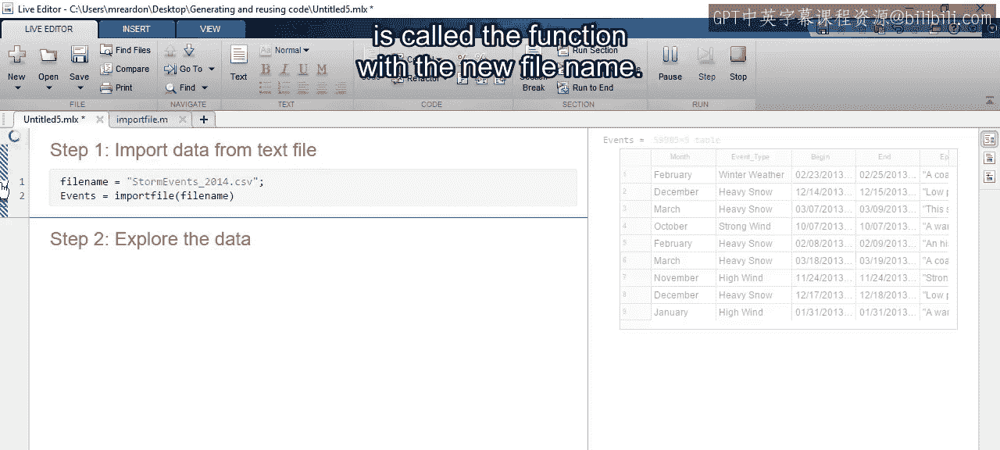

# Mathworks《实用数据科学与MATLAB（数据探索、特征工程、机器学习、毕业项目）｜Practical Data Science with MATLAB》 p18 17_生成和重用代码.zh_en [BV1Jr421w7wL_p18]

🎼，Previously， you learned how to import data interactively using the import tool and the benefits of automating the import process。

In this video， you will learn how to automate the import process by generating reusable code。

Let's start by opening the import tool and loading the 2013 weather events data。

The import tool provides a preview of the data and automatically selects options for importing the data into a table variable。

Recall that you can make further customizations by selecting the variables you are interested in。

Modifying the variable and table names。And specifying their data types。

The last step is to click the importm selection button and select importm data。Notice， however。

 that there are several other options available for generating MALb code。

Clicking generate a live script will create a live script containing the corresponding import code。

 including any customizations you have made。Use this code as a starting point for your exploratory analysis。

 You can then repeat and share your analysis in the future without having to repeat the steps in the import tool。

If you are working with mobile files with the same format。

It's a good idea to generate an import function instead。

The import function contains the necessary code to import your current data file with your chosen customizations。

But it can also be used to import other files with the same structure when you provide their names as input。

To use the import function， first save it to the same location as your analysis code and your data files。

Then add code to your data analysis script to specify the file name and then call your function and assign the output to a variable。

Now， all you have to do to import a different data file is called the function with the new file name。

🎼。