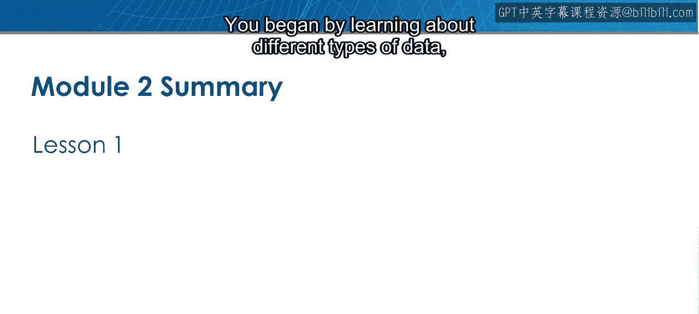
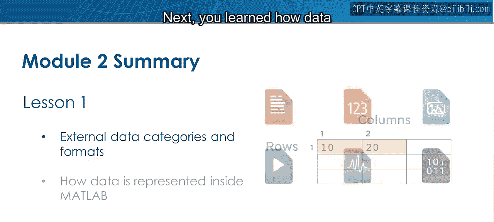
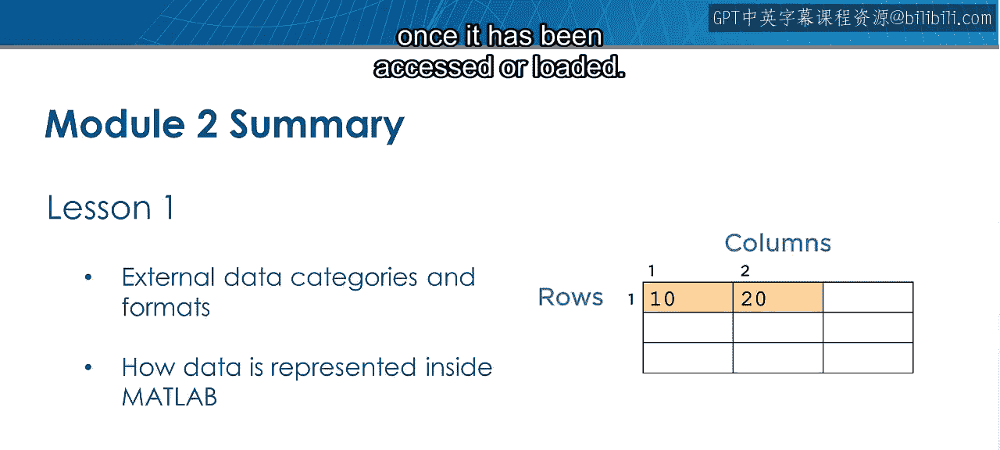
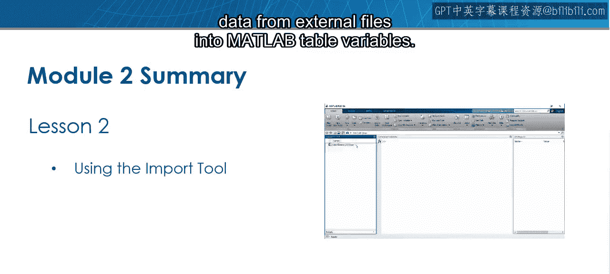
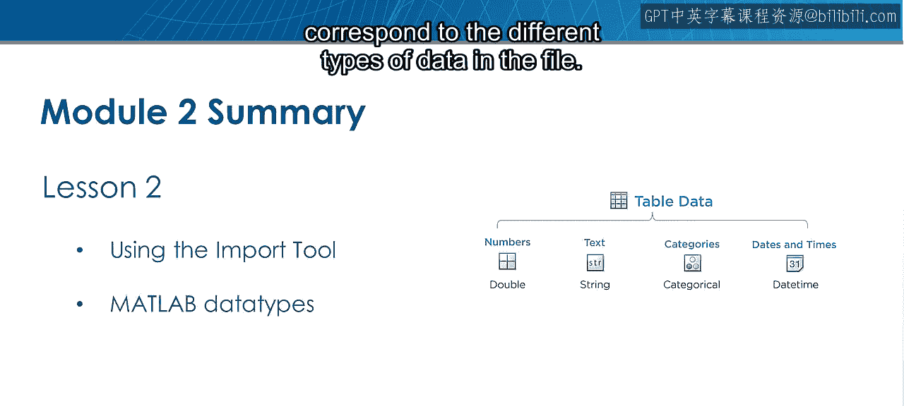
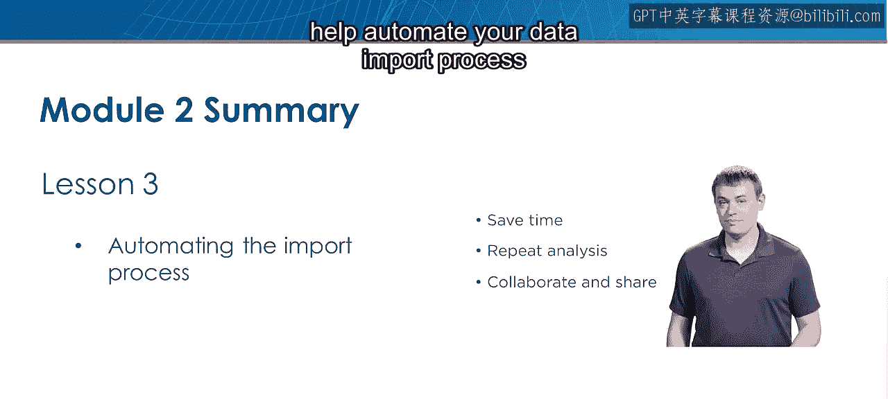
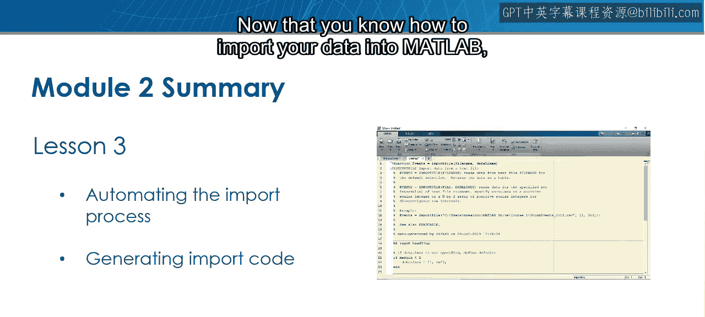
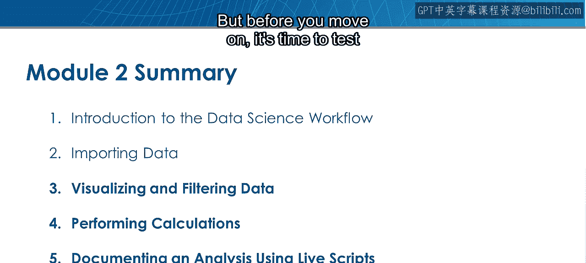
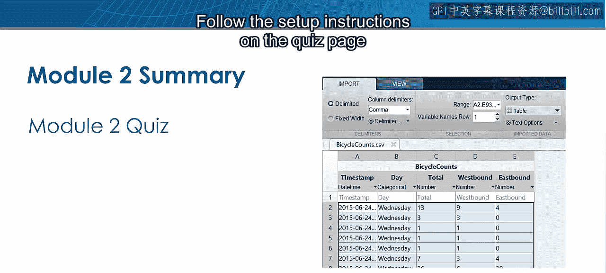
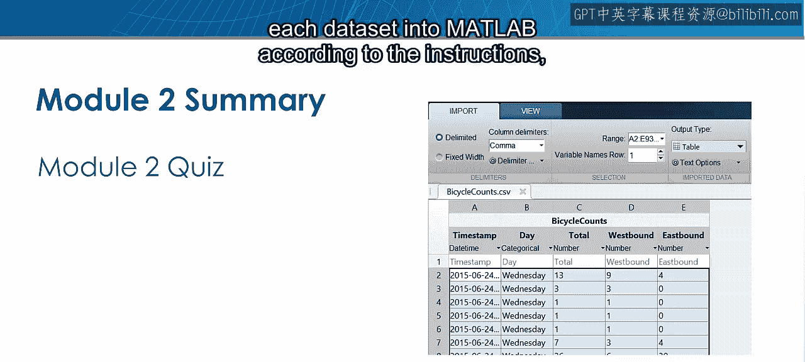

# Mathworks《实用数据科学与MATLAB（数据探索、特征工程、机器学习、毕业项目）｜Practical Data Science with MATLAB》 p19 18_模块2导入数据总结.zh_en [BV1Jr421w7wL_p19]

🎼，Congratulations， you've reached the end of moduleule 2。The moduleule 2 quiz is up next。

 so it's time to recap what you've learned。You began by learning about different types of data and how data is stored outside of MatL。

Next， you learn how data is represented inside of MatTLb once it has been accessed or loaded。

Then you use the import tool to interactively load data from external files into MALB table variables。

Once the data was loaded， you saw that the data types of each variable in your MAL table correspond to the different types of data in the file。

Lastly， you learned how the import tool can help automate your data import process by generating code。

 making your job easier in the future。

Now that you know how to import your data into MatTLb。

 you're ready to start exploring your data using visualizations and descriptive statistics。

 which are covered in the next two modules。

But before you move on， it's time to test your data import skills by taking the moduleule2 quiz。

Follow the setup instructions on the Quiz page closely to access the required files in MATLap。

Then use the import tool to load each data set into MALAB according to the instructions and answer the questions that follow。

。