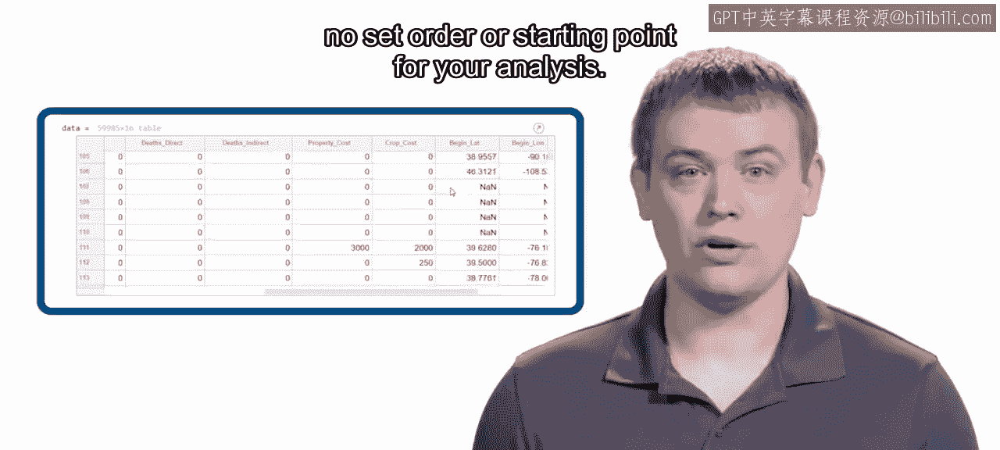
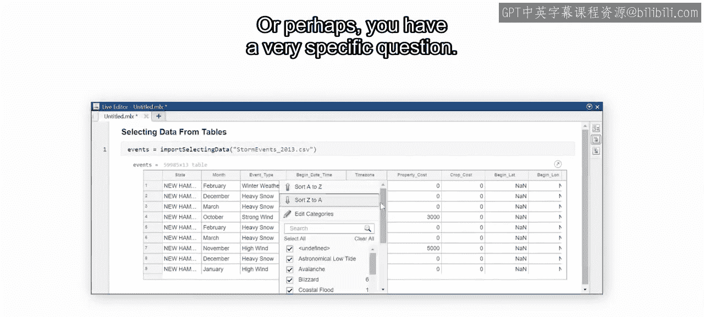
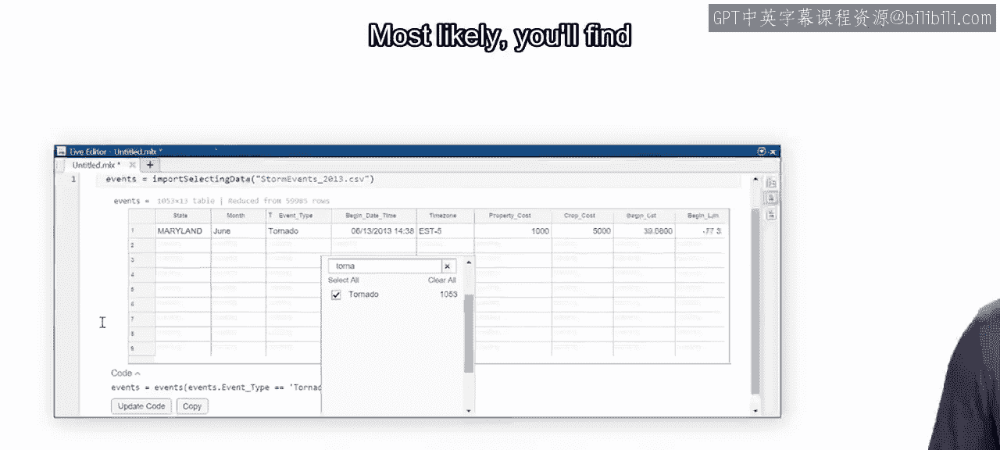
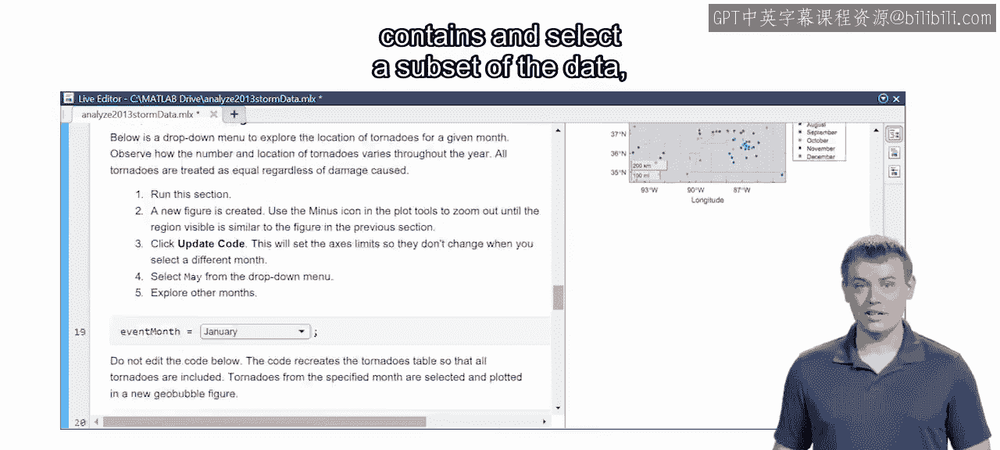
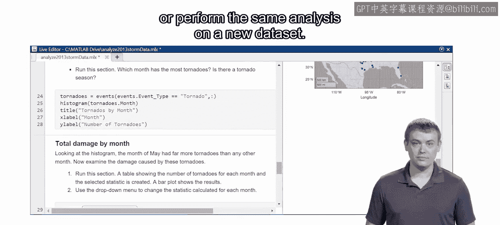

# Mathworks《实用数据科学与MATLAB（数据探索、特征工程、机器学习、毕业项目）｜Practical Data Science with MATLAB》 p20 19_模块3可视化和过滤数据介绍.zh_en [BV1Jr421w7wL_p20]

🎼。

Welcome back。Now that you know how to import your data into MATLb， it's time to start exploring。

When you have lots of data， determining how and where to begin might seem overwhelming。Keep in mind。

 though， there is no set order or starting point for your analysis。

Maybe you'll find it most helpful to create visualizations to see what the data contains。

Or perhaps you have a very specific question， and we'll start by selecting just the data needed to answer that question。

Most likely， you'll find exploration to be an iterative process in which you create visualizations。

 perform some simple calculations， select data from a table， visualize the new results， and so on。

Fortunately， there are many interactive tools in MATLB that help you explore data while recording the steps needed to reproduce the analysis。

Using these interactive tools to visualize， select and modify data is the focus of this module。

For example， consider the live script for analyzing tornado events you worked with previously。

You'll learn how to create the visualizations it contains and select a subset of the data like tornadoes that caused property damage for further analysis。

You'll also capture the code generated by MATLb and add it to a live script。

 you can use the script to repeat the analysis later or perform the same analysis on a new data。

By the end of this module， you'll have the skills needed for many common data exploration tasks。

 so let's get started。