# Mathworks《实用数据科学与MATLAB（数据探索、特征工程、机器学习、毕业项目）｜Practical Data Science with MATLAB》 p21 20_绘制表中的数据.zh_en [BV1Jr421w7wL_p21]

🎼，Now that you know how to import data into MatLb， what's next？

Maybe you have a specific question and are ready to dive right in。

More likely you'll need to start exploring your data to gain insight into what it contains。

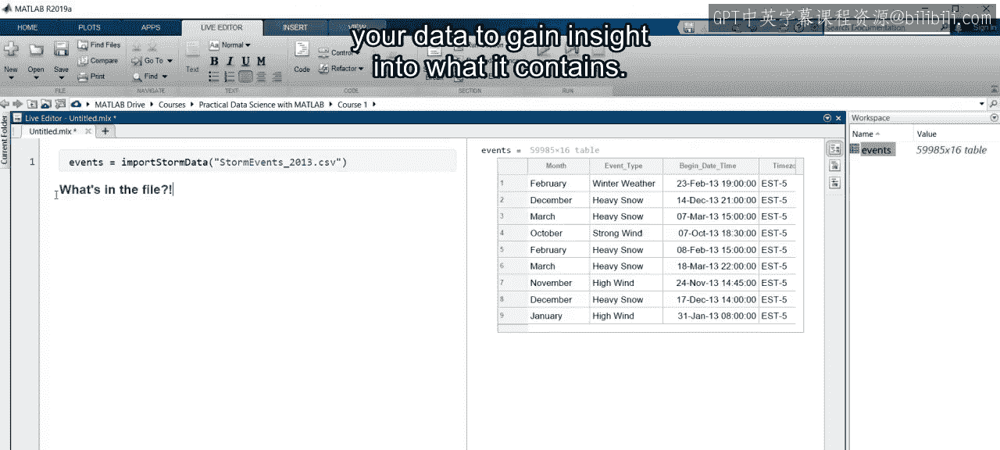

Creating visualizations is a great way to start。In this video。

 you'll learn how to create different types of plots。

Use the documentation to learn more about a specific plot。

And add labels and titles to help communicate your results。

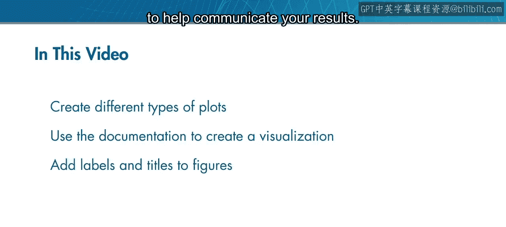

Let's revisit the weather event data， but this time， start right after importing the file。

Imagine that this is the first time you're looking at the data。 Where would you start。

A preview of the nearly 60，000 events is displayed。

You can scroll through the table to get an idea about what's in it， but that's a lot of scrolling。

Visualizations can provide more insight。For example。

 how many and what type of events are contained in the data。

A histogram of the event types might help。To create a plot。

 go to the MATLB Workspace and double click the table to open it in the variable editor。

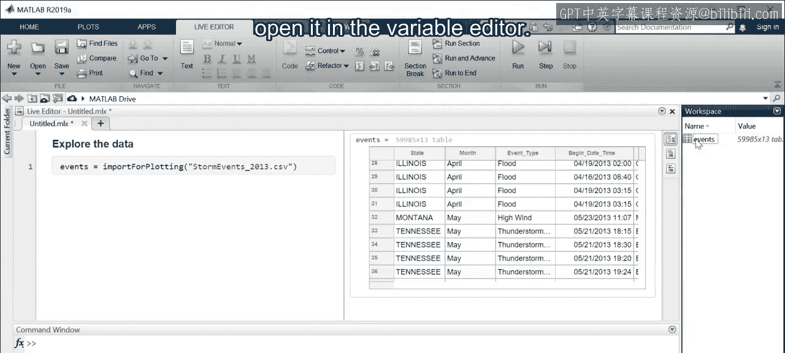

This opens the full table in an editable window。Next。

 select the variable you want to plot in this example， event type。And then click the plotts tab。

The different types of plots available for the selected data are shown。

If you're unfamiliar with a type of plot， the icon gives a visual clue。Here， select histogram。

The histogram is displayed in a new window。Now you can see all the event types in their relative frequency at once。

For example， thunderstorm wind makes up nearly a quarter of the 60000 events。

That would have been difficult to see， just by looking at the table。

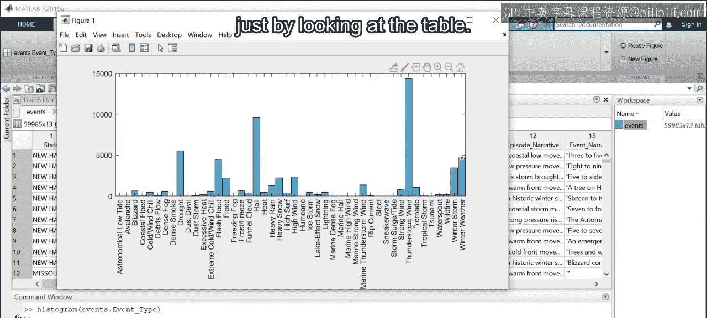

Also notice that the code used to create the figure was placed in the command window。

This enables you to copy the code。And paste it into the live script for future use。

Many types of plots require multiple variables。

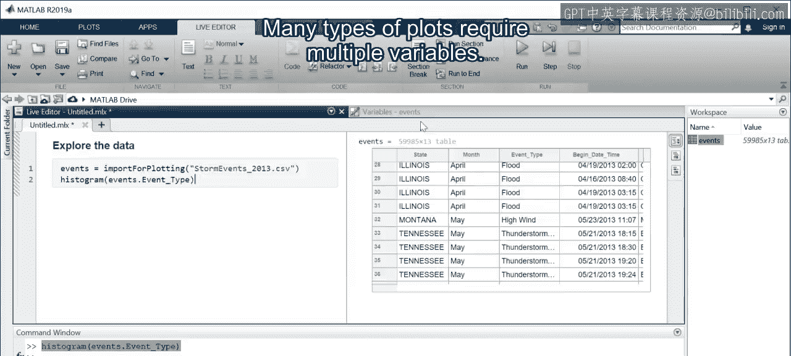

For example， you may want to use latitude and longitude to visualize the geographic location of events。

Pres controll while clicking to select multiple variables。H。

 none of the plot types shown here look like a geographic plot。

Click the down arrow to see all available plot types for the selection。

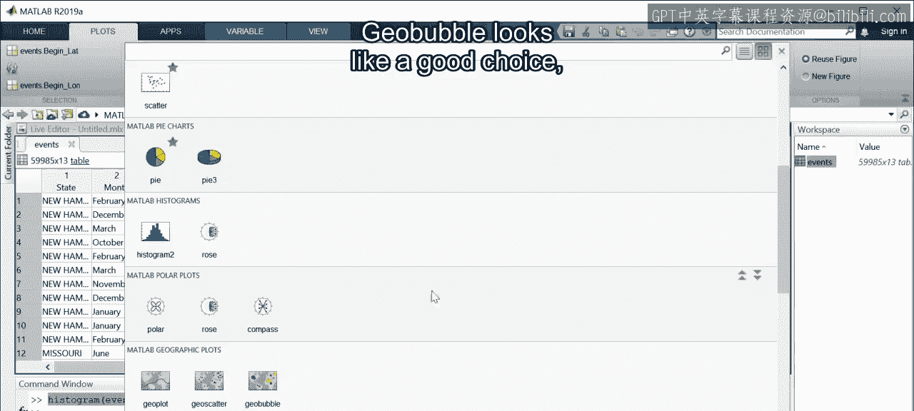

Geobubble looks like a good choice。But there are a lot of events in the plot。

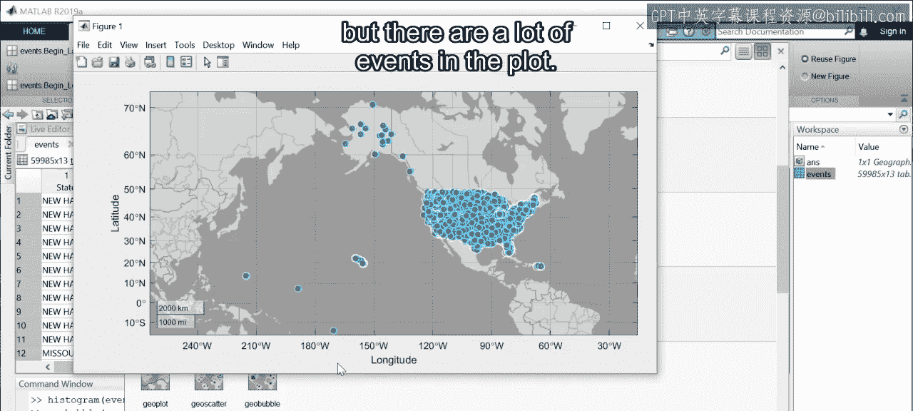

Just like in the live editor， you can zoom in。And pan， to focus on a region of interest。

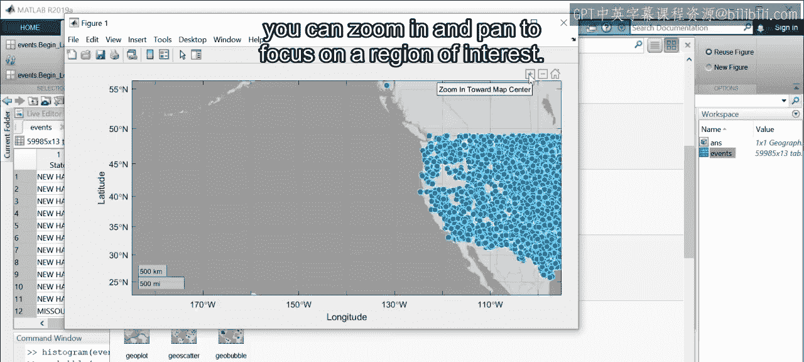

You may recall from the tornado example that the plot markers varied in size based on damage and color based on month。

How can you recreate this？To get help using the Gebubble function， highlight the function name。

 right click and select Help on selection。This opens the documentation for the function。

Here we see that the function can be called with additional inputs to specify size and color。

 so let's try it out。Back in the variable editor， press control and select the property cost and month variables in that order。

Notice that with four variables selected， the number of available plots is greatly reduced。

So now Gebubble is one of just a few options。Perfect。😊。

The new plot markers vary in size and color based on the additional inputs provided。Finally。

 copy and paste the command into your live script and run it。

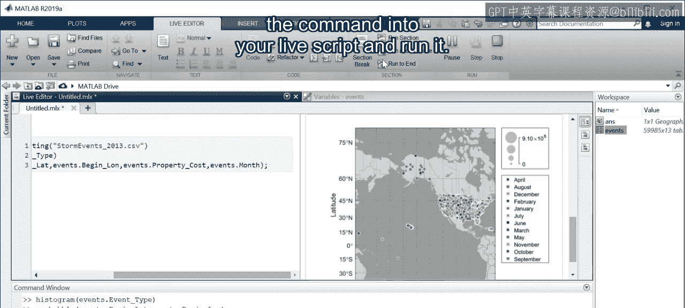

Now that the plots are in the live editor， when you click on a plot， the figure tab becomes active。

In the figure tab are common customizations you can add to your figures。Let's add a Y label。

And title to the histogram。

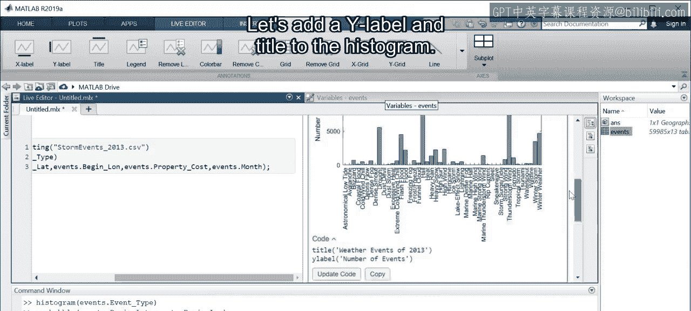

The code required for the label and title is generated so you can add it to the file and document your steps。

Visualizations are a great way to start exploring your data。

You now know how to plot variables contained in a table。

Use the documentation to learn more about a specific type of plot。And add common customizations。

You may have noticed that when you have a lot of observations。

 some plots become crowded and difficult to interpret。That's where filtering your data comes in。

 which is a topic covered in another lesson。

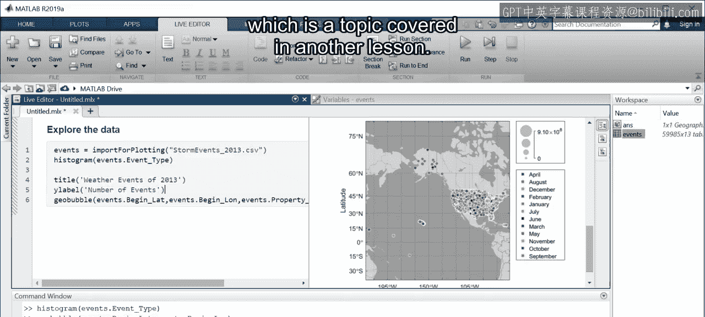

🎼。