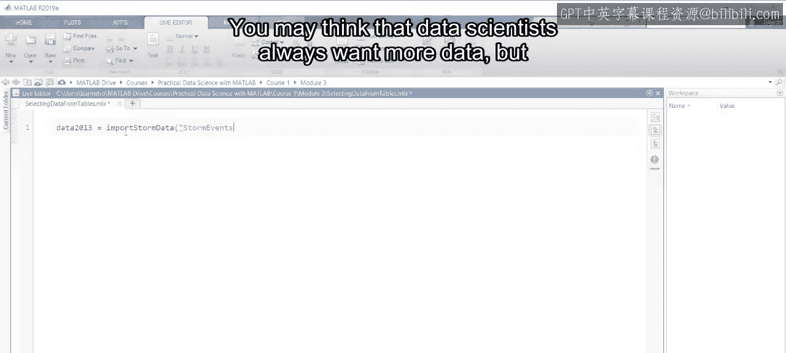
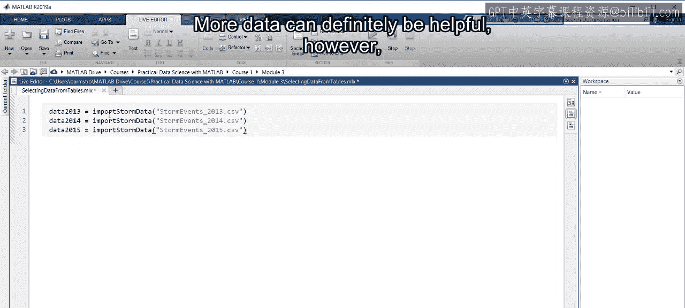
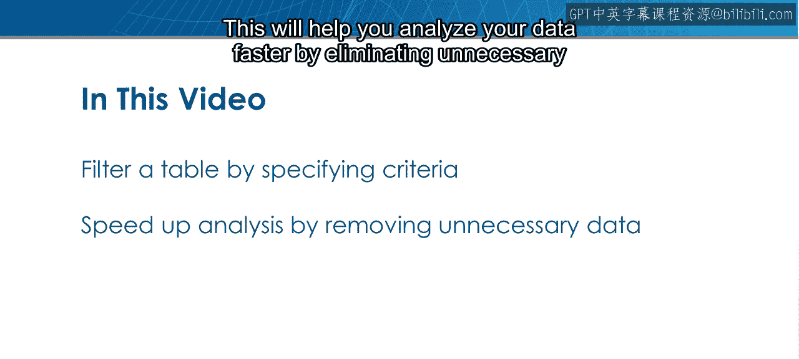
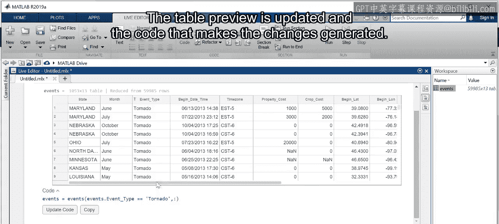
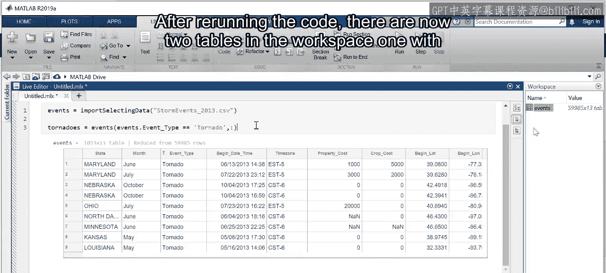
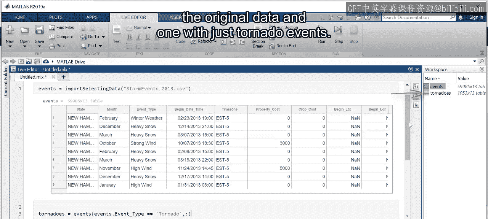
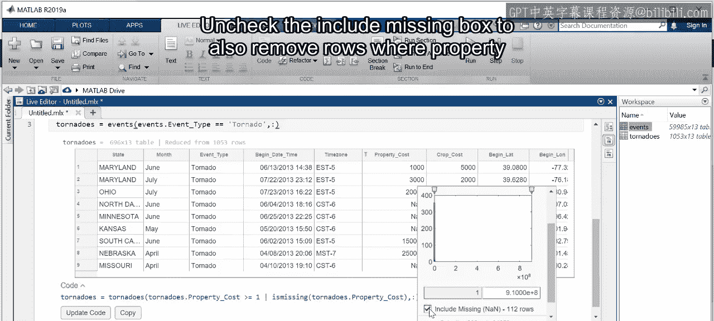
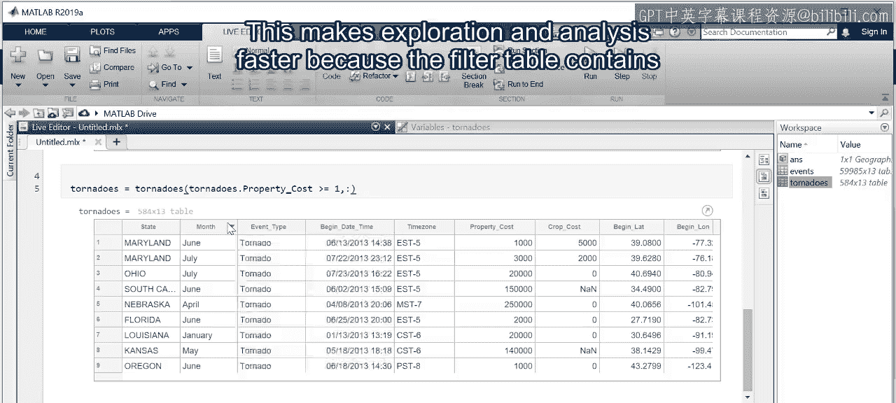
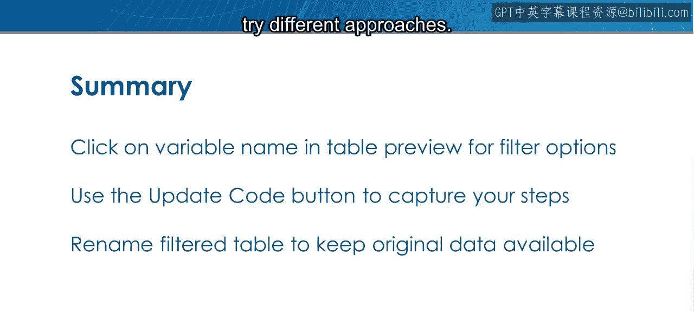

# Mathworks《实用数据科学与MATLAB（数据探索、特征工程、机器学习、毕业项目）｜Practical Data Science with MATLAB》 p22 21_从表中选择数据.zh_en [BV1Jr421w7wL_p22]

🎼，You may think that data scientists always want more data， but that's only partially true。

More data can definitely be helpful。 However， thinking of the 2013 weather data。

 if you're interested in only tornadoes， you have about 58000 unneeded observations。

All that extra data can make it harder for you to find answers to your questions。

How can you filter the data to keep only what's relevant for your analysis。In this video。

 you'll learn how to select a subset of data from a table based on criteria you define。

This will help you analyze your data faster by eliminating unnecessary observations。

Let's open the 2013 weatherather Even file and consider situation in which you want to analyze tornadoes that cause damage。

 similar to the live script you worked with earlier。Upon importing the data。

 all event types are included。When you click on a variable name in the table。

 options are displayed for sorting and filtering on that variable。

A set of check boxes indicates the event categories that are included in the table。

Rather than uncheck each category that isn't tornado， click clear All。

You can either scroll through the categories to find the one you want or use the search bar to find it。

The table preview is updated and the code that makes the change is generated。

Click update code to add it to the script。Notice that the generated code uses the same name for the filter table as the original table。

This means the original data will be replaced by the filtered table。When you're exploring a data。

 it's helpful to keep the original data available so that you can quickly try different types of analysis。

 So here let's rename the filtered table tornadoes。After rerunning the code。

 there are now two tables in the workspace， one with the original data。

 and one with just tornado events。

Making a second table does use more memory。 so if you are working with very large data sets。

 you may need to stick with a single table。Let's further explore the table of tornadoes by clicking on the property cost variable。

This is a numeric variable， so you have a few different options for using it to filter and sort the table。

It's difficult to see in this example because the range of values varies from 0 to 910 million。

 but there is a histogram of the data along with sliders that you can move to select a range of values to include in the table。

Instead of using the sliders， specify a minimum value to include in the table by directly typing it in here。

Using one will remove all observations that have zero property cost。

Unchecked the include missing box to also remove rows where property cost values are missing。

Update the code and run the file to get a table of tornadoes that cause property damage。

The final table has just 584 events， far fewer than the nearly 60，000 in the original file。

And now that the table includes only damage causing tornadoes。

 a geographic plot provides more insight than one showing all event locations。To recap。

 you can use the interactive tools to select and extract data from tables。

This makes exploration and analysis faster because the filter table contains only the data relevant to your analysis。

Click on a variable name to bring up options for sorting and selecting data。

Use the update code button to add the corresponding steps to your script。

And rename the filter table so you can return to the original data and try different approaches。

。