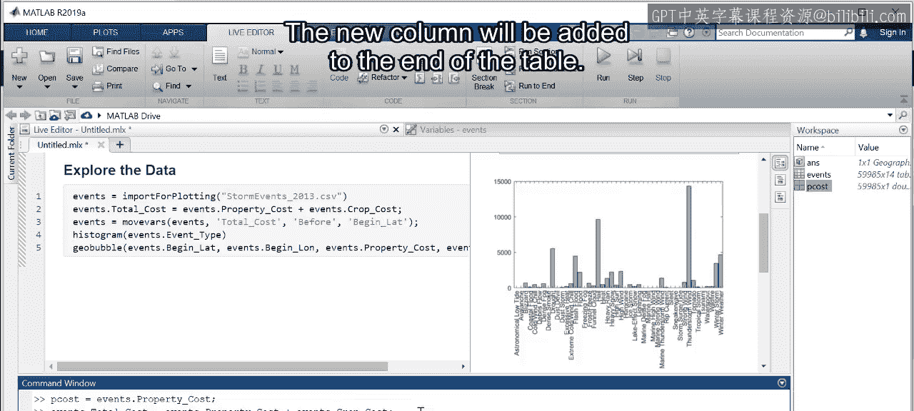

# Mathworks《实用数据科学与MATLAB（数据探索、特征工程、机器学习、毕业项目）｜Practical Data Science with MATLAB》 p23 22_访问和创建表变量.zh_en [BV1Jr421w7wL_p23]

🎼，🎼You've used interactive tools to begin exploring the weather event data。

 You've also captured the generated code and added it to a script。In this lesson。

 you'll take a closer look at that code to see how you can access individual variables in a table and use them to add new variables to the table。

You'll also learn how to save your results so that you can use them in the future or share them with others。

Why would you need to add new variables to a table？ Well。

 let's look at the contents of the weather data again。

The cost of damage done to property and damage un to crops is reported separately。

If you want to know the total cost of any weather event。

 you need to add property cost and crop cost together。And to simplify future analyses。

 you'll need to add that result to the table。To start。

 let's look back at the plotting code that was generated。Notice the pattern of table name， dot。

 variable name。This is how you access the contents of a table variable。

So this line accesses the contents of the event type variable from the events table to create a histogram。

Next， let's access property cost values。Start by typing a variable name to store those values。

 and an equal sign。Then type the name of the variable。

 followed by a dot and the name of the variable in the table。Perfect。

 now there's a new variable in the workspace。😊，Double click this new variable to see its contents and confirm that they match the values from the original table。

So to access data in a table， you use a dot to separate the table name and variable name。

But how do you add a variable to the table like the sum of property cost and crop cost。

You add variables to tables， much like you access them。 Start by typing the name of the table。

 followed by a dot。Then type a new name for a variable to add to the table here I've chosen total underscore cost。

After the equals sign， type the operation that produces the new data to place in the table。

 So this command takes each value in property cost。

 adds it to the corresponding value in crop cost and places the result into the events table as total cost。

Looking at the table contents， you see total cost added as a new column。

 Scll down to view a few observations and confirm that this new column does indeed hold the sum of the two original cost columns。

After performing analysis and adding data to a table。

 you may want to save the new table into a file format that others can use without needing Matlaap。

But before sharing the results， it's helpful to put the columns in a logical order。

To move total cost next to the other cost variables。

 move the cursor to the left side of the variable name until the drag indicator appears。

Then click and move the variable to the desired location。

Notice that the code for the move operation was captured。

 Let's copy the code and place it in a script to keep a record of our steps for future reference。

The last thing to do is save the updated table to a new file using the right table function。

The first input is the name of the table， followed by a name for the new file enclosed in quotes。

And now you have a new file in the current folder that you can use in the future or share with others。

To summarize， you access data stored in table variables by typing the name of the table and the name of the variable separated by a dot。

Similarly， you can add a new column to a table using the dot notation with a new variable name。

The new column will be added to the end of the table。

Rearrange the columns by clicking and dragging in the variable editor。

Once you have your updated table， arrange the way you want it。

 you can use the right table function to save it to a file for use outside of MAlab。

。