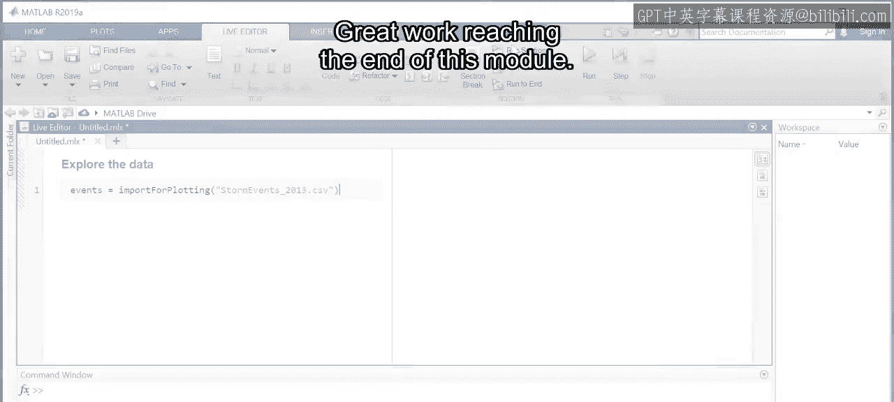
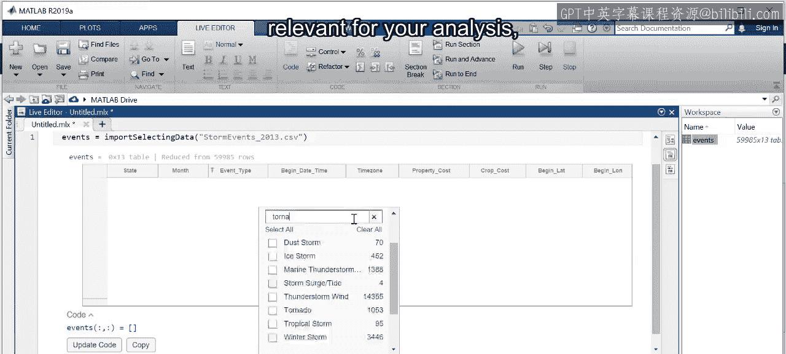
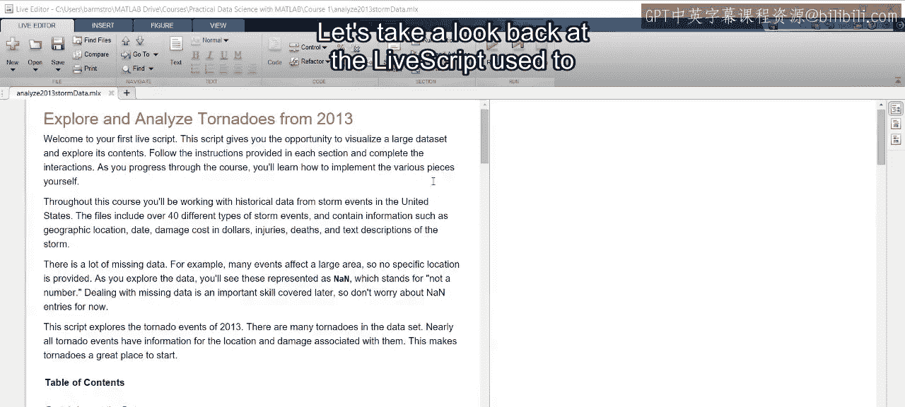
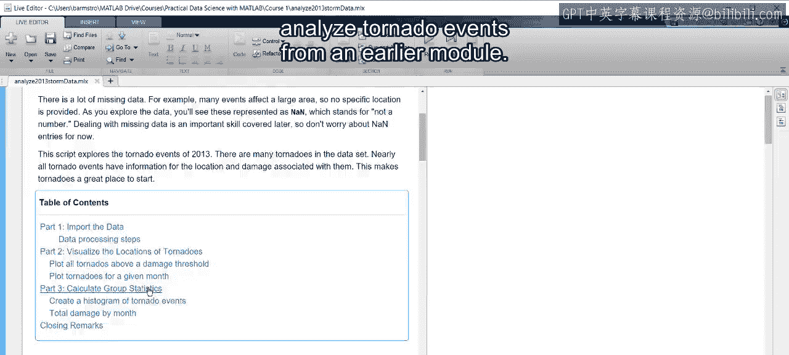
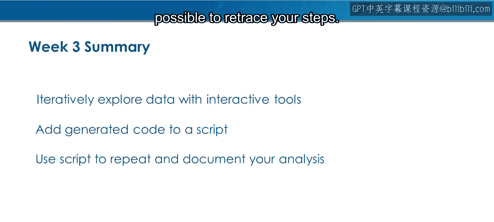
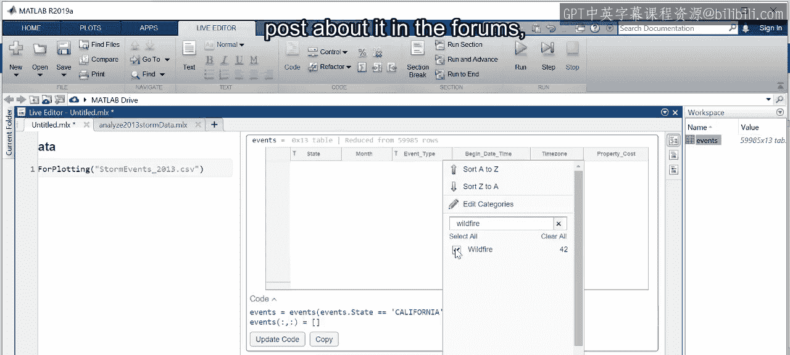

# Mathworks《实用数据科学与MATLAB（数据探索、特征工程、机器学习、毕业项目）｜Practical Data Science with MATLAB》 p24 23_模块3可视化和过滤数据总结.zh_en [BV1Jr421w7wL_p24]

🎼，🎼Great work Reaching the end of this module。 Take a minute to think about what you've learned so far。

 You can import data， create visualizations， filter data to focus on what's relevant for your analysis。

 access variables and tables and add new variables to a table。 In other words。

 you can already do a lot of exploratory data analysis。😊。

Let's take a look back at the live script used to analyze tornado events from an earlier module。

Much of the code you see here was automatically generated and added to the script via the interactions you just learned。

Keep in mind that exploring data is an iterative process。 In this script。

 visualualizations are created after selecting a subset of data from the table。

 but that's not how you'll typically interact with a new data set。

You'll typically try a variety of approaches as you look for insights into the data。

That's why it's important to capture the generated code and add it to your script。

You may head in a direction that doesn't help answer your questions and need to come back。

Capturing the generated code makes it possible to retrace your steps。

Now is a good time to practice what you've learned。

Pick an event type or two that interests you and maybe choose a state。

 practice creating new tables from the original weather events file and create a few visualizations。

If you find something interesting， post about it in the forums。 And when you're ready。

 take this week's quiz。 Good luck。😊。

。