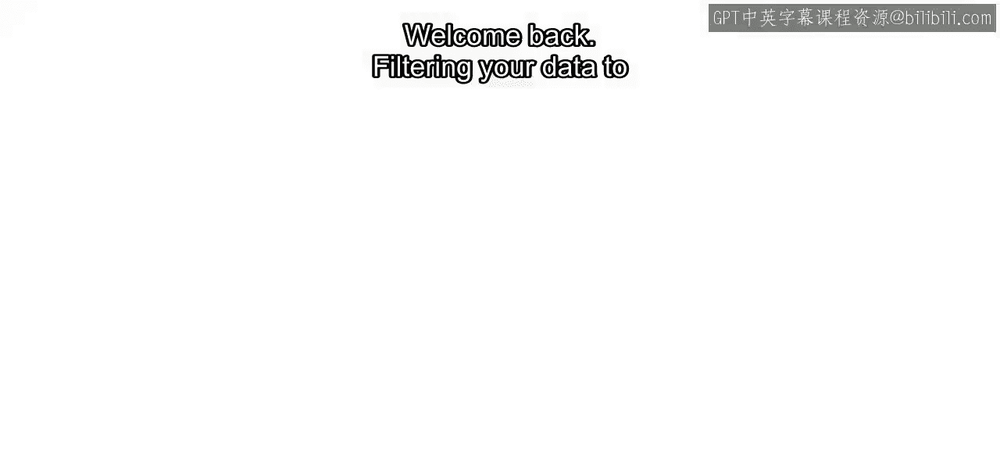
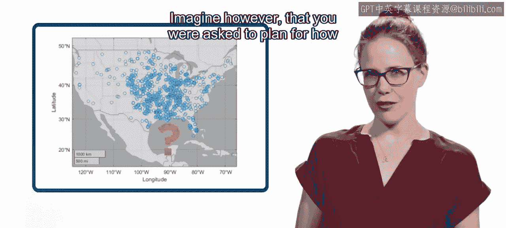
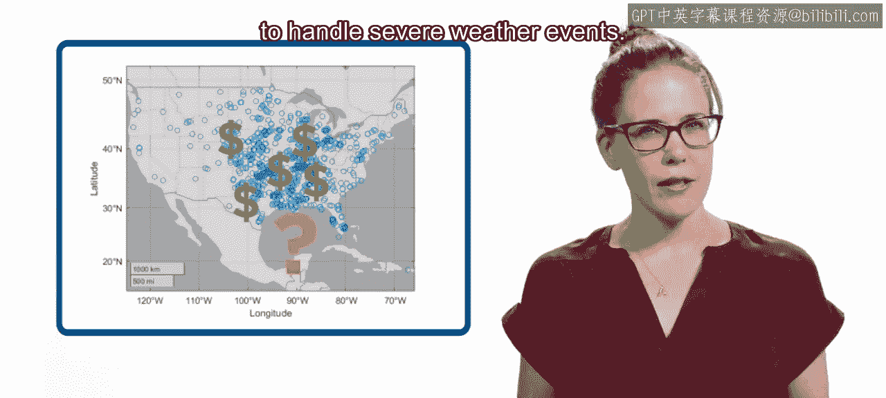
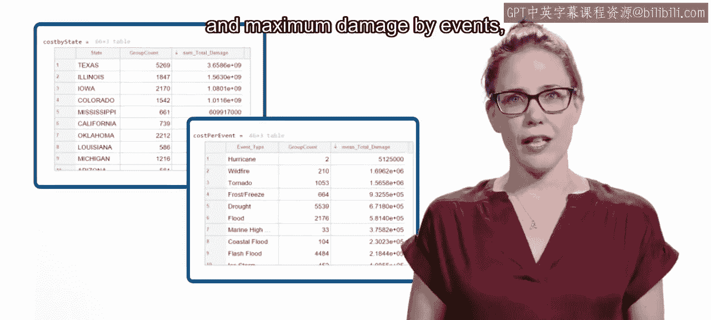
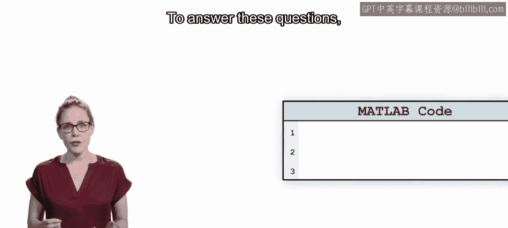
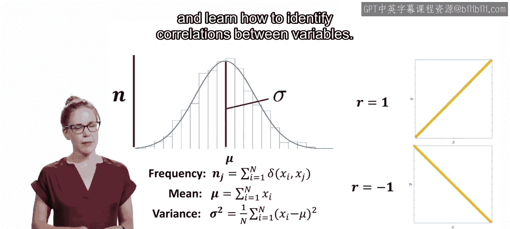
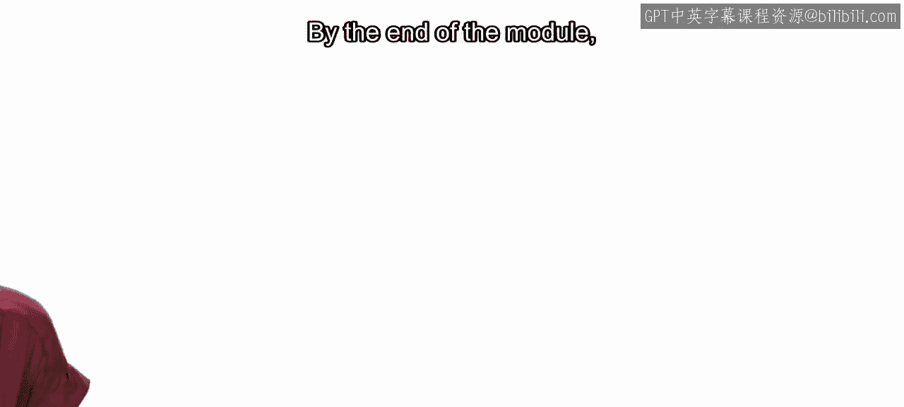
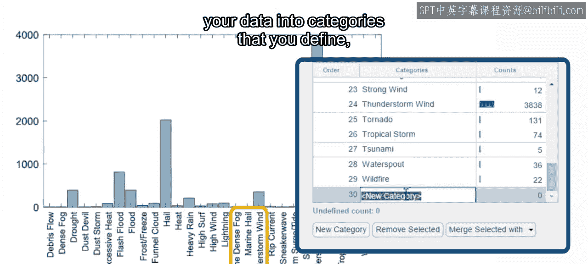
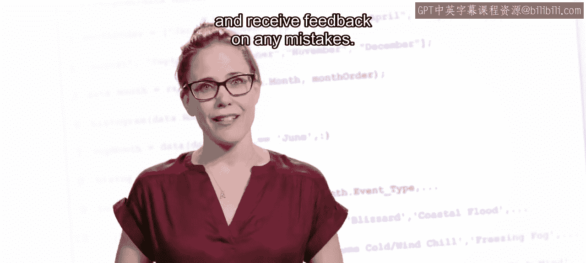

# Mathworks《实用数据科学与MATLAB（数据探索、特征工程、机器学习、毕业项目）｜Practical Data Science with MATLAB》 p25 24_模块4执行计算介绍.zh_en [BV1Jr421w7wL_p25]

🎼。

Welcome back。 Ftering your data to focus on key variables and creating visualizations can take you a long way in your analysis。

 For example， you now know how to visualize the geographic distributions of various weather events。

 Imagine， however， that you are asked to plan for how resources should be allocated to handle severe weather events。

Statistics such as total cost per state， average cost per event。

 and maximum damage by event will help you make an informed decision。

To answer these questions， you'll need to start performing some computations on your data。

We'll start this module with the basics。You'll learn how to set up calculations with variables。

You'll calculate some basic statistics and learn how to identify correlations between variables。

 You already know how to filter data interactively， and in this module。

 you'll learn about more sophisticated selection criteria that you can use for filtering。

And by the end of the module， you'll be able to regroup your data into categories that you define and calculate statistics on those categories。

There's a lot to cover， but don't worry， you'll have opportunity to apply what you've learned throughout the module。

 you'll perform calculations directly in the browser and receive feedback on any mistakes。

If you get stuck， visit the forum and ask for help。By the end of the module。

 youll be able to carry out more detailed and more advanced analyses of your data。

 so let's get started。