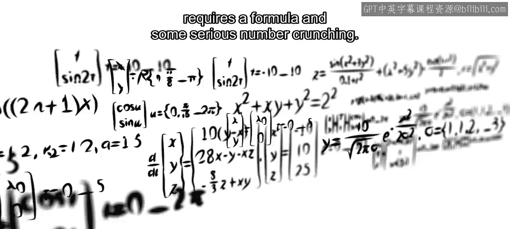
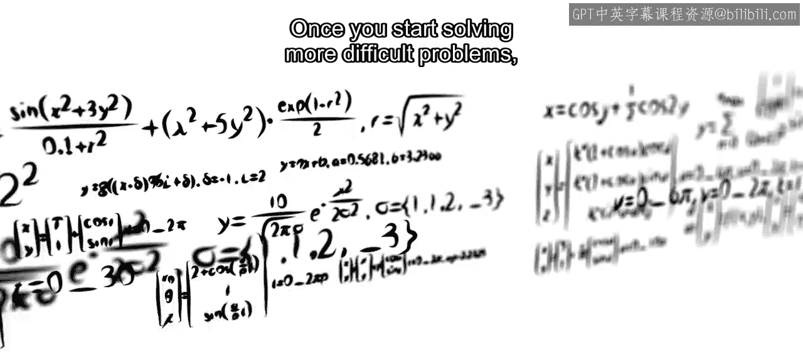
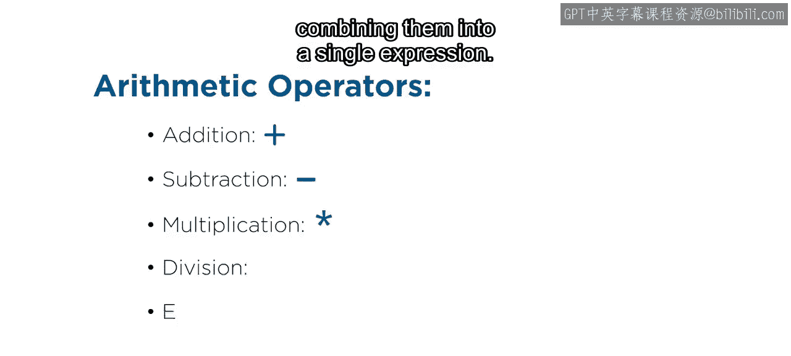
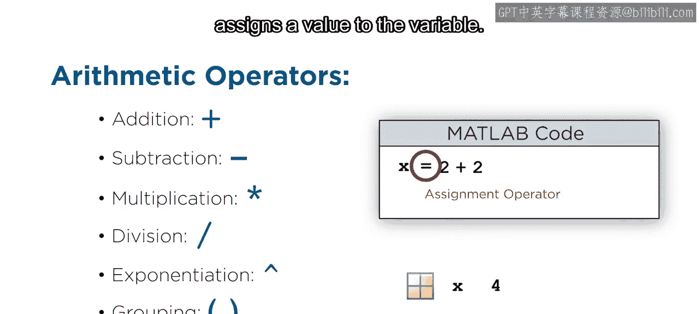
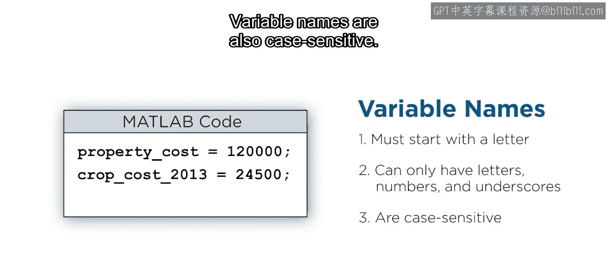
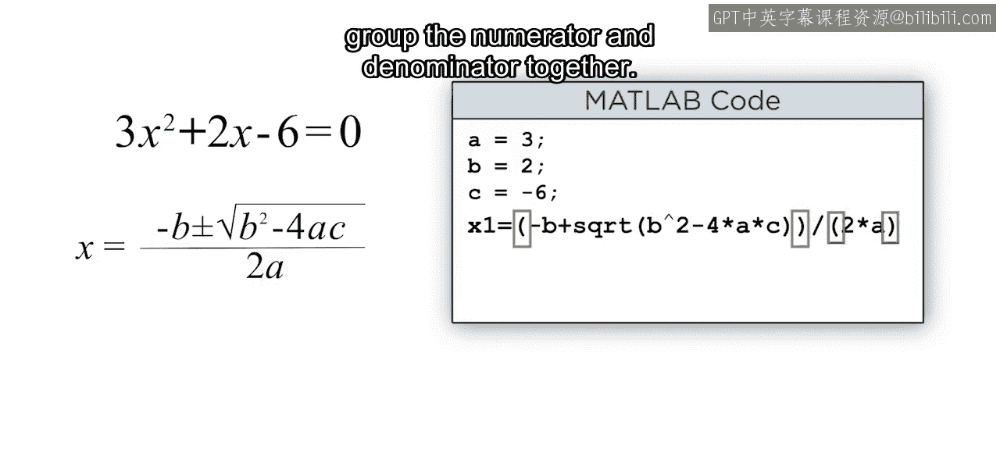
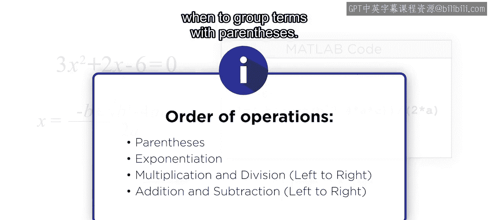
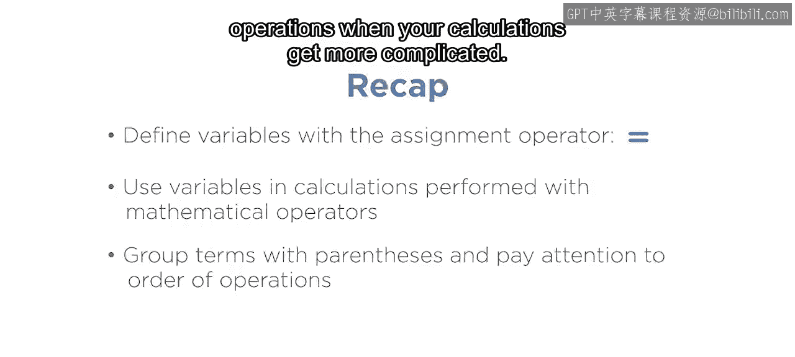

# Mathworks《实用数据科学与MATLAB（数据探索、特征工程、机器学习、毕业项目）｜Practical Data Science with MATLAB》 p26 25_基本数学运算.zh_en [BV1Jr421w7wL_p26]

🎼。

Sooner or later， you're likely to encounter a problem that requires a formula and some serious number crunching。

 some of which can't be done by hand。

Once you start solving more difficult problems， you need to perform some of your tasks programmatically。

By the end of this video， you'll be able to perform basic mathematical calculations and use order of operations when writing expressions in MATLAab。

Consider a familiar example， solving a quadratic equation。

This expression includes several different arithmetic operators that are the building blocks of many MATLb calculations。

Let's look at these building blocks before combining them into a single expression。

You perform calculations by entering mathematical expressions using these common operators。

This result is stored in a variable called ants， which is used by default。

To store the result in a particular variable， use the equal sign。

 which is referred to as the assignment operator， since it assigns a value to the variable。

Give your variables descriptive names to help you remember their meaning。When choosing a name。

 keep in mind that there are a few important rules to follow。

Variable names must start with a letter and can contain only letters， numbers， and underscores。

Variable names are also case sensitive。

Variables are useful because they're stored in memory， so you can use them in calculations。

For example， to calculate the duration of a storm， you simply subtract the variables already storing the storm's start and end time。

Now that you know the basics， you're ready to calculate the roots of the quadratic equation。

Begin by defining the variables A， B， and C。Choosing these variable names makes the MATLb expression resemble the mathematical formula。

Next， enter the formula for the first route。You can use parentheses to group terms in complex expressions。

Be sure to use an asterisk to indicate multiplication， or you'll get an error like this one。

While this expression may appear correct at first， it doesn't produce the intended result。

Because Matlab calculations follow the order of operations， this expression was evaluated。

So minus B is no longer part of the fraction， and a is not in the denominator to get the correct result。

 Add the parentheses shown to group the numerator and denominator together。

It's helpful to have a good understanding of the order of operations so that you know when to group terms with parentheses。

Now that the first route is done， change the plus sign to a minus sign to find the second root。Great。

 now the calculation is complete。So to recap， you define variables in MATLAb using the assignment operator。

 and you can use variables and calculations performed with mathematical operators。

Remember to group terms and pay attention to the order of operations when your calculations get more complicated。

