# Mathworks《实用数据科学与MATLAB（数据探索、特征工程、机器学习、毕业项目）｜Practical Data Science with MATLAB》 p27 26_使用向量.zh_en [BV1Jr421w7wL_p27]

🎼，In many applications， you need to perform calculations on a list of values between an upper and lower bound。

A list of values is also known as a vector。

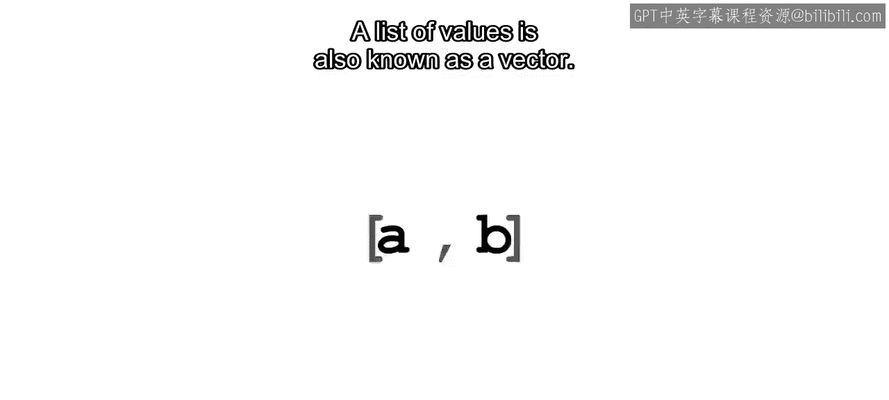

Often， the values are separated by a common spacing。

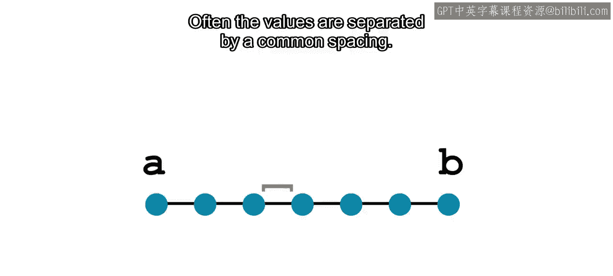

Take， for example， plotting the quadratic equation used previously to calculate the roots。

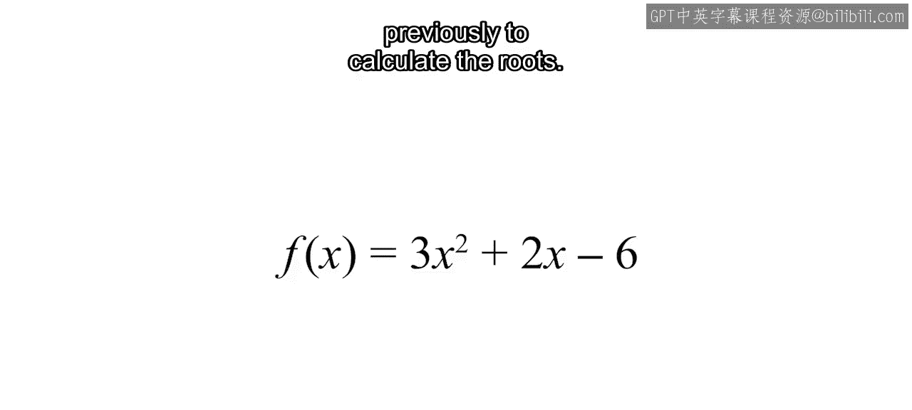

To make this plot， you need a list of X and Y values with enough points to lead to a smooth plot。

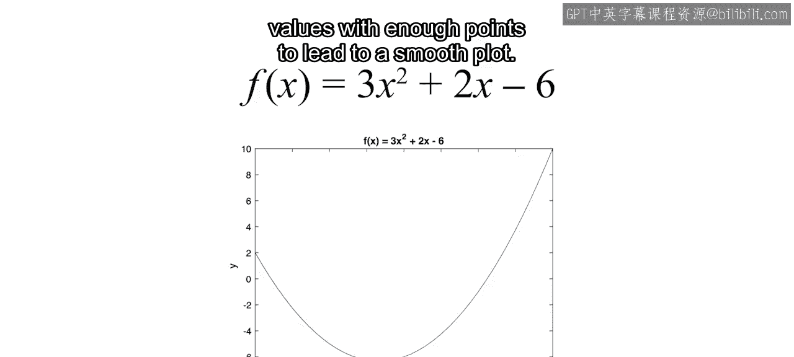

To accomplish this task， you need to create a uniformly spaced vector and know how to perform calculations on an entire vector。

 Let's see how to do that。

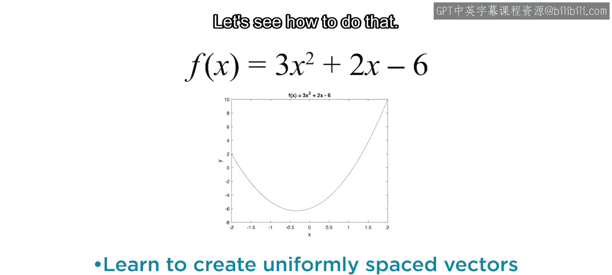

To create a plot， you need a list of values for X and Y。

You could do this by calculating and entering each value individually。In MatTLAb。

 you can create a vector by entering the sequence of values placed within square brackets and separating the values with commas。

However， this would be very time consuming。

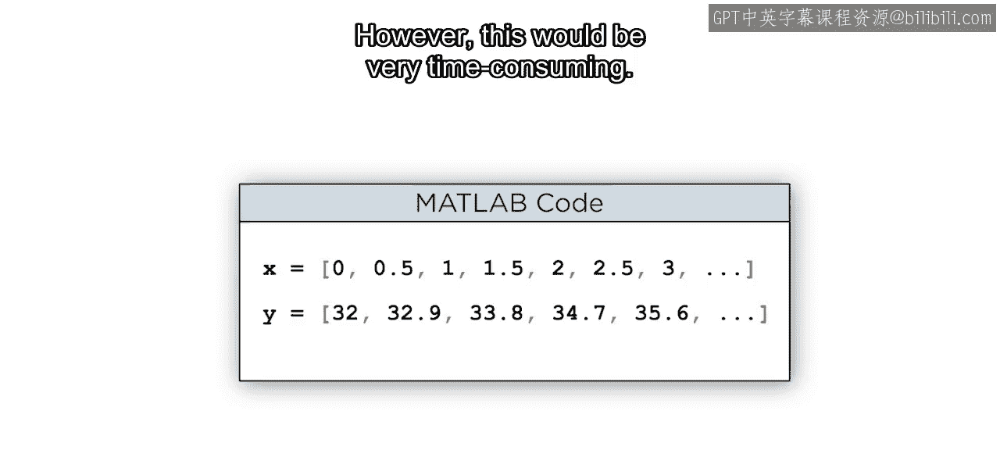

Instead， you can quickly create uniformly space vectors using the colon operator。

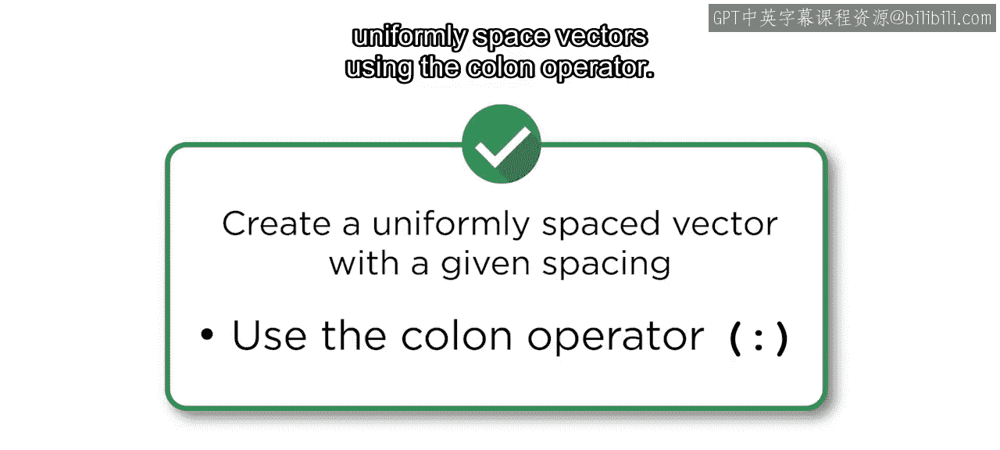

Start by creating a vector of values for x with a lower bound of negative 2 and an upper bound of 2。

If you insert a colon between the upper and lower bounds。

 the result is a row vector containing values， starting at negative 2， ending at 2。

 and with the default spacing of1。A plot with only five points won't be very smooth。

More points are needed， which means using a different spacing。In that case。

 you include the spacing value between the two endpoints and separate everything with a colon。

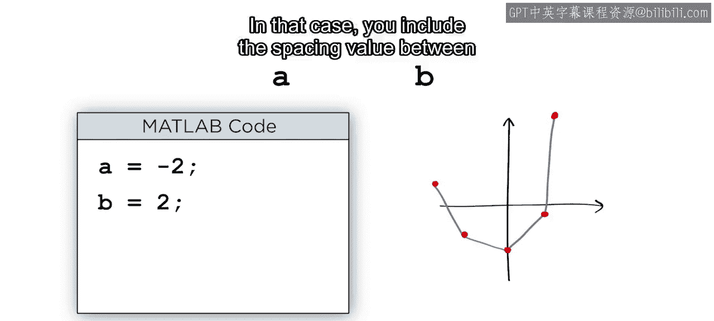

For example， here you create a vector of values with a spacing of 0。3。

When the spacing does not divide the interval evenly， as is the case here。

 the result is a vector of uniformly spaced values that begins at the lower bound。

 but ends before the upper bound， which is not included。If the spacing is changed to 0。1。

 the result is a vector of 41 elements starting at negative 2 and ending at the upper bound of 2。

 because this time， the spacing divides the interval evenly。

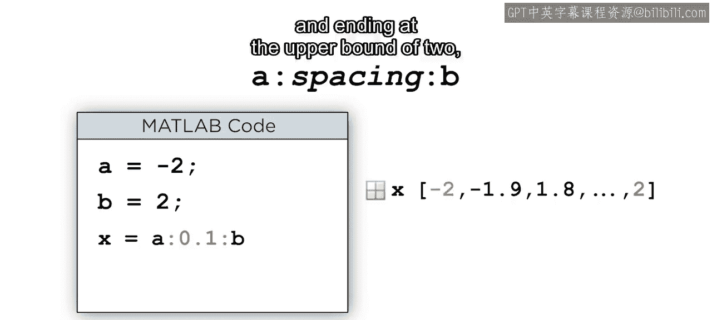

Great， you created the vector of X values using the colon operator。

But do you still have to calculate the y values individually？Well。

 try using the vector X in a calculation the same way you previously use just numbers and see what happens。

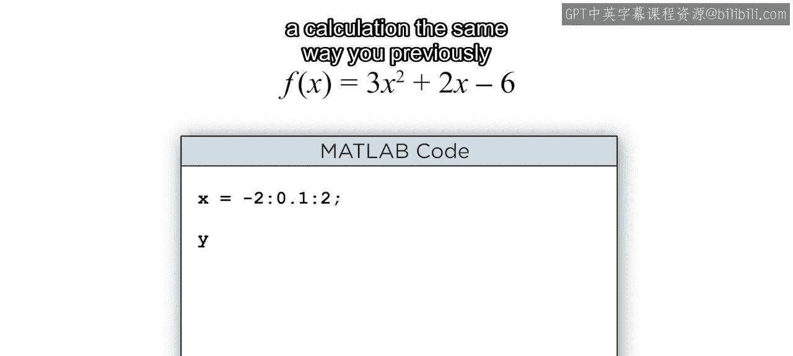

Oh， what's going on？Here you need to square each element of x。Well， no problem。

 With one small change， you can perform element wise operations。

 Take these two vectors as an example， to multiply the corresponding elements of V1 and V2。

 use the element wise multiplication operator。

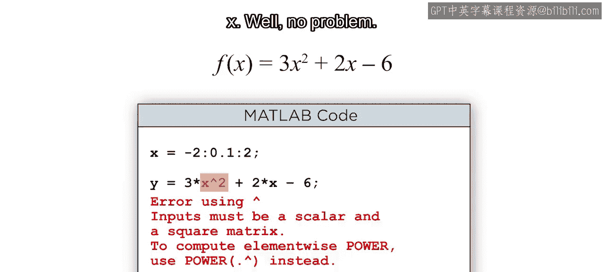

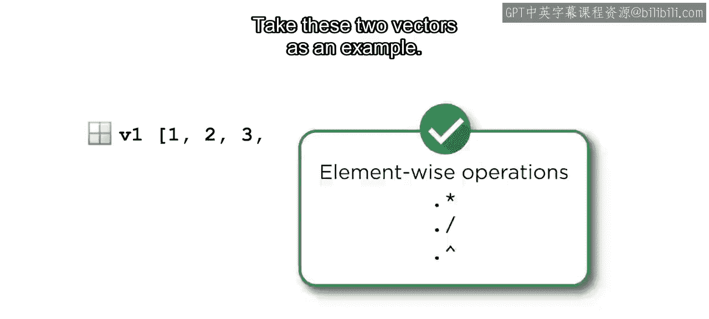

Similarly， you can do element wise division。And exponentiation by adding a dot before the division and power operators。

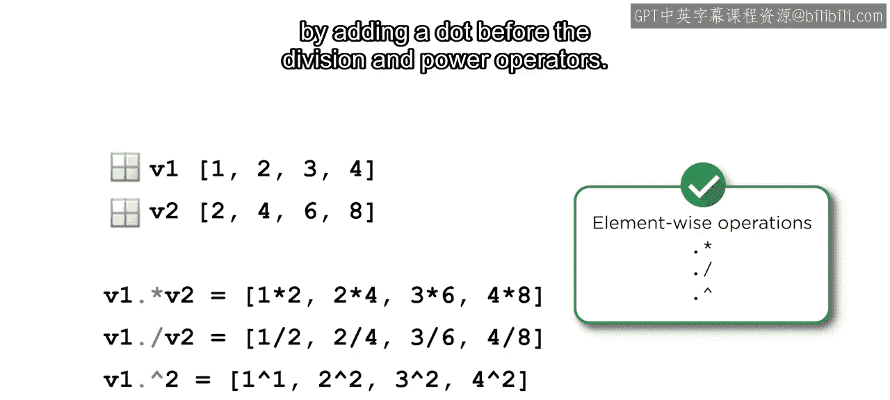

There are no special operators for element wise addition and subtraction because they are the same for scalrs or numbers and vectors and matrices。

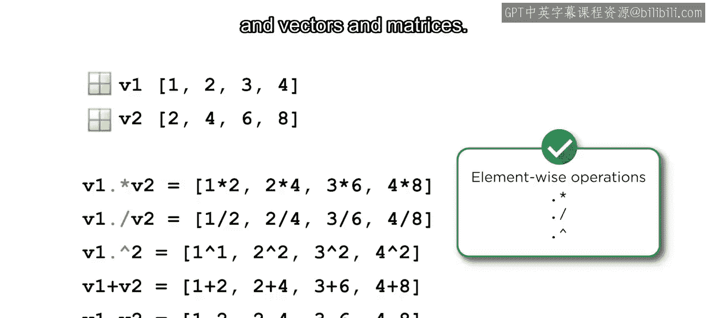

There are a couple common mistakes to watch out for。

It's easy to forget the dot when doing element wise operations。

Or to accidentally use vectors of different sizes。When this happens。

 you get an error message about matrix dimensions， what。Don't worry， if you're not using matrices。

 but get a matrix dimension error while trying to perform an operation on corresponding elements of two vectors。

 check that you're using the elementwise operators that your vectors have the same number of elements and that the vectors are both row or both column vectors。

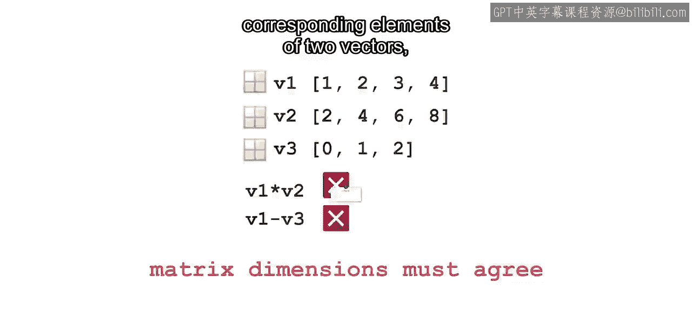

Now back to that function you want to plot。

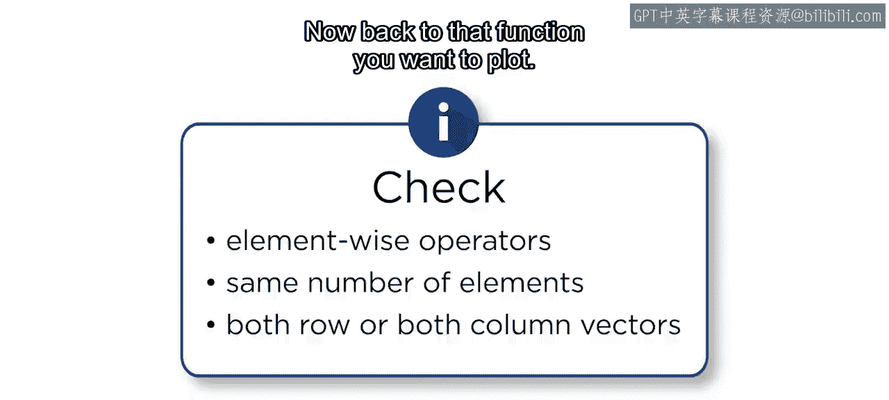

Since x is a vector， you need to use the element wise power operator to square each element of x。

Let's see how this expression is evaluated。First， each element of x is squared。

Then each element of the two vectors is multiplied by the scals 3 and 2。Finally。

 when adding or subtracting scalrs and vectors， the scalar is automatically expanded to match the size of the vector before performing the addition or subtraction。

And there you go， using element wise operations， you create a vector of y values calculated for each point in x。

Now， this plot accurately represents the function。To recap。

 you can use the colon operator to create a vector of evenly spaced x values and element wise operators to calculate all the y values in a single expression。

This will be especially helpful later when you need to select subsets of your data and perform calculations on them。

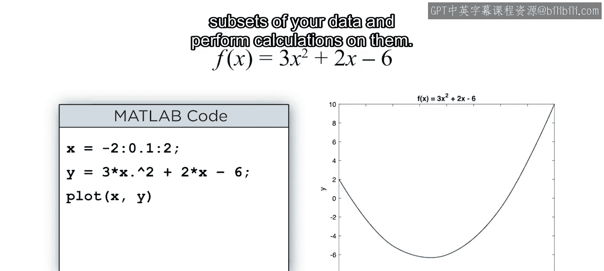