# Mathworks《实用数据科学与MATLAB（数据探索、特征工程、机器学习、毕业项目）｜Practical Data Science with MATLAB》 p28 27_使用函数.zh_en [BV1Jr421w7wL_p28]

🎼。

MatLb includes thousands of ready to use functions that perform a variety of common tasks。

 but if you're going to make the most of all that functionality。

 you first need to know how to use MatTLb functions。

 So let's take a closer look at functions and how to use them。

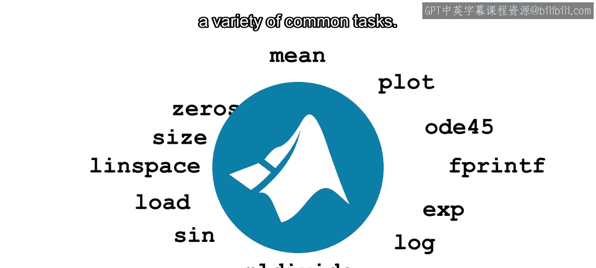

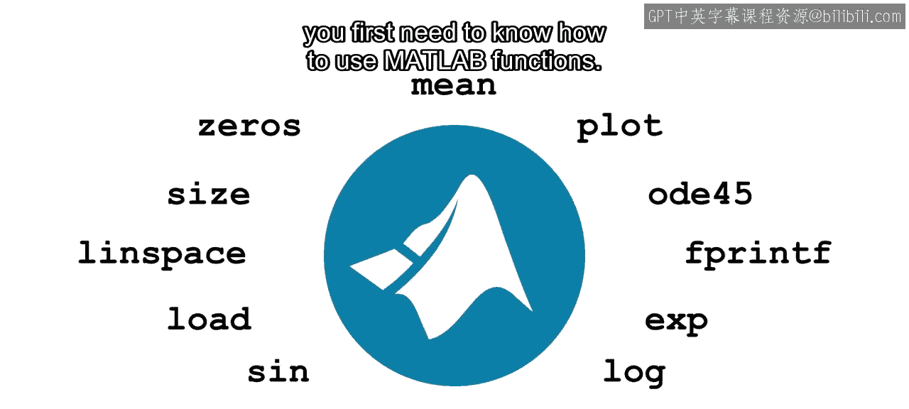

By the end of this video， you'll be able to call MatTLb functions。

 which you'll need for tasks like calculating group statistics and finding correlations between data。

You've used functions available in MatTLAb before， like SQRT to find the square root of a number。

 but there are also functions that you can use to visualize data， import an image。

 or quickly find the smallest or largest element of a vector。

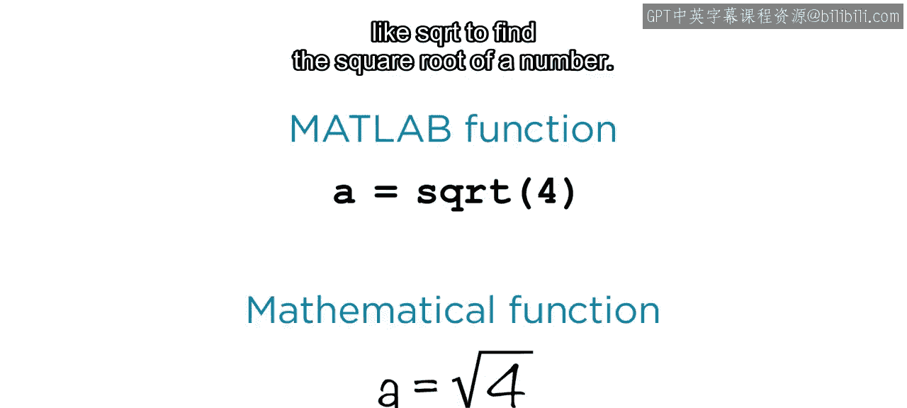

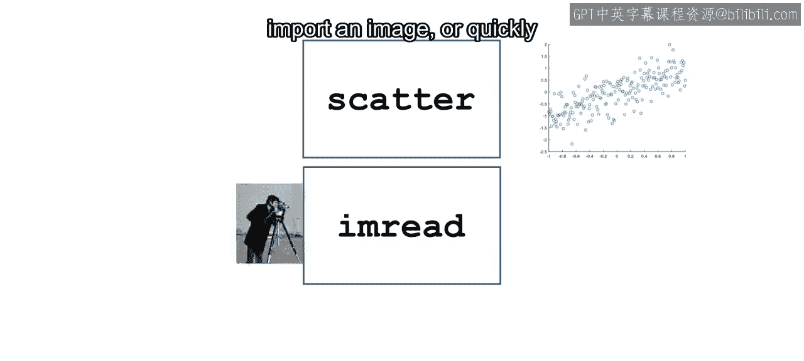

Even though there are thousands of Matlab functions。

 there are just a few basic usage patterns to learn。

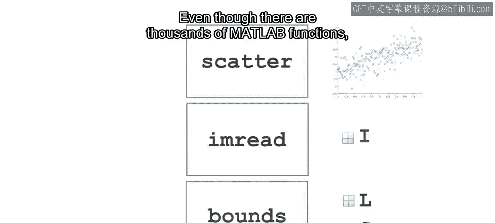

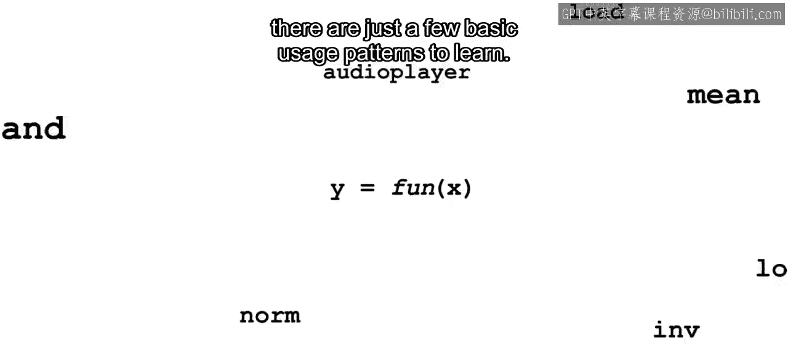

You use a Matlab function， as you would， a mathematical function。 You have the function name。

 the input enclosed in parentheses。And you can assign the result to an output variable。

There can even be multiple inputs and multiple outputs， depending on the function。

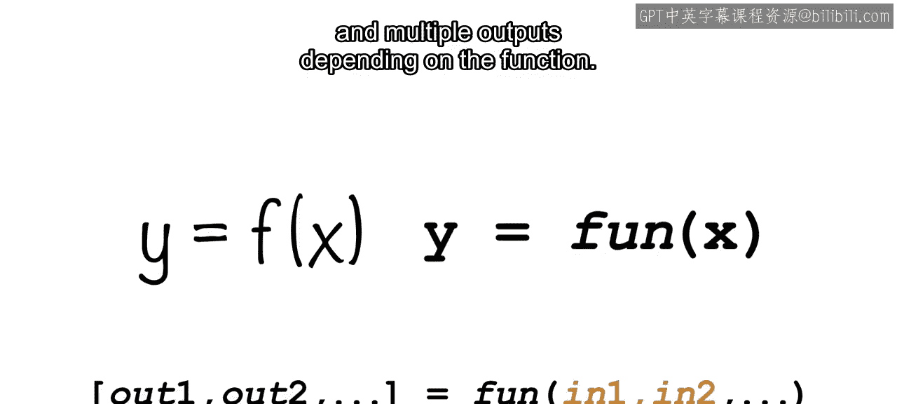

Let's start with the basics。 Many familiar mathematical functions like sign。

 logarithm or exponential follow this same pattern and take on similar names as Matlab functions。

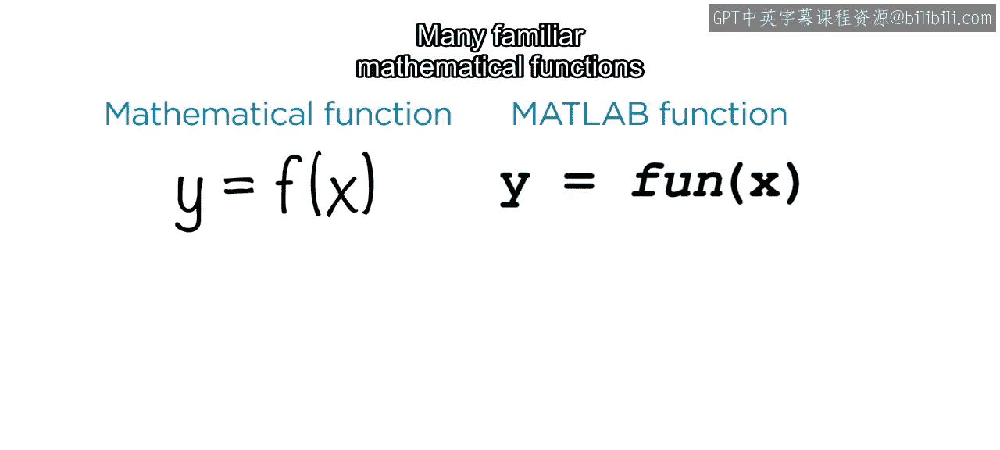

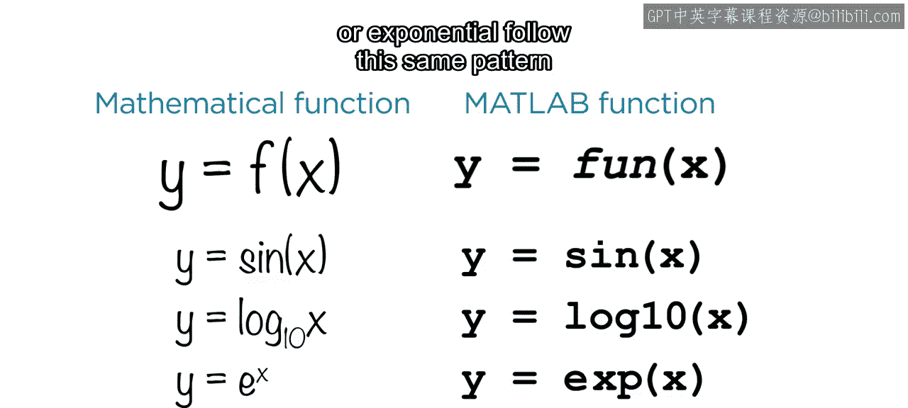

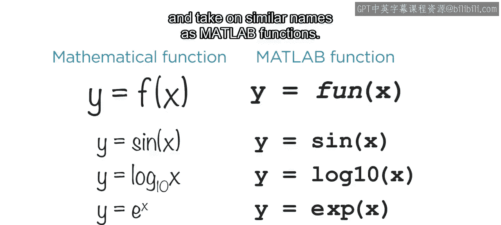

Mathematical functions like sine can accept a vector or matrix as an input。

The output will be of the same size as the input， and the function is applied to each element。

But Matlab functions are more general。Take this function call， for example。

 What do you think it returns。If you answered negative one， you're correct。

 When you pass a vector to the min function， it returns to the smallest value of the vector。

What you may not have known is that the min function can also tell you the location of the smallest value。

Here， it tells you the location is 4， since the smallest value is the fourth element of the vector。

Many Matlab functions can return multiple outputs if you ask for them individually inside a set of square brackets。

Similarly， many functions accept multiple inputs。

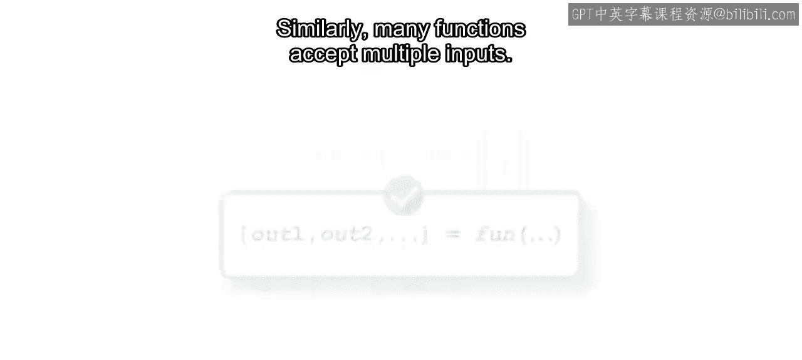

Consider， for example， setting geographic limits to your geobu plots。

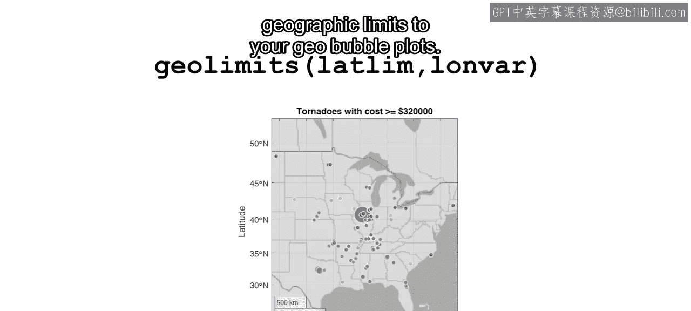

The geolims function takes a two element vector for latitude and a two element vector for longitude and updates the existing plot。

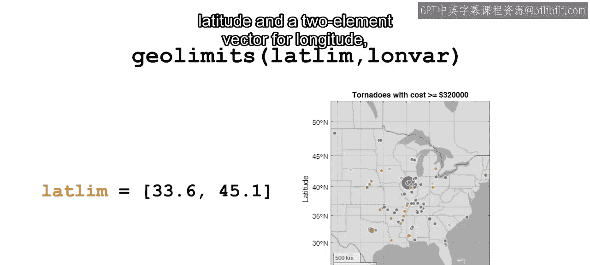

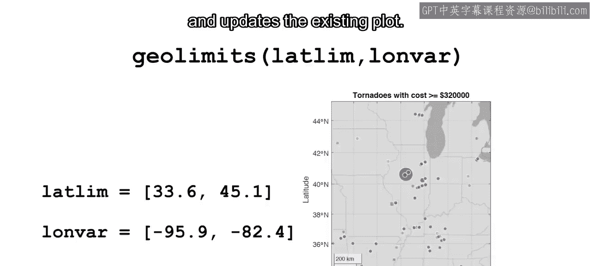

If you're curious about other MALb functions， you can look them up in the documentation。

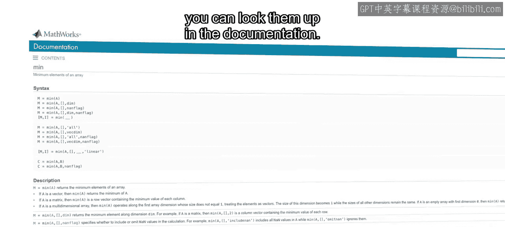

Each function's documentation provides examples of how to use it in common scenarios。

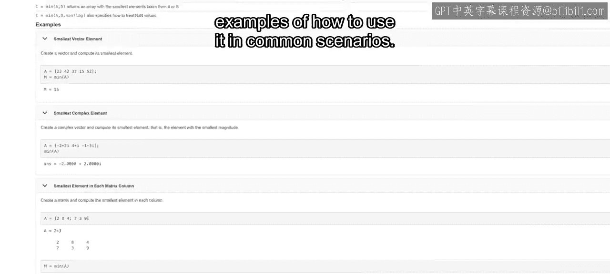

And now you know the basics of calling MatLb functions later。

 you'll learn how to use functions to help you quickly summarize your data。

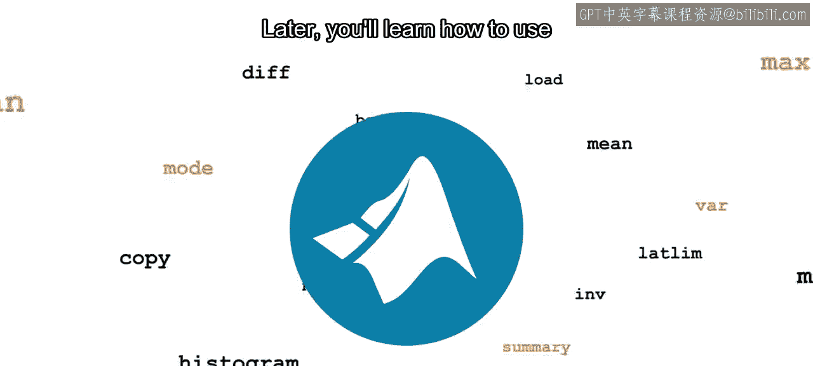