# Mathworks《实用数据科学与MATLAB（数据探索、特征工程、机器学习、毕业项目）｜Practical Data Science with MATLAB》 p29 28_计算汇总统计.zh_en [BV1Jr421w7wL_p29]

🎼。

When exploring data， the first step is to learn more about individual variables and the values they contain。

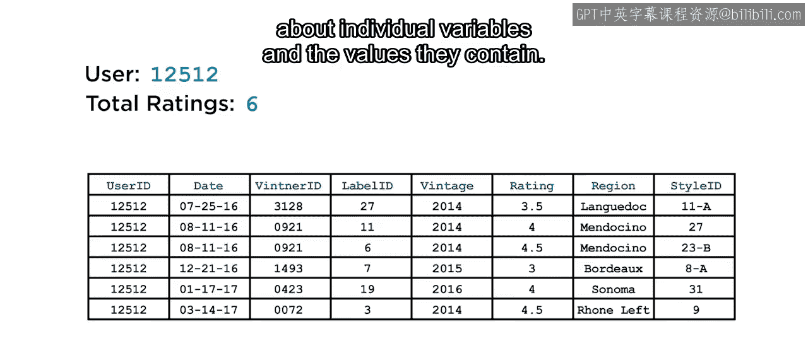

For small data sets like this one， it's possible to inspect observations directly。

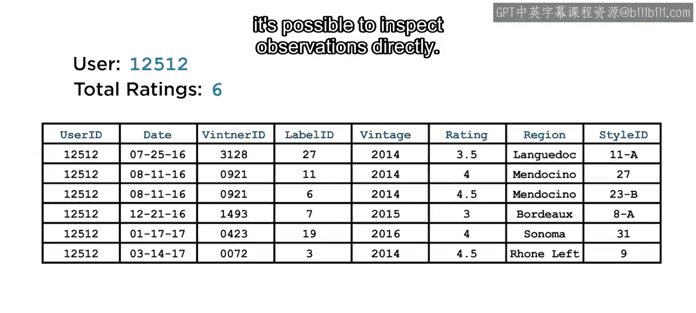

But this quickly becomes impractical for larger sets。

It's also difficult to learn how values are distributed from inspection alone。

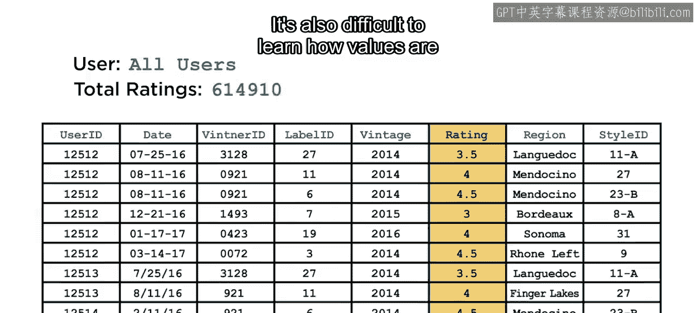

Descriptive statistics provide a convenient way to summarize data sets that may contain hundreds。

 thousands， or even millions of values。

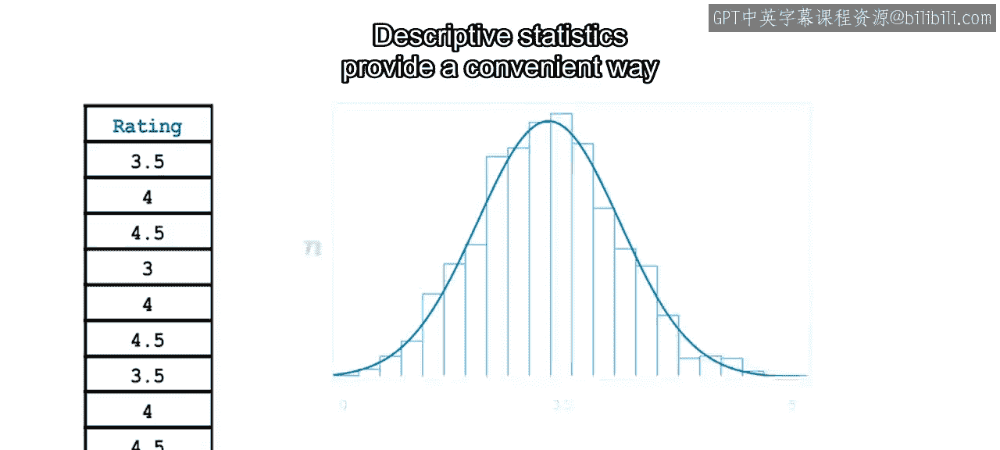

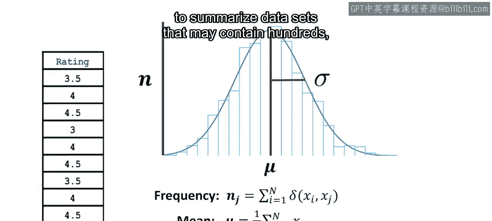

Let's take a look at an example data set to see how to summarize data using statistics。

This table contains measurements from a blood pressure study conducted at several locations。

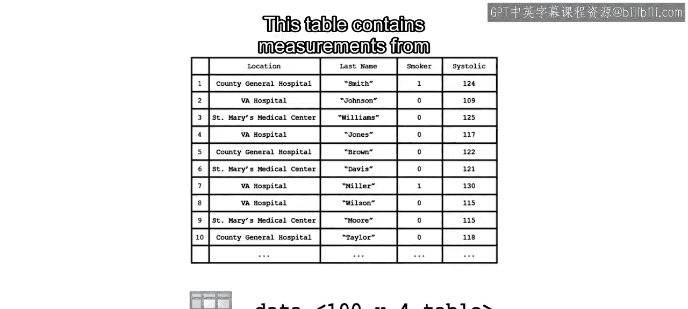

To learn more about the study， the participants， and the results。

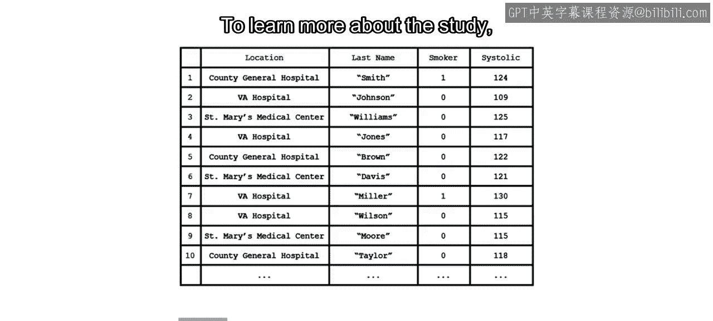

You first need to understand what values are possible for each variable and how those values are distributed。

You can use the summary function to obtain a quick overview of each variable。

The summary function accepts a table as input and returns the name。

 size and data type of each variable， as well as additional information about its values。

The information displayed for each variable depends on its data type。For example， the minimum。

 median and maximum values are displayed for double variables。

While frequency counts are displayed for categorical and logical variables。

Note that no additional information is provided for string variables。

 as this type of summary information isn't particularly helpful for text。

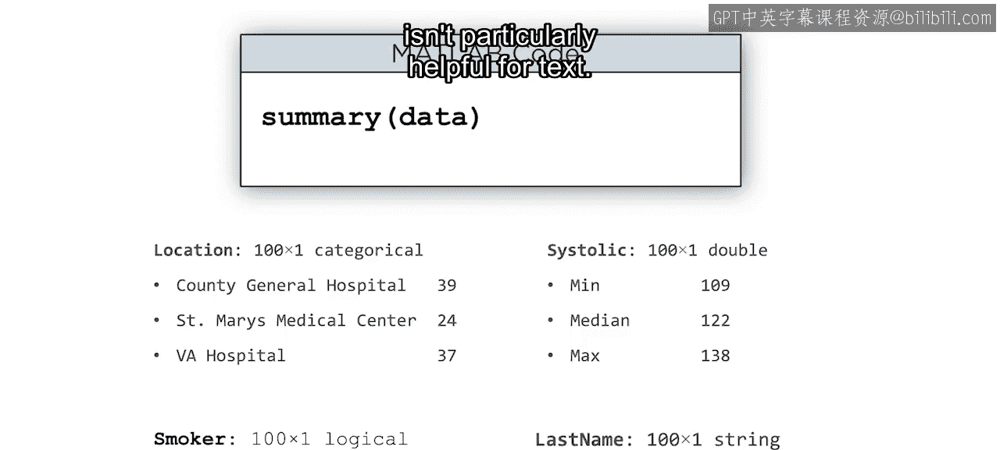

Statistics for individual variables can be obtained using the descriptive statistics functions available in MatL。

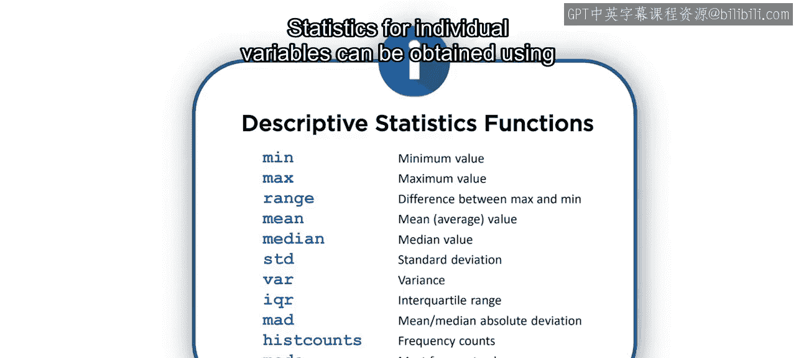

For example， you might like to know the most common testing location。

 which can be computed using the mode function。

To better understand blood pressure readings， use the mean function to find the average value。

Then use the standard deviation function to see if most values lie close to the mean。

 which corresponds to a small deviation。Or if they are spread further throughout the range。

 as indicated by larger deviations。You now have the tools necessary to describe the variables in this data set。

However， your own data may sometimes contain missing elements or NNs。

Such values lead to nonnumeric results when computing certain statistics。

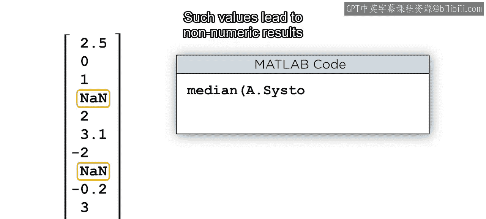

In these cases， include the omit naan option when calling these functions to include only numeric elements in the calculation。

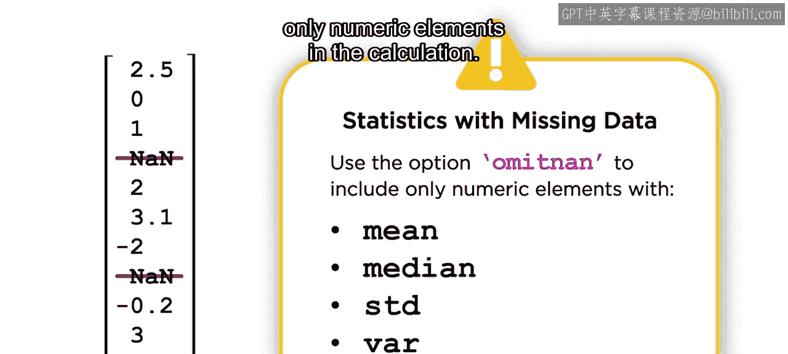

There， that's more like it。Now that you know how to use the descriptive statistics functions in MALb。

 it's time to learn more about your own data。

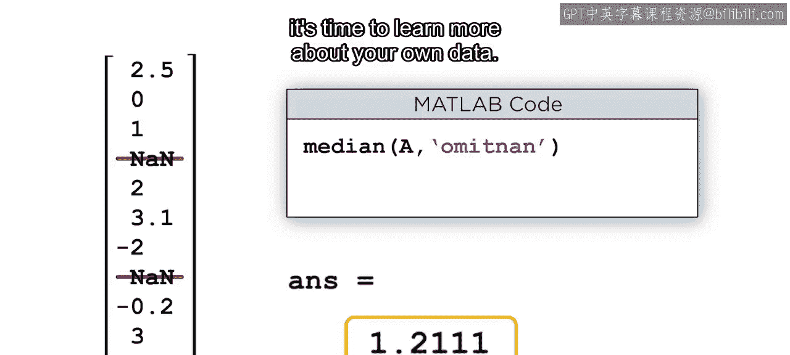