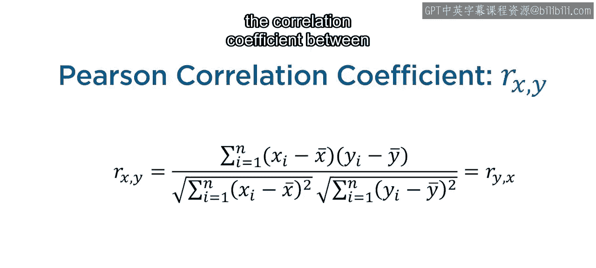
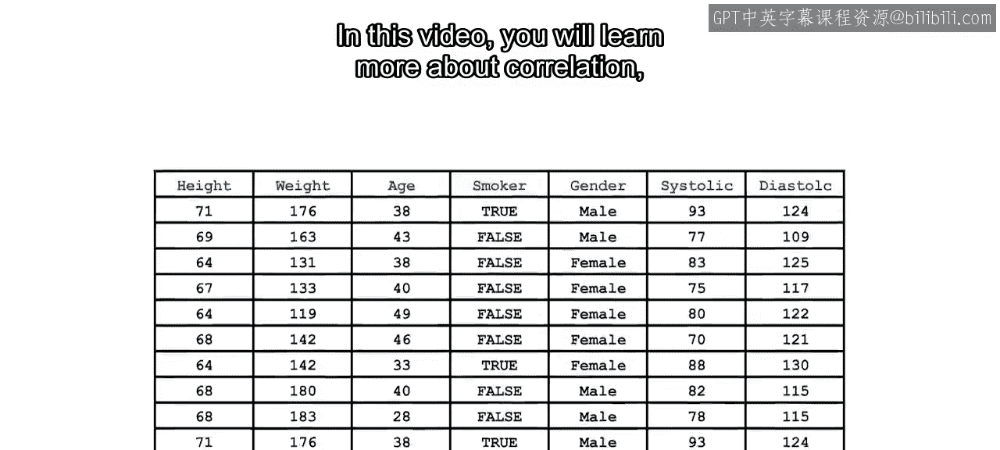
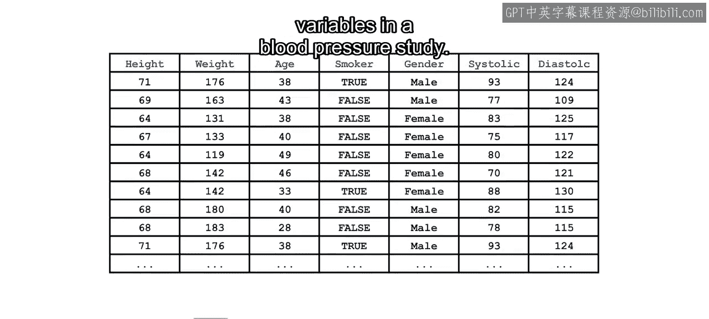
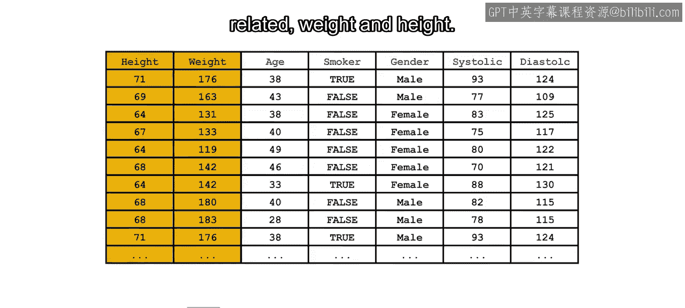
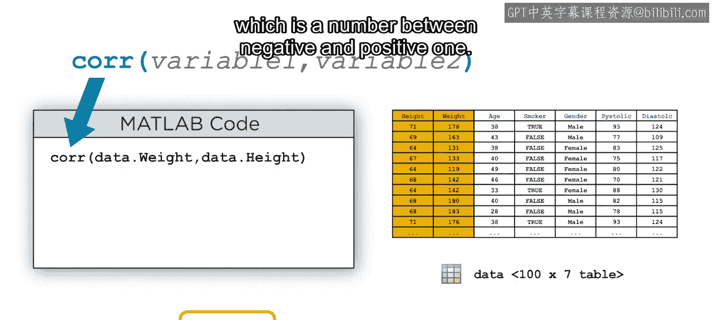
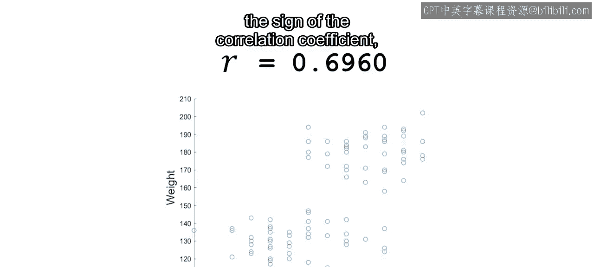
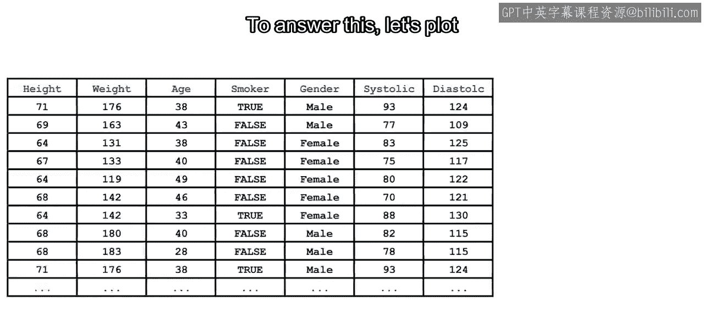
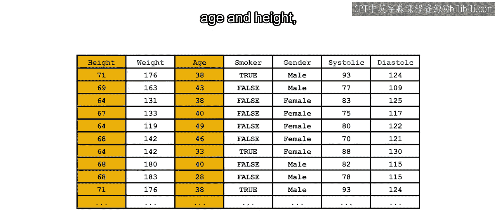
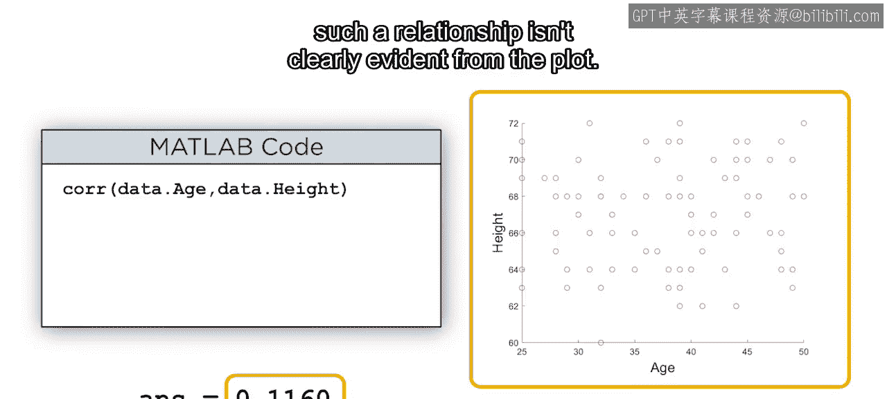

# Mathworks《实用数据科学与MATLAB（数据探索、特征工程、机器学习、毕业项目）｜Practical Data Science with MATLAB》 p30 29_变量间相关性.zh_en [BV1Jr421w7wL_p30]

🎼，Once you have a good understanding of the individual variables in your data set。

 you can begin to look for relationships between variables。

Visualizations can help uncover potential relationships。

 but in order to describe and compare these relationships。

 you need a more quantitative method of evaluating them。

One such method is to calculate the correlation coefficient between two variables using MATLb。

In this video， you will learn more about correlation while exploring relationships between variables in a blood pressure study。

Consider two variables you'd expect to be related， weight and height。

To calculate the correlation between two variables。Use the core function。

The output is the correlation coefficient， which is a number between negative and positive one。

The sign of the coefficient is determined by whether the variables are positively or negatively correlated。

Positive correlation implies that as the values in one variable increase。

 the corresponding values in the other tend to increase as well。

 The opposite is true for negatively correlated variables。

The positive correlation between weight and height is evident when they are plotted against each other。

Now that you know about the sign of the correlation coefficient， what does the magnitude tell you？

To answer this， let's plot two variables that are likely unrelated in adults， age and height。

Then compute their correlation coefficient。While the sign indicates the variables are positively correlated。

 such a relationship isn't clearly evident from the plot。

That's because the magnitude of the coefficient is determined by the correlation strength。

Values close to negative or positive one indicate a strong。

 linear relationship between the variables。Vues close to zero imply a weak relationship or no relationship at all。

When you compare both plots， the stronger linear relationship between weight and height is evident。

 While a similar relationship between age and height is， well， difficult to discern。

Note that the magnitude of the correlation coefficient is not related to the slope of the linear relationship。

 Only how close the data points are to falling on a line。For example。

 each of these data sets has a coefficient of plus or -1。

 even though the slopes of the lines connecting them vary。Furthermore。

 a small correlation coefficient is only indicative of a weak linear relationship。

A strong nonlinear relationship may still result in a coefficient close to 0。

Now that we've learned how to interpret and compute correlation coefficients。

 let's use them to investigate the relationship between blood pressure and other variables like age。

By grouping both blood pressure variables together using square brackets。

 you can compute correlations to multiple variables at the same time。

There doesn't seem to be much a relationship between these variables， which is reflected by the plot。

What about blood pressure for smokers versus non smokers？

Note that even though smokers is a logical variable。

 the correlation coefficient can still be computed by the core function。

The output indicates a potential relationship that should be explored further。

What about the correlation between blood pressure and gender？

Correlation coefficients for categorical variables can be computed after converting them into a vector of logical values using the double equals operator。

The result is the correlation between blood pressure and belonging to the female category。

Coeficients for additional categories can be computed in the same way， and that's it。

