# Mathworks《实用数据科学与MATLAB（数据探索、特征工程、机器学习、毕业项目）｜Practical Data Science with MATLAB》 p31 30_访问数据子集.zh_en [BV1Jr421w7wL_p31]

🎼。

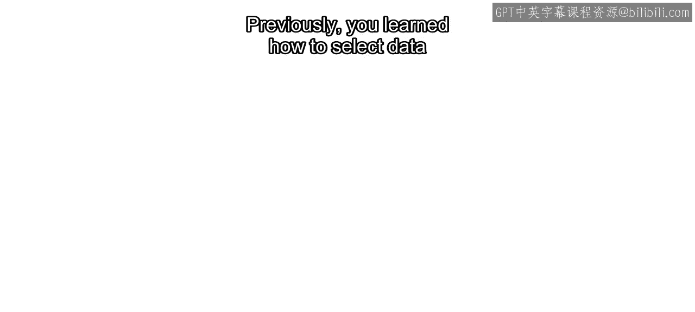

Previously， you learned how to select data by interacting with a table in the live editor。

 For example， by clicking on the event type variable and the weather data。

 you created a new table containing only tornadoes。

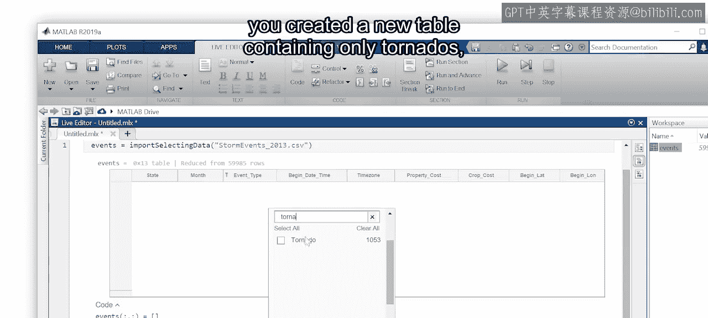

This is often the best way to start interactiveactive tools provide a preview of the selection results and generate the required code。

However， there are some types of selections that cannot be done interactively。

Like what if you want to replace values such as missing data？

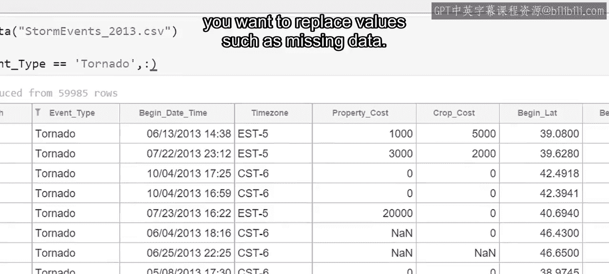

In this video， you'll learn how to access elements of vectors， matrices and tables。

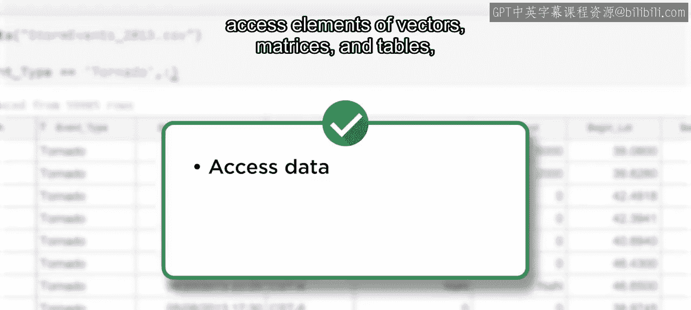

Use relational and logical operators to select data based on defined conditions。

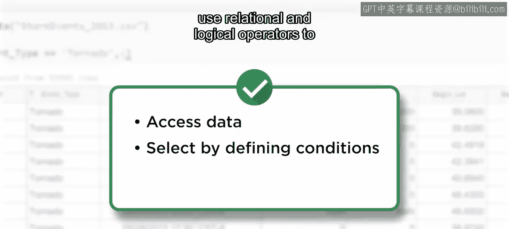

And replace values in a data set。

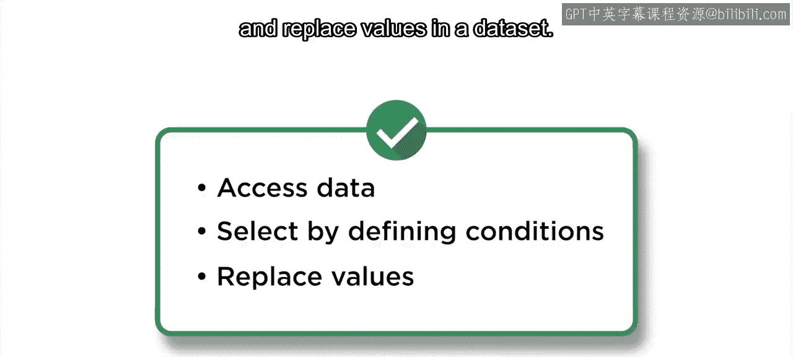

To begin， let's start with a vector。Elements of vectors are numbered sequentially。

 This number is known as an index。In this example， index 3 contains the value 6。

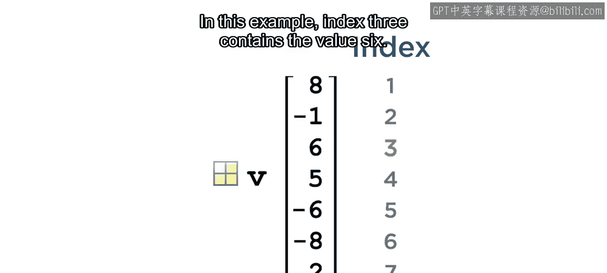

To access that element， type the variable name and enclose the index and parentheses。Here。

 the new variable has the value 6。Multiple elements are accessed using a vector of indices。

 So this command returns the first four elements of the vector。

And this command accesses the negative elements found at indices 2， 5， and 6。

To change elements of an existing variable， place the variable to the left of the equal sign and the elements to change in parentheses。

For example， this command changes the value of index 4 to0。

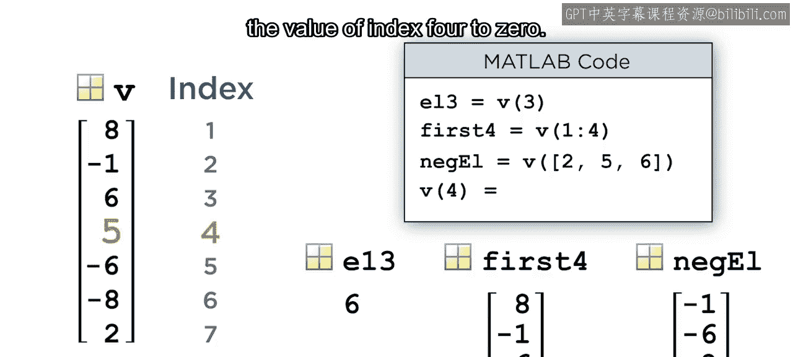

Now that covers vectors， but matrices tables have rows and columns。

Both the row and the column indices need to be specified to access or change the values。

Do this by separating the rows and columns with a comma。Here。

 a new variable is assigned the value from row 2 column 3。

And this command returns all the columns from rows 4 and 5。When working with matrices and tables。

 it's common to need an entire row or an entire column， so instead of creating a vector of indices。

 you can use a shortcut。Use a colon to represent an entire row or column。

Now take a moment to try what you've learned。

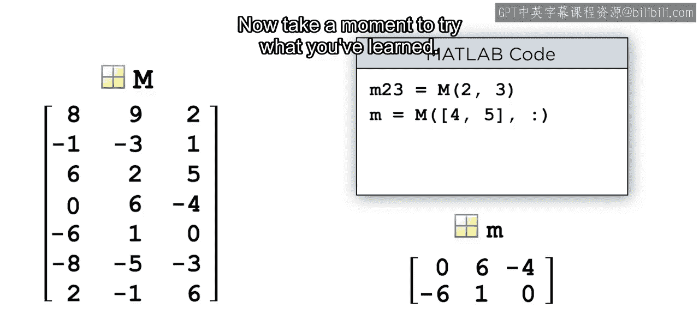

That covers accessing elements of vectors， matrices and tables。

 so to create a table containing only events with property costs， you can just scroll through the 60。

000 observations while writing down the row index for each one that is not zero。

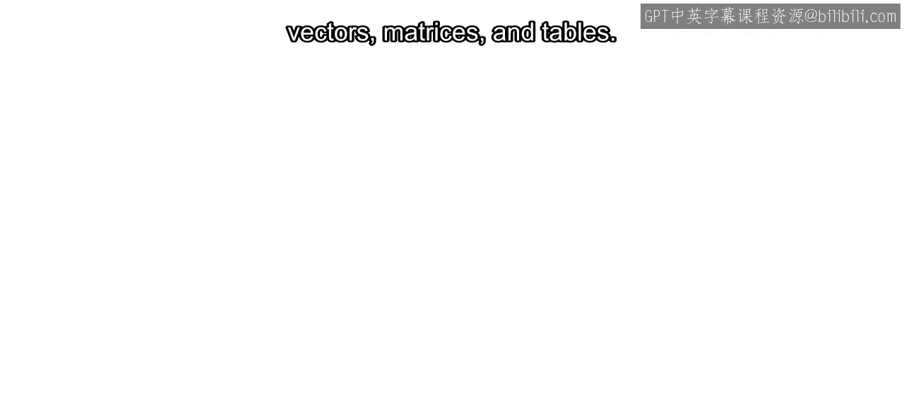

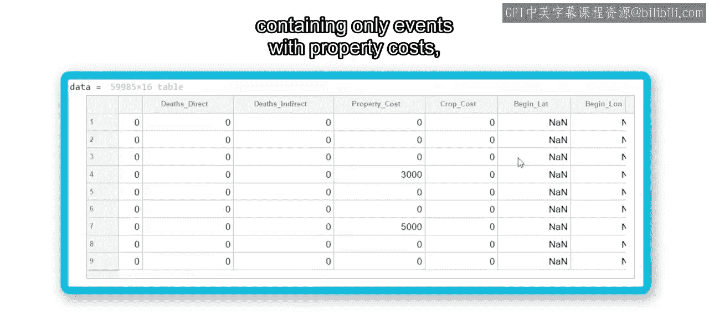

Just kidding， please never attempt that， instead， let's see how to extract elements based upon a condition instead of the index。

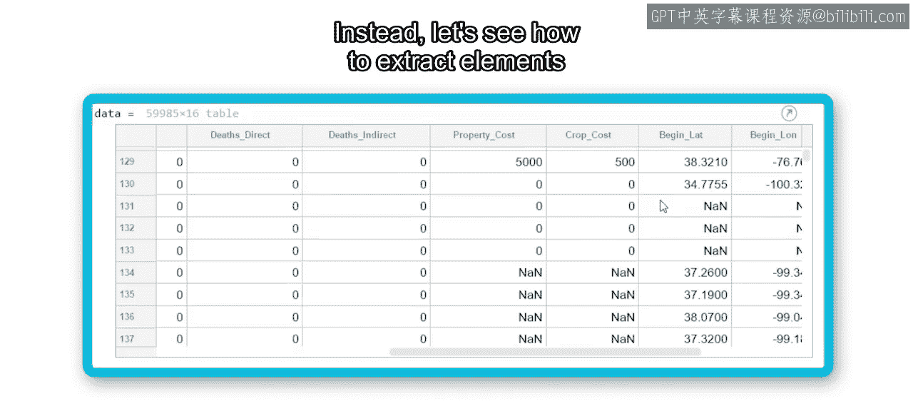

Before tackling this problem on a large table， let's go back to the vector example。

 assume you need to extract only those elements that are greater than0。

The command still uses the variable name followed by parentheses。Inside the parentheses。

 specify a condition to determine which elements to select。

You can read this command as access the elements of v where v is greater than 0。

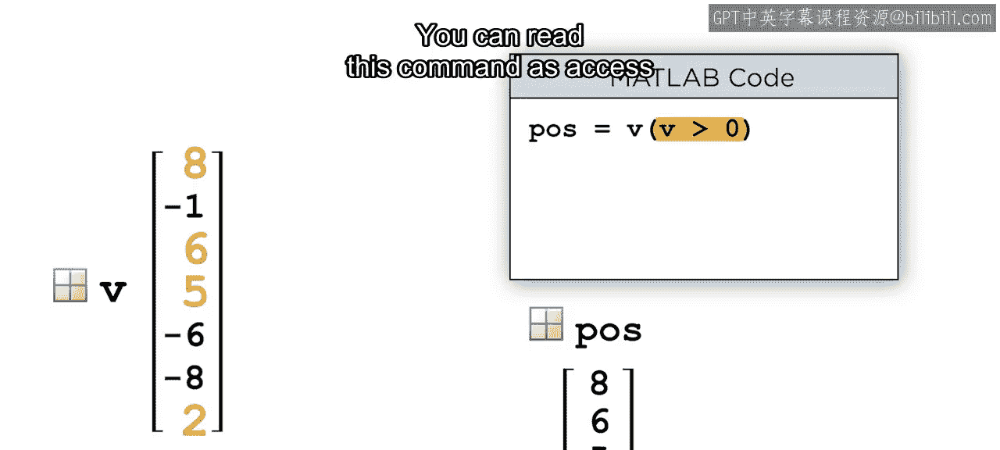

Conditions are combined using the and or or operators。

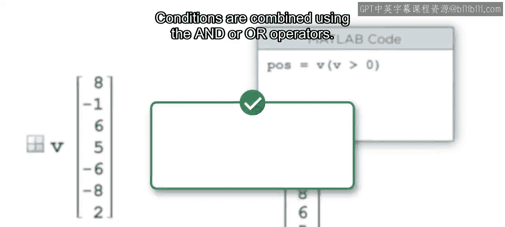

For example， to get the values of v greater than minus6 and less than or equal to 5。

 combine the two conditions using the and operator。Okay。

 now you're ready to return to the weather data and apply these concepts。

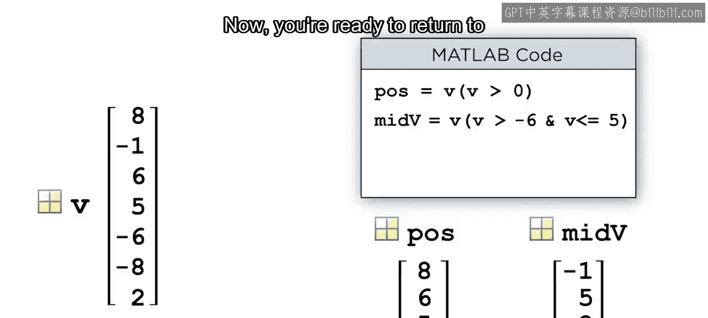

The data set distinguishes between damaged under property and damaged under crops。

What if you want to capture all the events that resulted in any damage？

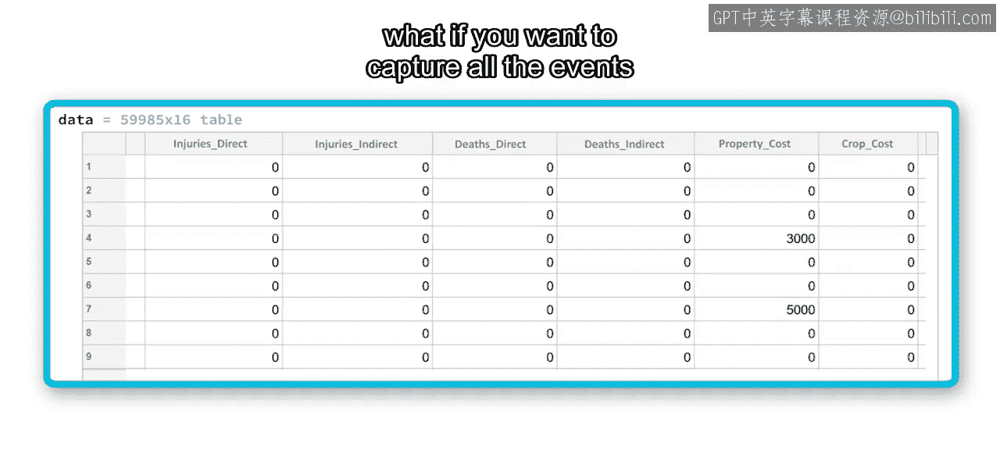

Using the interactive tools on both variables generates the code you see here。

The code produces a table with events that cause property damage and crop damage instead of ore。

Notice only 649 events fit these criteria。To create a new table with any event that caused damage。

 you need to select all the rows where the property cost is greater than 0 or the crop cost is greater than 0。

Because the table has two dimensions， you also need to specify the columns to return。Here。

 a colon is used to return all the columns。Perfect。

 the new table captures all the damage causing events and notice how many more events are included when an orR criteria is used。

You can see that some events still have missing data for property or crop cost。

Dealing with missing data is an important concept covered later in this specialization。However。

 since damaging weather events are typically well reported。

 missing data likely means the cost was zero or close to it。

How can you replace the missing data with a defined value。

To assign a new value to an element instead of accessing it。

 start with the variable you want to change to the left of the equal sign。

In parentheses enclose the elements or the selection criteria to use for their replacement。

In this case， the is missing function will select all elements with missing data from the crop cost variable。

Finally， add the replacement value to the right of the equal sign。

You can read this command as for all elements in the variable crop cost。

 where the value of crop cost is missing， replace that element with0。

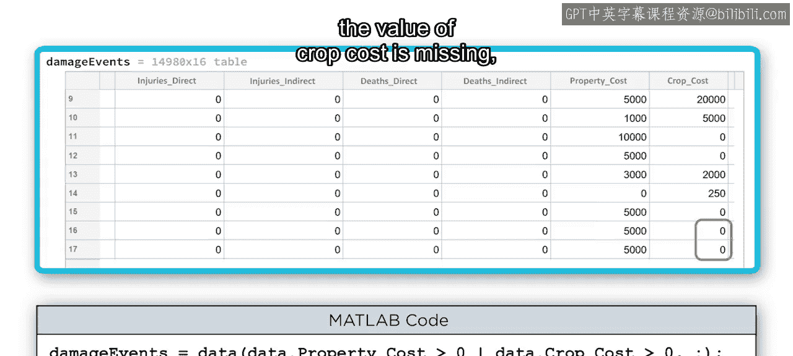

Oo， this video covered a lot of ground。

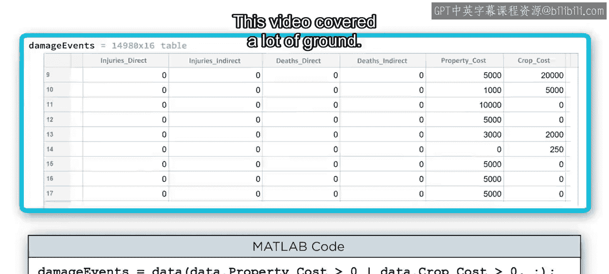

You now know how to access elements of vectors， matrices and tables。

 You can also define conditions to use when selecting elements from a variable or replacing elements in a variable。

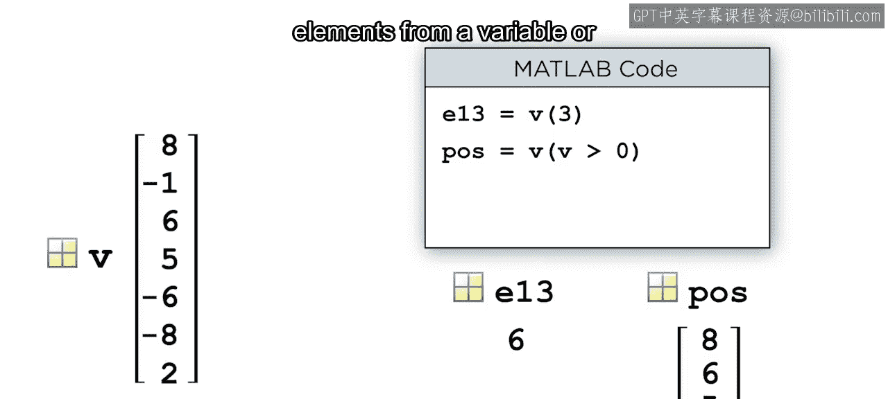

Before moving on， take a moment to review the live script exploring tornadoes from 2013。

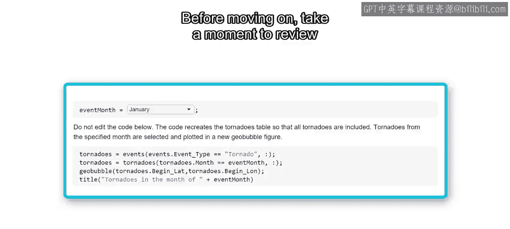

Look for lines of code where data is being accessed or modified and see if you can interpret the code。

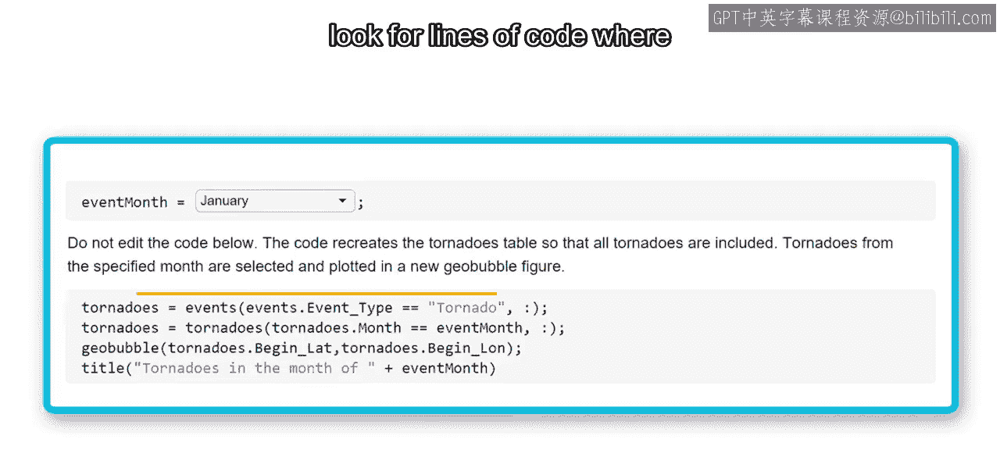

