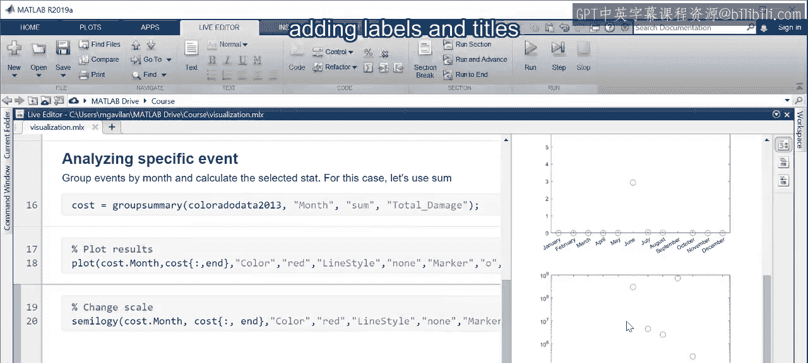
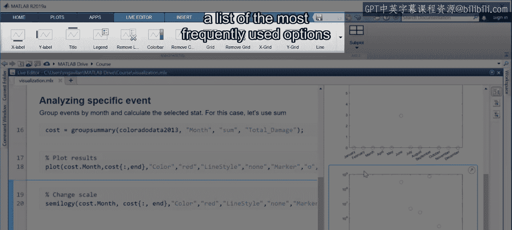
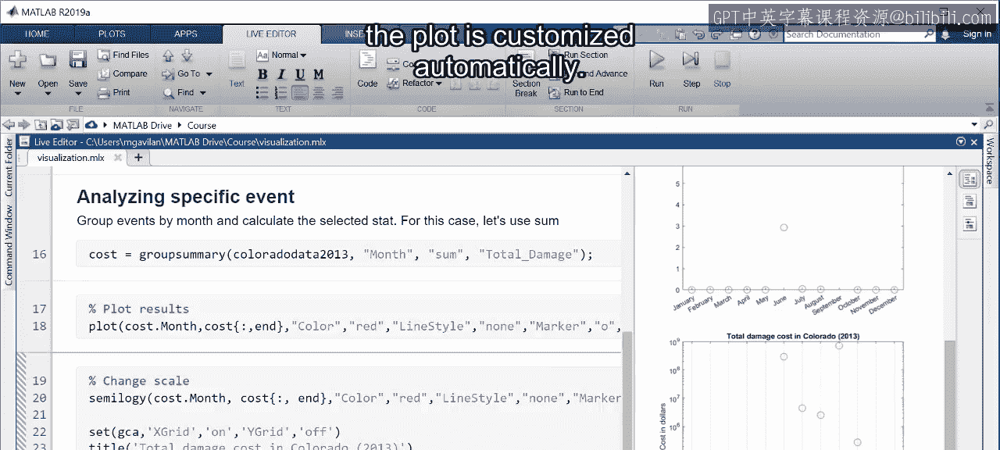
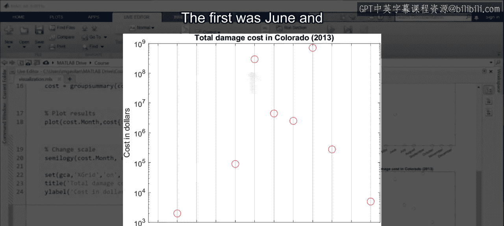
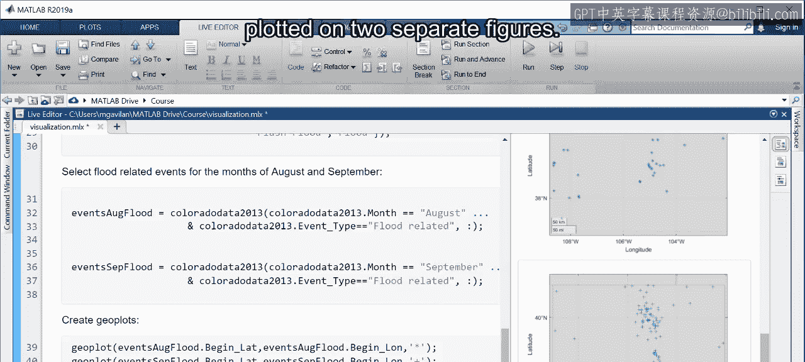
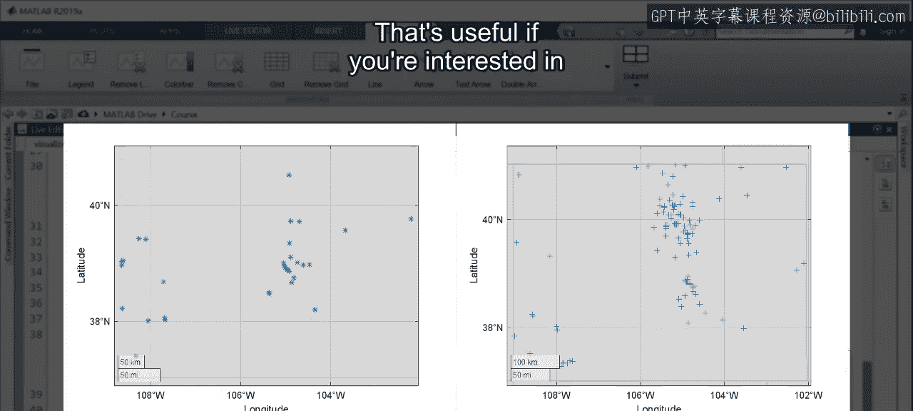
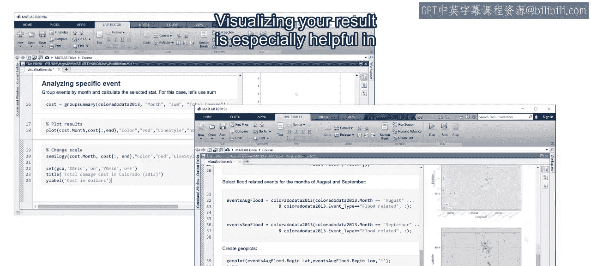

# Mathworks《实用数据科学与MATLAB（数据探索、特征工程、机器学习、毕业项目）｜Practical Data Science with MATLAB》 p34 33_可视化结果.zh_en [BV1Jr421w7wL_p34]

🎼，Visualization is a powerful way to make sense of your results and to communicate details of your analysis to others。

MaTLb provides a variety of functions for creating visualizations that help you get more insight from your data。

In this video， you will learn options for customizing the appearance of plots and adding annotations to make them clear to others。

You will also learn how to display multiple data sets in the same plot。

You've been using weather data for a specific year。

 Let's pick a state and look in more detail at the major weather events that happened there。

 It turns out the state of Colorado had historic floods in September of 2013。

 and visualizations will help to learn more about this event。

Let's see how once you import the data and calculate the total damage。

 you can group events by month and calculate the sum of the values for the total damage cost each month。

If you plot the sums versus the months of the year， the default line style is solid blue。

 which seems to imply that the data is continuous， even though it's discrete。In this case。

 showing individual data points is more appropriate given the data to do this。

 you need to provide additional arguments to the plot function。

Retype the plot command and you'll see suggestions for plotting additional data and providing plot options。

When you click an option， you see a list of properties like color that you can modify to change the color to red。

 for example， you provide the property name followed by the custom value。 Similarlyly。

 you can remove the line， change the marker to a circle and increase the marker size。

Once you run the command， you see the updated plot。This looks better。

 but the plot now implies that only two months of the year had nonze damage costs with a large range of values on the Y axis。

 you need to plot those values differently to better see the variations。For cases like this。

 you can explore other types of plots in the plot， a few values are much larger than the others。

 so you can use a semi logarithmic plot for the y axis。

 and then you can see that most of the values are indeed not zero。

The customizable properties for the semi log Y function are the same as those for the plot function。

 but you can view the documentation to check the full list of property names and values。

In addition to customizing the look， adding labels and titles makes the plot easier to interpret。

When you click on the plot， a list of the most frequently used options appears in the figure tab。

To use them all， just expand the view， add a title and axis labels。

 then add an X grid to make it easier to identify the corresponding month for each point。

Notice that the corresponding code appears underneath the plot for every customization made。

Remember to click Update code to automatically include the new commands in your existing code。

The next time your script runs， the plot is customized automatically。

This plot makes it even more obvious that Colorado had two very difficult months in terms of damage costs associated with weather events。

The first was June， and the second was September when the floods happened。

Now， to check in more detail the areas affected by the floods。

 you can look at where the flood events were reported。

 and in order to understand the events in context， let's check the location for the flood events reported in September in the previous August for comparison。

To accomplish this， merge all flood related events into one category。Also。

 make sure you use the data for the months in question what do you think will happen once you run this code to generate the visualization of the geographic locations？

As you can see， the data is plotted on two separate figures。

For August， you have flood events spread out in the state， while for September。

 most of the flood events are concentrated in a specific area。

Notice that the ranges on the axes for both plots are automatically scaled based on the data。

That's useful if you're interested in looking at the individual data sets。

 but you want to compare the two by plotting them together on the same axis。

 You do this with the hold command。

After the first plot command type， hold on to indicate subsequent plots should be on the same axes。

Then add hold off after the last plot。Click Run again and。

This time both plots are in the same figure and the ranges of the x and Y axis have been adjusted to fit both data sets。

Multiple data sets are automatically plotted with different colors。

 but as before you can customize the properties。Once the resulting plot is ready。

 you can also use a legend to tell the dataset sets apart。To do this， click on the figure。

 then click the Legen button in the figure tab。Click the labels to give them more descriptive names。

The keys in the legend are ordered from the first date plotted to the last。 When you're finished。

 use Upd code to generate code that incorporates the changes。This looks great。

 but you can go one step further and add the base map to include the terrain。

Notice how the majority of flood events reported for September are concentrated in the mountain system here。

For this reason， the 2013 Colorado flood events in this region are also referred to as the 2013 Colorado Front Ra flood。

And we found the connection just by visualizing the data。To recap。

 customized visualizations can provide you with insight into your data。

 You can tailor numerous properties of your plots， add titles and labels and much more。

 You can also include multiple dataset sets in the same plot when you want to establish comparisons。

😊，Visualizing your results is especially helpful in the exploration stage。

 and it will be essential later when you start communicating your results to others。

。