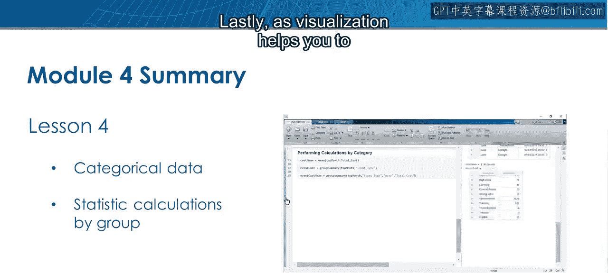
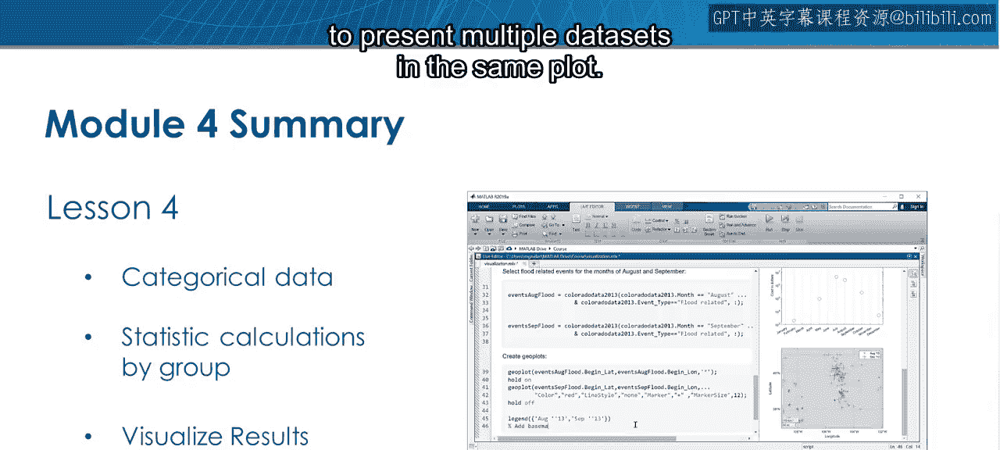
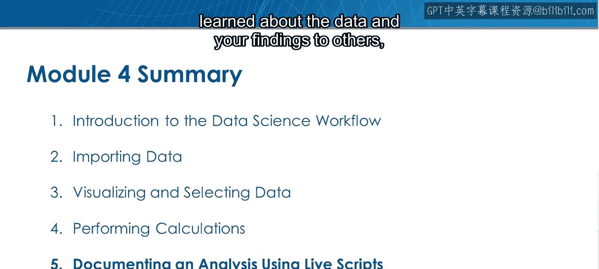
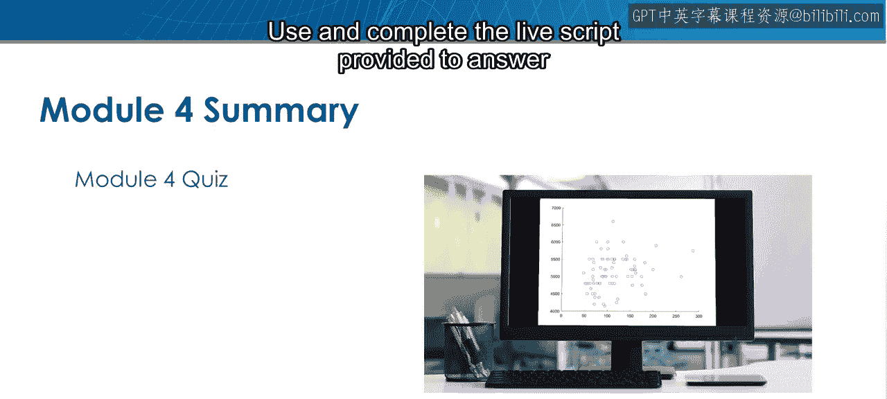

# Mathworks《实用数据科学与MATLAB（数据探索、特征工程、机器学习、毕业项目）｜Practical Data Science with MATLAB》 p35 34_模块4执行计算总结.zh_en [BV1Jr421w7wL_p35]

🎼，You've reached the end of moduled 4。 Great job。 As the quiz for this module is up next。

 let's recap what you've learned。You began by learning about basic operations in MatTLap when using scalrs and vectors。

Next， you learned how to use MatLb functions， which can help you with a wide variety of tasks。

Then you learn how to use descriptive statistics functions in MATLb to learn more about the values contained in your data。

Once you had a good understanding of your data， you began looking for relationships between variables by using the correlation coefficient。

You learned how to access elements of vectors， matrices and tables。

 and also saw how to apply conditions when selecting or replacing elements in a variable。

You learn about categorical data and how you can perform statistics。

 calculations by group to describe differences between groups and further detect relationships between variables。

Lastly， as visualization helps you to communicate details of your analysis to others。

 you learn how to customize your plots and how to present multiple data sets in the same plot。

Now you know how to perform basic calculations and analysis of your data using MATLAP。In fact。

 you can replicate many of the calculations and visualizations shown in the live scripts provided earlier。

You're ready to start presenting everything you've learned about the data and your findings to others。

 which is covered in the next module。

It's now time to test your skills by taking the module 4 quiz。

Follow the setup instructions on the Quiz page so that you'll have access to the required files in Matlab。

Use and complete the live script provided to answer the questions。

 and remember to check the forums if you need help。

