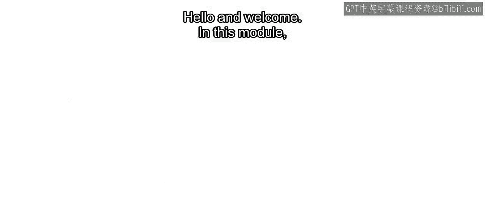
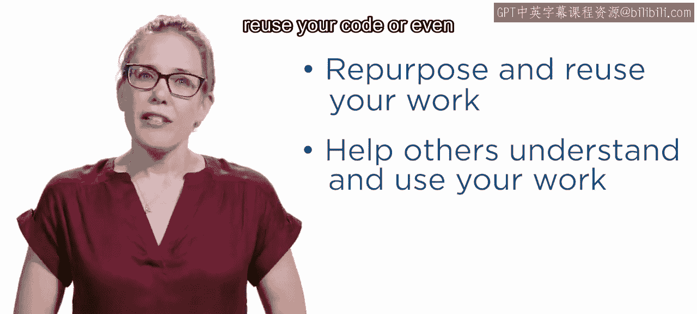
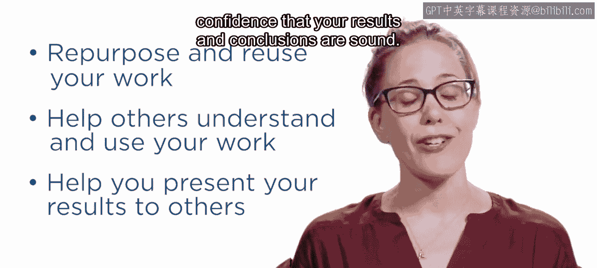
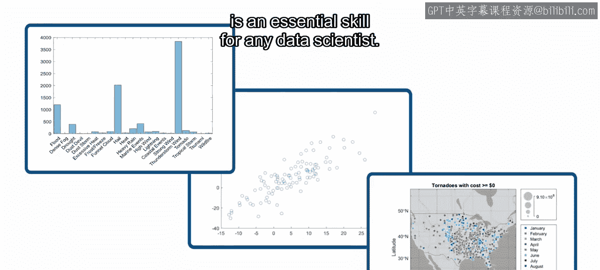
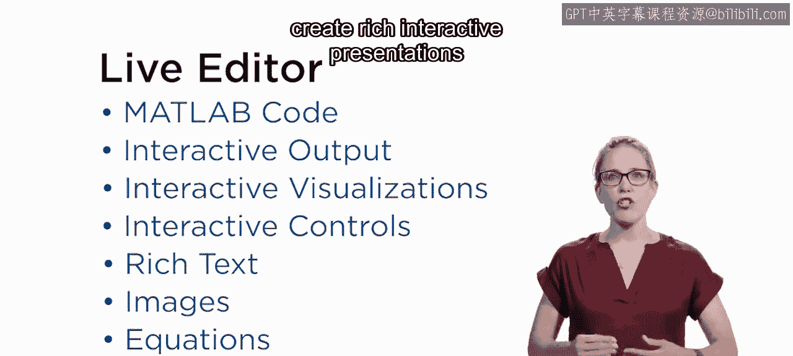

# Mathworks《实用数据科学与MATLAB（数据探索、特征工程、机器学习、毕业项目）｜Practical Data Science with MATLAB》 p36 35_记录你的工作.zh_en [BV1Jr421w7wL_p36]

🎼。

Hello and welcome in this module you'll learn about documenting and sharing your data science projects using live scripts。

 but before you learn the ins and outs of creating live scripts。

 let's consider why documentation is an important part of any data science project。First。

 it allows you to reuse your own work。 Often a new data set you're working with has a format similar to a data you worked with before。

Or you find yourself reusing a model with new data。So why reinvent the wheel？

It's usually simpler to adapt your old code than to start from scratch by recording information about what you did and why you did it。

 as well as what worked and what didn't， the process of updating your old code becomes much easier。

 and you can avoid making the same mistakes twice。Second。

 your documentation will enable others to reproduce your results and reuse your code。😊。

Or even deploy your solution as an automated system。

As you may already know， understanding someone else's code can be very challenging。

Providing your colleagues with a description of both your code and your methodology makes their job much easier。

Lastly， by documenting your analyses， you can provide your colleagues not only with metrics。

 models and visualizations， but with confidence that your results and conclusions are sound。

In particular， producing meaningful visualizations and clear summaries that help non technical peers understand your results is an essential skill for any data scientist。

By including interactive elements in your live script。

 you can empower your peers to explore and extend your work， even if they don't know how to code。

As you've seen， live scripts help you document your own work and create rich。

 interactive presentations to share with others。 Let's get started on communicating your results。😊。

