# Mathworks《实用数据科学与MATLAB（数据探索、特征工程、机器学习、毕业项目）｜Practical Data Science with MATLAB》 p37 36_创建直播脚本.zh_en [BV1Jr421w7wL_p37]

🎼。Live scripts enable you to combine your analysis and an explanation of that analysis into a single document。

You have already seen and interacted with live scripts throughout this course。 For example。

 you explored tornado events from 2013 using a script similar to this one。

Now you'll learn how to create a life script of your own。

Live scripts are built by combining text and code elements as needed to create your final document。

Formatted text， images， equations and hyperlinks are added in text blocks。

 while executable code and comments are added in code blocks。

You can distinguish the two by their background color。Code blocks have a gray background。

 like what you see here， and text blocks have a white background。To get started。

 you first need to create a new live script。On the home tab。

 click new Live script to open a blank live script in the live editor。

Did you notice that your active tab has changed。3 new tabs have appeared。

 and the live editor tab is now active。As you learned previously。

 many of the capabilities of MatTLb are discoverable via the tool strip。

You can hover over the icons to discover what each one does。

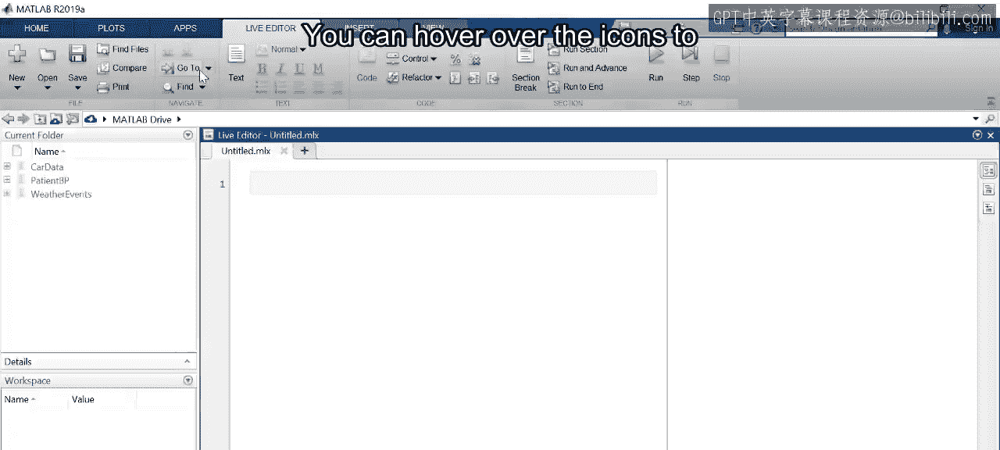

Before you start creating your life script， be sure to set your current folder。

 You will be using the 2013 St events data along with the data import function you created previously。

 so make the folder containing those files the current folder。

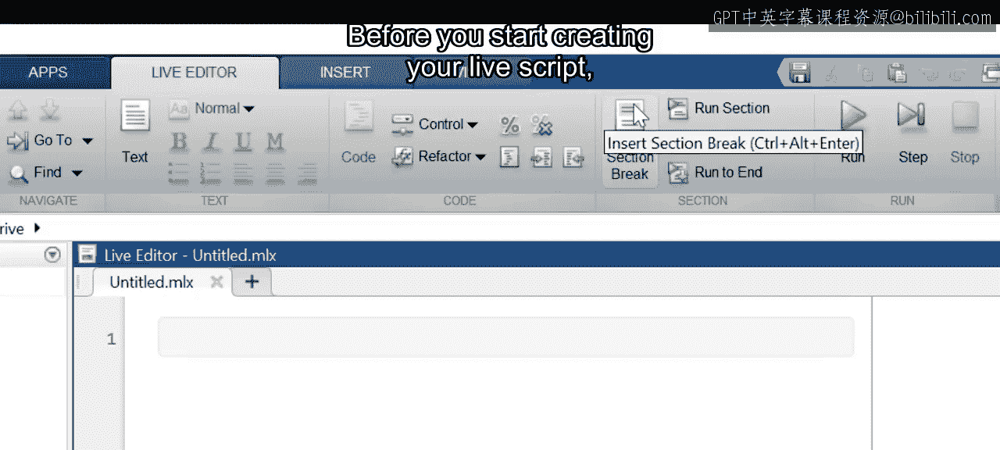

Now， the data can be loaded。Once the code has been added to your live script， click Run。

Because we left the semicolon off， a preview of the variable will appear in the output pane on the right。

We don't really have a specific question to answer yet。

 so let's explore the data set for something interesting to look into。

A heat map is a great way to visualize potential relationships between two variables。

Let's look at a breakdown of event types by month。Click run to execute the code and see the outputs。

By default， the results appear in a separate pane to the right。

 but you can change this to be in line， if you want。To change it。

 click the View tab and then output in line。The output location can be changed at any time and applies to all output in the document。

 Try it out to decide which view you prefer。You can also start adding your thoughts and findings as you analyze the data that way anyone with a live script can understand what you did。

Text blocks can be added anywhere by placing the cursor and clicking text。

You can change the formatting of the text to create titles。And headings。And at list。

Let's also center the title。You can also split the code into sections and then run the code in a single section。

This is especially useful as you develop and test your code。Here。

 the first few lines load and prepare the data for analysis。 Loing the data takes time。

 but only needs to be done once。You can iterate on the analysis code more efficiently by placing a section break after the line of code that places the months in order。

To do this， position the cursor and click sectionuction break in the tool strip。

Test this out by clearing the output and then running the codes section by section。

Click the view tab and select clear all output。Then place the cursor in the first section and click Run section。

Notice that the blue bar on the left turns solid once the code has run。

Now place the cursor in the second section。Note that the bar on the left is striped to indicate the code in this section has not yet been run。

Click Run section to display the heat map again。There is a lot of data in this heat map。

 which can make it hard to see and interpret。You can make it bigger by adjusting the width of the output display panel。

If it's still difficult to see， you can open the heat map in a new figure window。

 hover over the heat map， and when the Axes toolbar appears， click open and figure window。

That's interesting。 There are lots of hail events during the summer months。

 There are also numerous thunderstorm wind events during the same months。

 Perhaps the two events are related。Both of these events have latitude and longitude values。

 so you can create a geodensity plot to see if the events are concentrated in the same locations。

Add the code for displaying Hail and click Run section。

These events appear to be concentrated mostly in the central United States。

Now include code for thunderstorm wind and rerun the section。嗯。

No obvious relationship is apparent on the map， since these events appear to be concentrated mostly in the eastern United States。

This is a good place to update the live script with a summary of your findings。

 You could add a note about why you looked at these events and what you observed。

A good next step might be to look at the data for a specific state。

Let's create a new section for this。You can reuse the same code as before and add a second condition to the logical indexing to select events that occurred in a single state。

 for example， Texas。Once the changes are made， click Run section。

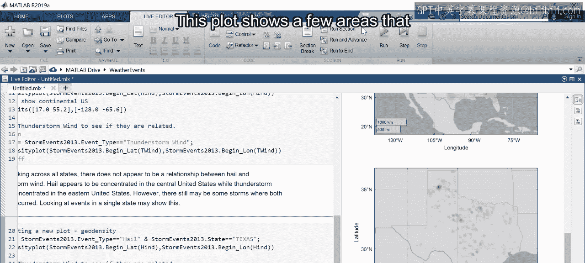

This plot shows a few areas that are worth looking into further。For example。

 this cluster around Amarillo。

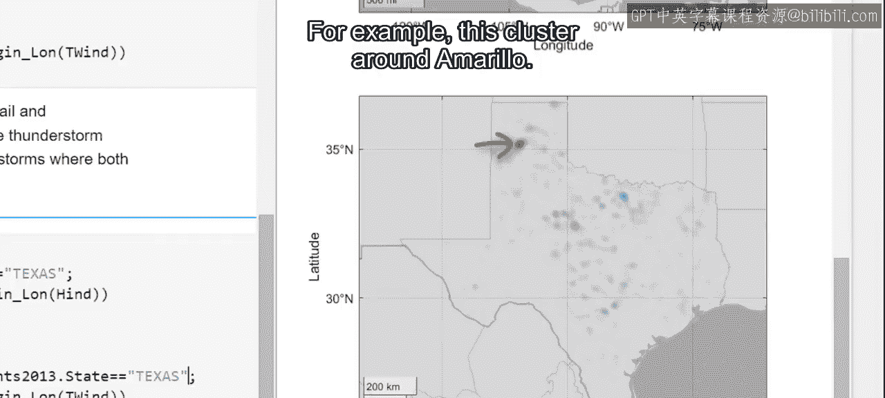

But how do you select just these events。

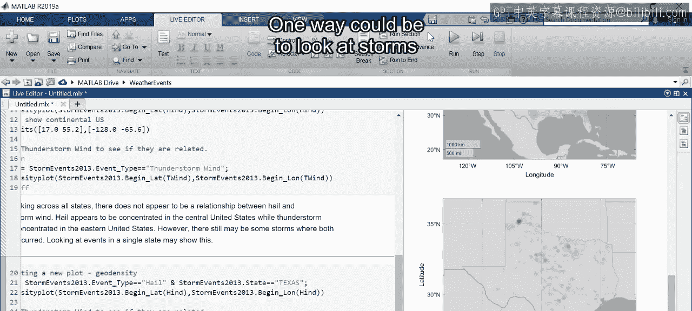

One way could be to look at storms within a certain distance of Amarillo。

You can use the Havever sign formula to calculate this distance using the latitude and longitude values contained in the data。

Many people may be unfamiliar with this formula。 You can add the equation to the live script and include a hyperlink to a reference page。

Equations are added to text blocks from the insert tab。First， place the cursor。

Then expand the menu below the equation icon and select equation。

A new tab will open with options that help you interactively build your equation using predefined symbols。

And structures。

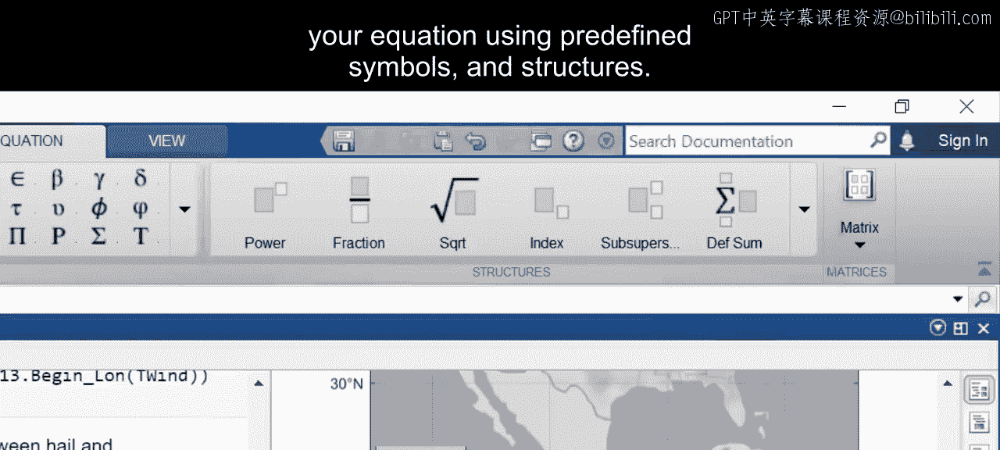

For example， this structure lets you add the sine squared term。

You can also combine structures like parentheses around a fraction by adding one structure inside another。

This symbol will add the dot to indicate multiplication。When you're done。

 click outside the equation editor to exit。To add a hyperlink， highlight the text。

 click hyperperlink on the insert tab and paste the URL。

You can add the calculated distance as a new variable on the table and use a conditional expression to select the desired events。

Here， you are checking for events within 8 km or about5 miles of Amarillo， Texas。

Once the data is selected， you can visualize it however you want。

Because you are interested in the timing of the events in relation to each other。

 you could consider displaying a table。Or perhaps a heat map。

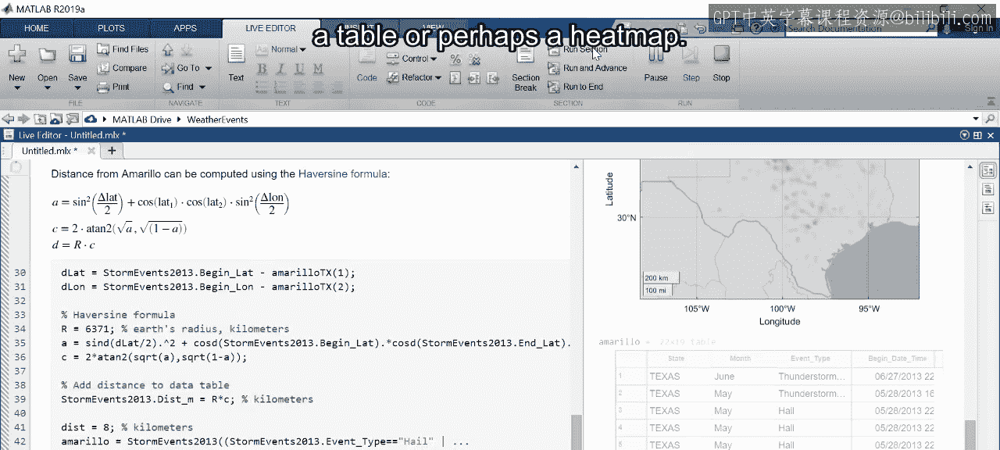

Here you see that on May 28th， there were multiple hail and thunderstorm wind events。

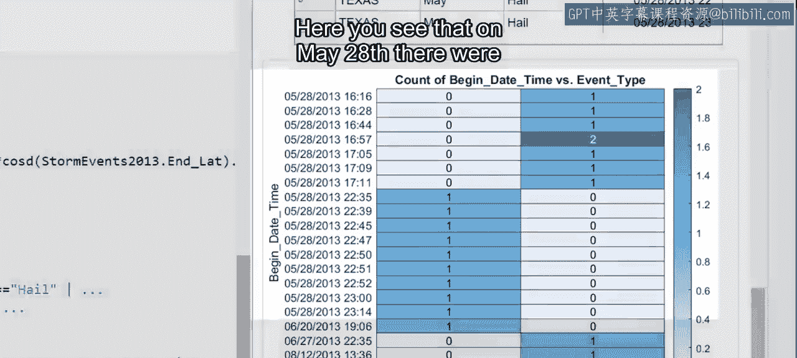

The wind events were recorded first over a one hour span。

Multiple hail events were recorded over a 40 minutes span starting approximately five hours later。

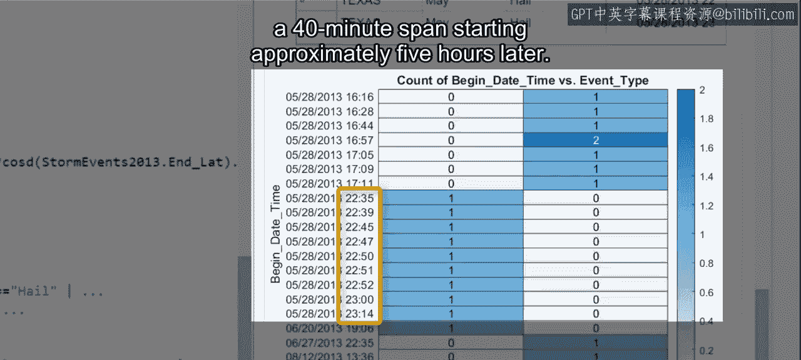

You could check other cities and states， but at this point， you can summarize your findings。

After finalizing the text and organizing the life script as desired。

 you are ready to share it with others。Be sure to save your final version。

Note that if you expand the save menu， you have the option of exporting your live script to a variety of common file formats。

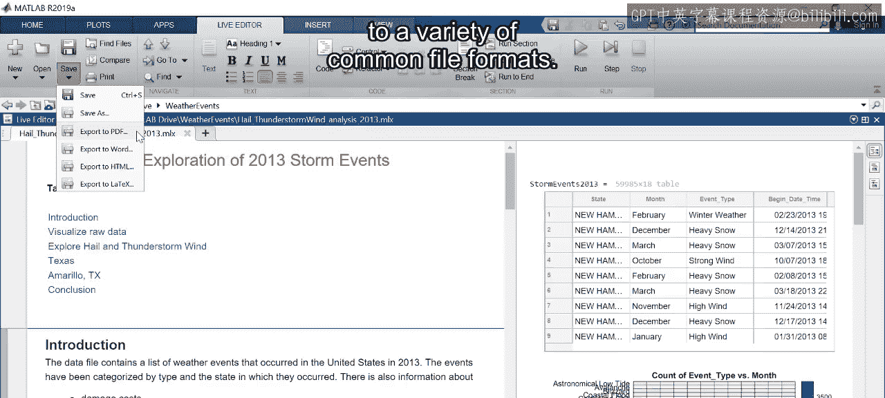

For example， selecting PDF would create a new document containing the text。

 code and outputs in a format that anyone can view。In summary。

 live scripts let you combine runudable code with formatted text。

You can add formatting to create a report to share with others。

The ability to export to a variety of formats enables you to distribute your analysis to people that do not have access to MALB。

Now， you are ready to learn how to make your scripts interactive with controls。

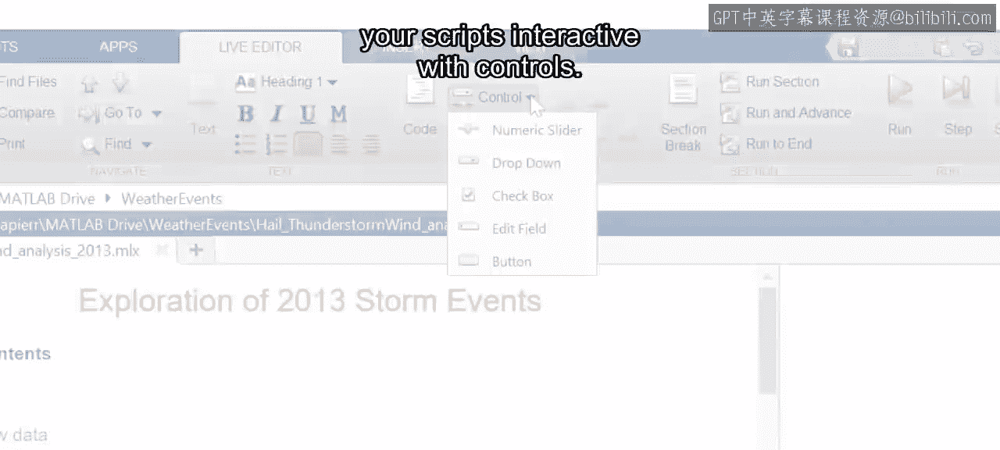