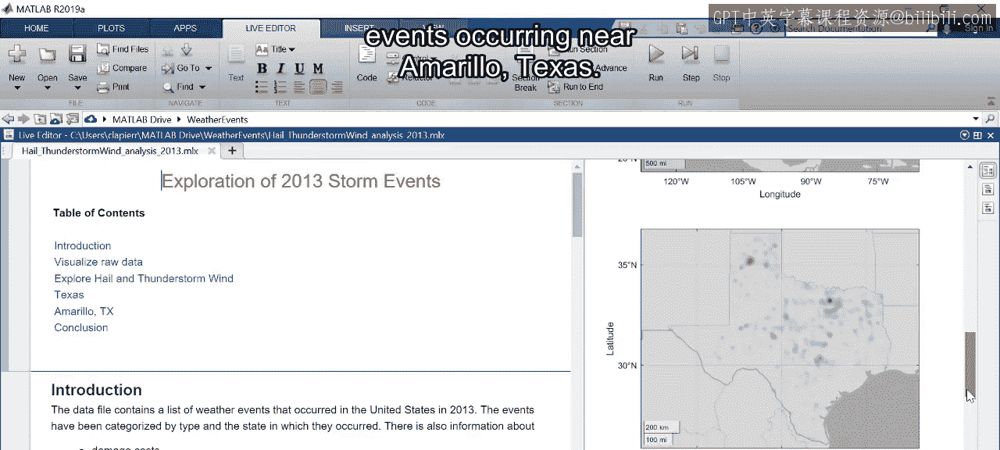
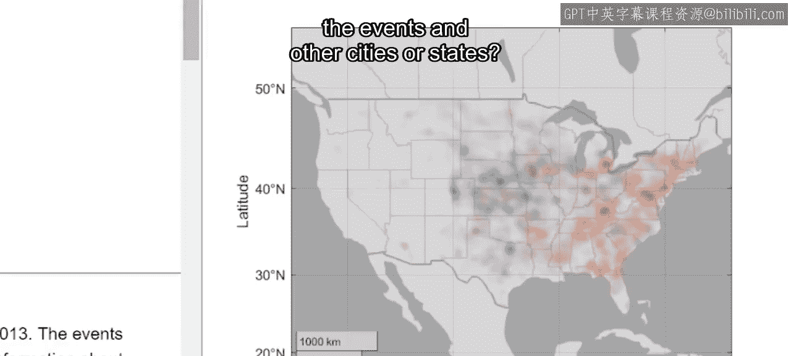
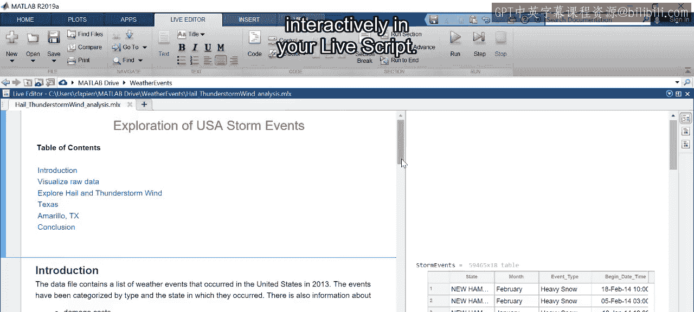
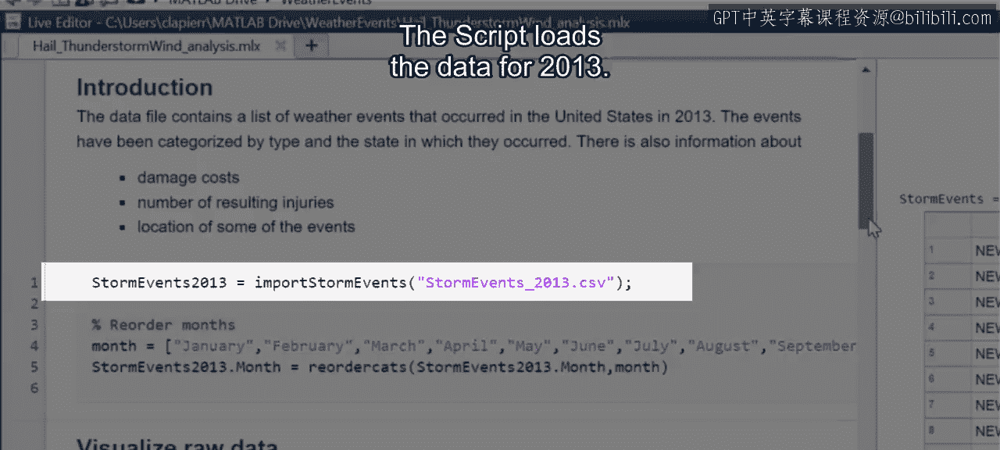
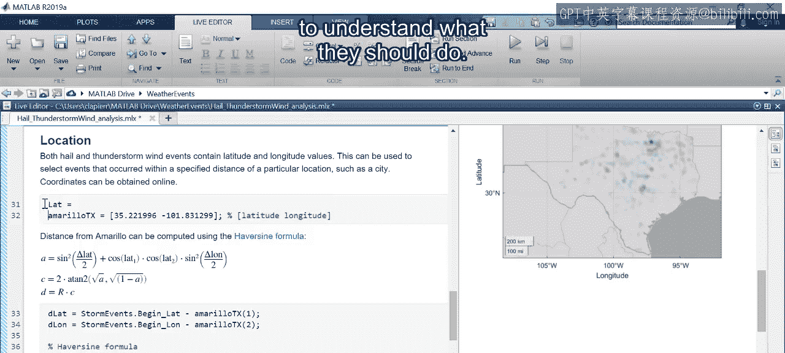
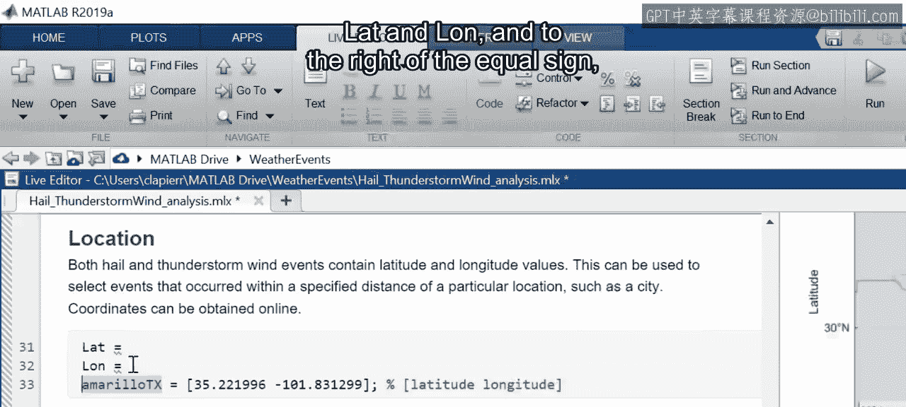
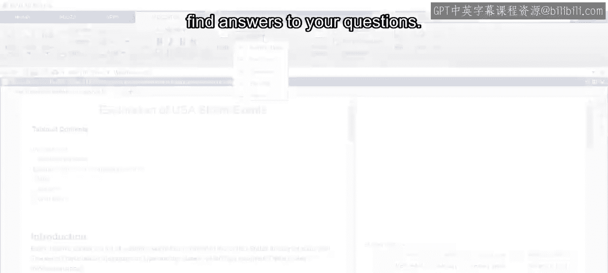

# Mathworks《实用数据科学与MATLAB（数据探索、特征工程、机器学习、毕业项目）｜Practical Data Science with MATLAB》 p38 37_为直播脚本添加交互式控件.zh_en [BV1Jr421w7wL_p38]

🎼。Let's revisit the live script you used to analyze hail and thunderstorm wind in 2013。

The data set contains nearly 60000 entries。 The script looked at only a handful of events occurring near Amarillo。

 Texas。

What if you wanted to explore the events in other cities or states。

 What if you wanted to investigate other event types。

 how can you make the analysis more interactive so that you and others can rapidly explore differences without rewriting the code。

In this lesson， you will use controls to set the values of variables interactively in your life script。

A good example for when to user a control is in the first line of code， loading the data set。

The script loads the data for 2013。 Someone analyzing this data may want to rerun the same analysis on data from other years。

 as well。

By replacing the file name with an interactive control。

 you enable the exploration of other years with just a few clicks。

Several types of controls can be added to live scripts。

You can see the available options by clicking on the live editor tab and expanding the control menu。

The drop down menu is the best choice for selecting the data file to load。

Let's copy the current file name to the clipboard so that we can add it to the control。

Then delete the name and add a drop down menu in its place。The control configuration menu appears。

List the options a user will see under item labels。

List the corresponding value for each label under item values。

A label and its corresponding value can differ， so it's fine to use just the year for the labels and the complete file name for the values。

Let's add entries for 2013 and 2014。By default， interacting with a control will automatically run the section of code it is in。

At the bottom of the configuration menu， you can change the default behavior to one of the available options。

As you can see， section breaks are important in controlling what code gets executed。

 You previously learned how to add sections to your live script as you consider where to insert breaks in your code。

 think about what you want to happen after you make a selection。In this case。

 let's select all sections。When you are done configuring the control。

 click outside the menu to return to the live script。Test the control by selecting 2014。

Did it do what you expected。The results should be fairly similar to 2013。

The drop down menu has made it easy to switch data files。

A second menu could also be used for selecting an event type or a state from a predefined list。

Some variables， however， are more open ended。For example， as you explore。

 it's likely that you want to look at events beyond Amarillo， Texas。

You can use edit field controls to capture the latitude and longitude of any location。

While it is true that the user could just update the code directly。

 adding a control here makes it obvious to a user where they should be making changes to the script。

Let's modify the code so it's easier for a user to understand what they should do。

Create two new variables， la and lawn。

And to the right of the equal sign， place an edit field control。

The variables will be assigned whatever value is entered into the edit field。

Since the latitude and longitude variables are numeric， set data type2 double。

For the execution option， consider what the user is doing here。

Both values will have to be updated anytime the city has changed。

 so it doesn't make sense to run any part of the script after one edit field has been modified。

Since the user could update the fields in any order。

 this is a scenario where doing nothing is probably best。

Once you have finished configuring each control， click outside to return to the live script。

You can pre populate the edit fields by entering the latitude and longitude values for Amarillo。

Remember that these coordinates are used to calculate the distance between each weather event and the city。

Currently， the live script is hard coded to select events within8 kilometers or five miles of the city。

This distance was chosen， arbitrarily。Users will probably want to modify this value。

 and numeric sliders provide a simple way to do so。

Delete the current value assigned to the variable D and replace it with a numeric slider from the control menu。

The control configuration menu enables you to set the minimum， maximum。

 and increment values of the slider。You should use values that will guide the user to meaningful results。

For example， you might be tempted to set men to zero。

 but specifying a distance of zero would result in no events being selected。Instead。

 let's use a min value of 5 kilometers， a max of 100， and a step size of5。For execution。

 selectCurrent section to End。This way， users will see updated results when they adjust the slider。

 which is likely what they want。For sliders， you can also determine when code execution is triggered。

 either while the slider is active or once the user has stopped using it。

Some of the plots in this section take a few seconds to generate。

 It will therefore be better to run the code once the final value has been selected。

 so select value changed。Okay， let's test it out。 Return to the live script and adjust the slider。

H perhaps 100 km is too high for the maximum。 The heat map gets really hard to read。

 with this distance。That's easy to fix though， you can modify a control by right clicking and selecting configurefigu control。

Let's change the max to 50 instead。Now set the slider to 10 kilometers so the heat map results are comparable to those from 2013。

Update your summary of the analysis and your script is done。In summary。

 adding controls made analyzing the weather data quicker and easier。

Before you had to locate the desired line of code and manually update values。

Now the locations stand out and the controls assist you in selecting appropriate values。Further。

 you can make sections of code automatically rerun when a change is made。

 further simplifying exploration of the data。Now you have the skills necessary to create your own live scripts At the end of this module。

 you'll create one of your own。Consider how you can use interactive controls to quickly explore your data and find answers to your questions。

