# Mathworks《实用数据科学与MATLAB（数据探索、特征工程、机器学习、毕业项目）｜Practical Data Science with MATLAB》 p39 38_使用MATLAB进行探索性数据分析总结.zh_en [BV1Jr421w7wL_p39]

🎼。

Congratulations on completing the first course in practical data science with MatLap。

 the ability to quickly explore lots of data is an important skill。 C visualizations。

 filtering data and calculating group statistics will help you answer many important questions。

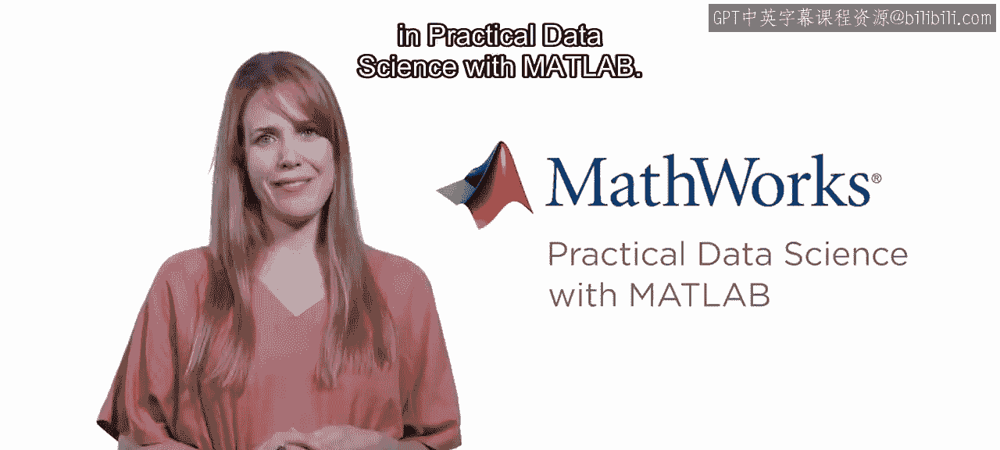

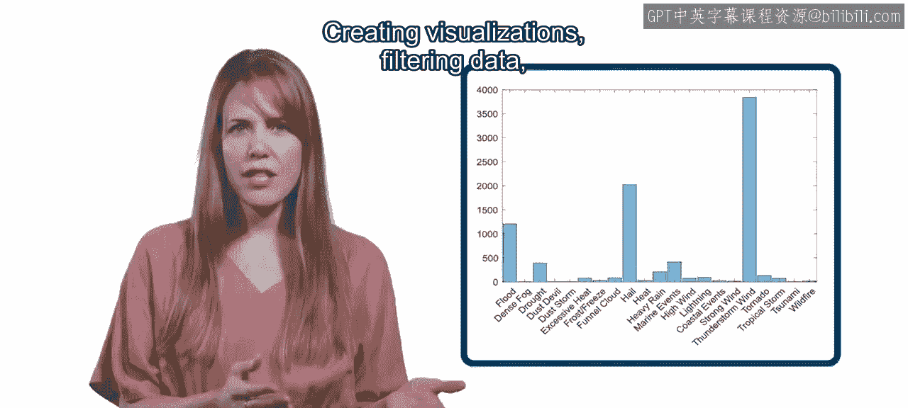

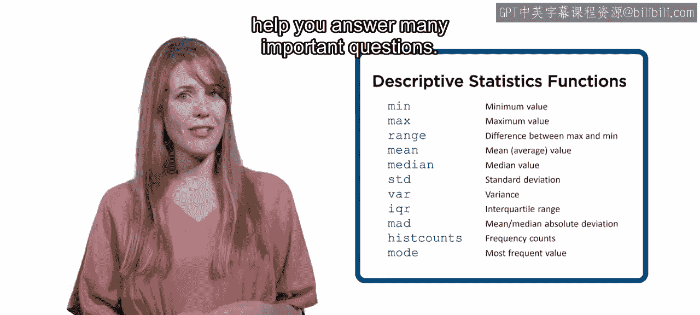

Before looking ahead to Co two， let's recap what you've learned so far。

You can now take a new data set and answer the question， what happened？

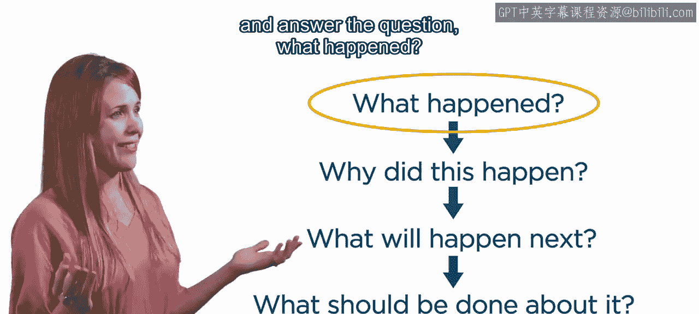

To do this， you followed a few steps。First， you brought data into MATLB using the import tool。

This tool enables you to interactively select how you import the data and automate the process in the future。

At first， this may not sound like a big deal， but you can't start an analysis without first having data。

Next， you learned how to create visualizations and filter your data using interactive tools。

 This is how to start exploring and looking for possible relationships in a new data set。

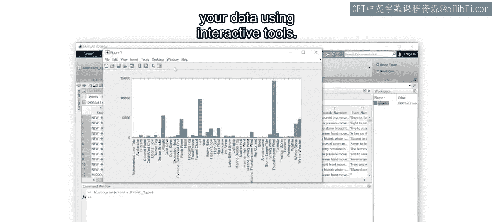

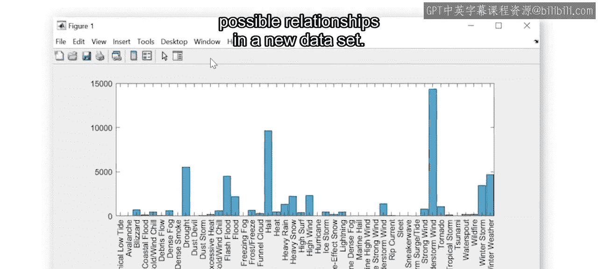

And as with the import process， the code required to repeat your steps is automatically captured。

 speeding up future analyses。After learning what's in the data。

 you next saw how to calculate statistics and look for correlations between variables。

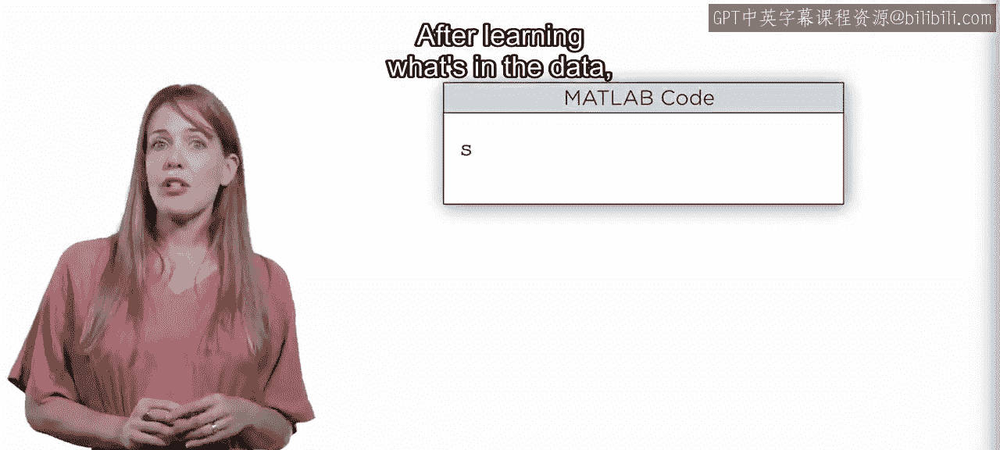

Now you're answering not only what happened， but also， why did this happen。

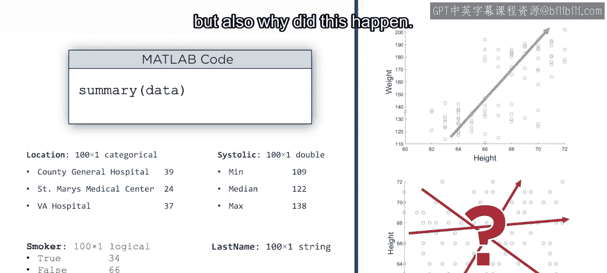

And finally， you put all the concepts together and created an analysis of a specific event。😊。

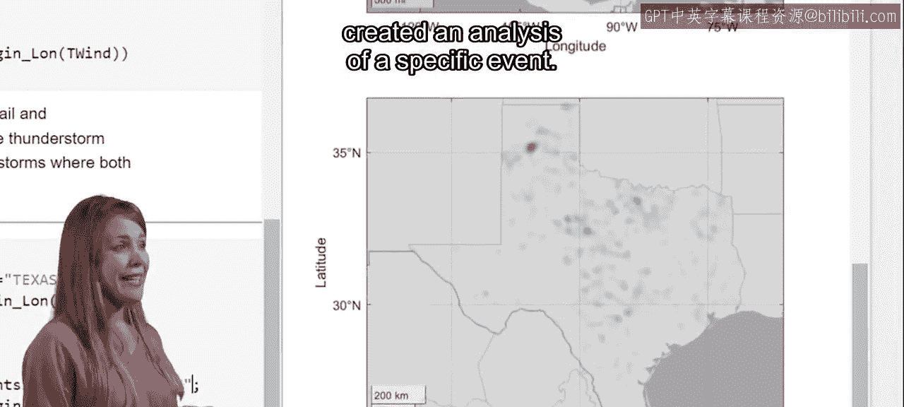

Your final analysis was more than text， code， and visualizations。

It was a story of what happened that helps inform future decisions。

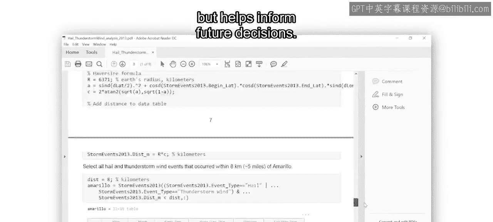

So what's in course，2， Let's ask Adam， who will be leading you through the second course， Adam。

 what can we expect。

Thanks， Aaron。You have accomplished a lot already， but additional skills are required in many data science applications。

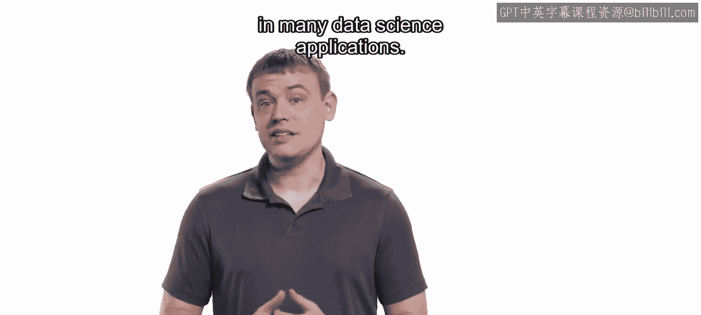

For example， what if you have to combine multiple data files？

How do you handle noisy data and outliers？How can you use your data to make predictions？

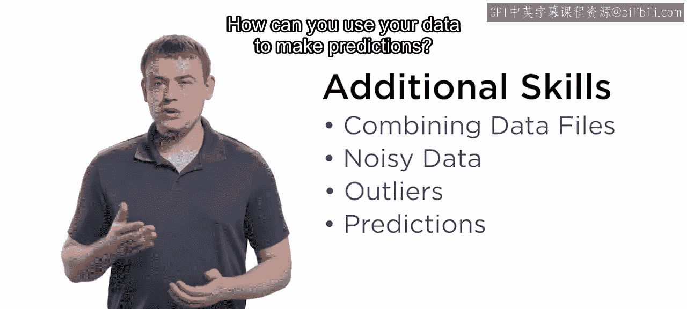

Join us for course two of this specialization， where we'll cover these topics and more。

