# Mathworks《实用数据科学与MATLAB（数据探索、特征工程、机器学习、毕业项目）｜Practical Data Science with MATLAB》 p40 0_实用数据科学与MATLAB.zh_en [BV1Jr421w7wL_p40]

🎼。

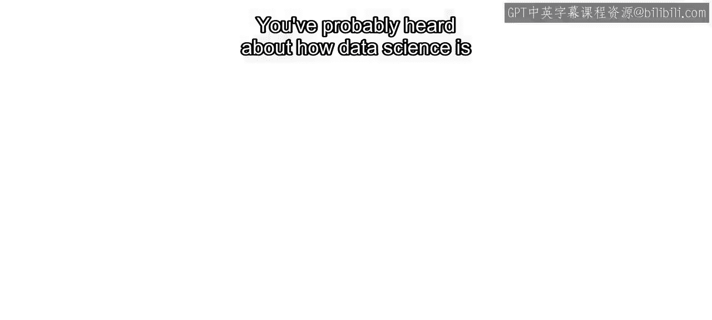

You've probably heard about how data science is revolutionizing entire fields as diverse as healthcare。

 automotive， consumer electronics， and many more virtually every industry has been affected。

 and if you're considering the specialization， you've likely seen the potential in your own field。

No matter your field， having strong data science skills sets you apart and helps you to turn raw data into meaningful results。

That's why MathWorks created practical data science with MATLB。

Completing the specialization will give you the skills and confidence you need to achieve practical results quickly Throughout this specialization。

 you'll be using MatTLb。

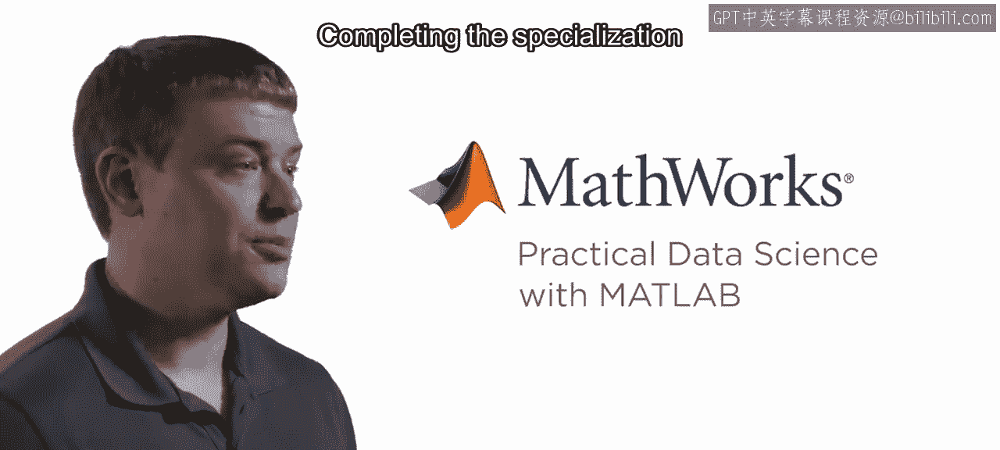

MatLab is the Go to choice for millions of professionals working in engineering and science and provides the capabilities you need to accomplish your data science tasks。

 MatTLAab uses familiar mathematical notation and ships with graphical apps to help you to rapidly iterate over common analysis tasks These apps reduce the time it takes to do meaningful data science work and help you get started immediately working with your data。

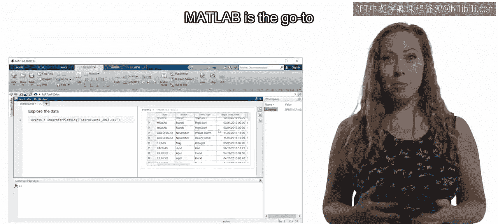

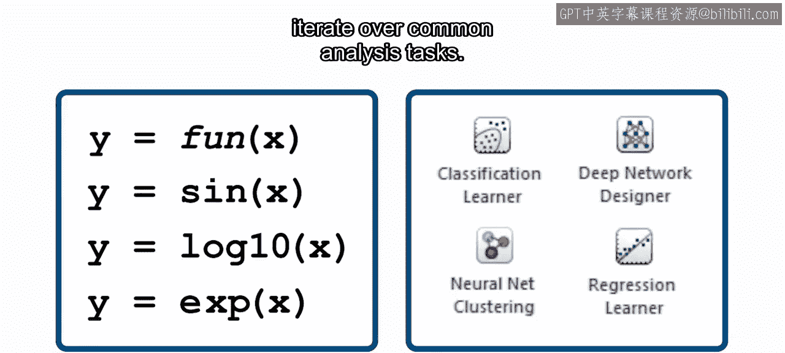

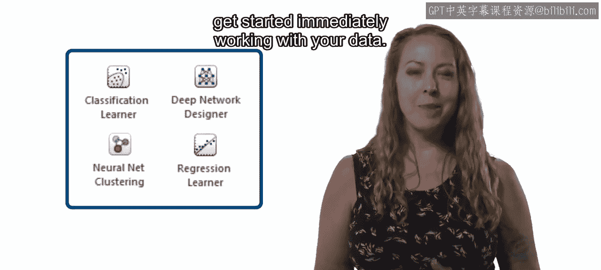

You know your field and you know your data。With the right tools and a little practice。

 you can build models that make accurate predictions based on patterns in that data。

 Techs like these are essential to any company looking to remain competitive。

After completing this specialization， you'll be able to build predictive models using your data。

This is one of the most in demand career skills employers are seeking today。

In the first course of this four course specialization， you will learn how to explore your data。

 using the graphical tools available in MatTLAb， you'll produce visualizations and perform common statistical analyses。

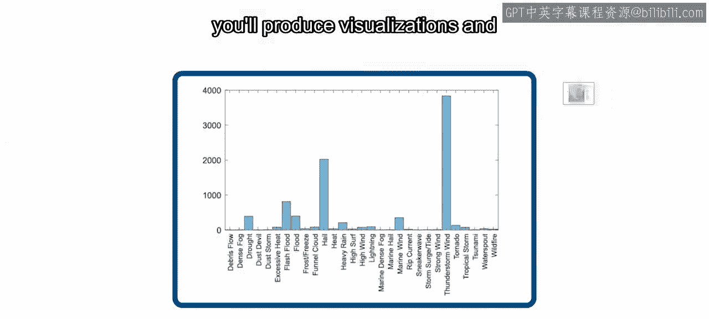

This course is designed to be an entry point for learners of all skill levels。

 The graphical tools enable you to rapidly experiment with different techniques and visualizations。

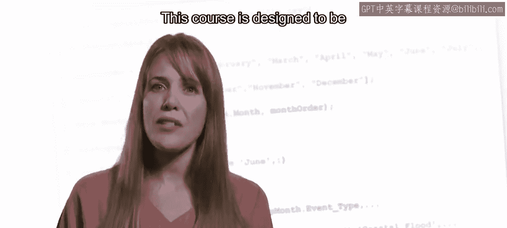

The corresponding code for the actions you perform appears on screen。

 helping you pick up the Matlab language and to start writing full scripts yourself。

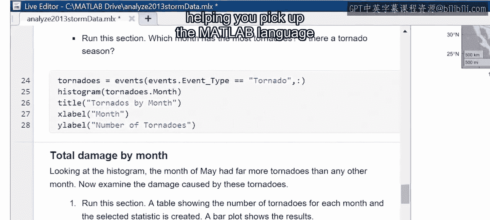

In the second course， you will build on the foundations。

 adding essential skills for pre processing your data， for further exploration and modeling。

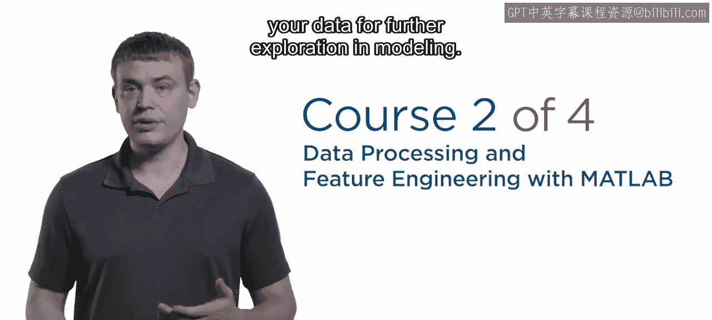

Completing this course will give you the ability to bring together data from various sources。

 Remove unwanted artifacts like outliers and missing data points。

And start to build basic models for classification and regression。

This course also explores specific types of data you are likely to encounter。

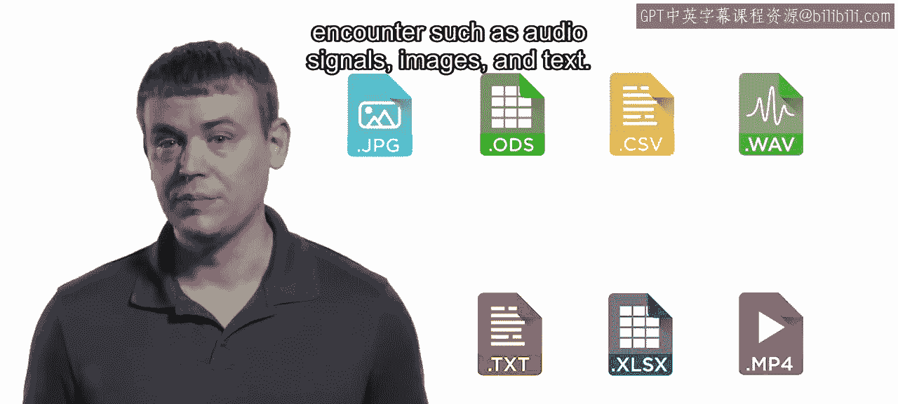

Such as audio signals。Images and text。

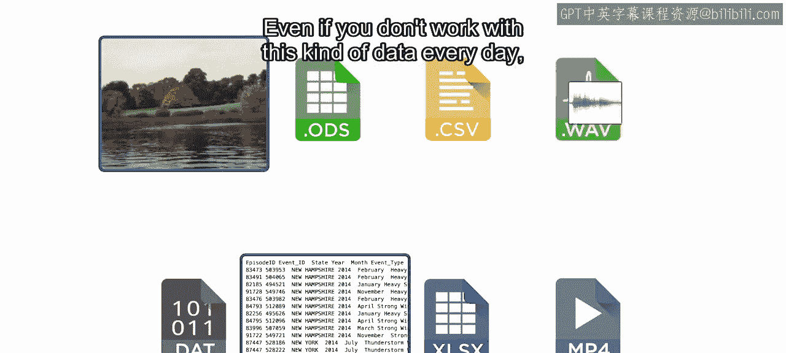

Even if you don't work with this kind of data every day。

 you will still find opportunities to apply the relevant concepts and apps as the need arises。

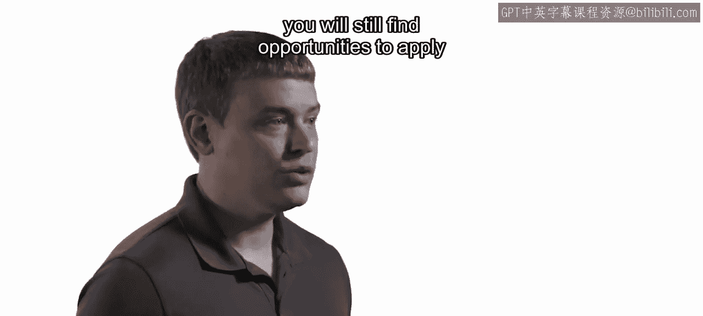

When you reach the third course， you'll be ready to start building machine learning models using the Matlab apps to experiment with a number of different modeling techniques and parameters。

 When you find a combination you like， you'll build a model and use it to make predictions。

 As with any new skill， the key to success in data science is practice。

 The final capstone project covers the full data science workflow。

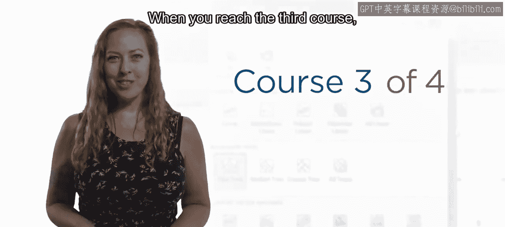

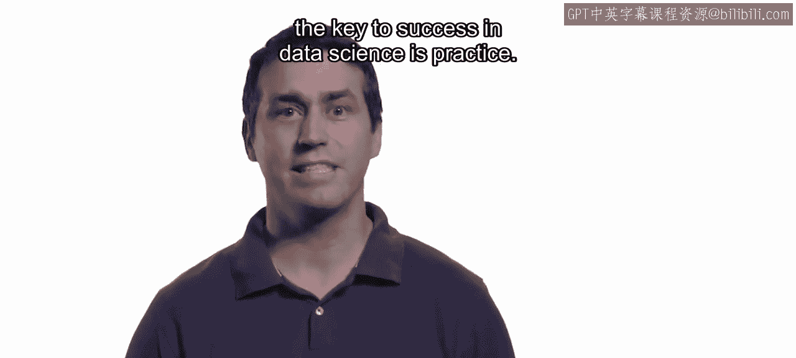

You'll apply skills from all courses in the specialization to build a predictive model。

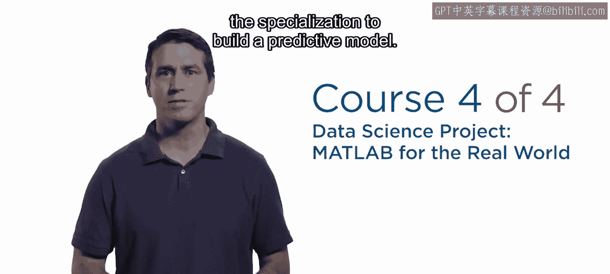

You'll work with peers to evaluate the model and more importantly。

 learn from their unique perspectives。Ready to start building the practical data science skills that you can use to make a difference in your organization and in your industry。

 Great， let's go。