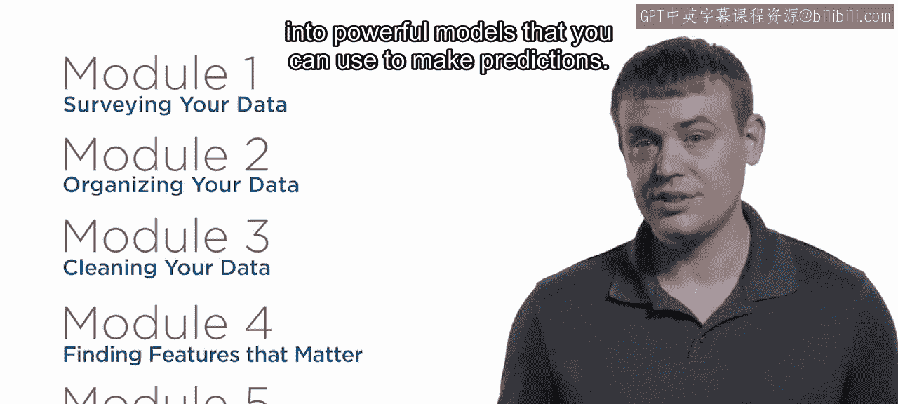
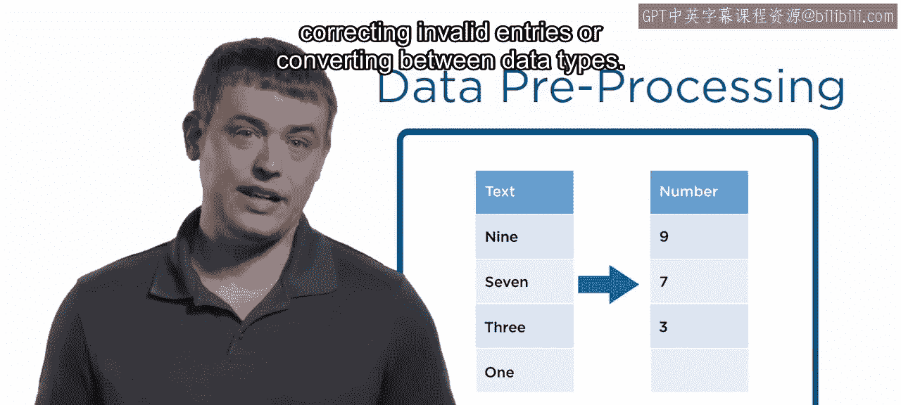
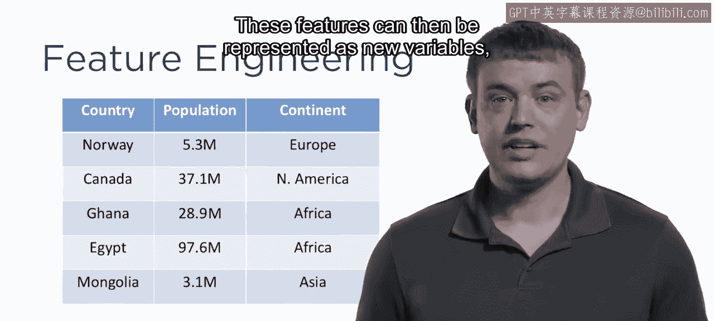
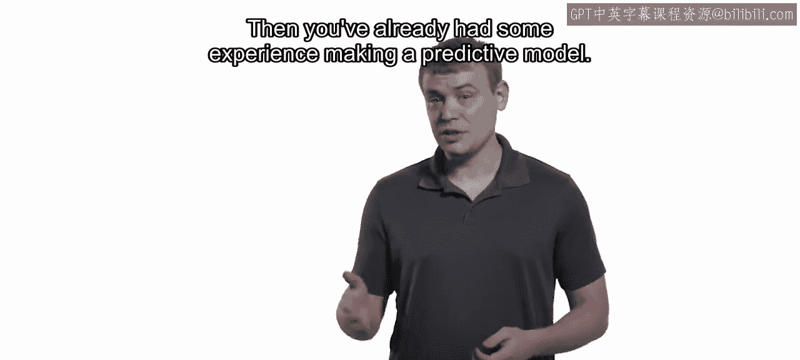
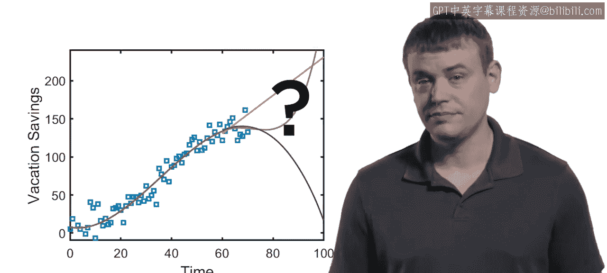
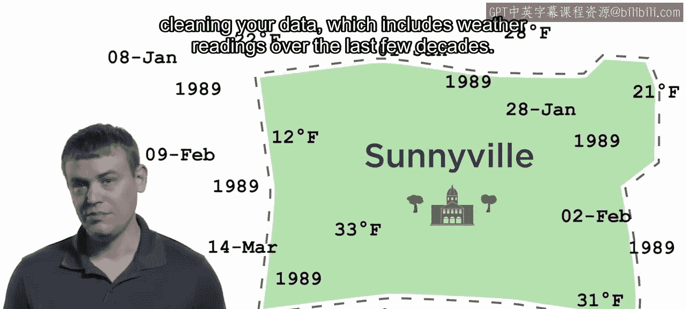
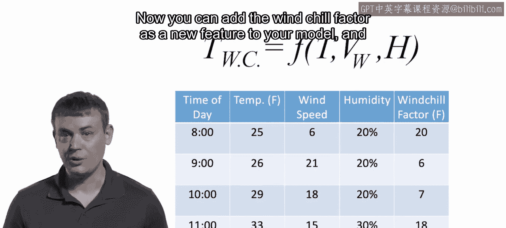
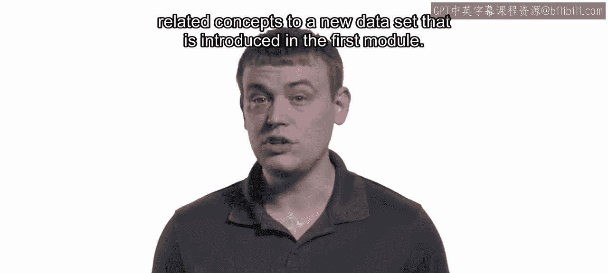

# Mathworks《实用数据科学与MATLAB（数据探索、特征工程、机器学习、毕业项目）｜Practical Data Science with MATLAB》 p41 1_数据处理和特征工程概述.zh_en [BV1Jr421w7wL_p41]

🎼。

Hello， my name is Adam Philian and welcome to the course。Throughout the next five modules。

 you'll learn how to transform your raw data into powerful models that you can use to make predictions。

You'll begin by transforming your raw data into an organized and usable form。

 a procedure known as data preprocessing。This includes tasks such as aggregating multiple sources。

Correcting invalid entries。Or converting between data types。

For example， imagine you are tracking a disease worldwide。Chances are。

 you're assembling multiple data sets from each affected country。

Each of which has its own reporting methods， diagnostic procedures， and measurement standards。

 and perhaps even its own language。You'll need to perform a lot of data preprocessing before you can even begin to look for global trends。

Once you have prepared your data， you can begin the process of feature engineering。

This involves using your domain knowledge to look for useful characteristics or features in your data。

These features can then be represented as new variables to be used in a predictive model。

If you aren't familiar with predictive modeling， consider the following。

Have you ever made a budget spreadsheet to help you see when you'll be able to save up enough for a big expense。

 like a luxurious vacation。Then you've already had some experience making a predictive model。

In data science， a model is a mathematical description of your data that enables you to forecast how a system will behave。

And therefore， make informed decisions from your data。

Let's walk through an example of this process from start to finish。

Imagine you're a meteorologist responsible for issuing extreme cold temperature warnings in your area。

You begin by organizing and cleaning your data， which includes weather readings over the last few decades。

From here， you can build a regression model of temperature fluctuations that you can use to estimate future temperatures。

If your model predicts extreme cold weather， then you issue your warning。 But can you do better。

It turns out that the actual temperature isn't the only component in determining how cold it feels outside。

A better measure and an example of feature engineering is the windshll factor。

Meteorologists calculate windshll using a formula that incorporates the measured temperature。

Wind speed and humidity。Now you can add the windshield factor as a new feature to your model and better determine whether or not to issue a cold weather warning。

Although feature engineering may sound complicated， as you can see。

 you are probably already familiar with the concept。In the last module of this course。

 you will apply your feature engineering skills to some common types of data。Such as images。

Text and audio or other signals。Throughout this course， you will apply prepro， feature engineering。

 and related concepts to a new data set that is introduced in the first module。

Don't forget to use the discussion forums if you have any questions or useful tips to share with your peers。

Let's get started。