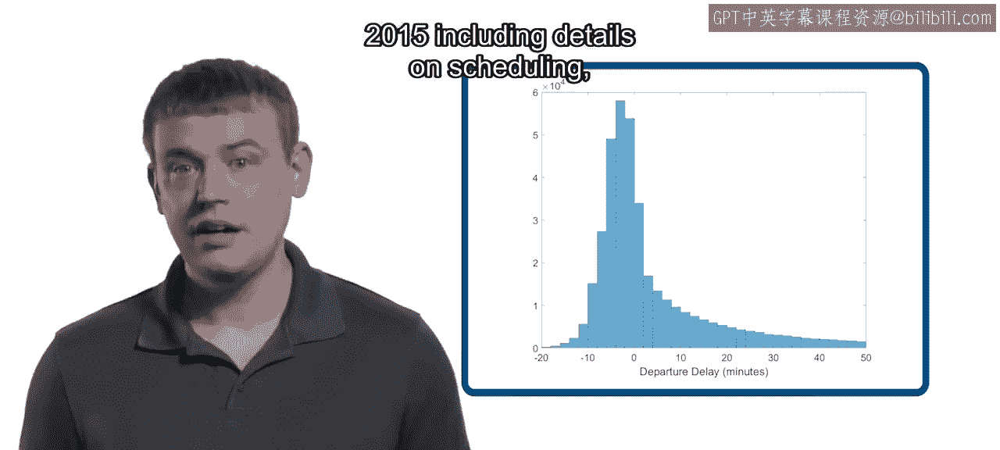
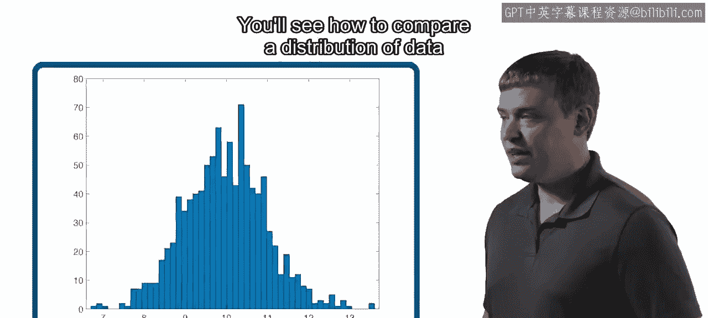
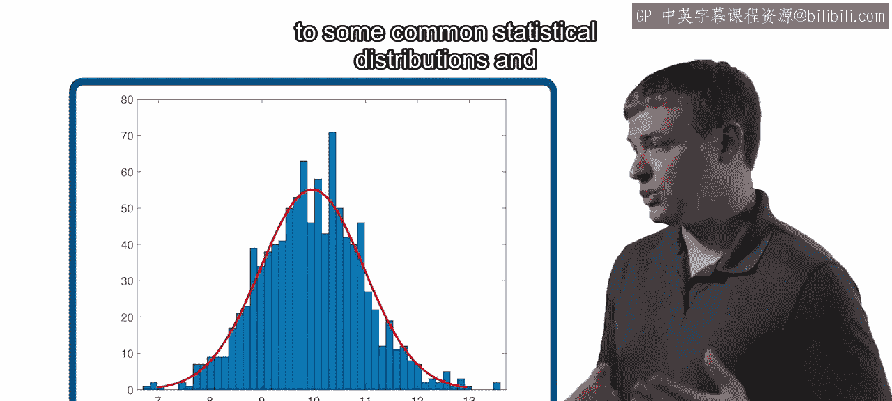
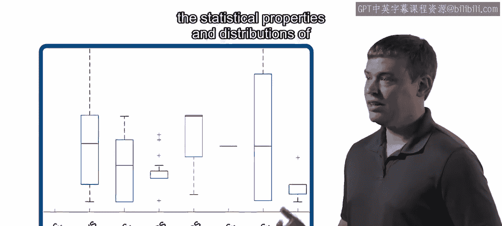
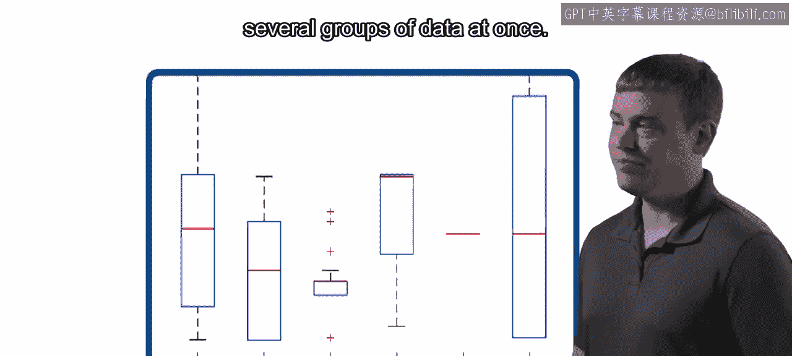
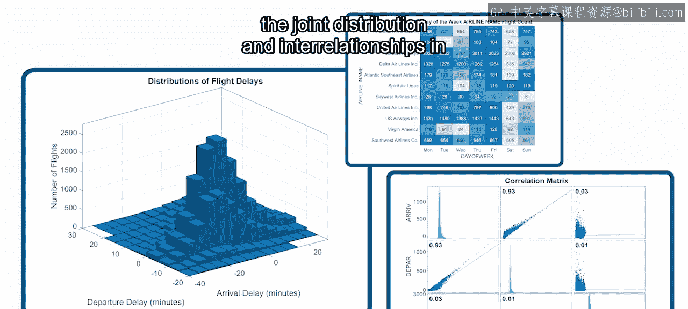

# Mathworks《实用数据科学与MATLAB（数据探索、特征工程、机器学习、毕业项目）｜Practical Data Science with MATLAB》 p43 3_模块1介绍.zh_en [BV1Jr421w7wL_p43]

🎼。

In this module， you'll start by reviewing exploratory data analysis。

You'll explore and visualize a new data set containing information on US domestic flights in 2015。

Including details on scheduling， aircraft， airports， and flight outcomes。

Then you'll dive deeper into analyzing the statistical properties and distribution of data。

You'll see how to compare a distribution of data to some common statistical distributions。

And use box plots to graphically compare the statistical properties and distributions of several groups of data at once。

Finally， you'll analyze the joint distribution and interrelationships in multidimensional data。

 using a variety of additional visualization techniques。

Let's get started。