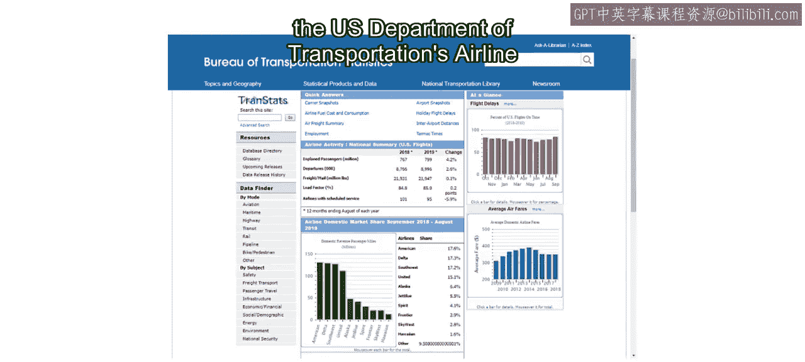
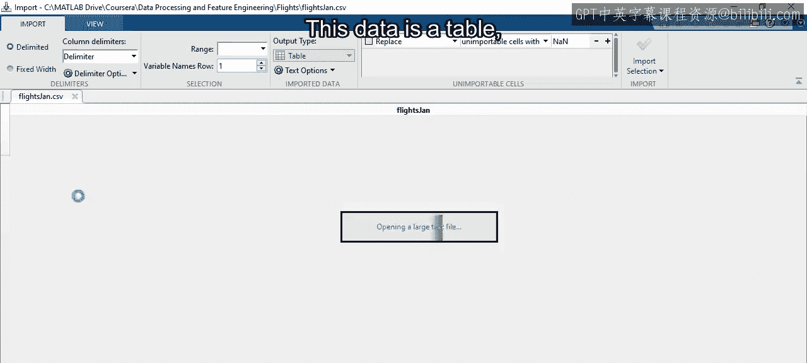
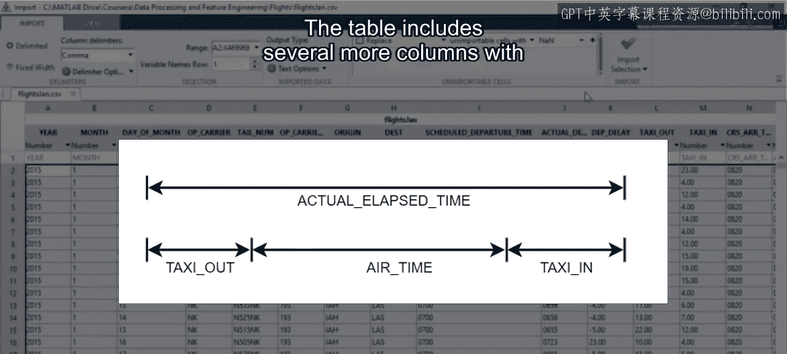
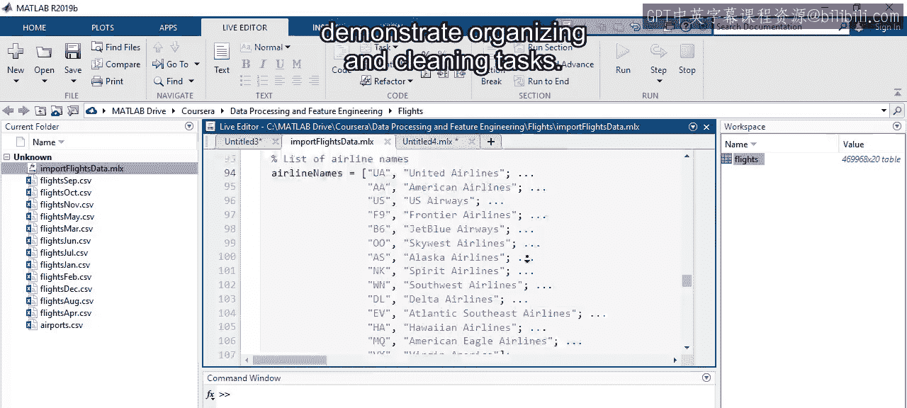

# Mathworks《实用数据科学与MATLAB（数据探索、特征工程、机器学习、毕业项目）｜Practical Data Science with MATLAB》 p44 4_航班数据集简介.zh_en [BV1Jr421w7wL_p44]

🎼，Now that you've downloaded the course files and set up your environment。

 let's take a look at the primary data set you'll use in this course。

You've been given the 2015 data from the US Department of Transportation's airlineline on time Perance data set。

From here on， we'll just refer to it as the flightlights dataset set。

This data set is a record of every domestic commercial flight in the US for all of 2015。

That's over 5。8 million flights。This type of data has many real world applications。For example。

 airlines can use this data to reduce delays and cancellations。

 allocate resources during busy times and holidays， or identify opportunities for adding new flights。

Let's start looking at the raw data to get a sense of what's inside。First。

 navigate to the folder containing the data。There are 12 files here with the prefix Fs that contain all of the data from 2015。

The files are split up by month， so Flightsjan。csv is a record of the flights in January。

There's also a file named Aircv， which contains information about airports in the United States such as name。

 city， and state， as well as latitude and longitude coordinates。Later。

 you'll see how to combine this information with the flights data to describe where flights are going。

Open the file， Fjan。csv with the import tool。

This data is a table， so there are multiple columns with the variable names at the top。

Each row in this table is a record of an individual flight。

 whereas the column is a different piece of information about the flight。For example。

 the date of the flight is specified by the first three columns， year， month and day of month。

There's also identification information for the flights such as airline。

 tail number and flight number。The tail number is a unique ID given to each aircraft。

 like a license plate number。Next to these are columns for the origin and destination airports。

The values here are three letter codes that can be used to look up information in the airport's file。

Following those are a series of columns with time information for the flight's departure and arrival。

In both cases， there's a record of schedule time and the actual time。

The Sch time variables have a prefix CRS， which stands for a computerized reservation system。

This acronym isn't very meaningful， but remember you can change variable names in the import tool。

For example， you can change the variable name， CRS depth time。

 to a much more descriptive scheduled departure time。Similarly。

 the depth time column can be changed to actual departure time。

It's good practice to use descriptive variable names。

The discrepancy between the scheduled and actual times is represented in the delay column。

The values here are the difference in minutes between the two times。

 A positive number means the flight was late。 it departed after it was scheduled。

 whereas a negative number means the flight was early， it departed before it was scheduled。

There are other columns that also have units of minutes such as taxi out， airtime and taxi in。

Repectively， these represent how long it took the aircraft to take off after it left the gate。

 how long it spent in the air and how long it took to get to the arrival gate after it landed。

When you add these three values together， you get the value in the actual Eapse time column。

The table includes several more columns with interesting information such as canceled flights。

 Check the reading after this video for a description of each of these columns。

Let's focus on the columns with time variables， which may be difficult to interpret at first。

You can see the departure time has four digit numbers some starting with0。

This is the time of day a flight departed using a 24 hour format。For example。

 the number 0804 refers to 804 a。A large number like 2245， refers to 1045 pm。

This might seem confusing， but don't worry， in a future lesson you'll see how to convert values like these to datetime values。

 which will make analysis much easier。Once you are ready to import the data。

 recall that you can use the import tool to automatically generate a function that enables you to easily repeat your import process。

Try selecting a few columns and generating a function。This opens a function file in the editor。

 You can save the function and reuse it to import any of the flights files。

It can be very helpful to add code to this import function。

 so you don't have to repeat certain tasks over and over。 For example。

 if you've determined that some missing row should be replaced with a particular value。

 you could add that code to this function。This added code will then run every time you load the data into MATLb。

In fact， such a function has been provided for you。

Open the function in the course files named Import Flights data。

You may recognize the top of this function has code that was generated by the import tool。

Below are extra lines of code that were added for various cleaning tasks。

 such as creating datetime variables。Don't worry if you don't understand the code right now。

 by the end of this course， you should be able to come back to this function and understand how the various steps work。

Try this function out yourself by opening a live script and using importm flights data to import the Flight's JA file。

You should now have a new table in the workspace。 Let's look at the values by opening the table in the variable editor。

This table is similar to the raw data you just saw， but with important differences。

You'll probably notice that the year， month， and day of month columns have been removed。

That's because this information has now been incorporated into datetime variables。Also。

 as you saw earlier， several variables have been renamed to be more descriptive。

The four date time variables are now named scheduled departure time， actual departure time。

 scheduled arrival time and actual arrival time。Several columns have also been reordered。For example。

 airtime has been moved in between taxi out and taxi in。

But don't let someone else's choices convince you that they have found the best way to prepare a data set。

 much of it can come down to personal preference。As you learn more about organizing and cleaning your data。

 you should try customizing your own import function。

 It's great practice for working with complicated dessets。And clearly。

 the flight's data is complicated。 It's messy， like most real world data。

 The additional cleaning code and import flights data had to be revised on multiple occasions when yet another quirk of the data was discovered。

But because of the messiness， this data set provides many great opportunities to demonstrate organizing and cleaning tasks。

By the end of this course， you'll be able to prepare your own messy data files for modeling and visualization。

