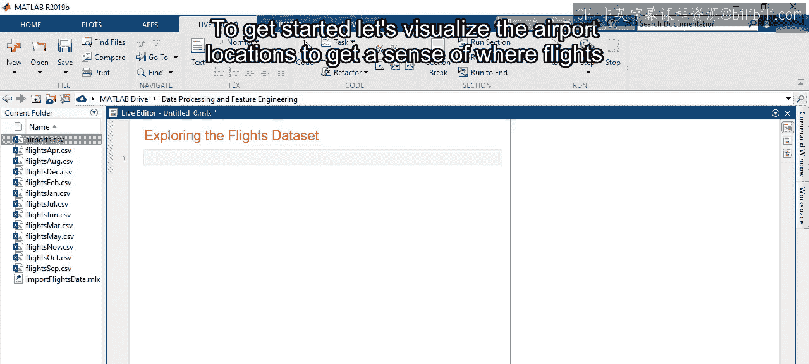
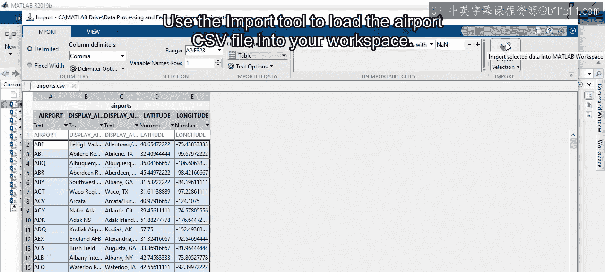
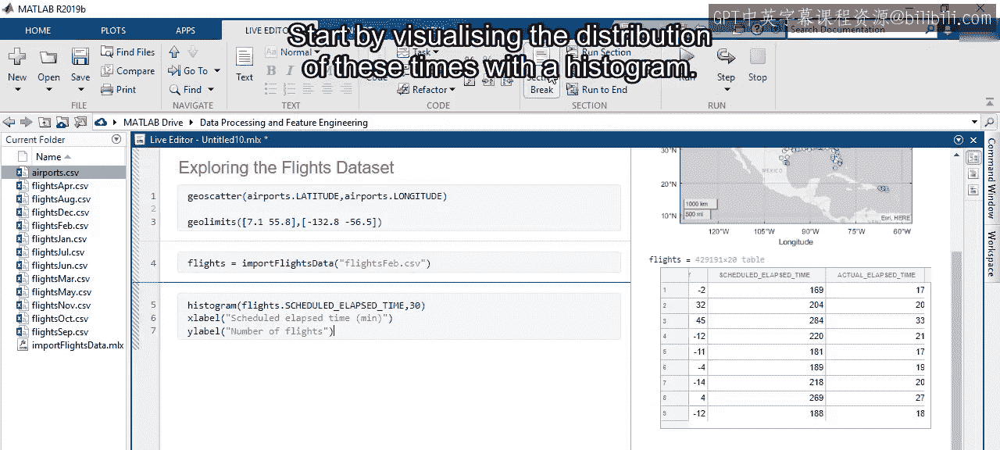
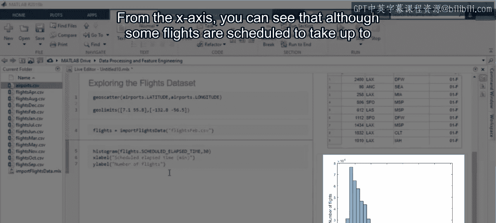
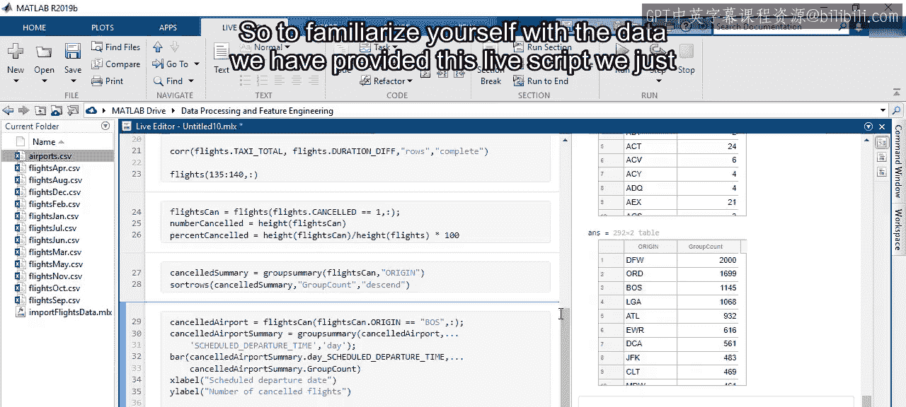

# Mathworks《实用数据科学与MATLAB（数据探索、特征工程、机器学习、毕业项目）｜Practical Data Science with MATLAB》 p45 5_探索航班数据集.zh_en [BV1Jr421w7wL_p45]

🎼。Now that you've seen the Flights data set， let's use what you've learned in the Exploratory data analysis course to examine this data。

To get started， let's visualize the airport locations to get a sense of where flights are occurring。

Use the import tool to load the airport CV file into your workspace。

Because latitude and longitude information is included。

 you can plot them on a map using the geocatter function。As you can see。

 there are 322 commercial airports spread across the United States and its territories。Remember。

 you can use the Axes toolbar to zoom in on a specific area， such as the Contiguous United States。

The corresponding code is automatically generated， click Update code to add it to your script。

On any given day there are thousands of flights between these airports。

 some flights occur between neighboring cities like Boston and New York City。

 while others cross the entire United States， so what is more common， shorter or longer flights。

To figure this out， you'll first need to import one of the flightlights CSV files using the custom import function introduced earlier。

Let's load the data for February。Here you can see all the variables in the table。

Scheduled elapsse time indicates how long the flight is expected to take in minutes。

Start by visualizing the distribution of these times with a histogram。

From the X axis， you can see that although some flights are scheduled to take up to 800 minutes。

 most flights take less than 200 minutes。

Therefore， shorter flights are clearly more common。

But how long does a flight really take compared to this schedule time？

This information is contained in the variable actual Eappsse time。

To find the difference between the two， subtract the schedule time from the actual time and add it as a new column in the table。

A negative difference indicates the flight took less time than was scheduled。Next。

 create a histogram to visualize this difference。Looks like most flights were accurately scheduled。

 but some took over 200 minutes longer than expected。Why was this？

Perhaps those flights spent more time in the air， create a scatter plot of airtime versus duration difference to investigate a possible correlation。

嗯。😊，There does not appear to be any relationship between these two variables， what else could it be？

Well， e lapse time is the sum of taxi out air and taxi in times。

What does a plot of total taxing time versus duration difference look like？

You can see there is a relationship between these variables and you can quantify the strength of the relationship by calculating the correlation coefficient。

Oops， the NN result means that these variables contain missing values。Remember。

 you can ignore missing values by specifying the option to only consider complete rows。

It looks like there is a fairly strong correlation which suggests the difference between scheduled and actual e lapse time is heavily influenced by the amount of time spent taxing。

All right， so you've answered one question but found some new questions in the process， for example。

 when do the Nan entries occur？Looking at the flights table。

 you can see that every flight has a scheduled departure time。

 but some don't have an actual departure time flights that are scheduled but don't actually depart are classified as canceled the variable canceled in the flights table is assigned a value of one when this occurs。

To make this group easier to explore， extract all of the canceled flights into a new table。

Looks like there were 20，517 canceled flights in February of 2015。

 That's almost 5% of the domestic flights that month and more than four times the rate for the rest of the year。

Nobody likes finding out their flight has been canceled。

 so let's determine when and where this happened to better understand the problem。

Are cancellations common everywhere or are they more prevalent at specific airports？

You can use the group summary function to compute the number of canceled flights by airport。

To find the ones with the most cancellations， sort the results in descending order。Inest。

 by looking at the resulting table， you can see that only a handful of airports had over1 thousand0 cancellations and most had less than 100 it may be that larger airports have a higher number of cancellations。

If so， you would expect the number of cancellations per day to be fairly constant for a given airport。

Mathworks headquarters is located near Boston， which has the code B O， so let's check there。Next。

 use the group summary function to group the data by departure day。

Then use a bar plot to graph the group count for each day。

Looks like the number of cancellations is not constant， instead。

 most cancellations occurred on just three days。It turns out February 2015 was an all time record breaking month for Boston with nearly two meters of snow。

You can find details for these storms in the storm event data used in the previous course。

And if you want an additional challenge， see if you can use the storm events data to explain cancellations at a different airport。

This exploration of the Flights data set uncovered a lot of information and even more questions。

You'll be using this data for most interactions throughout this course。

So to familiarize yourself with the data， we have provided this live script we just created so that you can continue exploring on your own。

 For example， you may want to see how the cancellation percentage changes for a nonwinter month。

 If you find anything interesting， post about it in the course forms。

