# Mathworks《实用数据科学与MATLAB（数据探索、特征工程、机器学习、毕业项目）｜Practical Data Science with MATLAB》 p46 6_描述分布.zh_en [BV1Jr421w7wL_p46]

🎼，Summary statistics are a fast way to gain insight into your data。

But stats like the mean and standard deviation only tell part of the story。For example。

 how likely is it that a new observation will have a value of one or six？

You might guess that since6 is close to the mean， it has a high chance of occurring。

And since one is more than a standard deviation away， it has a much lower probability。

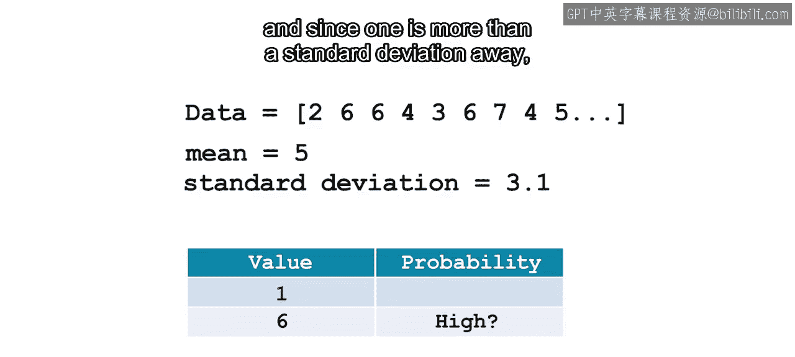

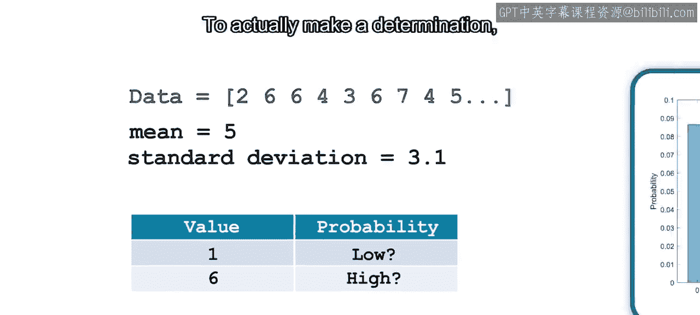

To actually make a determination， you need information about how the data is distributed。

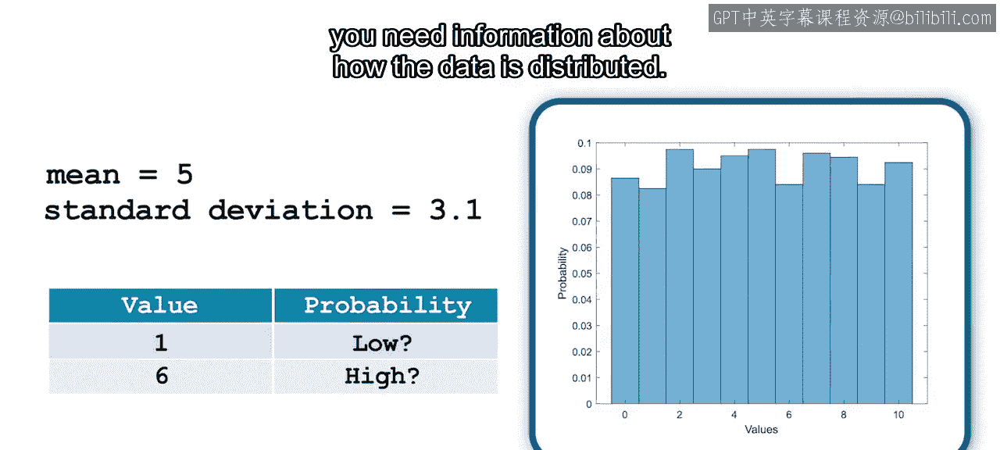

A common visualization for this task is a histogram。

Now you see that the data has a uniform distribution that is all possible values have equal probability of occurring。

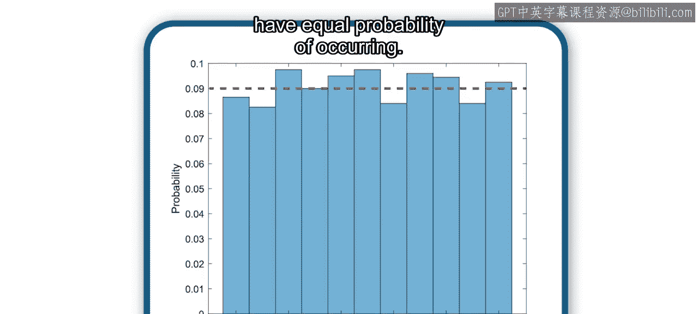

Thus， a new observation has an equal chance of being a one or a six or any value in the range。

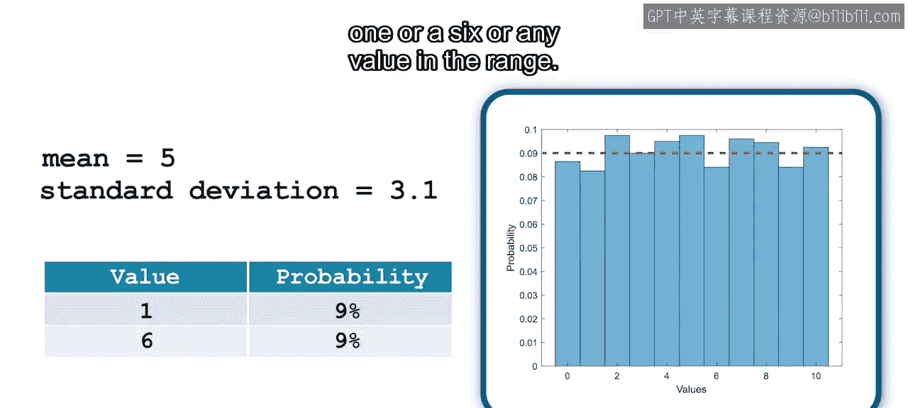

But what if the data has a normal distribution？Now the chance of a new measurement being a one is much less than being a six。

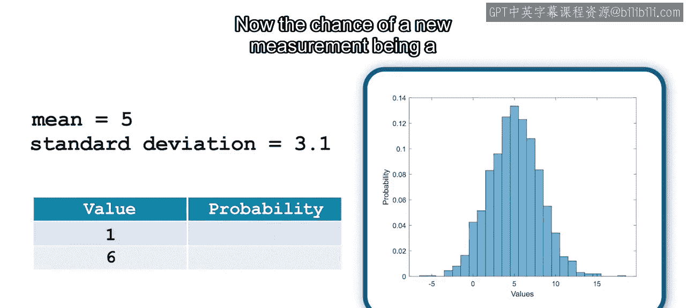

The probability is higher near the mean and falls off symmetrically as you move away from the mean。

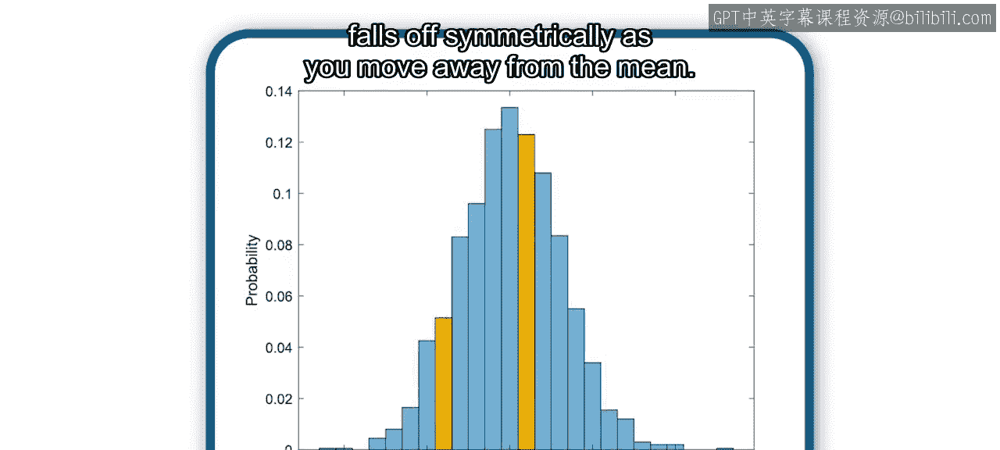

Note that the mean and standard deviation of the data is unchanged。

 only the distribution of the data is changed。

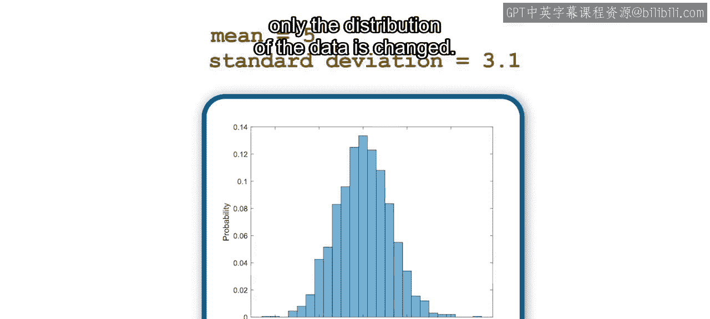

Both uniform and normal distributions are symmetric about their mean。Thus。

 the mean and the median are approximately equal。Also。

 the standard deviation is a useful measure for describing the spread of the data about the center。

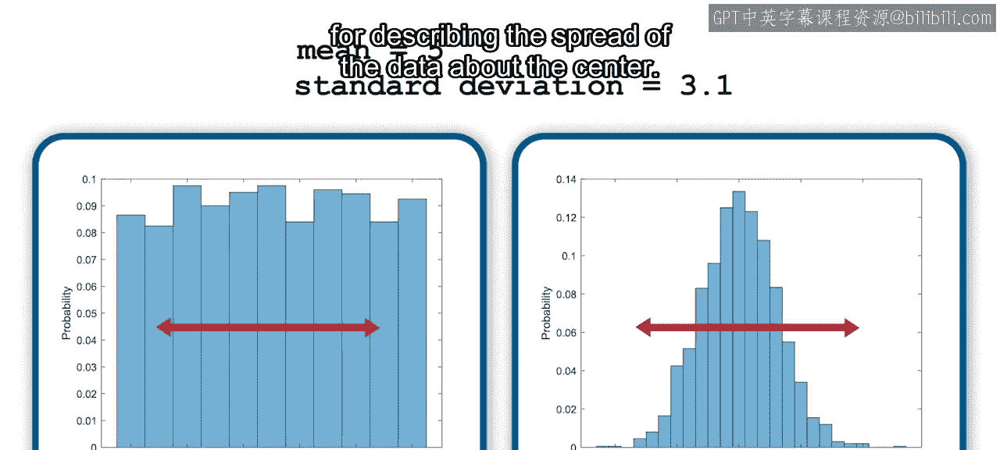

But as you've already seen in the flight data， many distributions are not symmetric。

 but skewed to the left or to the right。These two data sets have the same mean and standard deviation as before。

A left skewed distribution has a mean less than or to the left of the median。

And a right skewed distribution has a mean larger than or right of the median。To say it another way。

 the sw is where there's few。The amount the data is shifted towards the left or right is captured by the skewness。

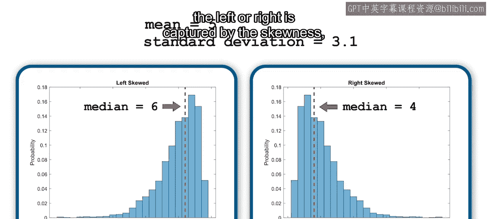

Which is less than zero for less skewed data and greater than0 for data that is right skewed。

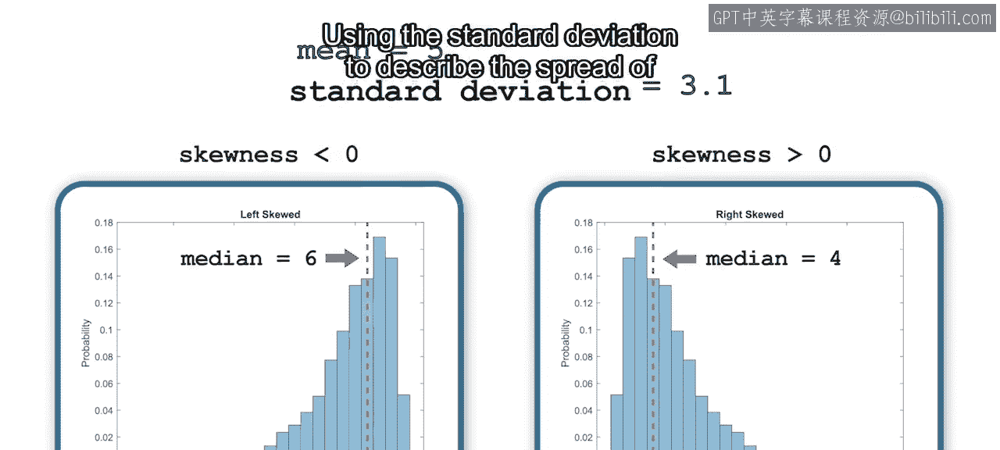

Using the standard deviation to describe the spread of observations isn't as useful for skewed distributions。

For example， in this right skewed data， there's a 51% probability of an observation being less than the mean。

And a 35% chance， it's more than the mean。And a 14% chance of being the mean。

Instead of standard deviation， a useful measure for describing both symmetric and asymmetric distributions is the inter quartile range or IQR。

The inter quartile range is the middle 50% of observations。To find the IQR。

 first sort the observations， next， find the median。

Since the median is the middle of the observations， this splits the data into two halves。

Then find the middle of the lower half。 This value is the first quartile， or Q1。

The middle value of the upper half is the third quartile or Q3。

The IQR is the difference between Q3 and Q1。Looking at the right skewed histogram。

 can you identify where the first and third quarts are。

A histogram is great for seeing the shape of the distribution。

 but it can be difficult to find the middle 50% of observations， particularly for highly skewed data。

A box plot is another useful visualization to see how data is distributed。

This box plot is oriented vertically， meaning the values in the data set are now on the Y axis。

The box in a box plot encloses the IQR as shown here。

The line inside the box represents the median of the data。

The whiskers of the plot extend to the smallest and largest values in the data that are not considered outliers。

Outliers are then plotted individually， giving you the full range of the data。As you can see。

 outliers are observations that are far from the center of the distribution and will be covered in more detail in a later module。

Because the main feature of a box plot is the inter quartile range。

 it's easier to identify the middle 50% of the distribution。

You can also identify skewness by observing if the median is closer to one of the quartiles。

And how long the whiskers are on each side of the box？Also。

 since the box plot is a compact visualization， it's useful for comparing distributions。

Let's look at the box plots for all four data sets examined in this video。

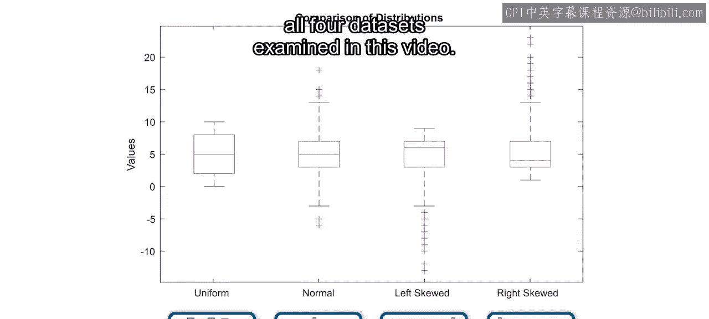

Remember that each data set has the same mean and standard deviation。

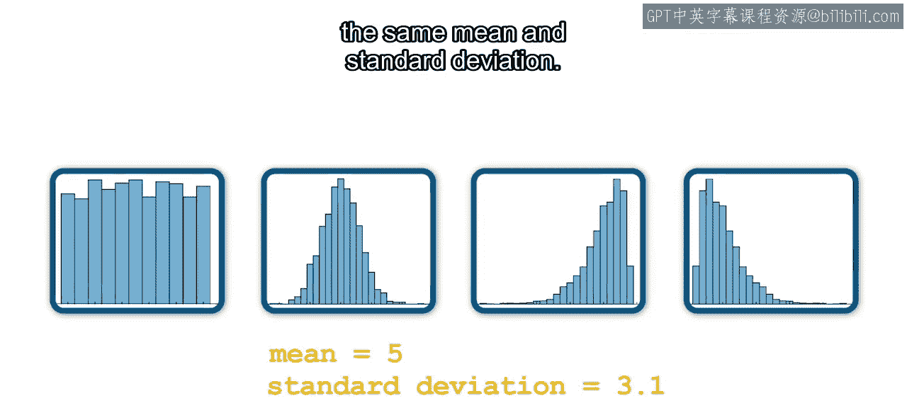

You can clearly see that the uniform and normal distributions are symmetric。

You can also see how the medians of the skewed data sets are closer to one of the quartile values。

So to recap what you've learned in this video。In addition to calculating summary statistics。

 it's important to examine the shape of a distribution before drawing conclusions about your data。

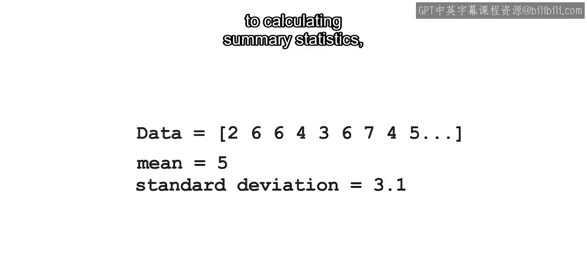

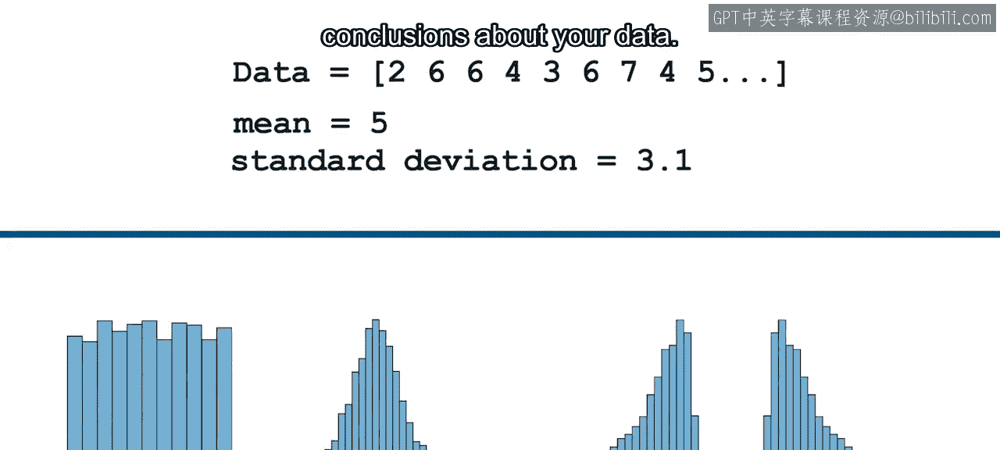

Data is often skewed， making it difficult to identify the center of a distribution。

The interquartile range is a useful metric as it defines the range of the middle 50% of observations。

Box spotts help you visualize the center of distributions by highlighting the IQR and median of the data。

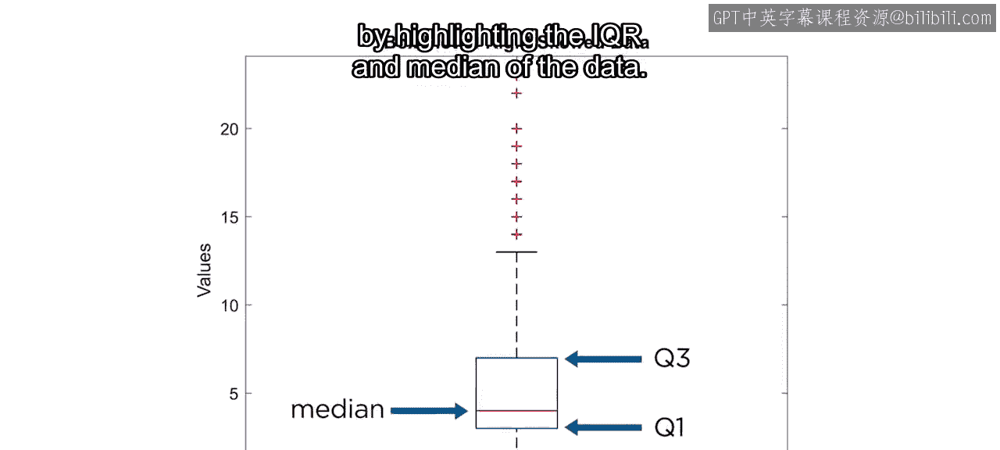

Now that you're familiar with the basics of describing distributions。

 the next videos will show you how to apply these concepts in MATLAP。

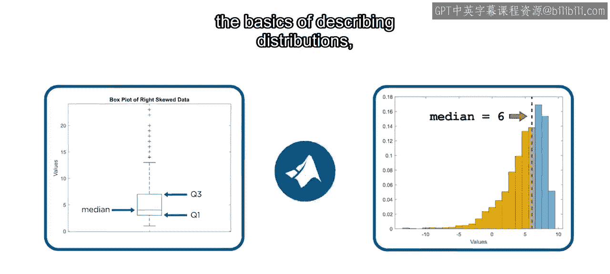