# Mathworks《实用数据科学与MATLAB（数据探索、特征工程、机器学习、毕业项目）｜Practical Data Science with MATLAB》 p47 7_分布示例.zh_en [BV1Jr421w7wL_p47]

🎼，You've just learned about common distributions that you may encounter in your data。

 as well as some simple metrics used to describe them。

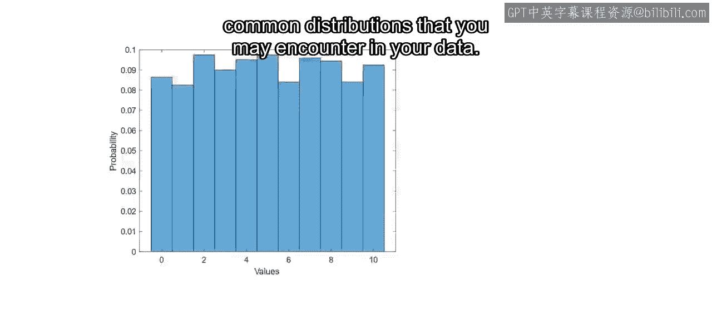

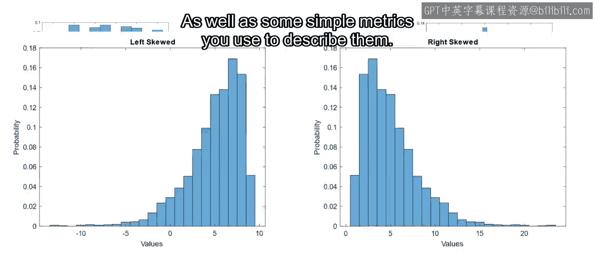

Now let's look at a few examples。In this process， you'll visualize and compute descriptive statistics for each example。

 giving you the opportunity to learn how to interpret the output these functions provide。

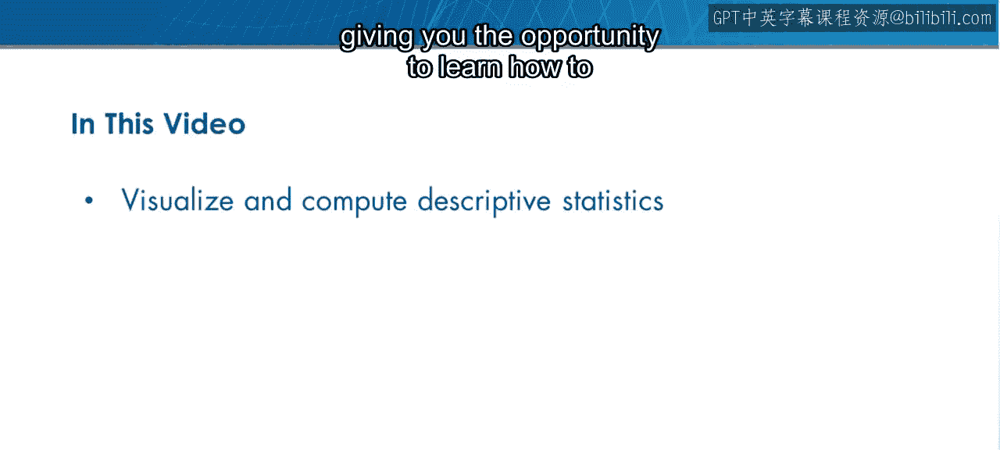

Let's start by looking at a uniform distribution。Uniform distributions occur when all possible outcomes are equally likely to occur。

For example， consider a fair die with six faces numbered one through six。If you simulated 12。

000 roles and created a histogram of the results， you would see that all six numbers occur roughly 2000 times。

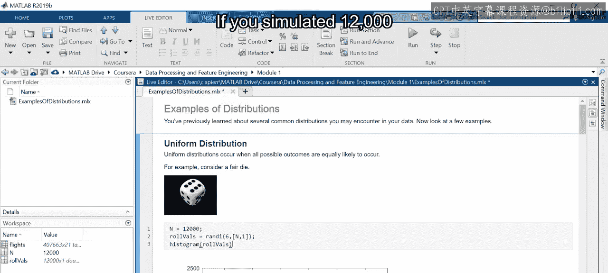

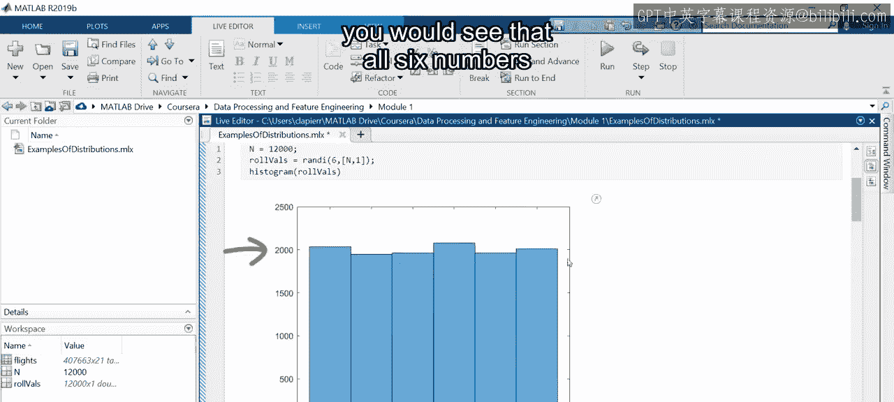

You can describe the distribution with two statistics calculated from the observed values。

 the mean to indicate the center and the standard deviation to describe the dispersion。

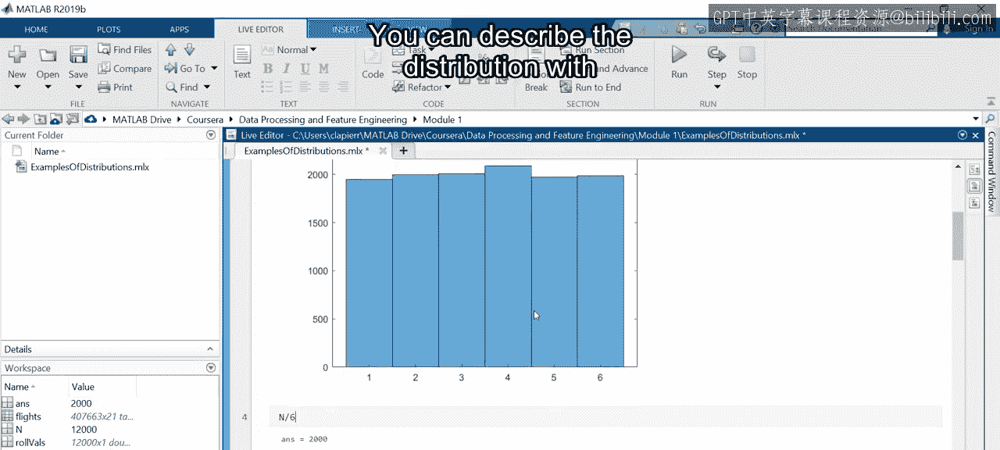

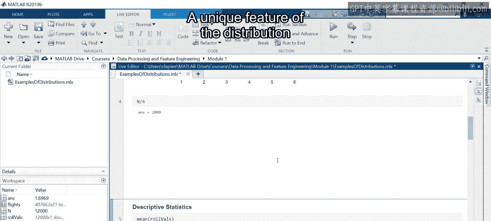

A unique feature of the distribution is that it's rectangularly shaped。

 something that isn't captured in these statistics。

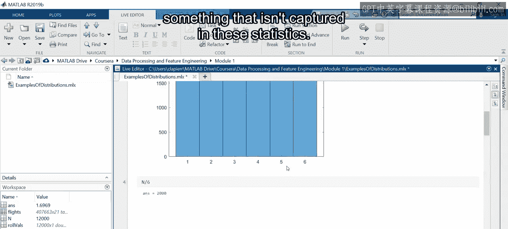

In most data sets， the probability of an outcome decreases as its distance from the mean increases。

 causing the distribution to exhibit a clear peak。When the data is distributed symmetrically about the mean with the bell shape。

 it's often said to be normally distributed。

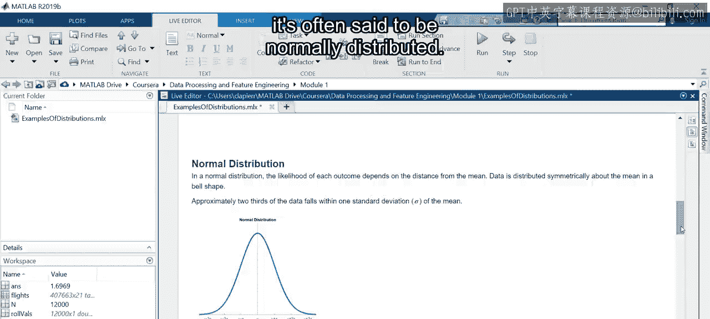

The mean and standard deviation provide insight into the shape of the distribution。

Approximately two third of the data falls within one standard deviation of the mean。

 while almost 100% falls within3。

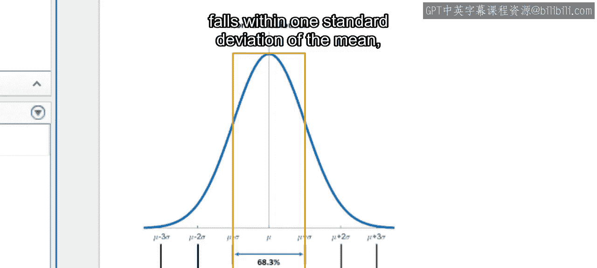

Let's consider the duration difference variable created earlier， as a reminder。

 this variable was created by subtracting scheduled eappsse time from actual eapse time。

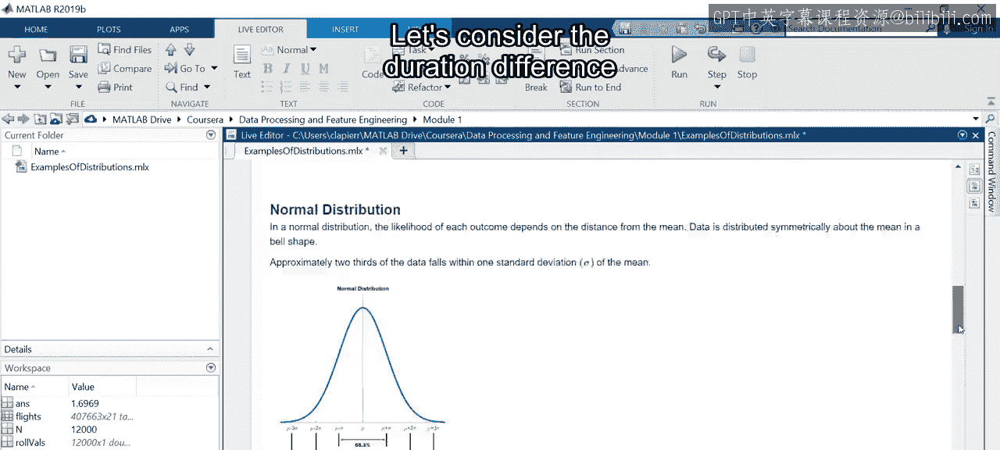

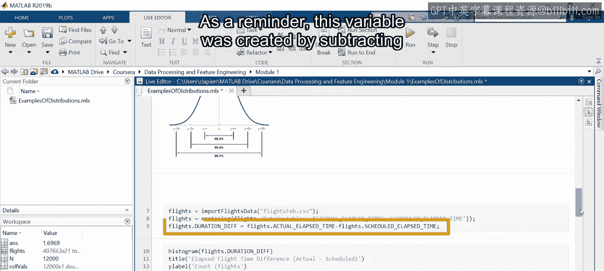

By creating a histogram， you can see that the distribution appears to be symmetric about the peak。

 which is minus5 minutes。This means a flight has the highest probability of taking five minutes less than what was scheduled。

However， knowing the peak difference doesn't tell you much about how likely other values are。

For that， you need the mean and the standard deviation of the distribution。

By calculating the values within one standard deviation of the mean。

 you can determine the range of times for approximately 68% of the flights。

Did you notice the mean is not minus5 minutes？

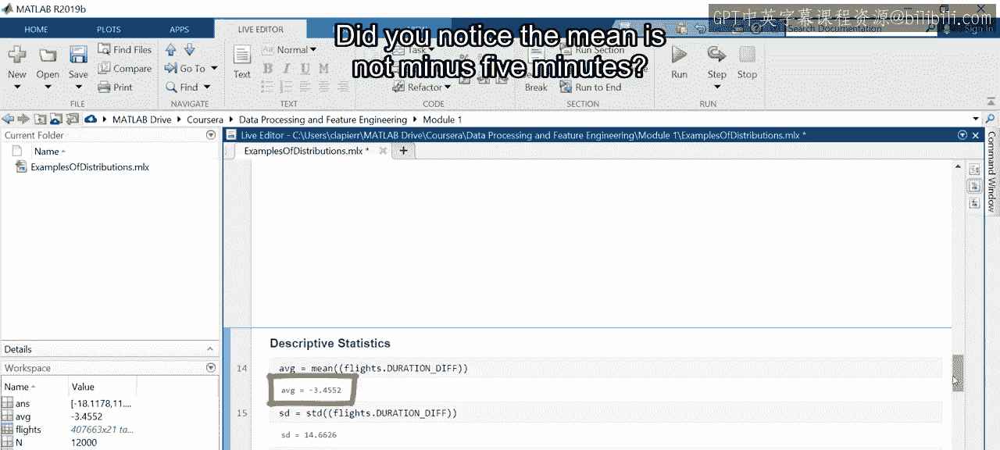

Why is that？Have you noticed the x axis extends to 200？

This is because there are data points on the right that you can't see unless you zoom in。

These are flights that took much longer than expected。

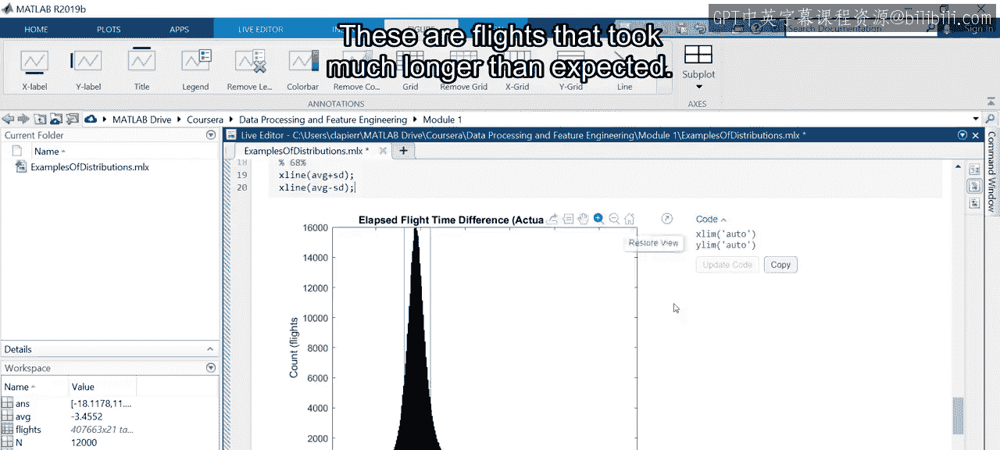

Use the ketosis function to obtain a measure of how your distribution compares to a normal distribution。

 which has a ketosis value of 3。Here， the curettosis is about 14。

 This means there is more data in the tails than would be expected if the data were normally distributed。

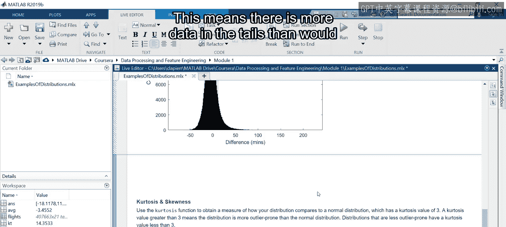

However， kettosis doesn't tell you how the data is distributed between the two tails。For this。

 use the skewness function。 valuesues greater than plus1 or less than -1 are commonly classified as substantially skewed。

 The positive value indicates this distribution is skewed to the right。 So although at first glance。

 the duration difference appears to be normally distributed， it's actually skewed。

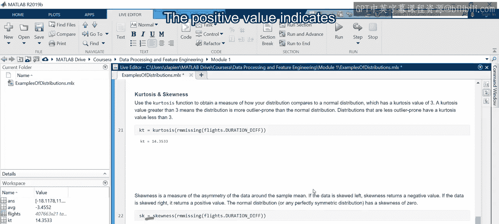

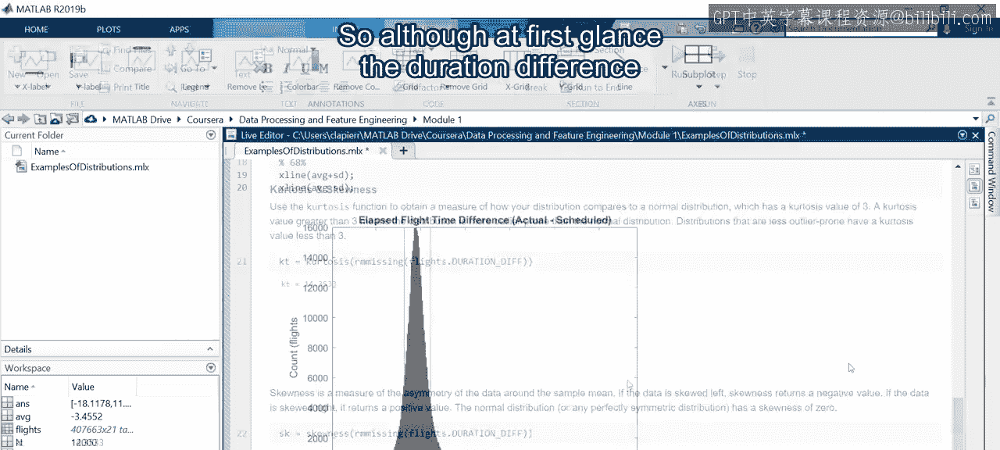

It's hard to see this in the histogram because the counts are so low for those longer flights。

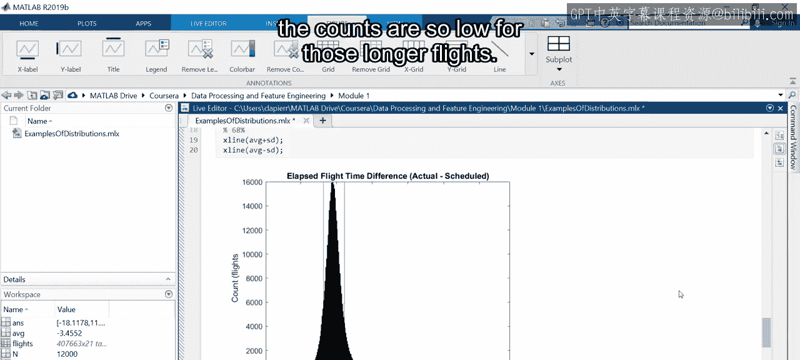

For this reason， whenever you encounter long tails。

 use the skewness function to check if your distribution is skewed。

Sometimes it's the data and the tails that you're interested in。

One visualization that's commonly used for examining this data is the box plot。Here。

 the horizontal red line is the median difference of minus5。

The box shows the extent of the intercorrtile range or IQR。

The length of the whiskers can be customized， but by default。

 they extend to the last data point that is less than 1。5 times the IQR box height。

All data points outside the whiskers are considered outliers and are plotted individually。

It's these outliers that were difficult to see before。

The real power of Bpots becomes apparent when you compare multiple data sets。For example。

 what if you wanted to see what duration difference looked like at the 10 busiest airports？

You can create multiple box plots in a single figure by specifying a grouping variable as a second input to the box plot function。

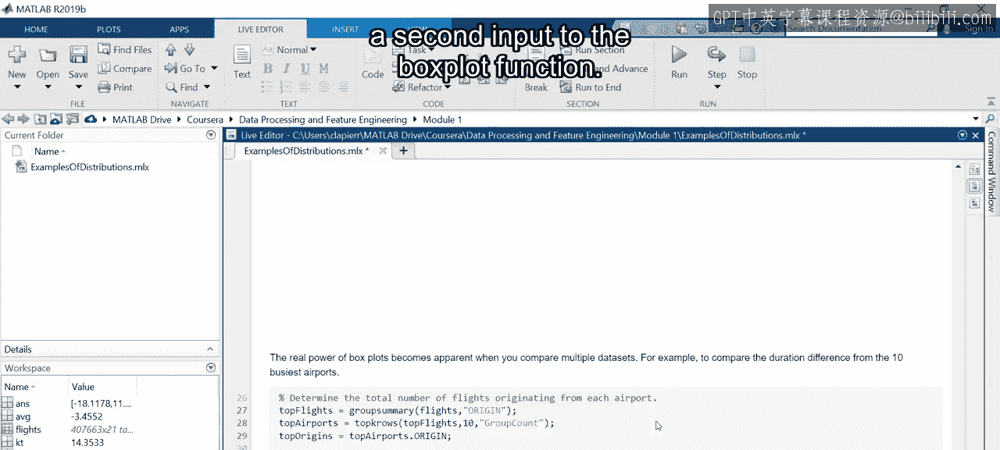

Now， at a glance， you can see that the median and IQR at all 10 airports is similar。In addition。

 the spread of data in the tails enables you to more easily compare the number of outliers from each airport。

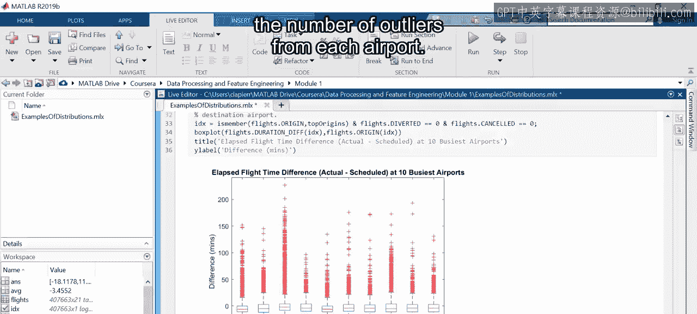

As you've seen， distributions can be described with descriptive statistics MATLB provides built in functions to both visualize and summarize your data。

Knowing how to use these functions and interpret the values they return helps you to analyze large amounts of data quickly。

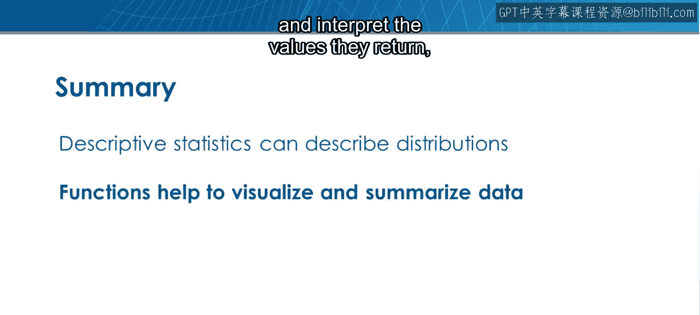