# Mathworks《实用数据科学与MATLAB（数据探索、特征工程、机器学习、毕业项目）｜Practical Data Science with MATLAB》 p48 8_可视化多维数据.zh_en [BV1Jr421w7wL_p48]

🎼，Previously， you've learned about some common distribution types and their properties。

 You've also seen how histograms， box plots and statistics can help you understand how the values of your variables are distributed。

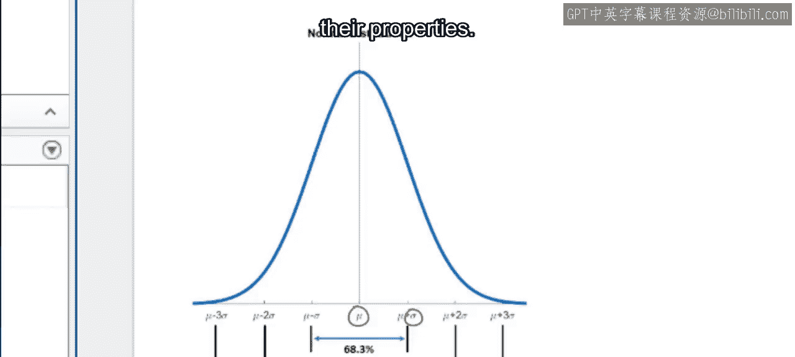

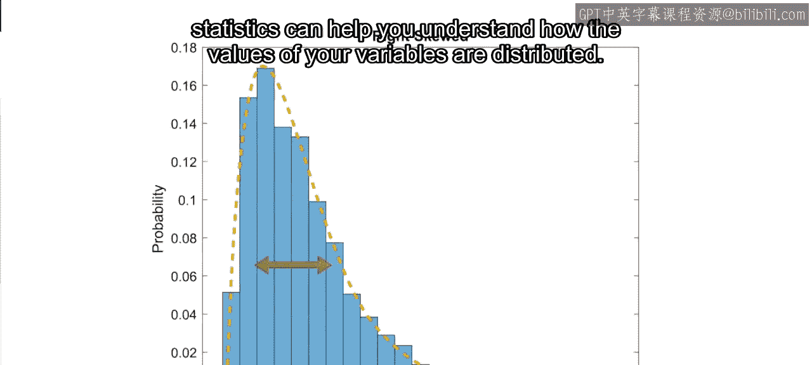

In this video， you'll learn more about variable distributions in two dimensions and additional techniques for visualizing multidimensional data。

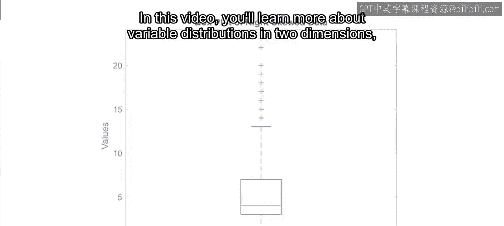

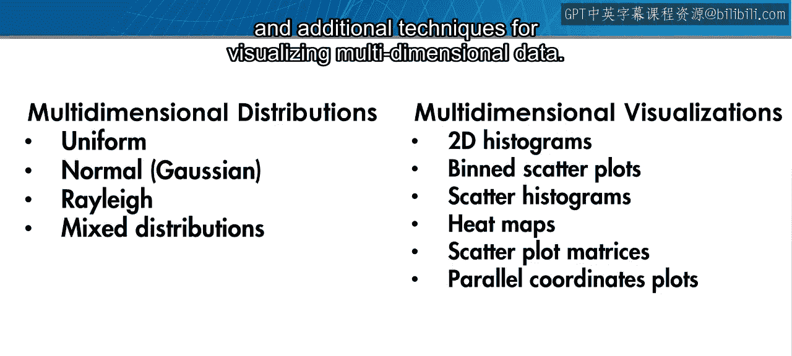

These visualizations can help you identify relationships between variables that can be captured using predictive models。

Or relationships between observations that appear as clusters of data values in two or more dimensions。

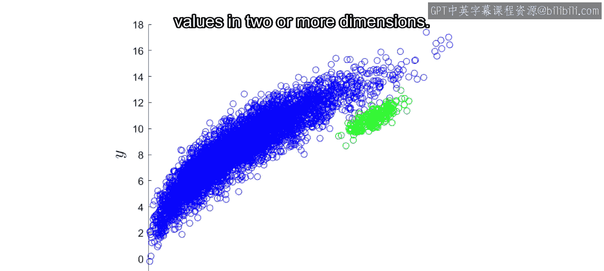

To follow along， use the script named multidimensional visualization that's included with the course code files。

The script begins by generating two uniformly distributed variables and creating a two dimensional histogram。

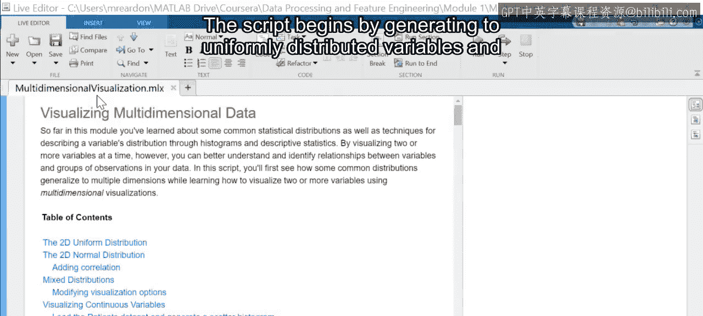

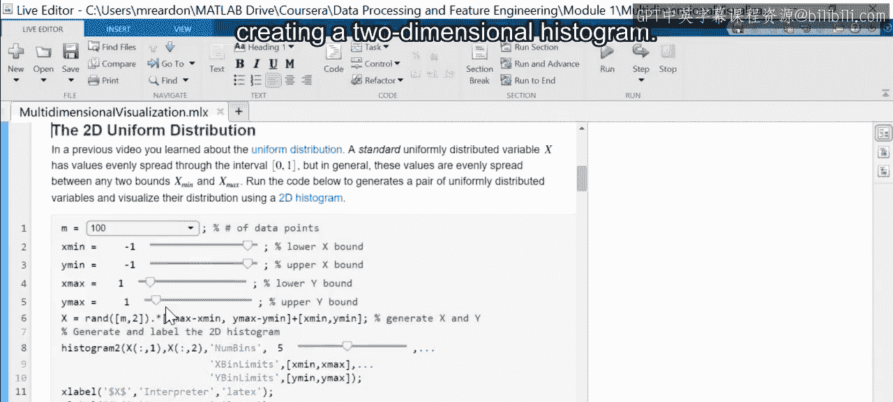

The histogram 2 function is used to divide the variable ranges into rectangular bins。

 count the values falling into each bin and plot the results using bars whose heights correspond to the bin counts。

You can use the controls to change the bounds of each variable or the size of the data set and observe how those changes are reflected in the histogram。

Note that as the number of observations decreases， it can be difficult to identify the distribution of variables due to random noise。

In those cases， it can be helpful to adjust the histogram properties like the B width or number。

Now let's look at another common multidimensional distribution type。

 the multivariate normal distribution。

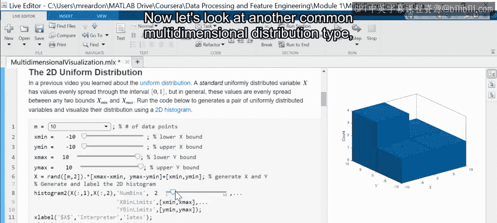

The code in this section generates two normally distributed variables and visualizes them using a bin scatter plot。

The bin scatter function bins the variable values in the same manner as histogram 2。

 But instead of using bar height to represent the bin count。

 the rectangular bins are colored with darker colors， denoting increased count。

Using the controls to change mean and standard deviation of each variable。

 it's clear that the center of the distribution can be shifted and its oval shape stretched。However。

 the distribution remains symmetric in the x and Y directions。

 similar to the uniformly distributed variables shown previously。In both cases。

 the variables are said to be independent。 That is。

 the values of one variable are not related to the corresponding values and the other variable by selecting a non zero correlation coefficient。

 However， you can introduce a linear relationship between the variables。

Note that compared to 2D histograms， the overhead view of the B scatter plot makes it easier to discern relationships like this。

While it's possible for two variables to be described by the same distribution。

 it's also possible that they belong to different distributions。

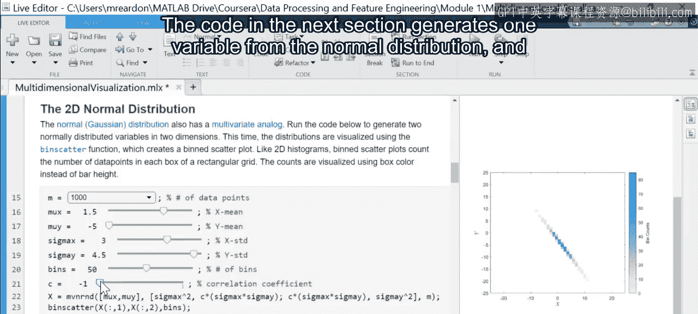

The code in the next section generates one variable from the normal distribution and the other from the rale distribution。

This time the variables are visualized using a scatter histogram。

 which combines a scatter plot with individual histograms for each variable。

With individual histograms， it's easier to determine the individual distribution of each variable than with a bin scatter plot。

You can use the controls to modify the mean and standard deviation of the normal variable and the parameter B。

 which controls the skewness of the raleley variable。Often。

 changing other display options like the marker size or marker filled properties can help clean up the scatter plot for larger data sets。

You can also change histogram properties like the width and number of bins or the histogram display style。

For example， the smooth style option can work better with small or noisy data sets。

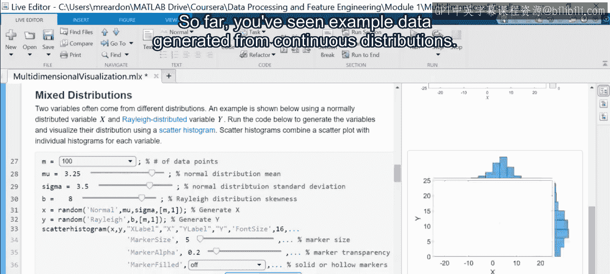

So far， you've seen example data generated from continuous distributions in this section。

 you'll see how to visualize a data set with both discrete and continuous variables using the patients data set as an example。

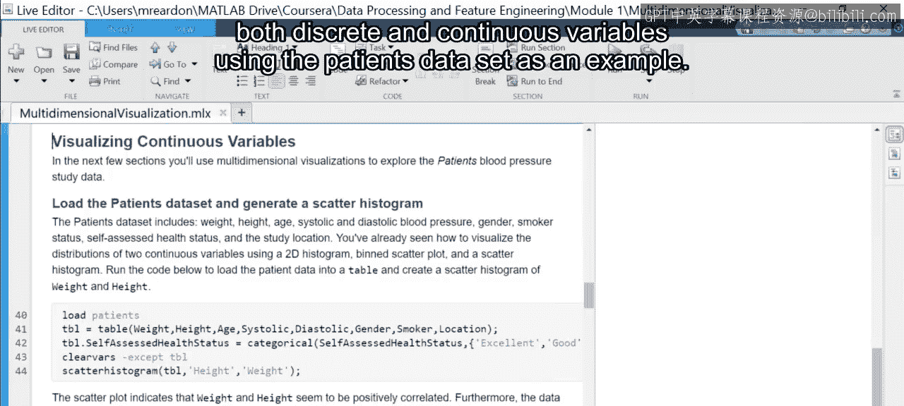

The positive correlation between these two variables has an obvious physical cause。

 but what is the reason for the two clusters？By adding a discrete variable as a group variable。

 you can help determine if the clusters in your data are due to differences between groups。

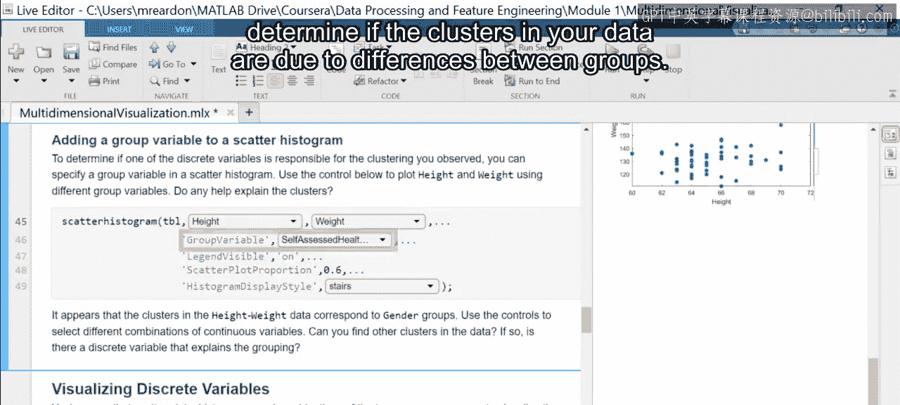

For example， it's now apparent that the clustering of height and weight values is likely related to patient gender。

Next， let's see how to visualize two discrete variables like smoking health status using a heat map。

A heat map is the discrete analog of the bin scatter plot。

 where each combination of values is represented by a colored rectangle on a grid。

And the color is determined by the number of observations belonging to that subgroup。

Heat maps can also be used to summarize the values of a continuous variable by specifying a color variable and a statistic to use as the color method。

The intensity of each rectangle is then determined by the value of the statistic applied to each subgroup。

For example， the median systolic blood pressure of smokers who rate their health excellent is 129。5。

While the median for non smokers who rate their health excellent is 10 points lower。

The previous visualization methods enable us to visualize two variables at the same time。

 possibly adding a third variable as a group or color variable。

But how can you view the entire data set at once？Let's take a look at some methods for visualizing high dimensional data sets。

The G plotot matrix function lets you create scatter plots and histograms for all continuous variables in your data set at once。

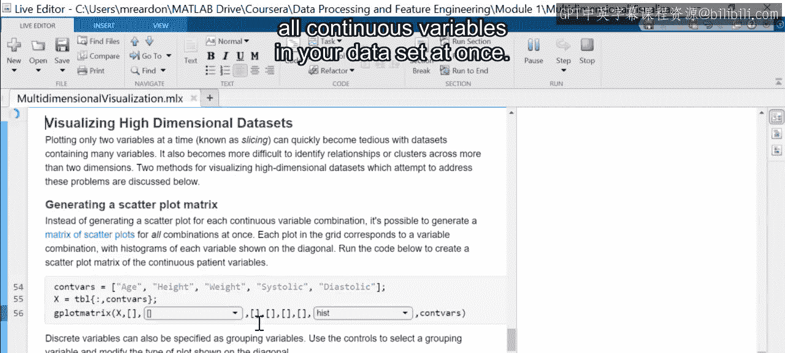

Scatter plots for each variable combination are arranged in a grid with histograms for each variable displayed along the diagonal。

Scatter plot matrices enable you to quickly view all variable pairs known as slices in the same figure。

 which can provide a quick overview of how each variable is distributed and how the two variables relate to each other。

Discrete variables can be added as grouping variables。

 so you can search for potential causes of any clusters you observe or identify distributions and relationships between variables that differ by group。

While plot matrices provide information on high dimensional data sets via multiple plots。

 a parallel coordinate plot enables you to view all variables in the same plot by including multiple axes。

 one for each variable。 Each observation in your data set is represented by a point on each variable axis。

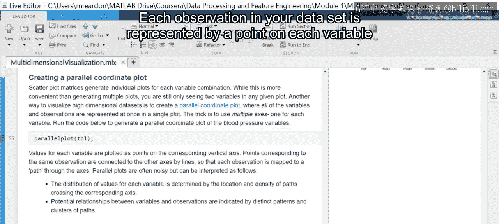

With the location determined by its value for that variable。

The points are then connected with line segments， forming an individual path for each observation。

The distribution of values for each variable can be inferred by the relative density of paths and the values at which they cross each axis。

Relationships between variables and clusters of observations are indicated by clusters of paths。

As you can see， parallel coordinate plots convey a lot of information at once and therefore can be difficult to interpret。

However， by using the available options， you can improve the clarity of your plot。 For example。

 by including discrete variables as grouping variables instead。

 we can see the blood pressure variables are clustered by smoker， while weight。

 age and height are not。Normalization options are also available to ensure the variable axes have similar scales。

Other plot options such as line width and transparency can be adjusted to reduce clutter for larger or highly clustered data sets。

To recap in this lesson， you've seen how to visualize multidimensional data using common visualization functions。

 including 2D histograms。

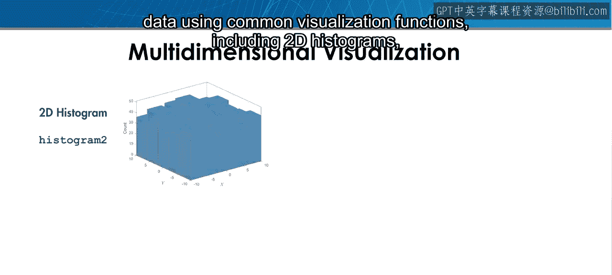

Bend scatter plots， scatter histograms and heat maps。

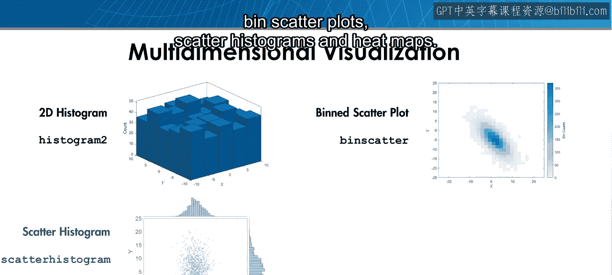

And you've learned how high dimensional data can be visualized by slicing。

 or by using alternative techniques like parallel coordinates plots。

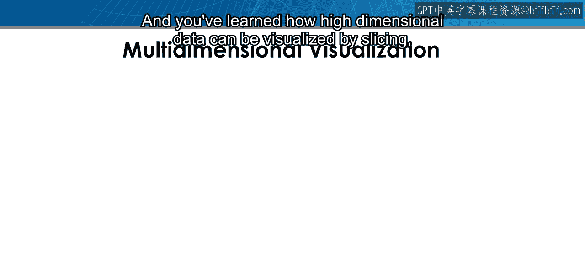

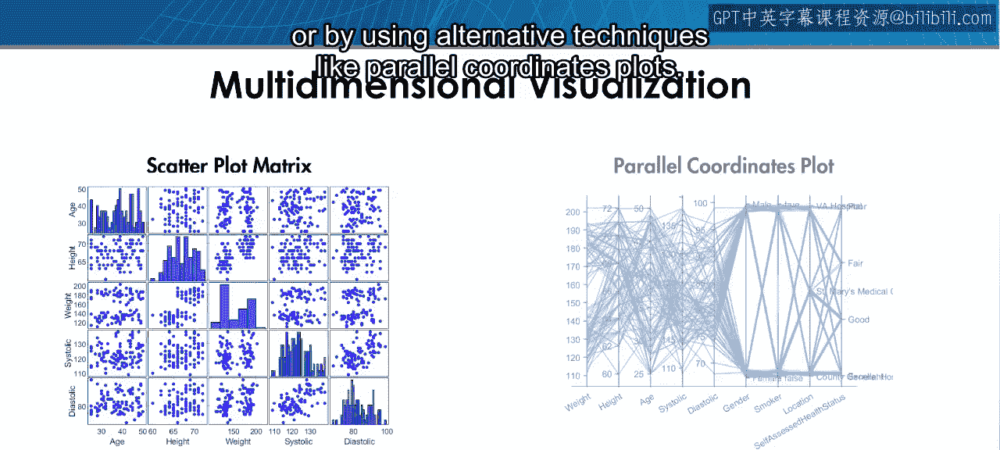

You've also seen how to add information or context using group or color variables and how histogram。

 plot， and normalization options can be used to generate clearer visualizations。

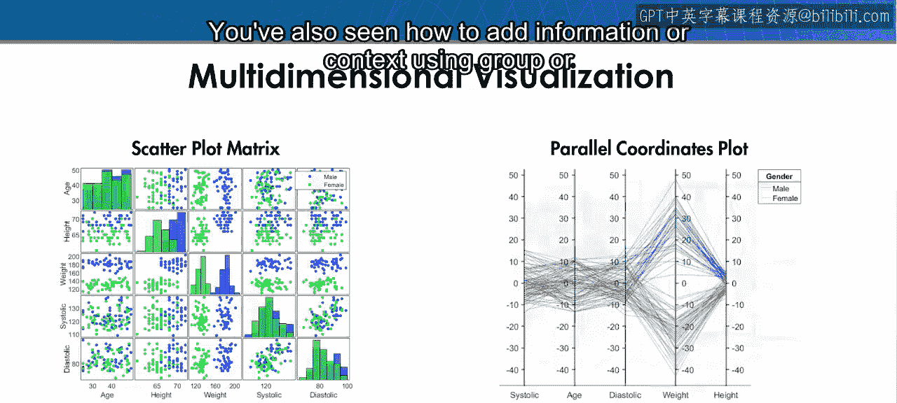

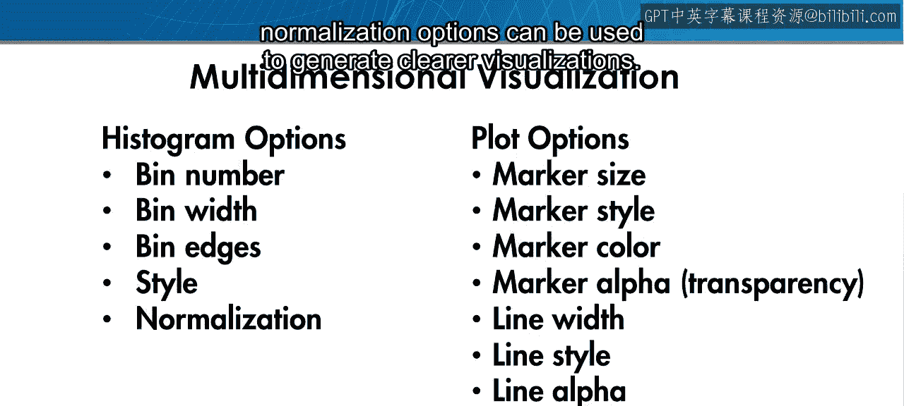

Now it's time for you to explore these visualizations。

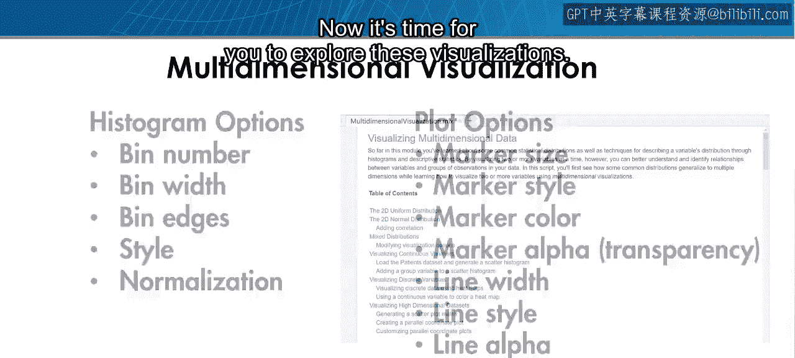

As you work through the script， think about what you might want to learn from each visualization。

 what you want to convey to others， and which options help you achieve these goals。

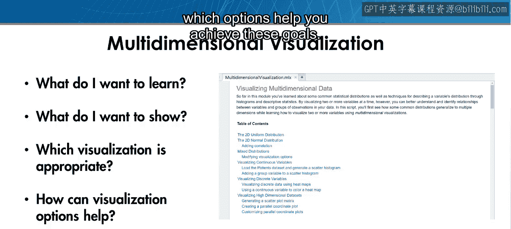

🎼。