# Mathworks《实用数据科学与MATLAB（数据探索、特征工程、机器学习、毕业项目）｜Practical Data Science with MATLAB》 p49 9_模块1检查数据总结.zh_en [BV1Jr421w7wL_p49]

🎼。Good work reaching the end of moduled1 Before continuing to the quiz。

 let's take a few minutes to recap what you've learned so far。

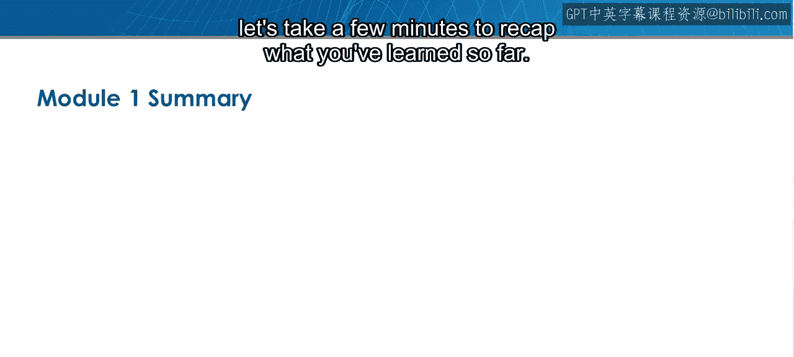

You began this module with an introduction to a new data set containing information for all domestic commercial flights in the United States for 2015。

You'll continue to use this data set throughout the course。After importing the data。

 you applied techniques you learned earlier in the specialization to explore and visualize the contents。

You practice manipulating the data to investigate trends and answer questions about commercial air travel。

 such as which airports were the most affected by cancellations？

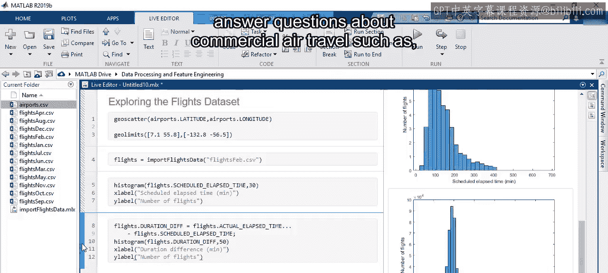

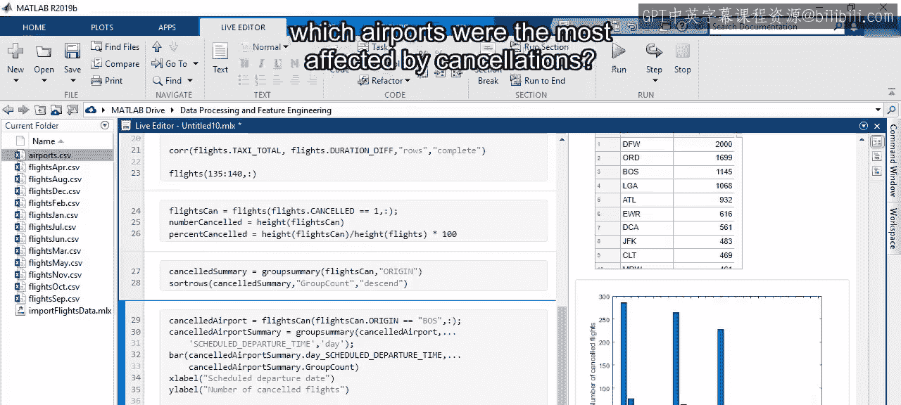

Knowing the distribution of observations， not just their average or other descriptive statistics。

 helps you better understand your data。

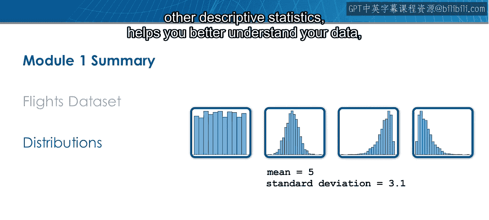

You now can describe and summarize three common types of distributions， uniform， normal and skewed。

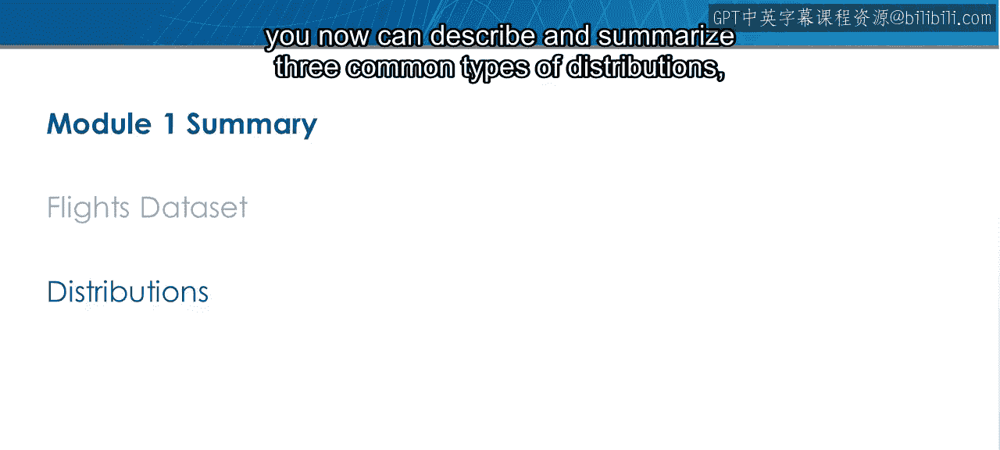

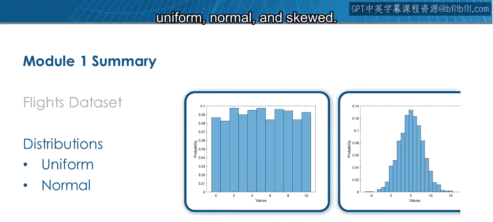

It's often difficult to tell where the center of a skewed distribution is。

 but this information is needed for comparing groups of data。

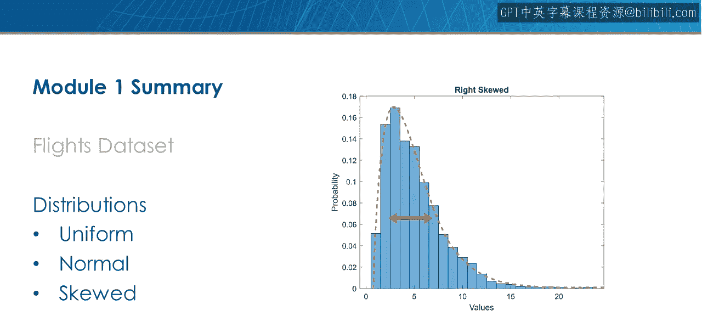

The inter quartile range is a robust measure of a distribution center。

 as it identifies the middle 50% of observations。You use box plots to visualize the intercorrttell range and compare the distributions of different groups of data in a single plot。

Of course， not all data can be viewed in two dimensions。

 You concluded the module by exploring visualization techniques for multidisional data。

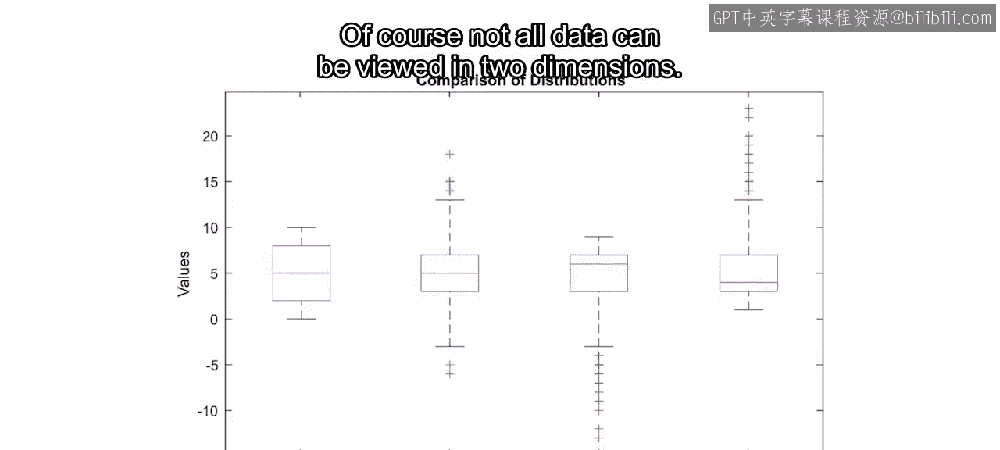

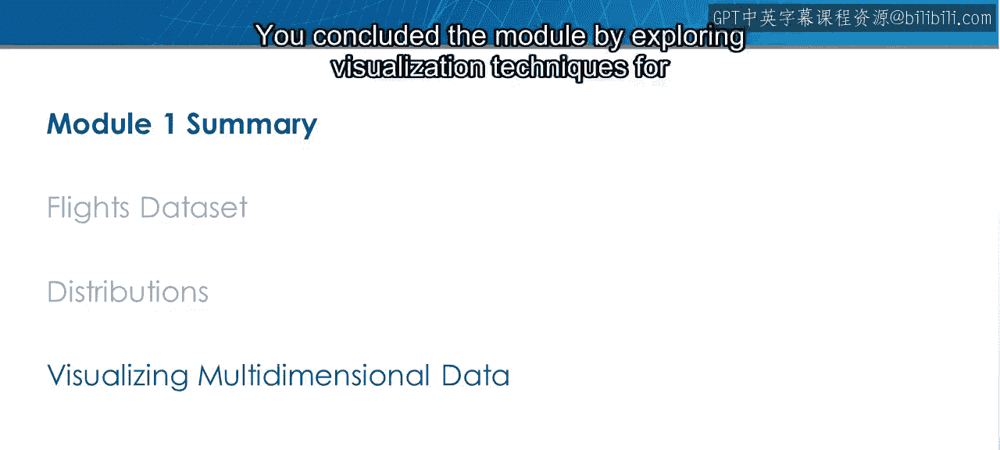

You used 2D histograms， bin scatter plots， scatter histograms。

 and heat maps to visualize two variables at the same time。

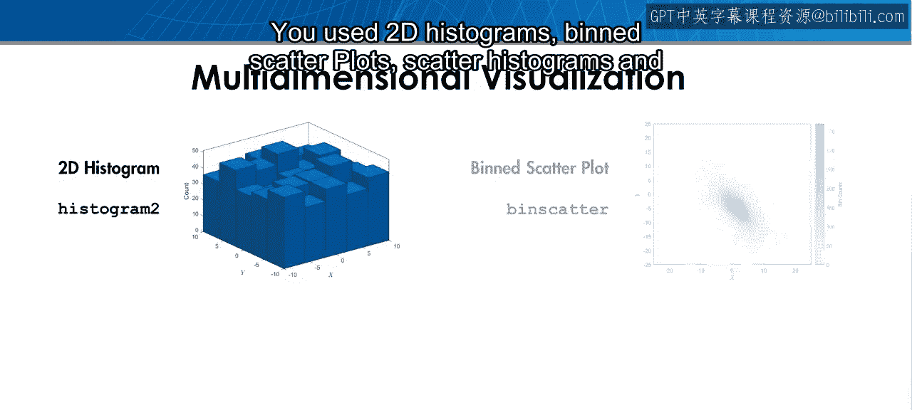

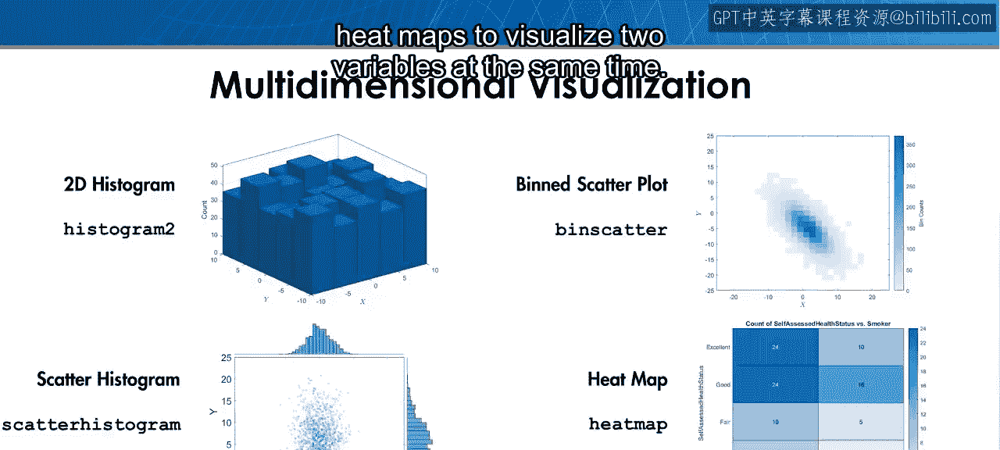

You also learned how to visualize high dimensional data using scatter plot matrices and parallel coordinates plots。

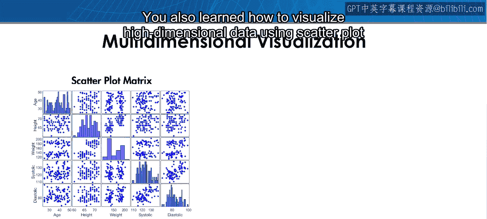

By specifying discrete variables as grouping variables。

 you are able to use color to identify trends and differences between groups within the data。

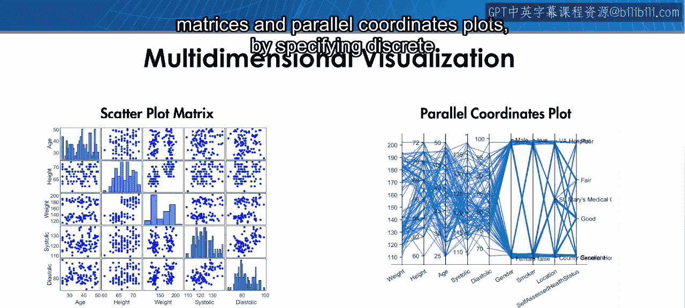

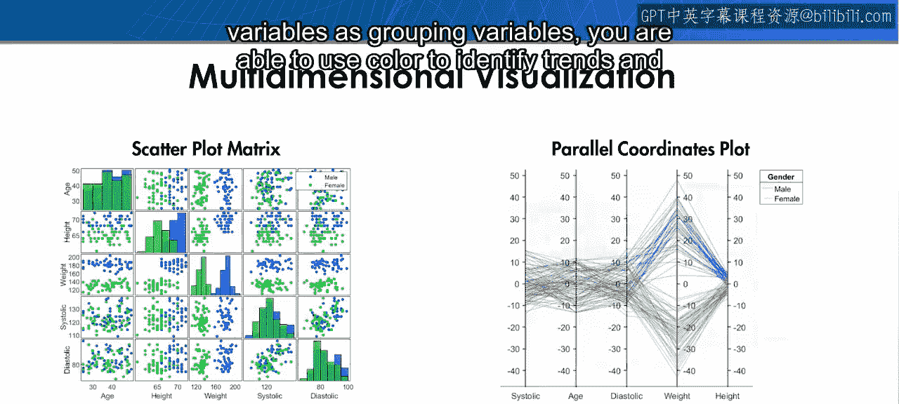

You'll apply these skills when performing cleaning tasks such as identifying outliers。

 and again when evaluating features to remove redundant or irrelevant information。

Now it's time to test your knowledge by completing the moduledule1 quiz。

 refer back to the lessons or post a question in the forum if you get stuck。

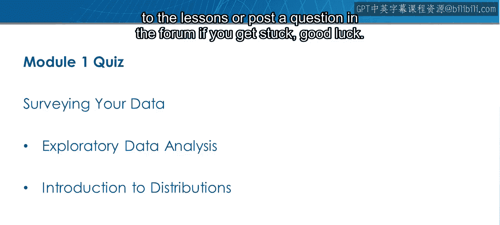

Good luck。