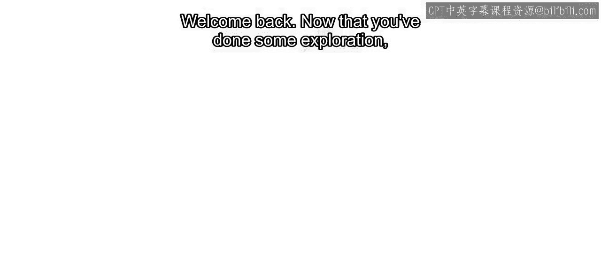
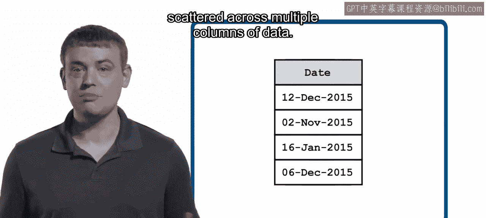
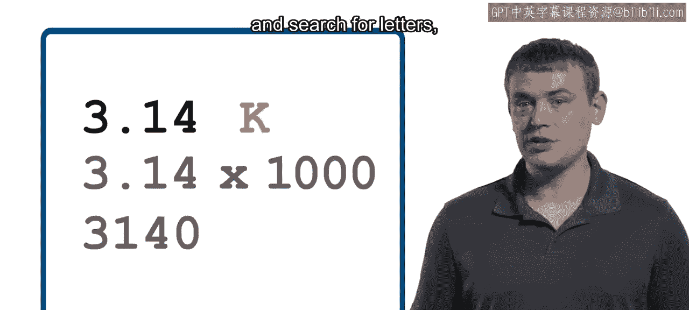
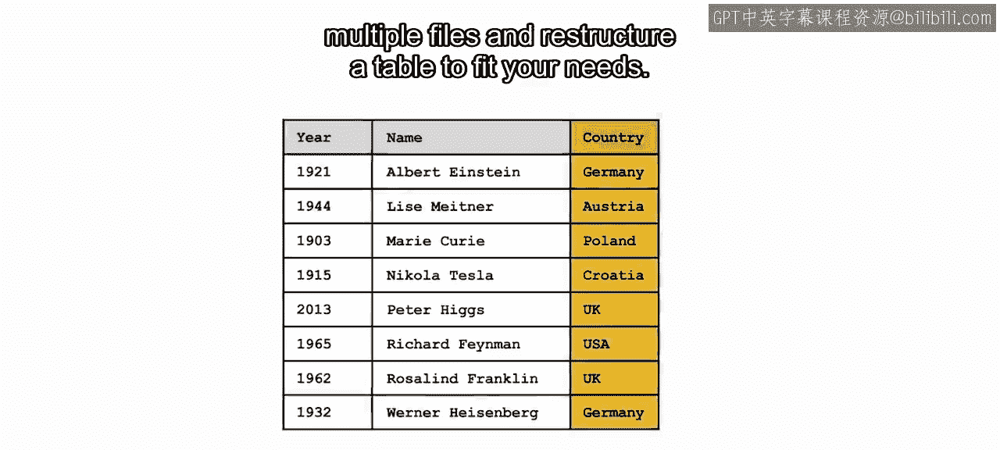
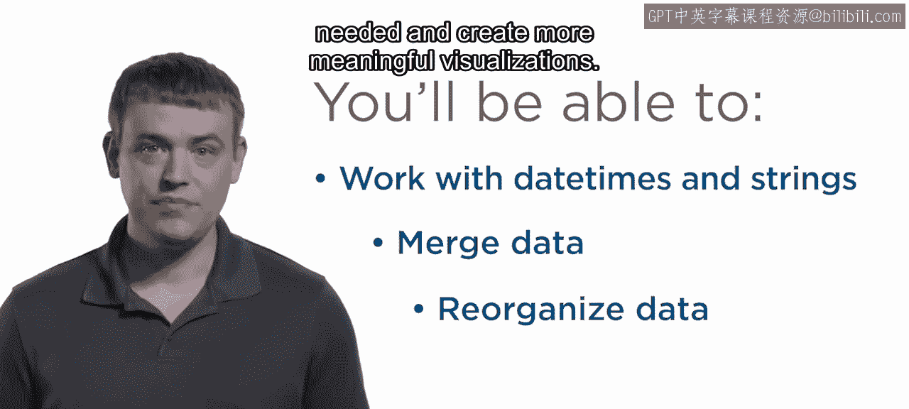

# Mathworks《实用数据科学与MATLAB（数据探索、特征工程、机器学习、毕业项目）｜Practical Data Science with MATLAB》 p50 10_模块2整理数据介绍.zh_en [BV1Jr421w7wL_p50]

🎼。

Welcome back。Now that you've done some exploration。

 it's time to start working with different types of variables。

Restructuring data and merging data from multiple sources。

Two of the variable types you will learn more about in this module are date time and string。

You've already seen how you can use date time variables to represent combined calendar and time of day information。

In this module， you'll learn more about working with datetime values。

And see how to construct them from information scattered across multiple columns of data。

You've also seen that string variables can represent data as text。Here。

 you'll manipulate string variables and search for letters。

Keywords。Or phrases in text。Next。You'll combine data from multiple files。

And restructure a table to fit your needs。You will practice using these techniques to prepare data for further analysis and the creation of insightful visualizations。

By the end of this module， you will be able to effectively work with date time and string variables。

Merge data from multiple sources。Reorganize and restructure data as needed。

And create more meaningful visualizations。