# Mathworks《实用数据科学与MATLAB（数据探索、特征工程、机器学习、毕业项目）｜Practical Data Science with MATLAB》 p51 11_处理字符串.zh_en [BV1Jr421w7wL_p51]

🎼。

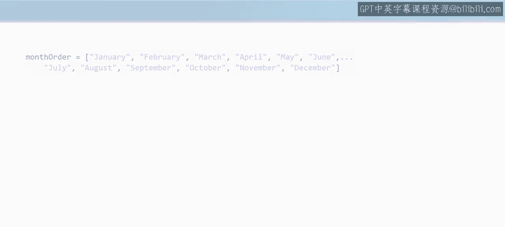

Earlier， you created strings and imported text in a MAla。

 but so far you haven't done too much with them。In this video。

 you'll learn how to manipulate strings， as well as search for text inside of strings。

If you took exploratory data analysis， you may recall that the files contain similar variables for reporting damage。

 damage property and property cost。The two variables recorded cost differently。

 Daged property uses a letter to denote the order of magnitude。

 While property cost is just the full number。Actually。

 the original files only contain the variable with the letters。

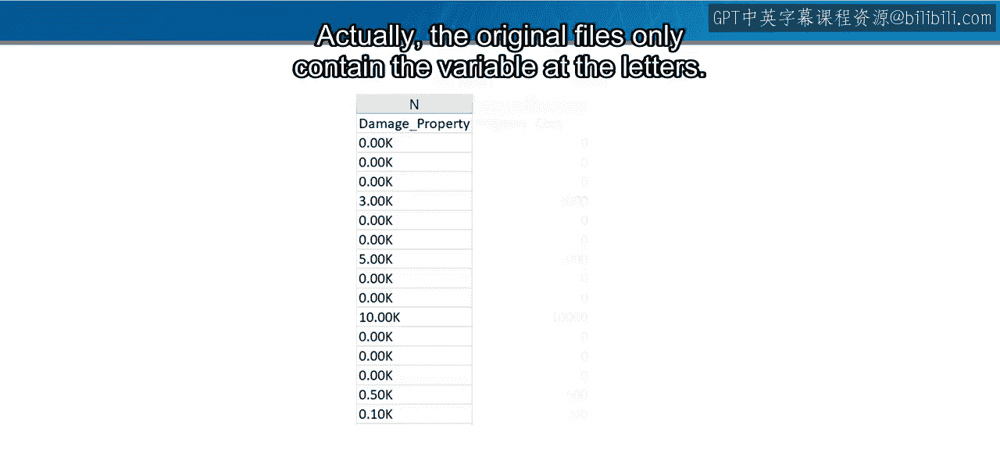

The numeric variable was created by manipulating the text。

Now you'll see the steps taken to perform the conversion from a string to a numeric value。

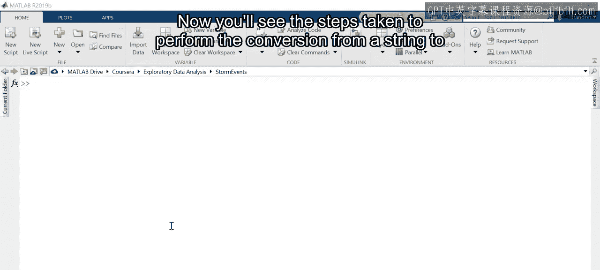

Start by opening the storm event file for 2016 using the import tool。

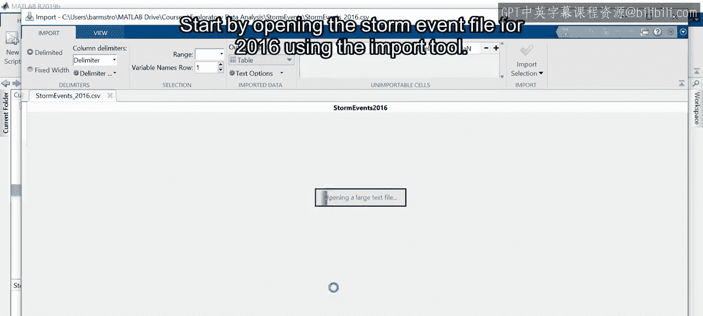

Notice that property damage is set to be imported as a number。When you hover over a cell。

 you see that only the numeric part of the data will be brought in。That is。

 the letter will be dropped。 So 2000 is going to become just 2。 That's definitely not what we want。

Let's change it to text and plan on fixing this after importing。Also。

 the episode narrative is detected as a categorical variable。

This is because each episode is made up of numerous events。

 so the contents of the episode narrative repeat。However。

 this is a free form text description of the storm。

Recall that a categorical variable represents a discrete set of unique values。

To analyze the contents of the narrative， we need strings， not discrete categories。

 So this variable needs to be changed to text as well。And to simplify things。

 I'm going to remove variables that are not needed for this task。

And create a live script to import the data。Run the script and preview the table。

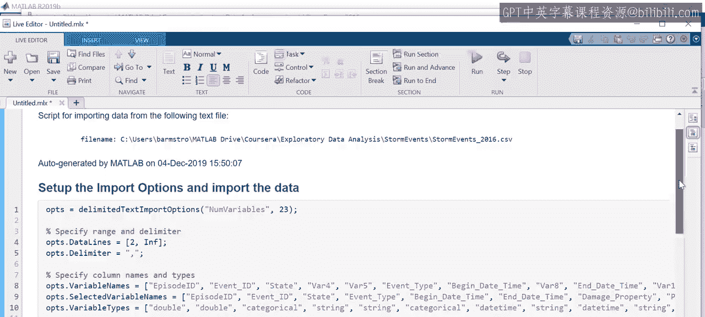

The goal is to make damaged property a numeric variable that matches property cost。

Scrolling through the table， you see the letter K is used to represent 1000。

Are all values reported in thousands of dollars， I don't want to scroll through 50000 events to find out。

Instead， notice that non missing entries consist of a number with a decimal point before the letter。

Therefore， removing the numeric portion of each entry will leave only the letters。

This is done using the oasese function。The first input to the erase function is the variable you wanna erase text from。

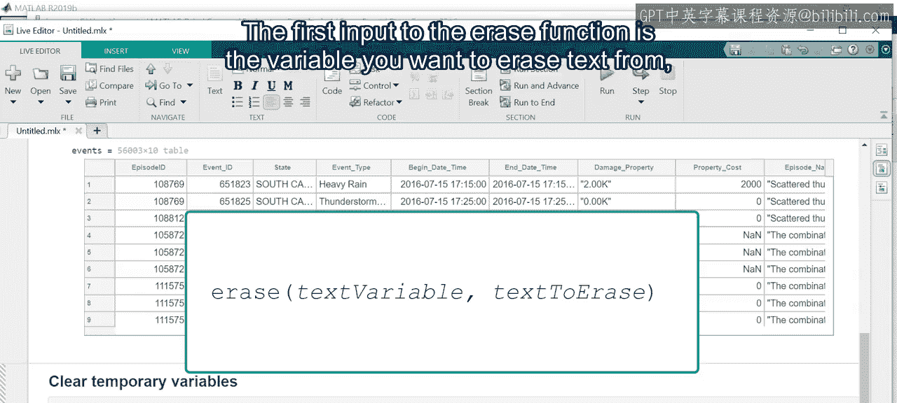

And the second input is the text to ase。So we need to create a string array for the second input。

Start by creating a string array of each digit stored as text and then add a string representation of the dot character to the array。

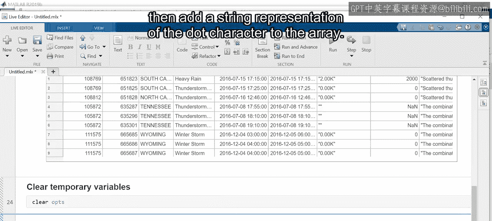

Currently， we're only trying to find unique letters， not actually modify the variable。

 so let's copy the contents from the table into a new variable。Now。

 we can use the erase function to remove all occurrences of numeric digits and dots from the damaged property string values。

Great， at this point， you have just the letters。 Use the unique function to identify the distinct values present in the data。

You can see that in addition to K， an M is used for millions and a B for billions。

 and you didn't need to manually find them。But how can you convert the entries to the correct numeric value。

Let's perform a small test， createate a text variable with the value 2。5 E to the 6。

 which is scientific notation in MatLb and see what happens when converting it to double。It worked。

A string like 5。00 k can be represented as 5。00 E3 without changing its meaning， and the string 5。

00 e3 can be directly converted to a numeric value。

Let's use the replace function to replace the letters K。

 M and B with their equivalent values in scientific notation。

The first input to replace is the string variable you want to replace text in。

The second input is the text to be replaced， and the third input is the corresponding replacement text。

So this command replaces the original text values in the table with the corresponding numeric values。

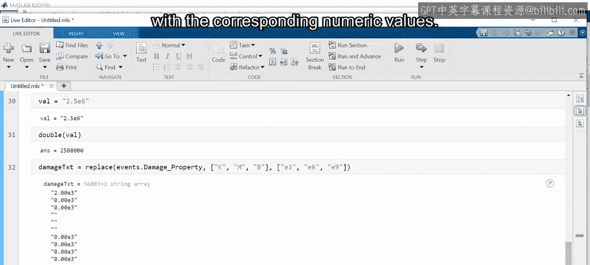

Scroll through the table and compare the new damaged property values with the property cost values to confirm that the replacement worked。

Remember that the original data did not contain numeric values。

 Pre processingces steps like this are often necessary before analysis。

 It's a good idea to add pre processingcess steps to your import files。

 just like we did with the flights data。

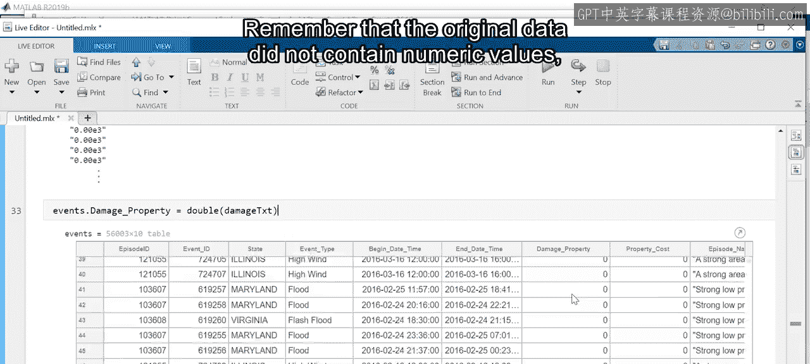

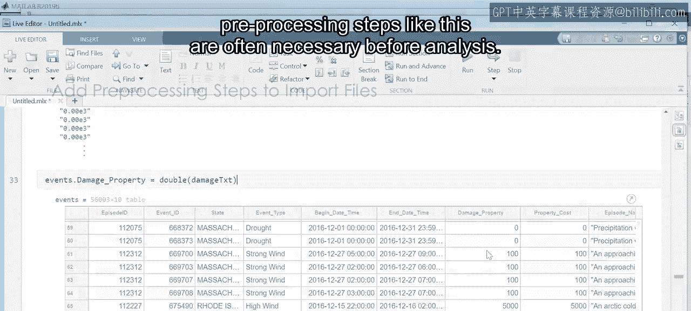

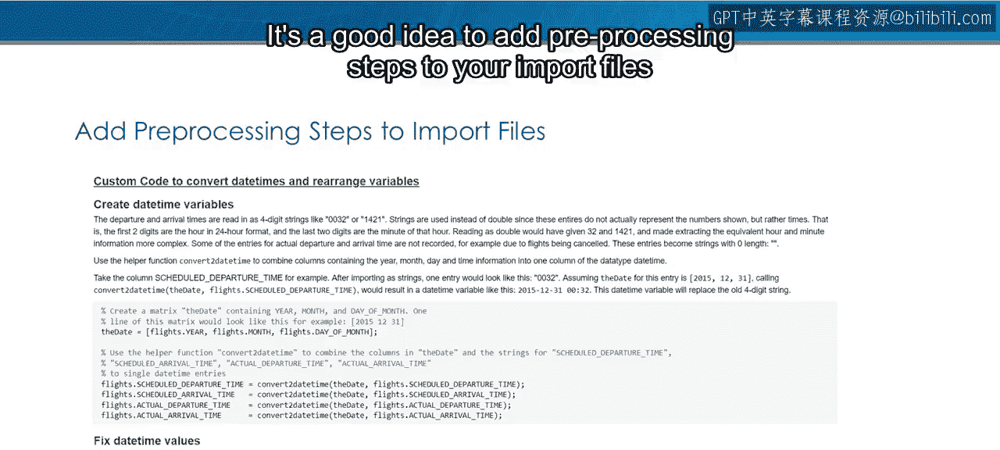

The property damage text was structured in a specific way。

 so you knew what to expect for all entries。

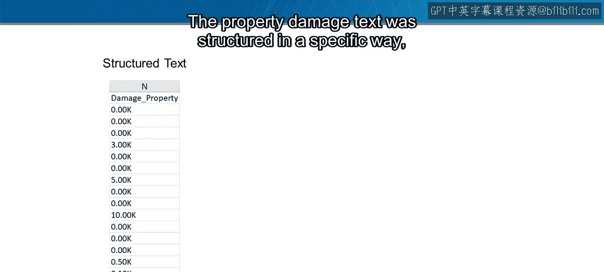

The episode narrative， on the other hand， is a description of the storm。

While there are guidelines for writing the narratives。

 the exact text is largely up to the individual recording them。So is this text useful。

Recall that large storms are recorded as many events。

 Perhaps the episode narrative can be used to find events related to a single， large storm。

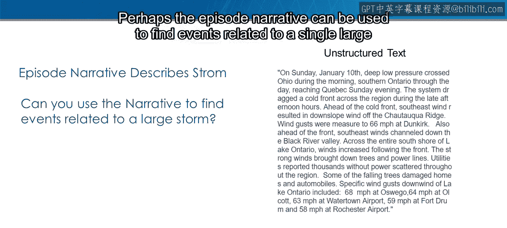

To test this， let's find the event that caused the most property damage by sorting the table and then look at its narrative。

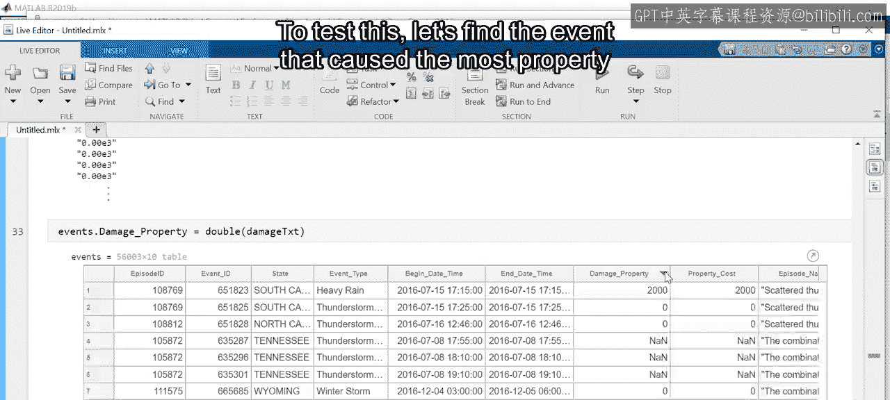

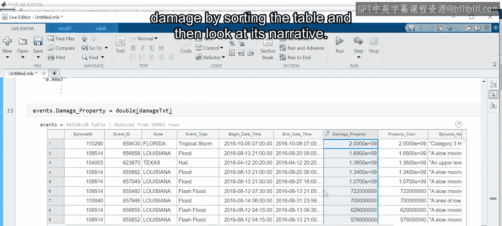

嗯。😊，Hurricane Matthew caused significant damage。Hurricanes are not isolated events。

 so it's a safe assumption that there are many entries in the table related to Hurricane Matthew。

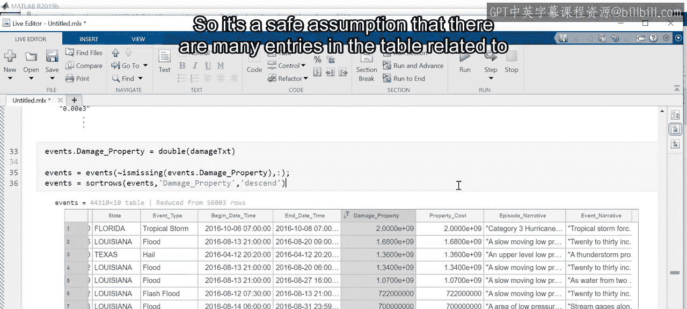

You can use the contains function to search string variables for specific text。

This command returns a logical vector with true。 If the episode narrative contains the string。

 Matthew。Then use the output from the containstains function to create a new table with only events where Matthew appears。

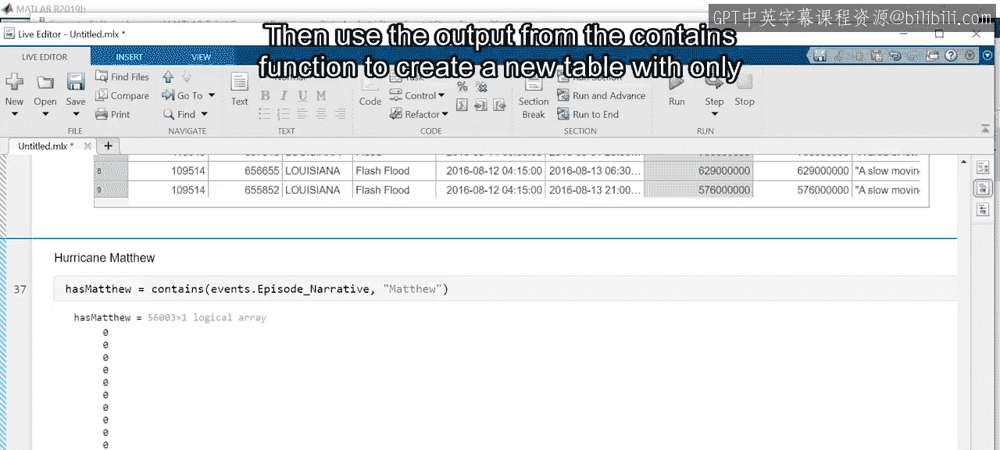

You can see there are 599 such events。Are they all related to the hurricane。

All you know is that the text has the word。 Matthew。 You don't know the context。

 So it's important to continue exploring the data and using other sources when possible to confirm your work。

 For example， looking at the range of dates， you see some outliers that might need further investigation。

This video covered a lot of ground， but still only used a few of the mini Matlab functions available for working with text。

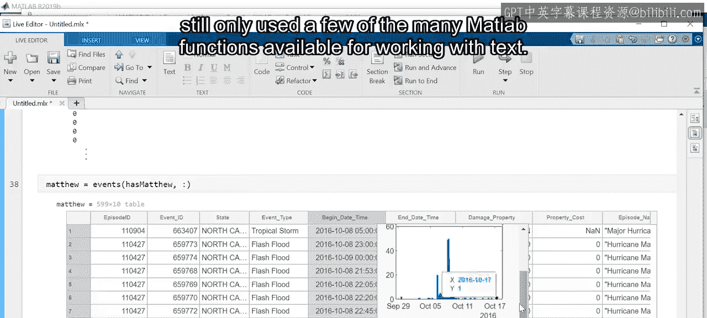

Visit the documentation to learn more about functions for various tasks such as modifying。

Or finding strings。

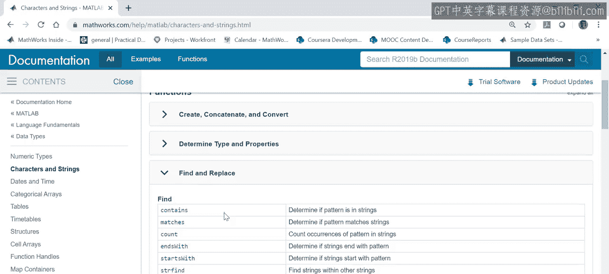

In summary， text variables can hold many types of data。

 and there are many different ways to work with them。

If your data cannot be neatly imported in a MATLb， importing as text for further processing is a good approach。

Many functions are available for working with string variables。

Here you manipulated strings and search for text inside of strings。Later in this course。

 you'll extend these concepts to apply feature engineering to text data。To practice。

 try repeating the process we just did for the damaged crops variable。

 or if you live in the United States， search the narratives for events near where you live。

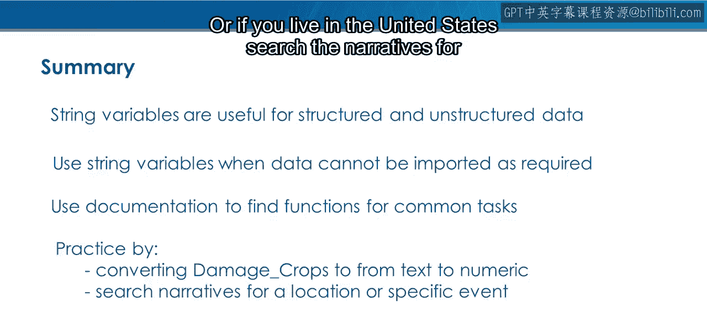