# Mathworks《实用数据科学与MATLAB（数据探索、特征工程、机器学习、毕业项目）｜Practical Data Science with MATLAB》 p52 12_处理日期和时间.zh_en [BV1Jr421w7wL_p52]

🎼。Many data sets include observations recorded over a period of time。

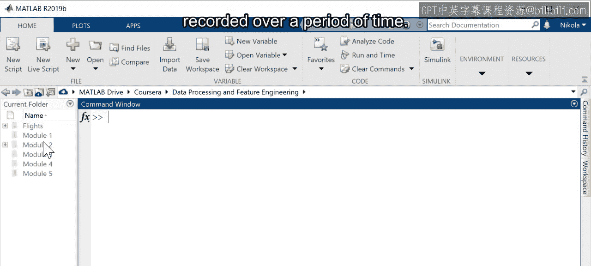

In addition to logging observations， these data sets capture the date or specific time of the observation。

You probably notice this with the Fs data。Sometimes date and time information is recorded not as a single variable。

 but rather in several parts as multiple variables。In this video。

 you will create datetime variables from separate variables and work with them。Using date time。

 you can calculate other values such as the flight time， the flight delay。

 or other time related values for different data。Take this data set as a first example。

It contains sensor data along with multiple columns for the date and time。

Suppose you want to calculate the time between readings。To do this。

 you need a single variable that contains all the information about the date and time。

Start by looking at the data type of each column。In this case， all the columns are numeric。

Use the datetime function to convert the six variables representing the year， month， day， hour。

 minute， and second to a datetime variable。By assigning the result to a new variable in the table。

 you capture the combined date and time information together with your data。

What if some of the variables are not numeric？This data set， for example。

 comes with three columns containing numbers for the year， month and day。

 and one column with strings for the time。Creating De times requires all inputs to be the same data type。

 numeric， or string。Because the time variable values contain a colon。

 they can't be directly converted to numeric values。In this case。

 you can convert the first three columns to strings and construct your own date string like this。

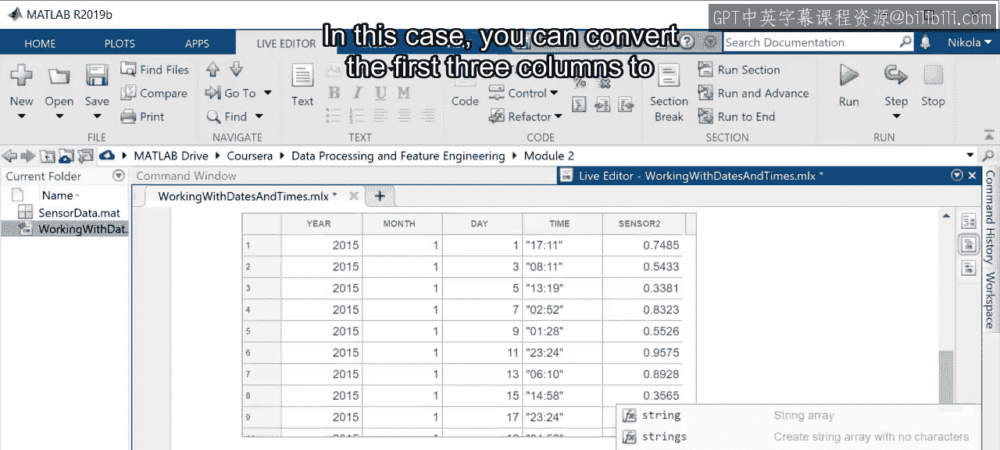

The result is a single string variable that looks like a date with dashes separating the year。

 month and day。Then use the date time function to convert the date string to date time。

Specifying the input format option helps to ensure all elements are detected correctly。Great。

 the time data is once again combined into a single variable。However。

 notice that the date is displayed in a different format than it was entered。

A date time variable has a format property to control how the date and time are displayed。

This enables you to control how the variable looks in the table while still retaining all the information。

Change this property by selecting it and specifying the new format to use。

Now that you know how to create daytime variables， let's see how you can perform calculations with them。

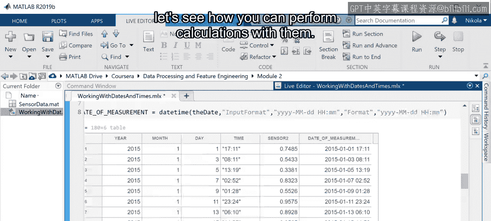

Assume you have two variables describing two points in time。

 like the departure time of a flight at 8 pm and the arrival time at 11 pm on the same day。

To calculate the duration of the flight， subtract the departure time from the arrival time。

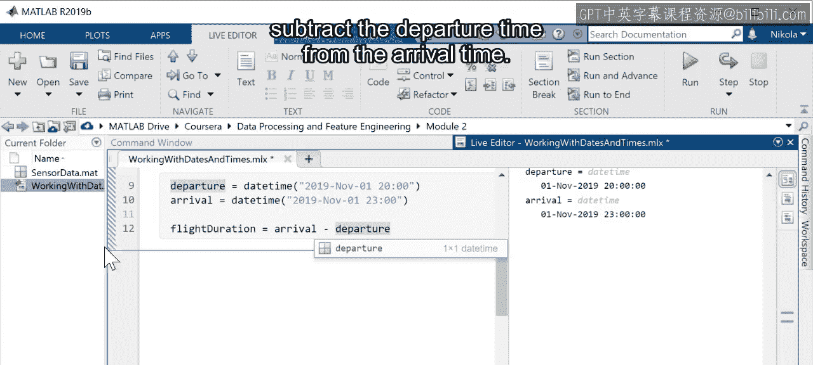

Now have a look at your result when you subtract date time variables like you just did。

 the data type of the result will be duration。

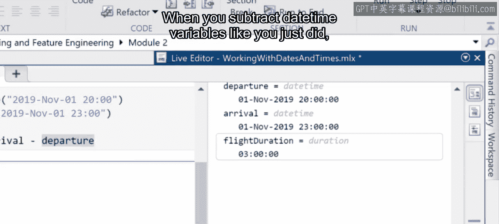

In this example， the duration represents the elapsed time in units of hours， minutes， and seconds。

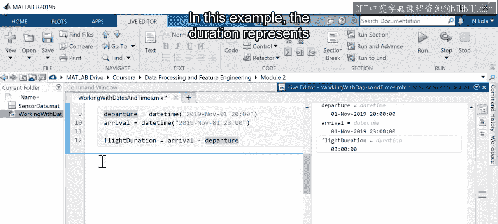

Let's say you have multiple connecting flights and want to calculate your total time in the air。

If the duration of each flight was recorded in hours and minutes。

 you would need to take the extra steps to account for the two separate units of time。

By storing the hours， minutes， and seconds in a variable of the data type duration。

 you'll be able to simply add two values and the units are handled automatically。

What if you had the flight durations as a numeric variable with units of minutes。

 such as 200 minutes for the first flight and 50 minutes for the second？

You can convert the numeric variable to a duration using the minutes function and work with the duration variables as you did before。

The flight duration is now calculated as 250 minutes。

Usually you would expect to result in a different format like hours and minutes。

You don't need to convert this by hand， simply change the way it's displayed。

Type a dot following the variable name and use the auto completion to select format。

 then specify the display format。The result from the previous operation is now displayed in units of hours and minutes。

 and you did not have to think about the conversion at all。

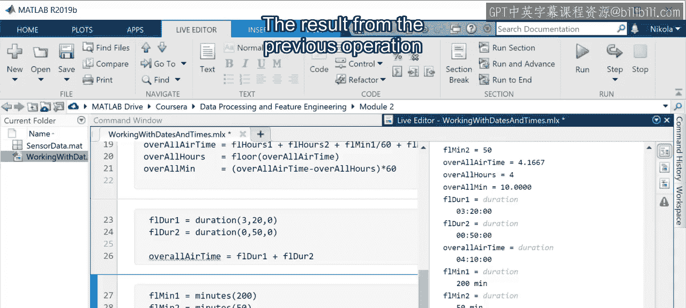

Many more functions for datetime and duration variables are available。

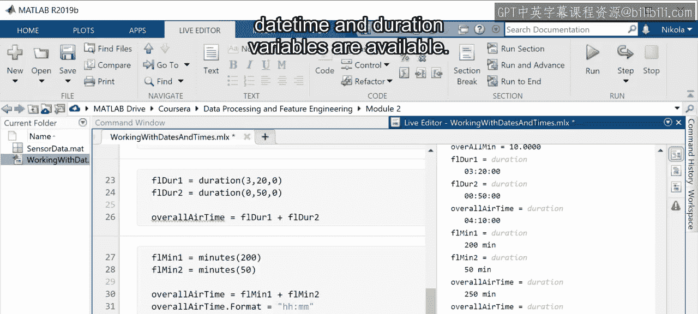

You can use them to perform calculations without having to account for the individual components and associated units of dates and times。

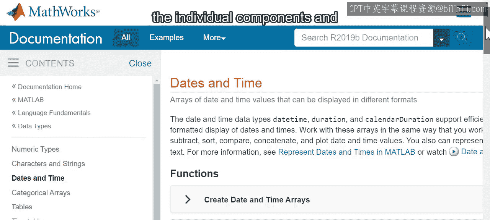

In the documentation， you will find a list of functions to create date and time arrayse。

Split dateeds and times。Determine their type and time zone offset。

Shift or calculate differences between dates。

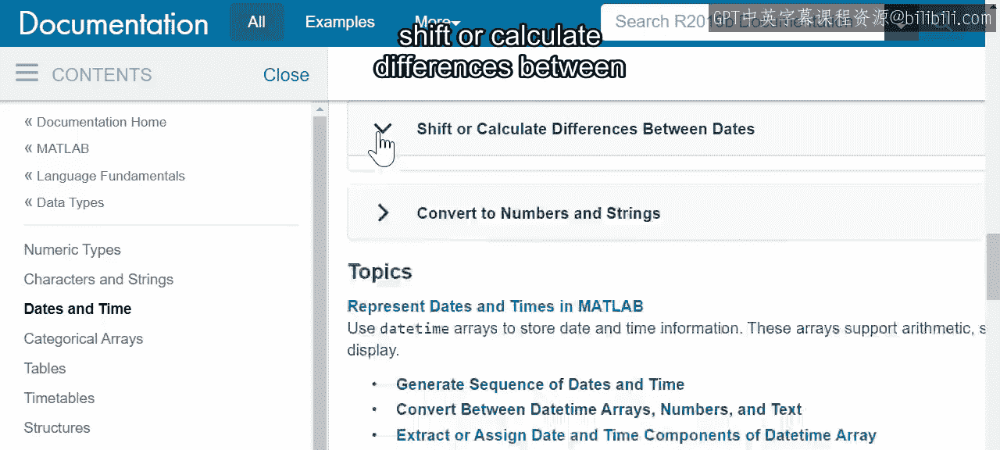

And convert them to numbers and strings。

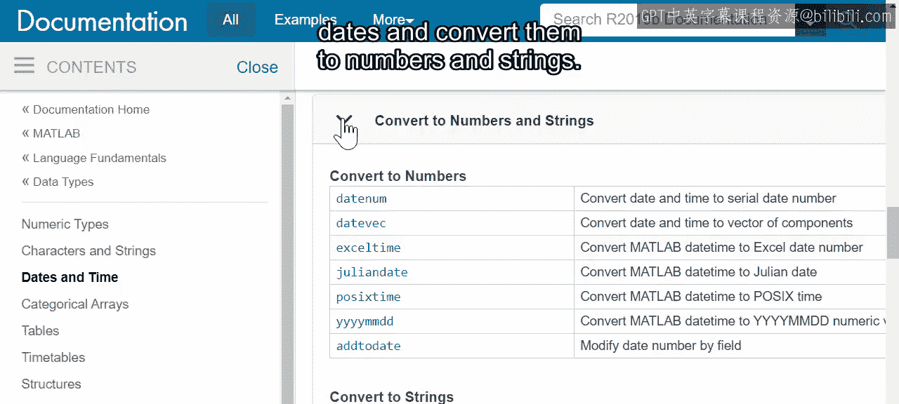

。