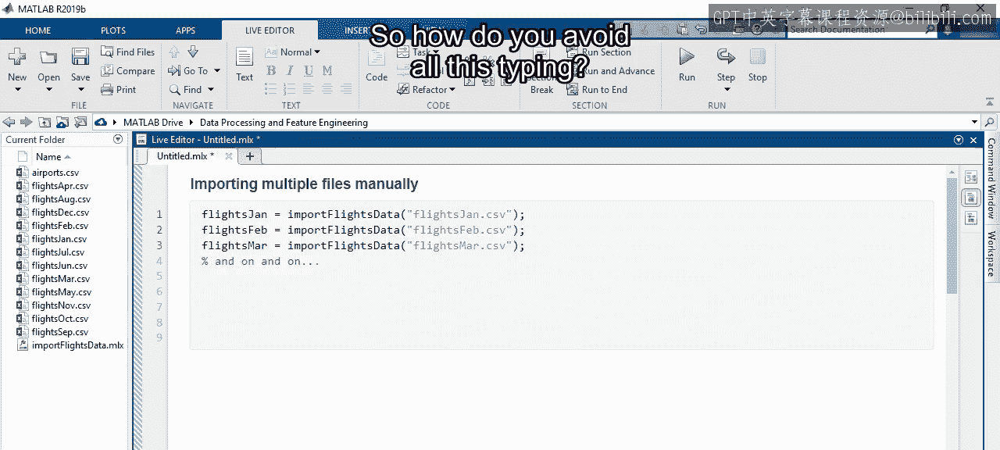
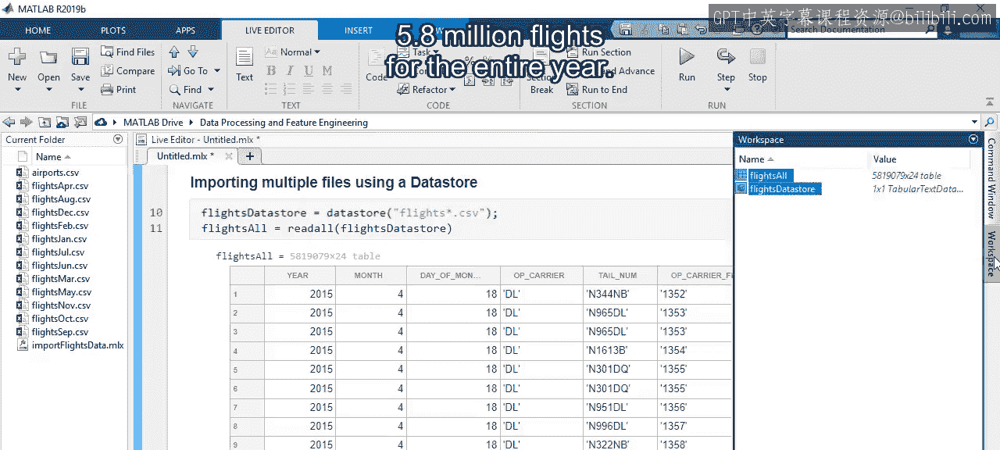
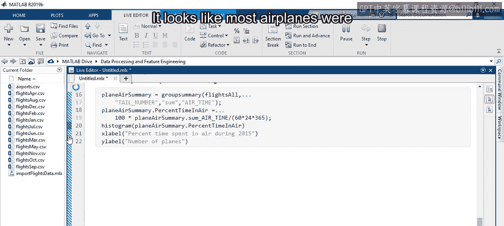
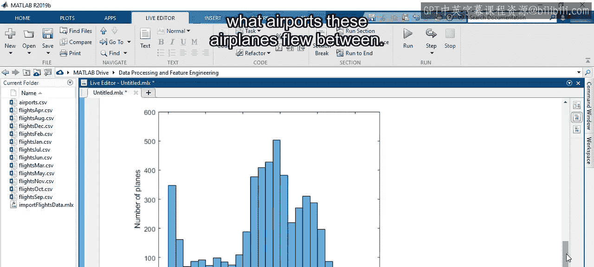
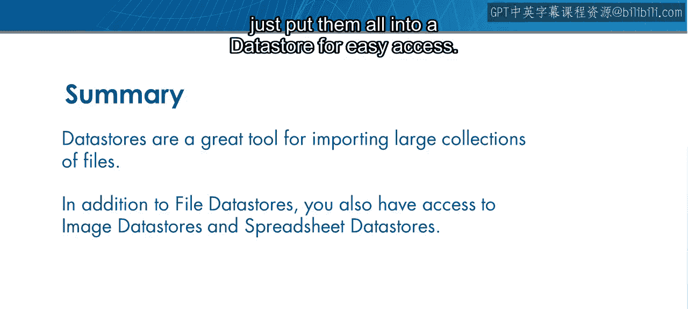

# Mathworks《实用数据科学与MATLAB（数据探索、特征工程、机器学习、毕业项目）｜Practical Data Science with MATLAB》 p53 13_导入多个数据文件.zh_en [BV1Jr421w7wL_p53]

🎼，Having spent some time exploring the flightlight's data set。

 you've now seen that the data is partitioned into a separate CSV file for each month。

But what if you have a question regarding all of 2015？

For instance， let's say you're interested in how long each plane spent in the air during a whole year。

To access the entire year's data， you could import a single month。Then copy this code 12 times。

 saving each month to a new table。However， this method quickly becomes tedious。

 especially if you include more years beyond 2015。So how do you avoid all this typing？

A more efficient method is to use a data store。A data store is simply a collection of files that MatLU organizes for easier importing。

In your case， you have the 12 flight CSV files that are ideal for this situation。

To make a data store in MatLb， input one of the F's CSV files into the data store function and save its output to a new variable。

But how do you include every file instead of one at a time。Again。

 you could type out a list of file names， but this is the trouble you're trying to avoid。Instead。

 because each file differs only by their three letter month abbreviation。

 you can represent all of them together using an asterisk。

This symbol acts as a wild card that matches any combination of characters。In this case。

 you want every file that begins with the wordfs。Then use the asterisk symbol。And lastly。

 include the dot CSV to specify the file type。Now your data store will collect every file that matches this naming pattern。

Next， use the read All function to import the data store and its 12 files as a table。

Over in the MatLb workspace， you can see the new table with all 5。

8 million flights for the entire year。

That worked fine。 But notice that you didn't use the custom import function that formats the table。

For instance， the departure time is represented by the four digit clock reading as it was reported in the CSV file。

Instead of the datetime variable， the import function converted it to。Don't worry。

 it's still possible to specify the import function instead of using the default one。To do this。

 you'll need to use a specific type of data store called a file data store。

 which is designed to use custom import functions。After you update your data store to this new type。

 you can then use the read function option to specify your custom function。

This is done by preceding the function's name with an at symbol。

You're almost there because now you have imported all 12 files。

 but each one is contained within its own table。For instance， the first table is the month April。

This happened because the file data store doesn't assume that each file is structured identically。

 which in this case is true。For instance， the fifth column is always the destination airport variable。

To change the default behavior， set the uniform read option to true。

Now the entire year is in one table。And you can return to the original question of determining how much time aircraft spent in flight during 2015。

Looks like most airplanes were airborne for 30% of the year。

But a few of them spent over half the year flying。If you want to practice。

 see if you can figure out what airports these airplanes flew between。

As you can see， data stores are a powerful tool for importing large collections of similarly formatted files。

This video introduced the specialized file data store。But depending on your needs。

 there are other types， too， like image data stores and spreadsheet data stores。

So next time you need to import hundreds or thousands of files together。

 just put them all into a data store for easy access。

。