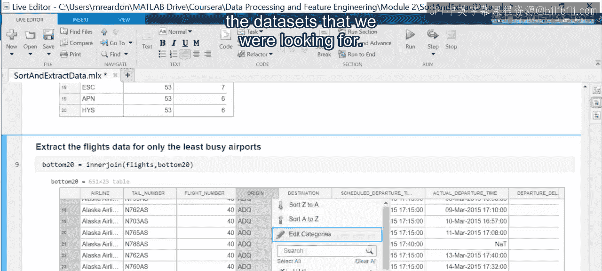

# Mathworks《实用数据科学与MATLAB（数据探索、特征工程、机器学习、毕业项目）｜Practical Data Science with MATLAB》 p56 16_排序数据.zh_en [BV1Jr421w7wL_p56]

🎼，You've probably encountered many lists that have been sorted in alphabetical order or entire tables that have been sorted on the value of a particular variable。

In data science， sorting can help you identify observations with the highest and lowest values。

 Let's see how sorting can be done in Matla。We'll start by opening the sort and extract data script。

 which obtains flight data for the top and bottom 20 airports by flight count。

These data sets can then be used to study the differences between the length， cause。

 and effects of delays in busy and not so busy airports。

The script begins by importing the flight data for a single month into a table variable。

The next step is to obtain the number of flights departing each airport using the group summary function。

 which returns a table of airports and flight counts。

Recall that you can preview and sort table variables using interactive controls。 For instance。

 you can sort the table by flight count in descending order to the busiest airports。

Note that the corresponding code to perform the sorting is automatically generated and we've added it to the script。

The sorting is done using the sort rows function， which takes a table as the first input。

Followed by a sorting variable。And a direction that determines the sorting order。

Note that the entire table is sorted simultaneously， not just the sorting variable。

After the table is sorted， the first 20 rows are extracted into a new table variable。

 which contains the 20 busiest airports and their flight counts。

This table is then interjoined with the flight data on their key variable origin。

The resulting table contains the flight data for only the 20 busiest airports。

Now to find the 20 least busy airports， that's a little more complicated。

If you return to the flight counts table and sort in ascending order。

 you can see that there are multiple airports with the same number of flight right around our 20 airport cutoff。

In order to break ties like these， it's sometimes necessary to add additional sorting variables。

As this analysis is ultimately focused on the causes of delays。

 preference is given to airports with more delays。To do this。

 a new variable is added to the original data， which indicates departures delayed more than 15 minutes。

That's the minimum amount of time for a flight to be considered delayed by the FAA。

The flight status is again summarized by Orig Airport this time by summing the number of delays per airport。

The resulting table now contains the number of flights and the number of delays for each airport。

After extracting the top 20 rows， you can see that the rows are sorted by flight count in ascending order and delays in descending order。

This time， the top K rose function was used to return only the first 20 airports。

Using top K rows to find only the rows you are looking for。

 is' usually more efficient than sorting the entire table and extracting。

Top K rows accepts a table as input， followed by the number of rows to extract from the top of the sorted table。

Like sort rows， you must also provide a sorting variable and direction。

Both functions also accept lists of variables and directions when sorting by multiple variables。

The final stept is to obtain the flight data for the least busy airports again using an inner join and we're done。

With the help of sorting functions， we were able to obtain the data sets that we were looking for。

