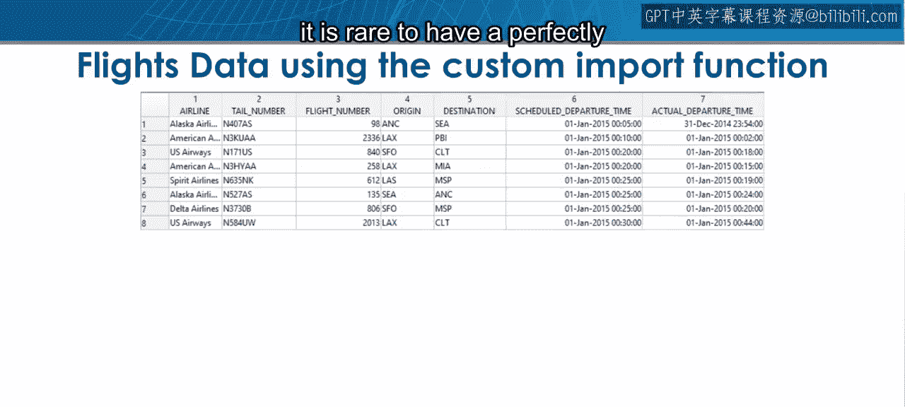
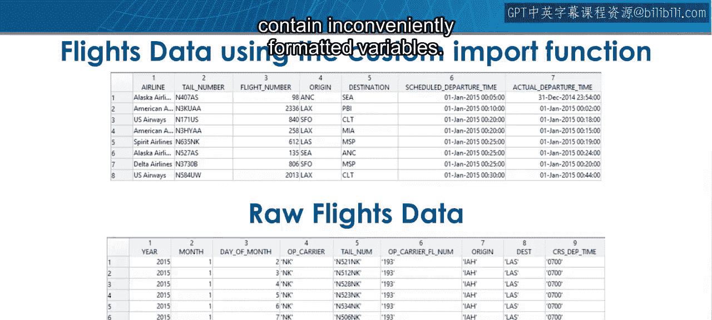
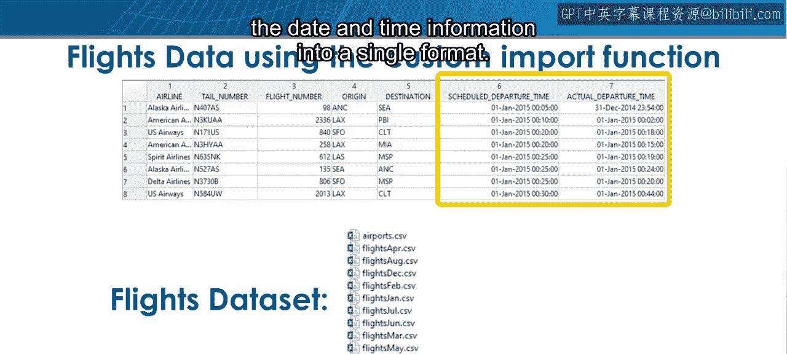
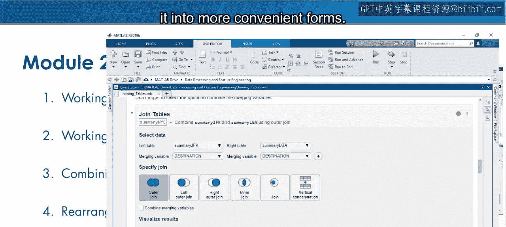
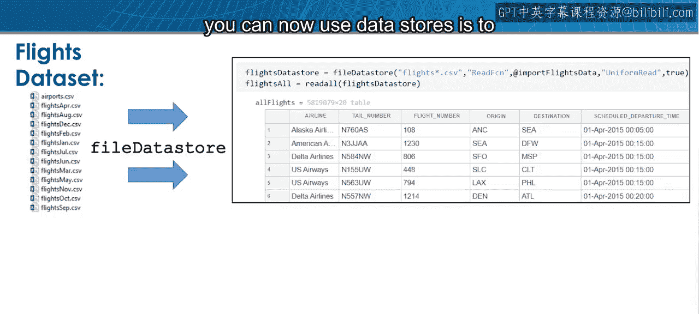
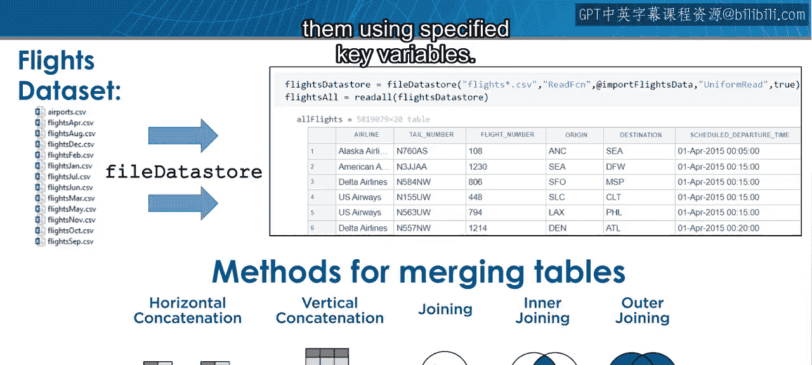
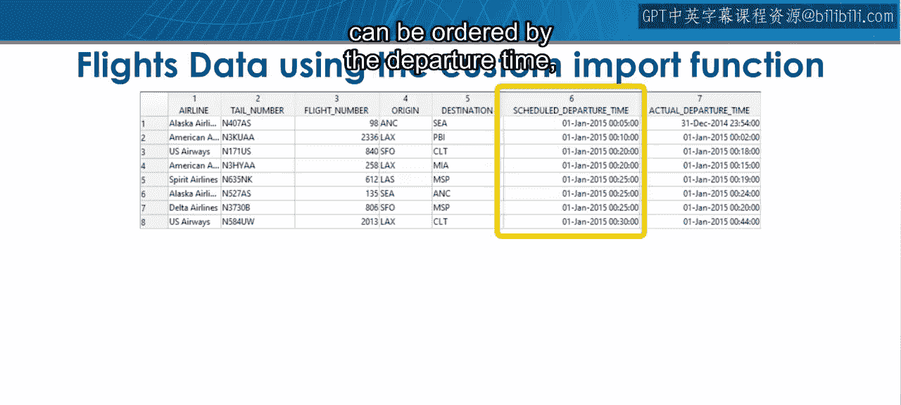
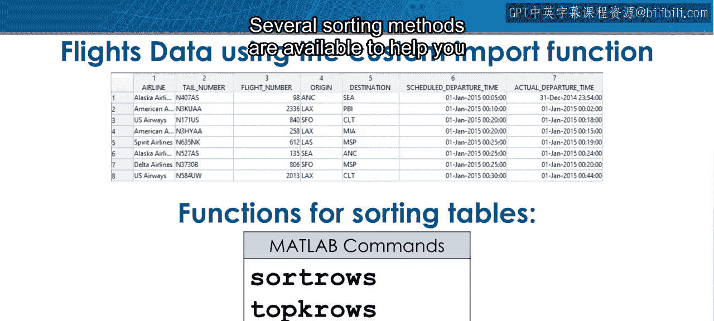
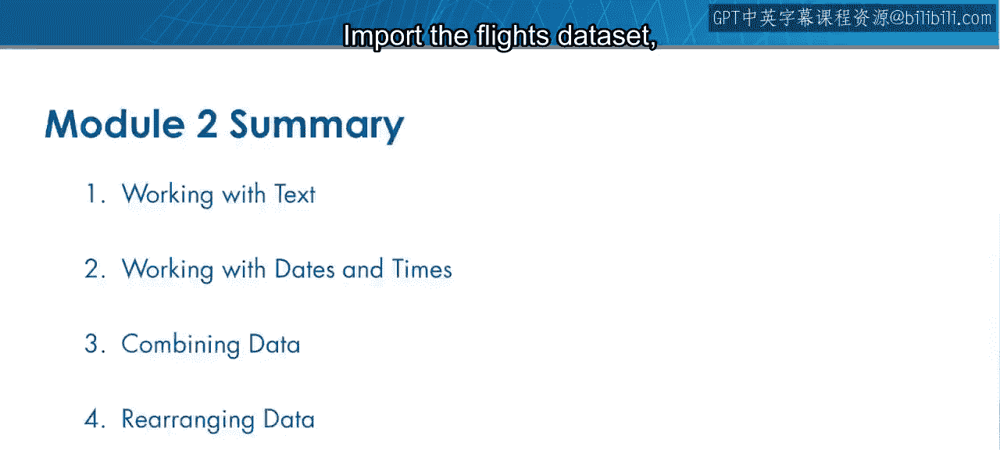
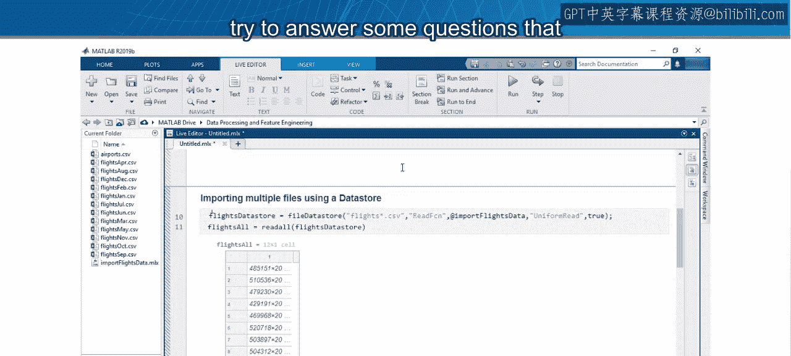

# Mathworks《实用数据科学与MATLAB（数据探索、特征工程、机器学习、毕业项目）｜Practical Data Science with MATLAB》 p57 17_模块2整理数据总结.zh_en [BV1Jr421w7wL_p57]

🎼，As you have seen in this module， when you first import raw data。

 it is rare to have a perfectly organized and ready to use table。

Your data will likely be disorganized， spread across multiple files。

 and contain inconveniently formatted variables。

For instance， the original flight data set spanned multiple files。

 and it took significant pre processing to assemble the date and time information into a single format。

You've learned how to process dates， times and text。

 as well as combine data from multiple sources and rearrange it into more convenient forms。

These skills will help you pre process any raw data you have。

If your data is stored in multiple files like the flight data set。

 you can now use data stores to vertically concatenate them upon importing。

Or if you need to merge multiple tables together， you can use a joining method to combine them using specified key variables。

You can also reorganize the rows in your tables by sorting the data using specific columns。

For instance， the flight data can be ordered by the departure time， the origin airport， or both。

Several sorting methods are available to help you analyze your data and communicate your results。

You also saw that it's common for raw data to be recorded in formats that are not ideal for analysis。

You can now use text and date time variables to extract relevant information from raw data and convert between data types。

Before you take the quiz， now is a good time to practice what you've learned。

Import the Flights data set， use the data store to load all 12 months and try to answer some questions that involve the topics covered in this module。

For instance， what day of the week has the most flights？

Or which states are most prone to flight cancellations caused by weather。

And if you find something interesting， share it on the forum。

。