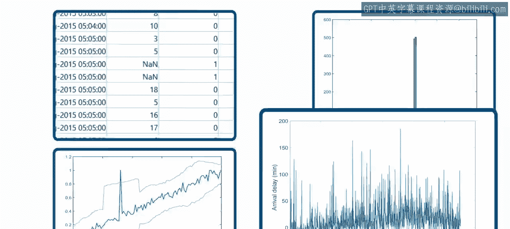
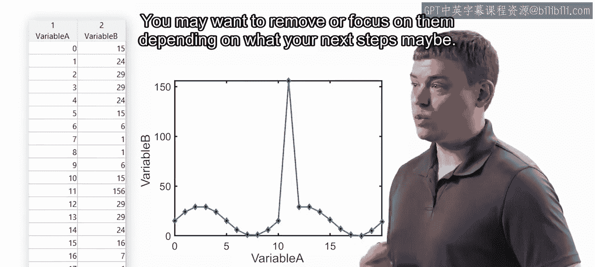
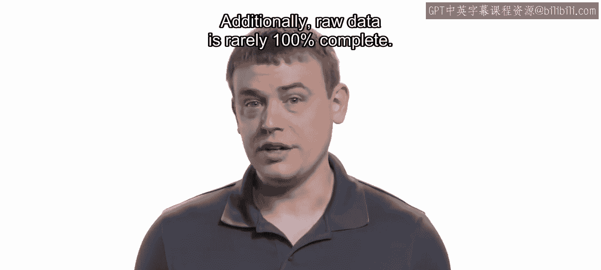
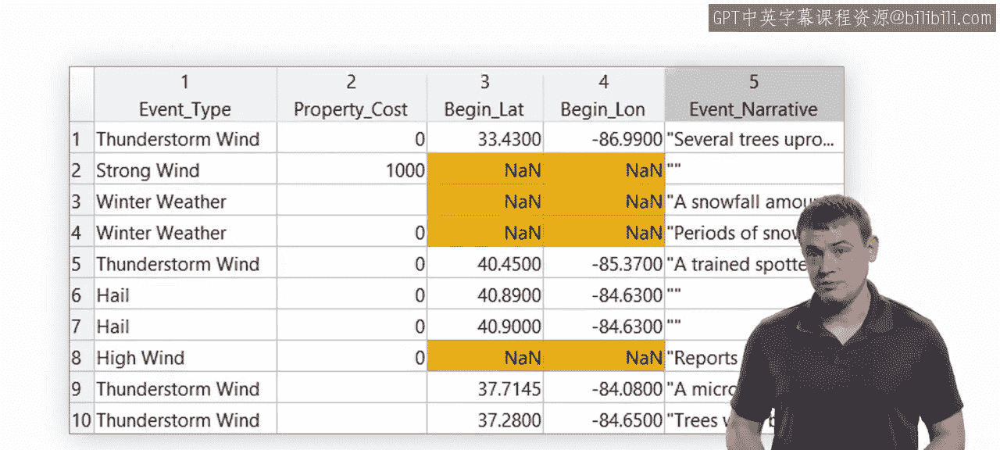
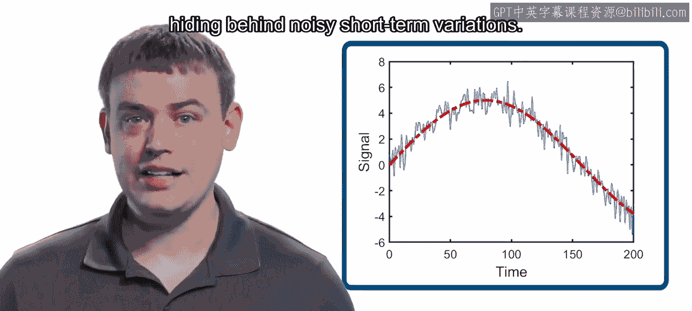
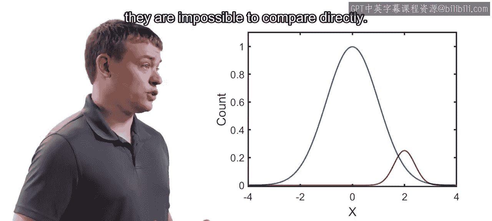
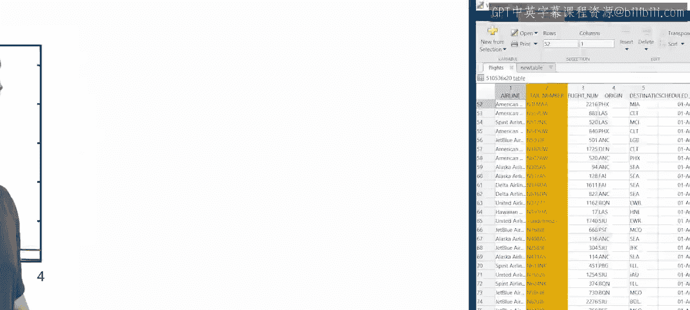
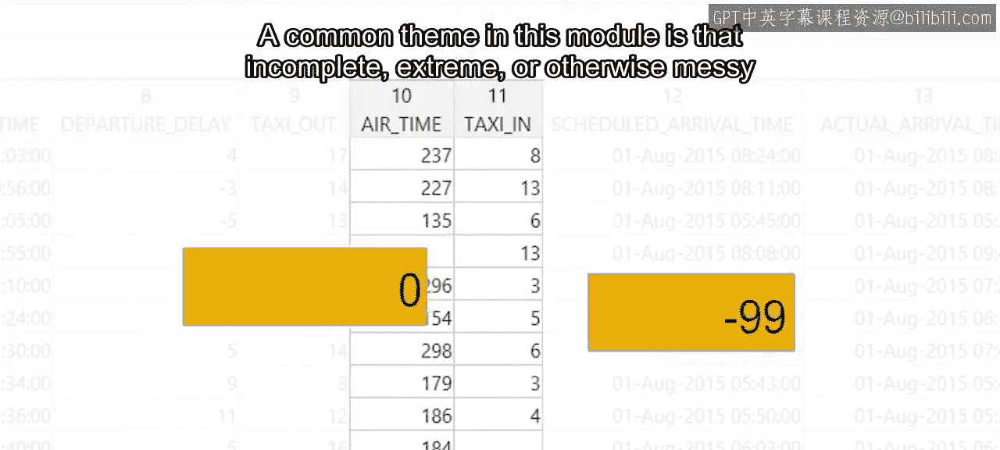
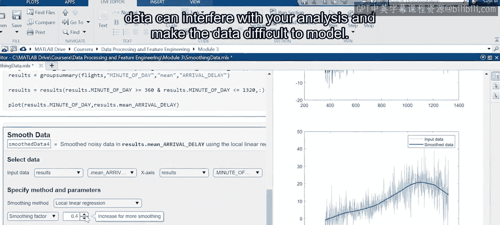
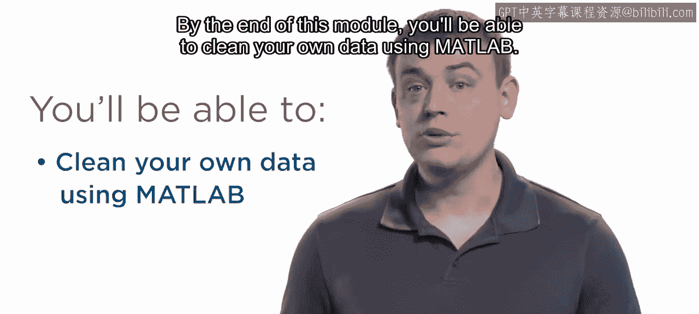

# Mathworks《实用数据科学与MATLAB（数据探索、特征工程、机器学习、毕业项目）｜Practical Data Science with MATLAB》 p58 18_模块3清理数据介绍.zh_en [BV1Jr421w7wL_p58]

🎼，Welcome back。Now that you have a sense of what your data looks like。

You may have noticed it contains some irregularities。

That's because raw data is often messy and needs to be preprocessed before any in depth analysis can begin。

This task is commonly known as data cleaning。In this module。

 you'll learn several techniques that you can apply to clean your data。For instance。

 some data points may seem out of place， like these points on the graph。These are called outliers。

You may want to remove or focus on them， depending on what your next steps may be。

Additionally， raw data is rarely 100% complete。

For instance， recall the storm events data。A missing entry could signify unknown。

 such as a missing GPS location。

Or it could mean a value not significant enough to report， such as negligible property damage。

Or perhaps the variability in the data makes it difficult to identify any sort of pattern。

In this case， you may want to smooth your data to highlight long term trends hiding behind noisy。

 short term variations。

Lastly， maybe two variables cover such different scales that they are impossible to compare directly。

In this case， you can rescale or normalize your data。

A common theme in this module is that incomplete， extreme。

Or otherwise messy data can interfere with your analysis and make the data difficult to model。

By the end of this module， you'll be able to clean your own data using MATLb。

So let's begin。