# Mathworks《实用数据科学与MATLAB（数据探索、特征工程、机器学习、毕业项目）｜Practical Data Science with MATLAB》 p59 19_识别缺失数据.zh_en [BV1Jr421w7wL_p59]

🎼，You've now learned how to organize your data and combine multiple data files。

It's time to face one of the biggest challenges with almost every real data set。Missing values。

The best way to prepare for dealing with missing values is to understand the data you have。

Understand how missing values are represented。How the data was collected。

Where missing values are not supposed to be。And where they are used specifically to represent the absence of data。

Identifying missing data is the first step in determining what to do with it。In this video。

 you'll learn about the different types of missing values and how to identify them using MATLb。

A variety of factors can lead to missing values。Including failure to load the information。

Corrupt data。An incomplete recording of the information， among others。

It's important to understand why values are missing in the data because they can make your task of learning from the data very difficult。

 if not impossible。In fact， incomplete data can introduce bias to your analysis。

 which in turn can produce incorrect predictions。Also。

 identifying and understanding missing values is important for handling the remaining data correctly。

Let's start by understanding how missing data is classified。Typically。

 data scientists classify missing values into three main mechanisms。Missing at random。

Missing completely at random。And missing not at random。

These mechanisms will help you later on to decide which approach to use when handling these missing values。

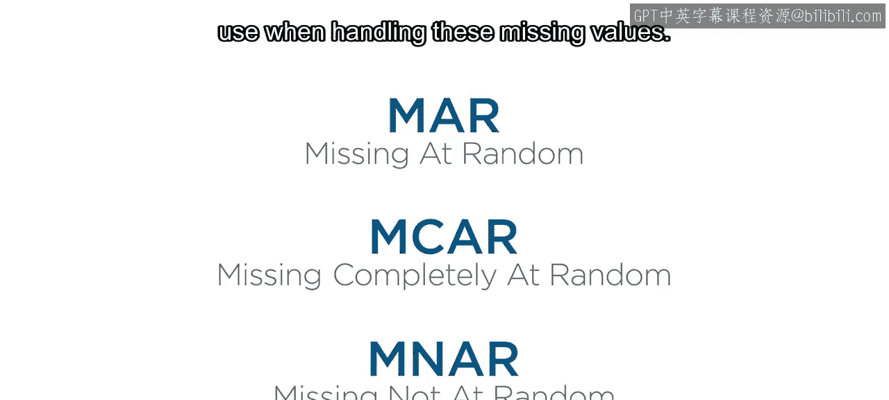

Missing at random means that the reason why the variable is missing is not related to its underlying value。

 but is instead conditional on other variables。

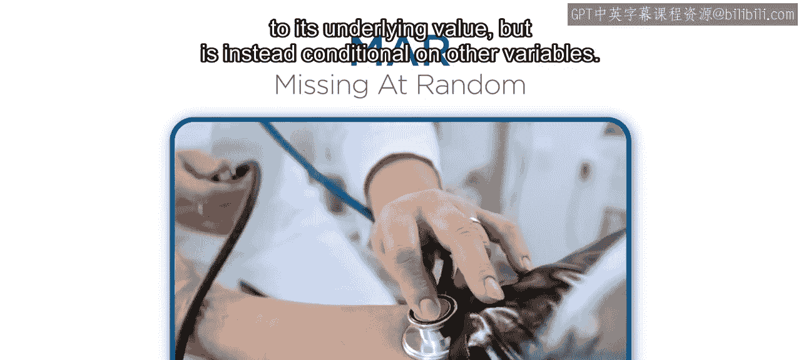

For example， imagine you have data containing information about blood pressure in the population。

Missing values in this data set can be conditional on age。

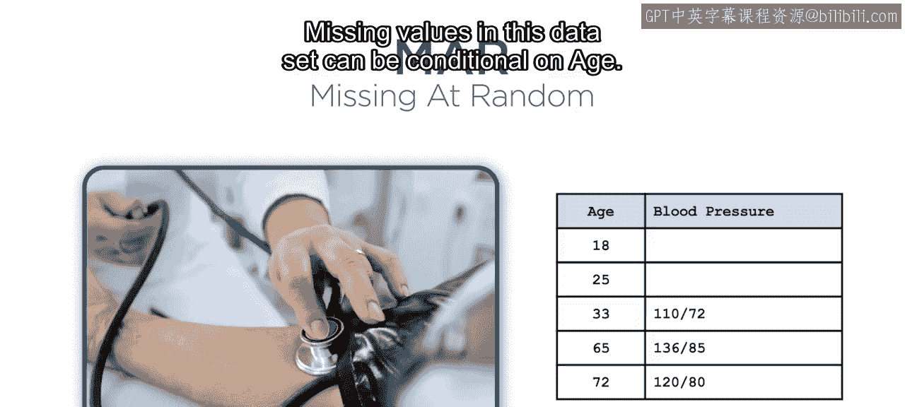

In some countries， older people are more likely to have their blood pressure checked during a regular checkup than younger people。

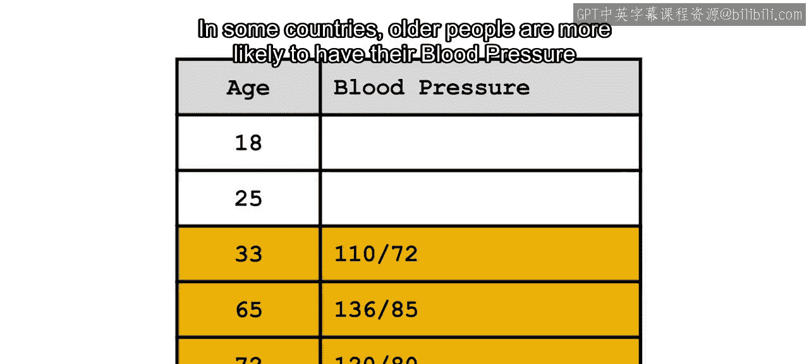

This has nothing to do with the value of their blood pressures， so in this case。

 the pattern for missing values is conditional not on the blood pressure reading itself。

 but on another variable， namely the age of patients。

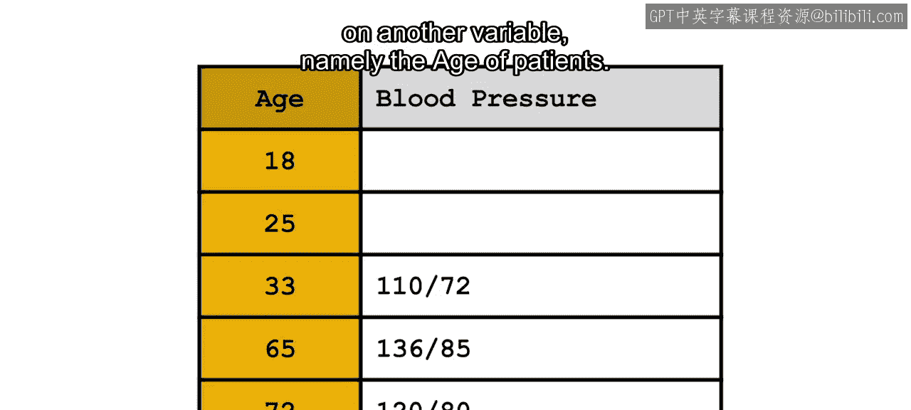

Missing completely at random means that the missing data mechanism is unrelated to the values of any variables。

 whether missing or observed。For example， imagine a data set created out of survey responses for customer satisfaction。

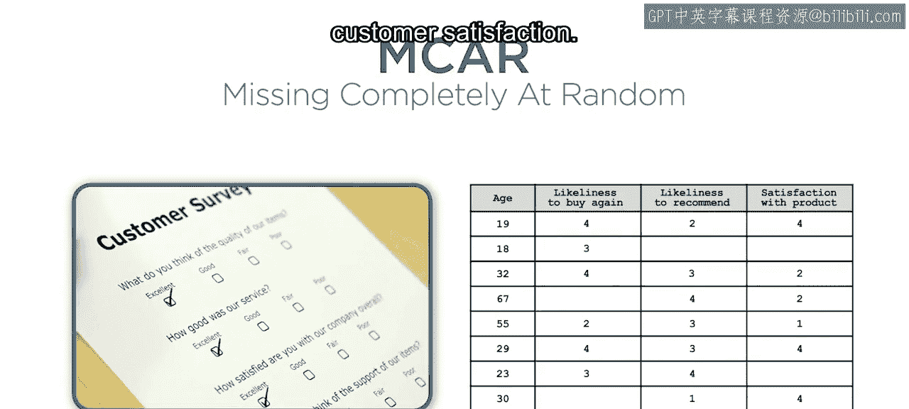

These types of questions are typically optional。

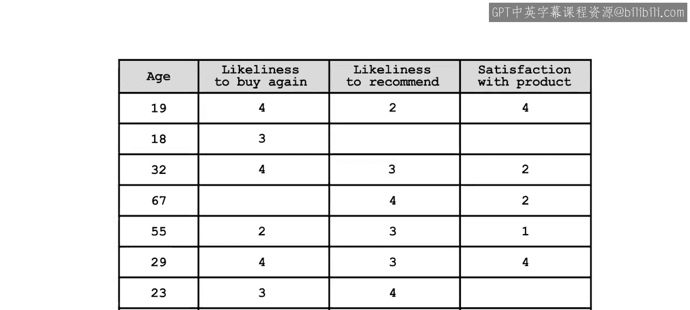

If you were to separate the results for complete responses versus missing responses。

 you might notice these two groups have no correlation with the customer's ages。

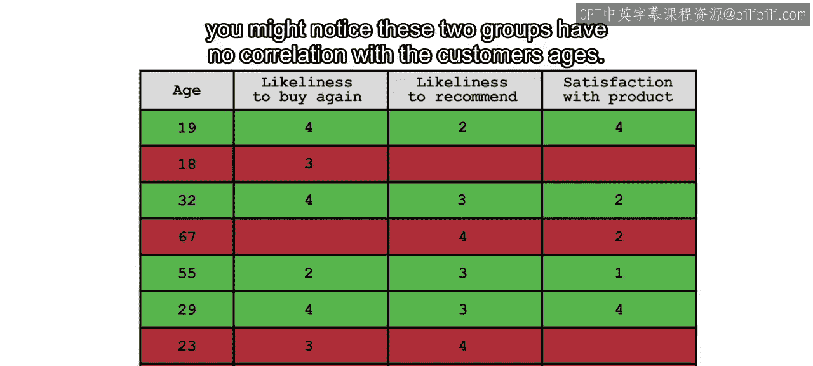

Each customer simply chose to skip one or more questions at random。

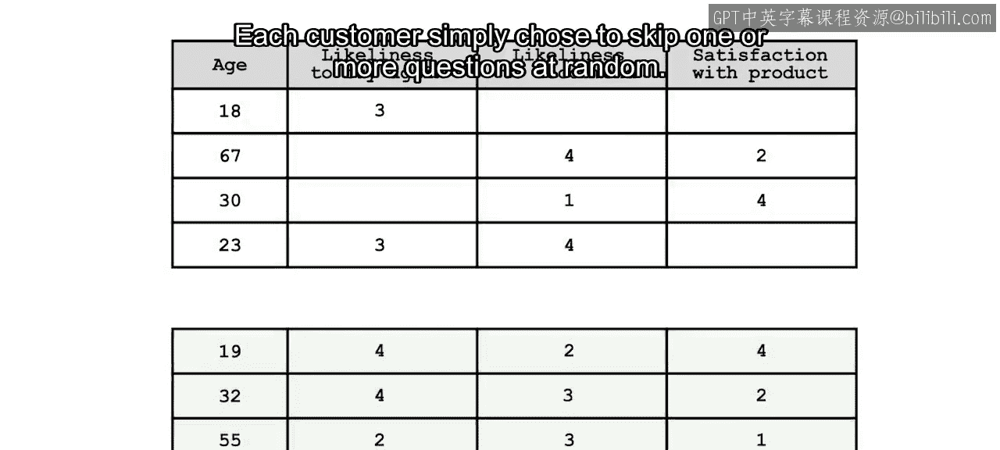

Finally， missing not at random means that the reason the variable is missing is related to the value of the variable itself。

For example， if your survey now asks people about their incomes。

 there may be a higher probability that people with higher salaries do not want to reveal their income。

 meaning they might just skip the question。

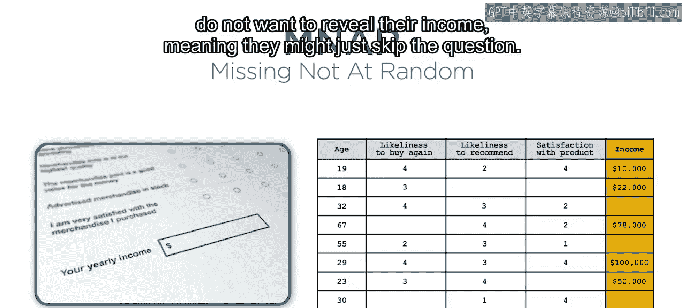

In this case， the data is missing because of the very same values you're trying to collect this is the most difficult category as the incorrect handling of this missing data could lead to strong bias in your results。

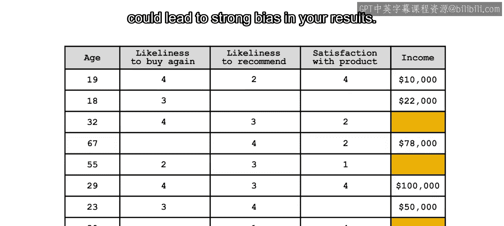

So what about the Flights data set？Well， imagine you listed only the scheduled departure time。

 taxi in and canceled columns。The missing values for Tax in appear to have no relationship with the scheduled departure time。

And there's no indication that the reason the values are missing is because of the values themselves。

However， looking at the cancel column， you understand that a missing value for taxi in is conditional on the canceled status of each flight。

So this is assumed to be a case of missing at random。

The scheduled departure time does not predict when the value is missing。

 but this value is conditional on another variable。

This understanding will help you later to determine the best way to handle these missing values。Now。

 regardless of the mechanism for missing data， you need to identify the missing values。

 how do you do that？In MATLb， you use the function is missing to identify the missing values in your data。

Is missing of A returns a logical output that indicates which elements of the input contain missing values。

The size of this resulting array is the same as the size of a。However。

 note that standard missing values depend on the data type。For numerical and duration values， a Nan。

 not a number， will be interpreted as a missing value。For example。

 when using is missing with a taxi in column。Note how the entries with Nan return a logical value of one。

But for datetime， string， or categorical variables。

 missing values will be identified differently as shown in this table。For example。

 consider the actual departure time variable。Notice how the missing values are identified as nat or not a time。

Notnice also how the missing values in the tail number column。Are identified as undefined。

Note that missing data can also correspond to data that has been incorrectly recorded。For example。

 imagine the value for airtime was recorded incorrectly as zero。

Or the taxi in value was recorded as a negative number。

You would want these values to be identified as missing。What do you do in cases like these。

The standardized missing function replaces values specified in indicator with standard missing values。

So for airtime recorded incorrectly as zero， or the taxi in recorded as a negative number。

You would use standardized missing to replace those incorrect values as missing。To recap。

 you learn that the reasons for missing data generally fall into three different categories。

 which are helpful in determining how to deal with this data。

You also learn how to use the function is missing to identify missing values。

 as well as standardize missing to replace any value with standard missing values。Next。

 you'll learn how to handle missing values using this information。

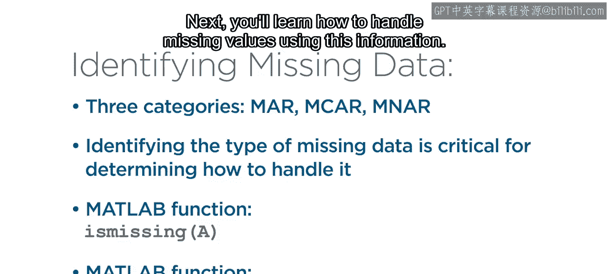