# Mathworks《实用数据科学与MATLAB（数据探索、特征工程、机器学习、毕业项目）｜Practical Data Science with MATLAB》 p60 20_处理缺失数据.zh_en [BV1Jr421w7wL_p60]

🎼，You've learned what missing data is and how to identify missing values in your data sets。However。

 you now have another question to answer。 What do you do with the missing values once you identify them。

You could ignore these missing values， remove those entries that contain missing data。

 or replace them with new values。There is no generalized best way to deal with missing values。

There are some alternatives based on the different missing data mechanisms you learned earlier。

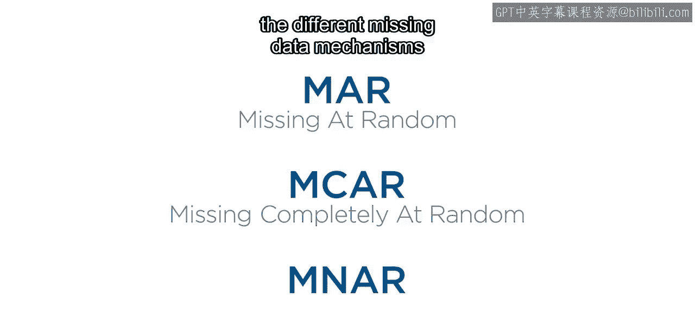

Also， domain knowledge and understanding how to interpret your data will be your main allies in successfully dealing with missing data。

In this video， you'll take a closer look at the different options you have for handling missing data and how you get this done in MatTLb。

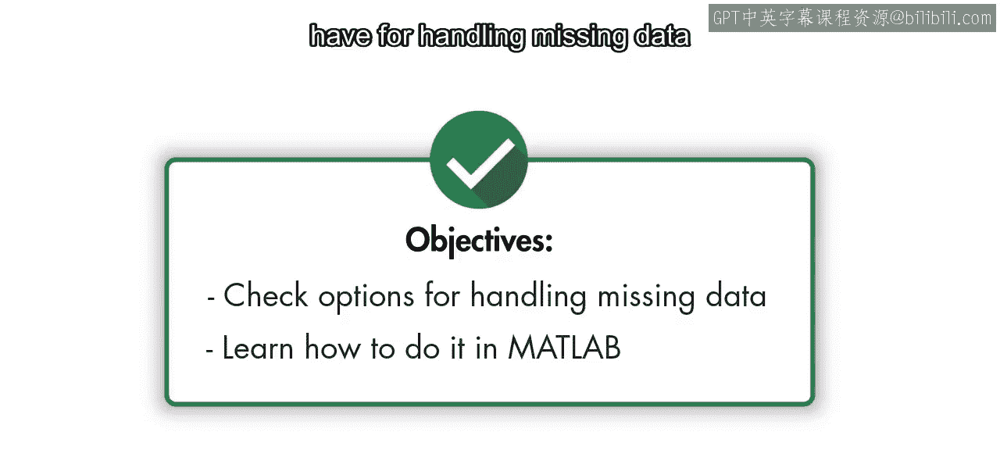

In the Exploratory data analysis course， you learn how to safely ignore missing data。

Many Matlab functions enable you to ignore missing values using the Omit Nan option。

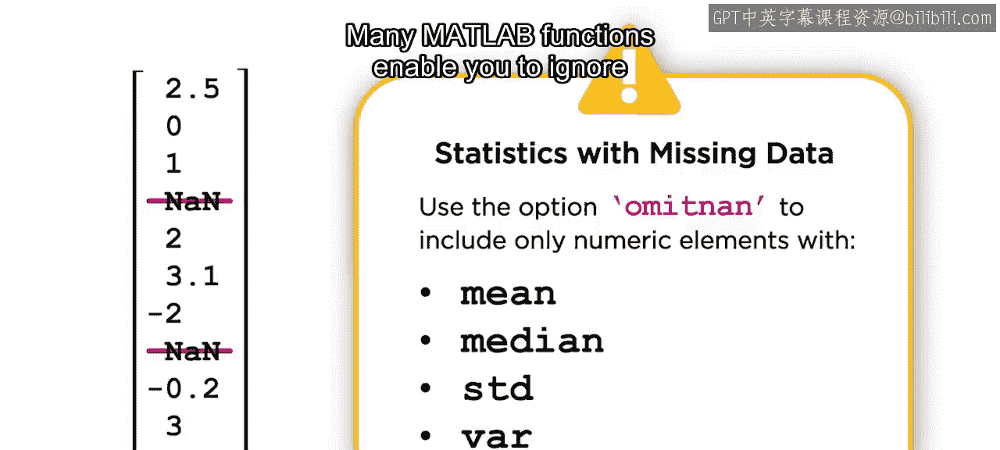

Notice how this applies only to numeric values。Beyond ignoring missing values。

 there are two remaining options， removing and replacing。

One of the simplest approaches is to just delete the data points with missing values。

In the case of missing not at random， dropping the missing values will introduce some level of bias to the model。

 since the likelihood of a value being missing is related to the value itself。

In the case of missing at random， deletion could also introduce bias。

 but if the percentage of missing data is small， then you can likely drop data without substantial loss of statistical power。

If the data is missing completely at random， deletion does not add any bias。

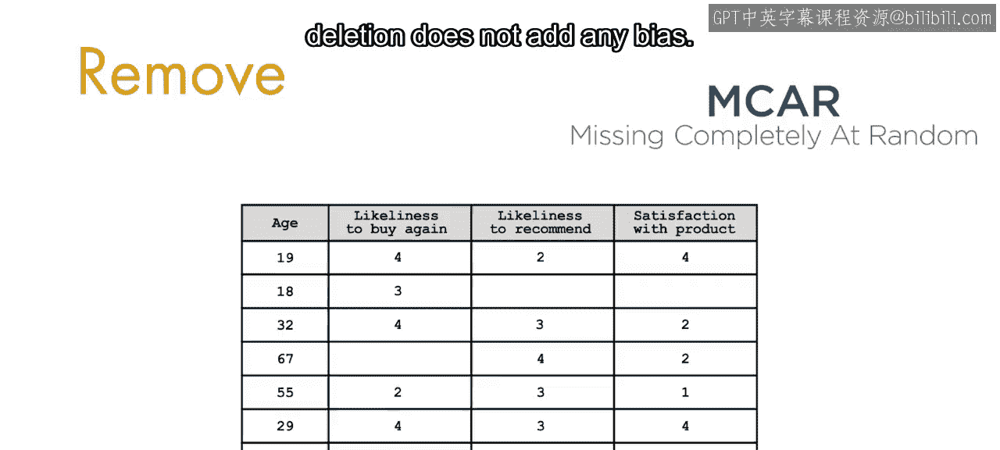

However， you need to be careful as you could be significantly reducing the size of the data set if it has too many missing values。

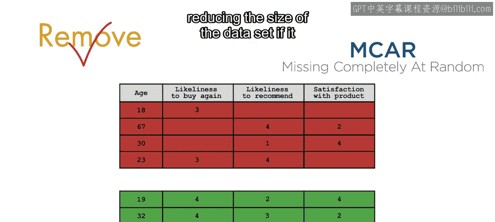

Let's use the flights data set again。

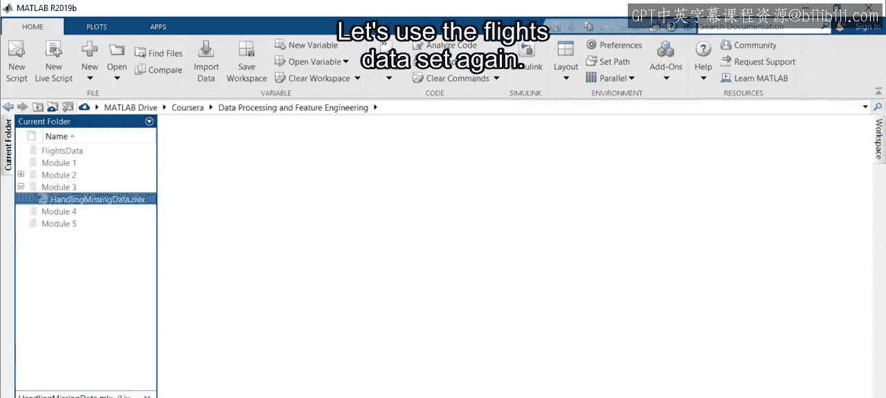

As shown previously， missing values in this data set are characterized as missing at random。

If you count the number of missing values identified。

 you will see the amount to 1% of the data for the month of August。

So deleting these values will likely not cause a substantial loss for your statistical analysis。

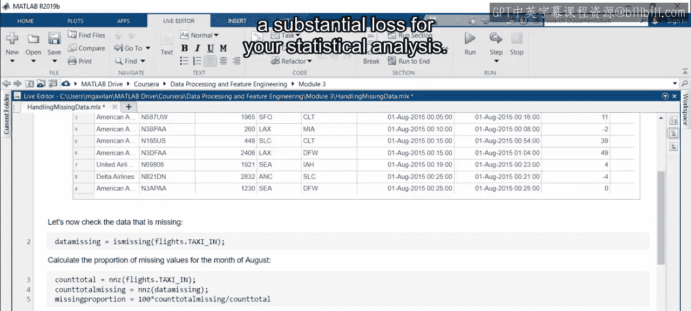

In MatTLab， you use the function RM missing to remove missing entries。If the input is a vector。

 then RM missing removes any entry that contains missing data。If the input is a matrix or a table。

 then RM missing removes any row that contains missing data。Similar to the function is missing。

 missing values are defined according to the data type of the input。

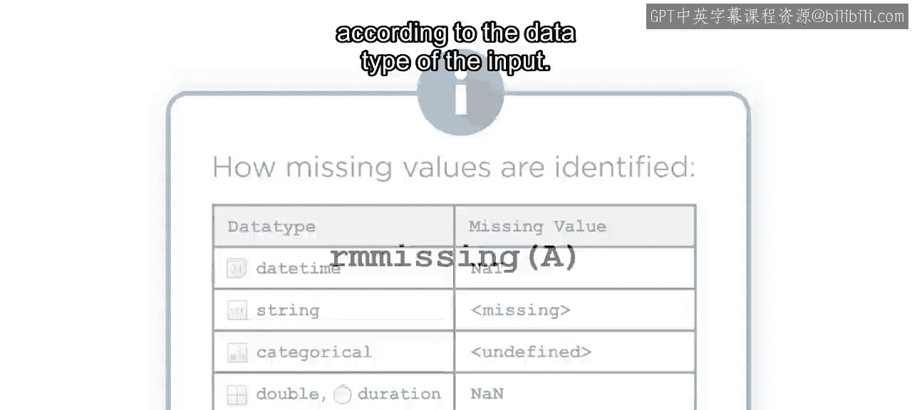

In the case of the Flights dataset set， RM missing returns an output without the rows containing missing values。

Note that this process can also be used in more complex tasks。 For example。

 suppose you want to determine if the data reveals any daily trend in the arrival delays。To do this。

 you need to remove missing values。Since there are multiple flights occurring every minute。

 you can use group summary to bin the Fs data by minute。

The mean arrival delay will be a single number for every minute of the day for this specific month。

You can then remove all missing values corresponding to Nan。You do this by using the input argument。

 data variables and selecting the corresponding table variable name。

After dealing with the missing values， you can then use this result to start looking for a trend in your data。

In a subsequent video， you'll learn in more detail how to accomplish that goal。

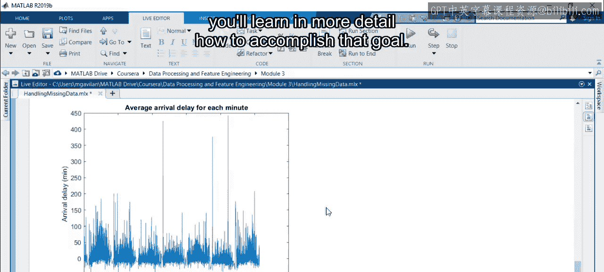

Now， your first alternative was removing the rows containing the missing values。

But what if doing so could dramatically reduce the size of your data set。

Or what if you have a data set displaying a missing not at random mechanism？In such cases。

 you can replace the missing values with estimated or representative values。In MatTLb。

 you can do this with fill missing， which fills missing values of the input A using the methods specified as input。

For example， you could replace a missing value using a constant value。

Fill missing supports a variety of methods for generating the values to be filled。

Common methods include using the mean， median or linear interpolation to name just a few。

 when you only have numeric data， testing multiple options can be simplified using a live editor task。

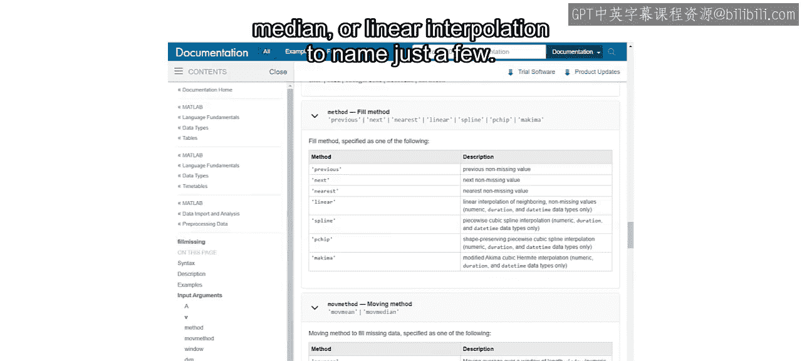

On the live editorit tab， select Task and then select clean missing data。

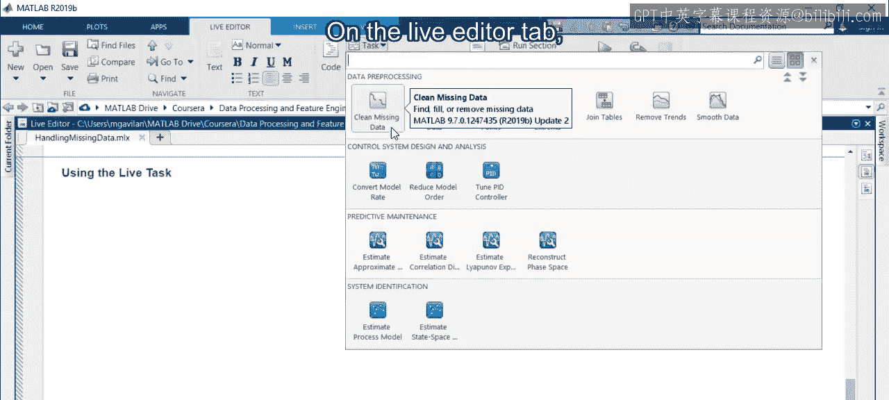

Once you select the data set and the variable， use the drop down menu to select fill missing。

Multiple method options will be shown， and you can visually inspect the effect of each different method。

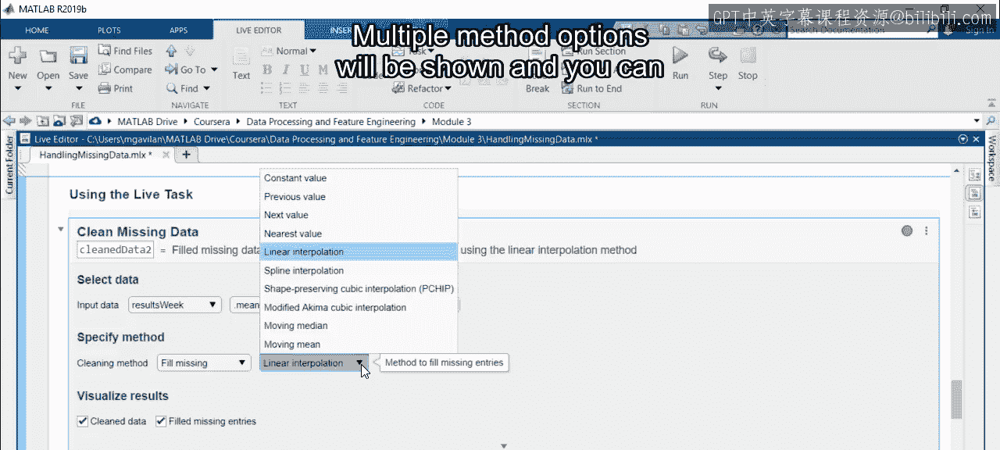

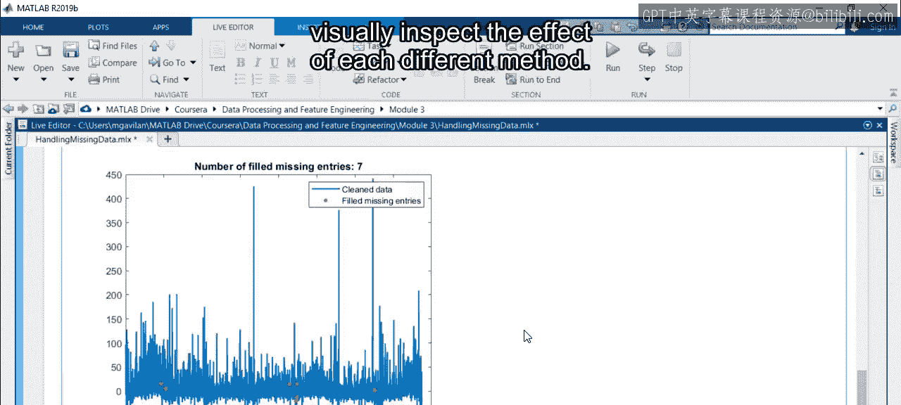

Notice this live Ed task also enables you to remove missing data values instead of filling them。

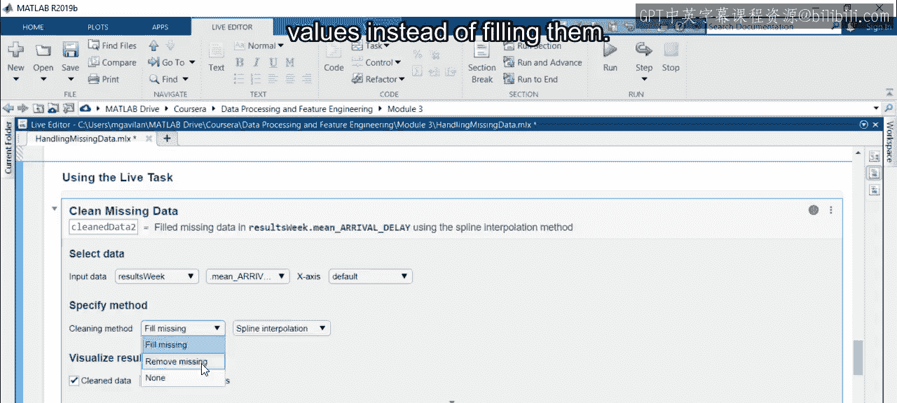

To recap， remember that you have to handle missing values appropriately to avoid biasing your results。

You can either remove missing values using RM missing or replace them using fill missing。

When deciding the best course of action， make sure you understand why certain values in your data are missing。

Now you will have the opportunity to practice these concepts。

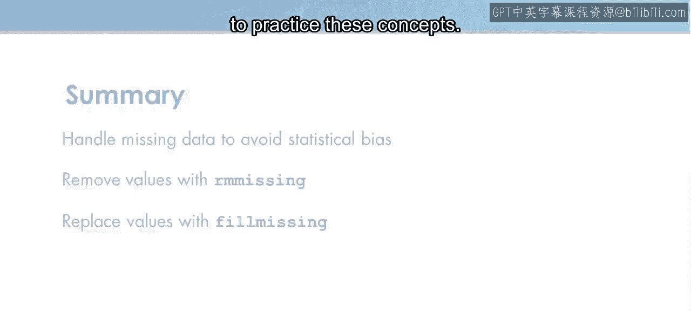