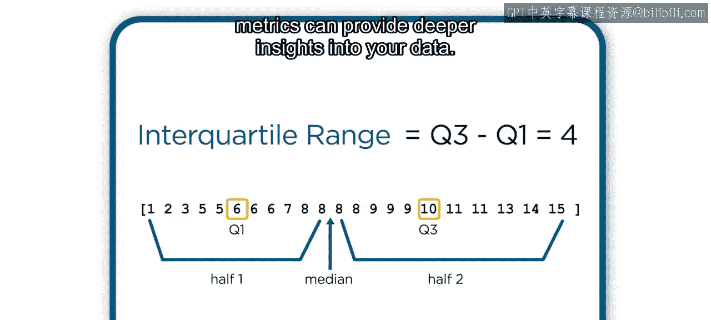
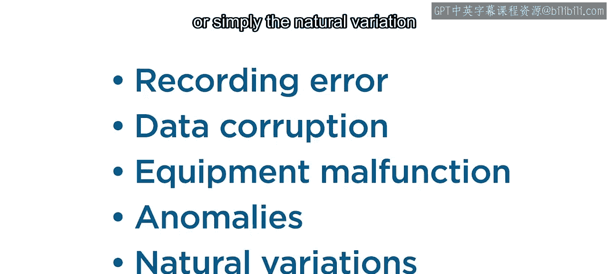
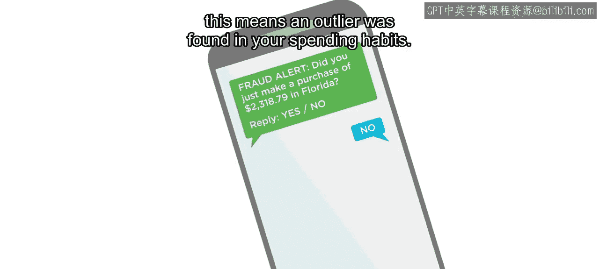
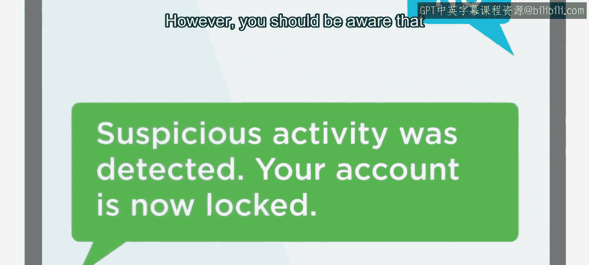

# Mathworks《实用数据科学与MATLAB（数据探索、特征工程、机器学习、毕业项目）｜Practical Data Science with MATLAB》 p61 21_识别异常值.zh_en [BV1Jr421w7wL_p61]

🎼，You've previously seen how basic statistical distributions and metrics can provide deeper insights into your data。

But what about data points that seem unlikely or unusual？In this video。

 you'll learn what outlier data is。The qualitative effects outliers can have on data visualization。

 statistical metrics and modeling。How to identify outliers？And what can be done with them？

An outlier is a data point that is outside of some expected range or does not follow an expected pattern。

Outliers can result from things such as recording errors。Data corruption。Equipment malfunction。

 anomapolilies。Or simply the natural variation in a population or system。

So outliers are different from the majority of your data。But does that matter？

What should you do with them？Sometimes you may have some additional knowledge about the data。

 such as theoretical understanding in your domain。Or technical knowledge about the measurement setup。

In scenarios like these， you may be able to determine that an outlier is due to some specific source of error and that it should be eliminated or even replaced。

Remember， though， outliers are not necessarily bad data。

Outliers are often expected with large enough sets of data due to natural variations。

Outlayers may actually be points of interest for anomaly detection in medical。Manufacturing。Safety。

And security applications， among many others。For example。

 if you've ever received a suspicious credit card activity notification。

This means an outlier was found in your spending habits。

This is something you probably want to know about。

However， you should be aware that any type of outlier can affect your analysis。

They can reduce your ability to easily visualize data as a whole by imposing scaling favorable to a few unusually large points of data。

Identifying and ignoring outliers in this case can significantly improve the picture。

 making it easier to see trends or patterns。Outliers can significantly bias the distribution mean and standard deviation。

Consider this vector of values with the following metrics。

Now notice what happens when we add a large outlier。The mean is more than doubled。

 and the standard deviation is over 10 times larger。However。

 the median and inter quartile range have not changed much。

Outliers generally have much less of an effect on these metrics。

The relative stability of these metrics in the presence of outliers。

Comes in handy for some identification algorithms later on。

Outliers can also bias as models created with your data。

Consider the following data with a linear model。Looks like it fits nicely。

Now notice what happens when you introduce an outlier at various positions。

The model becomes biased towards the outlier and away from the linear trend in the data。

You can often improve model accuracy by ignoring outliers like these。

All these scenarios have one thing in common， they need to identify outliers。Okay。

 so how might you go about that？Well， there is no universal definition of how far out or how different a data point has to be to make it an outlier。

Defining these thresholds for outliers should always be done case by case。

 based on your understanding of the situation and needs。

There are many methods you could use to identify outliers， far too many to cover here。

A few popular outlier limits。Are three standard deviations above and below the mean。1。

5 times the inter quartile range above or below the third and first quartiles。

And three scaled median absolute deviations above and below the median。

Standard deviations above and below the mean are useful for normally distributed data。

But due to the sensitivity of both metrics， the bounds may shift significantly with skewed data or large outliers。

In contrast， both the inter quartile range and median absolute deviation methods are more useful for general distributions and unaffected by extreme outliers。

Additionally， moving mean or median methods can be useful for identifying transient spikes on a signal or other outlier data points that are not otherwise out of range。

Summing up， once you identify outliers in your data。You can leave them in place。

Issoollate them for analysis， delete them， or even replace them。

Just as there is no one size fits all definition or method for identifying outliers。

 there is no predefined approach to dealing with them。Ultimately。

 it is up to you to use your best judgment in your knowledge of the data to decide how to identify outliers and what to do with the ones you identify。

