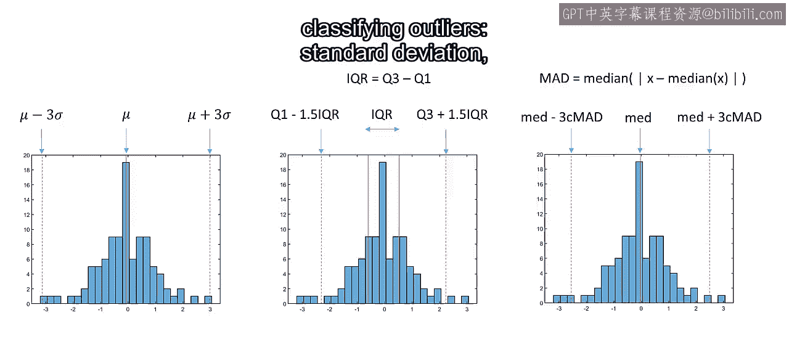
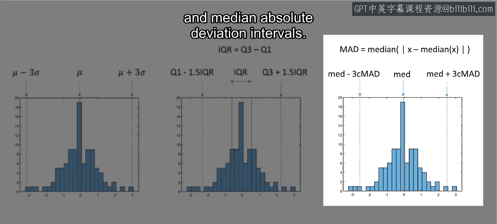
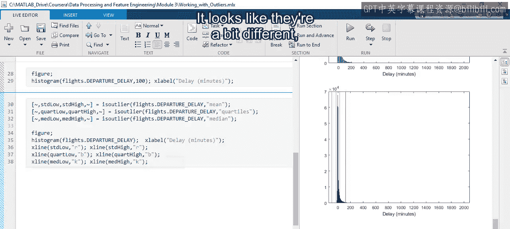
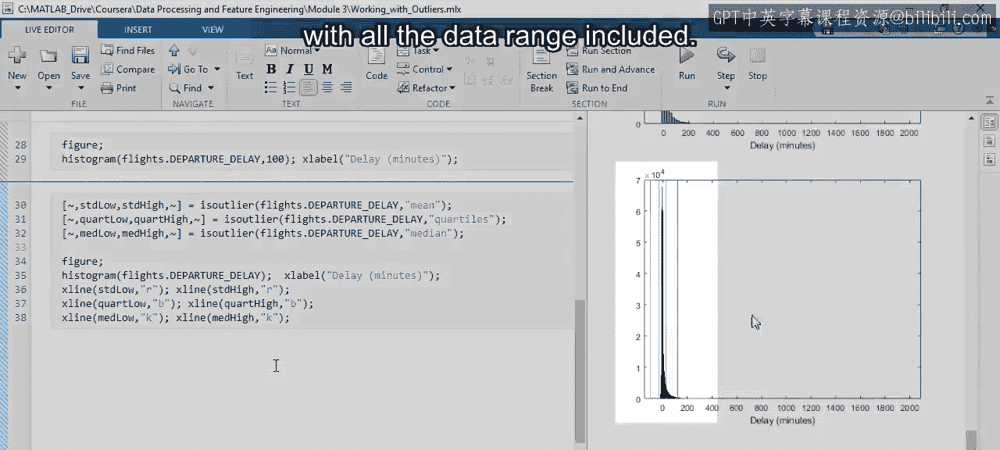
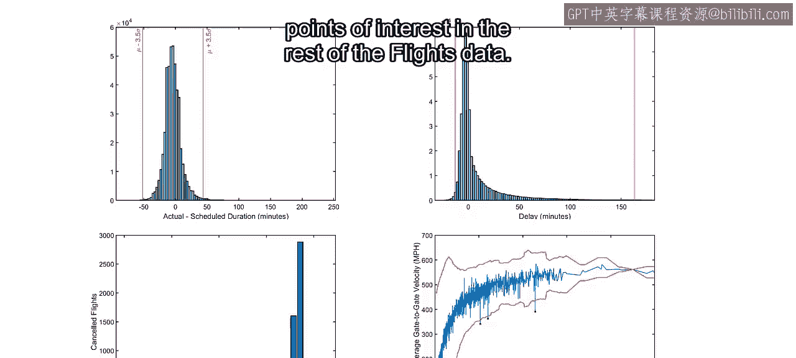

# Mathworks《实用数据科学与MATLAB（数据探索、特征工程、机器学习、毕业项目）｜Practical Data Science with MATLAB》 p62 22_调查异常值.zh_en [BV1Jr421w7wL_p62]

🎼，You've just learned some general concepts about outliers。In this video。

 you'll see some of these concepts illustrated using the flights data。

And begin to use tools in MATLb to identify and work with outliers。

Flights that arrive late can be extremely frustrating。

 But how much deviation from schedule is typical to investigate this。

 Let's calculate the difference between actual and scheduled elapsed time from gate to gate。

Plotning the results， it looks like most flights deviate from their scheduled duration by an hour or less in either direction。

But it looks like there are quite a few outliers as well。

It is difficult to really gauge the distribution due to the crowding of so many data points。

Let's use a histogram to get a better picture。The majority of the deviations are within an hour。

But the distribution is definitely not uniform in this range。

It would be nice to see this in more detail， but some large outliers are biasing the visualization。

So how can you deal with these outliers？There are two main functions in MATLb that will help you with outliers。

Is outlier and R M outliers。

As you might have guessed based on the names， is outlier helps you identify outliers for further analysis。

 and RM outliers detects and removes them。

Recall the three common methods you saw previously for classifying outliers。

Standard deviation。Intercorrtile range。And median absolute deviation intervals。

While any one could work， since you know there are very large outliers。

 let's go with the median absolute deviation method。

The core of the distribution is far more clear now。

Notice that most flights take less than their scheduled time。To see more of the data。

 you can use the threshold factor parameter with RM outliers to adjust the number of intervals used to classify outliers from the default of three。

Okay， but what about before the plane even leaves the gate？

Let's take a look at the distribution of departure delays。In this case。

 there are outliers so large that almost the entire distribution appears empty。This time。

 let's compare each of the three common methods of outlier classification。

Let's start by calculating the bounds for the standard deviations method。

Then add these to the histogram as red vertical lines。

Then do the same with the inter quartile range method in blue。In median method in black。

It looks like they're a bit different。

But it is difficult to see with all the data range included。

You can zoom in to get a better picture。Or you can regenerate the figure to show only the part you're interested in。

Notice the standard deviation extends far into mostly empty space， which is not desirable。

The other two methods look like they may result in too much loss of data。

The symmetry of all these methods means scaling them cannot resolve both issues。

This is a situation where you may want to employ bounds that you can skew as you see fit。

One way to do this is using percentile thresholds。Let's take a look at what 1% to 99% looks like。

Percentile bounds can be adjusted to eliminate or keep as much of the data as you see fit。

Only 1% of departure delays are above 160 minutes。But remember。

 there were some close to 2000 minutes。More than an entire day。

Departure delays longer than 24 hours seem rather suspect and probably merit further investigation。

So are there other outliers in your data that could be points of interest？Of course。

Calculate the canceled flights per day using the group summary function。

And plot the result versus scheduled departure time。

This is a scenario where visual identification is sufficient。

You can see something unusual from the 26th to the 28th。

Let's check the airports with the top 10 most canceled departures and arrivals on January 27th。

It looks like predominantly airports in the northeast。

A quick search online reveals that this region was hit with a major blizzard on this date。

Another way to think about air travel duration is gate to gateit velocity。

Or the total distance travelled， divided by the elapsed time between the departing and arriving gate。

It looks like the average velocities are most commonly between  three and 400 miles perph。

But some of the flights seemed surprisingly slow。Even below typical highway speeds。

Before removing any outliers， consider that this distribution may be a function of distance。

Plotting average velocities as a function of distance confirms that there is a relationship between average velocity and total distance。

So defining outlayers based on the distribution of Veloc's ownwood may not make sense。

Let's take a look at the maximum average velocity as a function of distance。

There may seem to be a few outliers here。Since the outliers are only apparent when we plot velocity versus distance。

 a moving window will be useful。You can use either a moving mean or moving median with I outlier。

For example， a moving 300 point mean classification can be implemented like this。

You can visualize the results using the outputs from the Is outlier function。

First plot the moving lower bound as a red line。Then， add the upper bound。Finally。

 you can highlight the classified outliers using the indices returned。

Now that you've seen a few examples of how to investigate and work with outliers in MatTLb。

 it's your turn。Take some time to expand upon the script shown here and continue investigating where this analysis left off。

Or find your own trends and points of interest in the rest of the flight's data。

