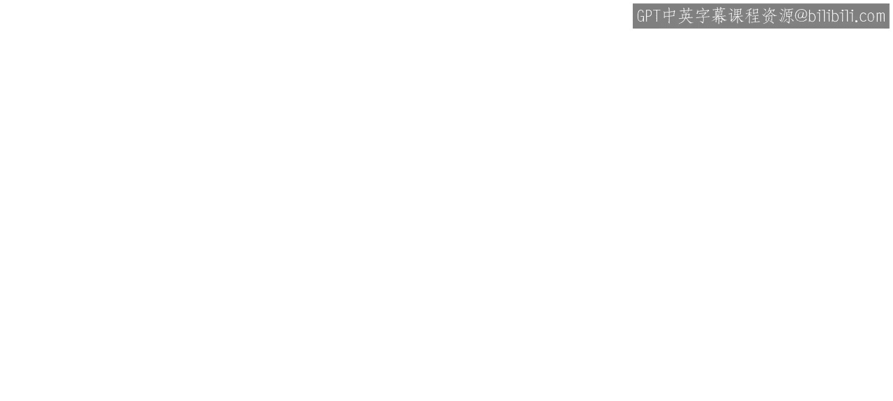
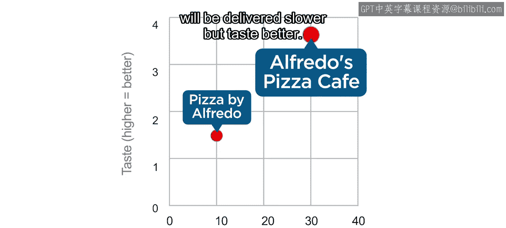
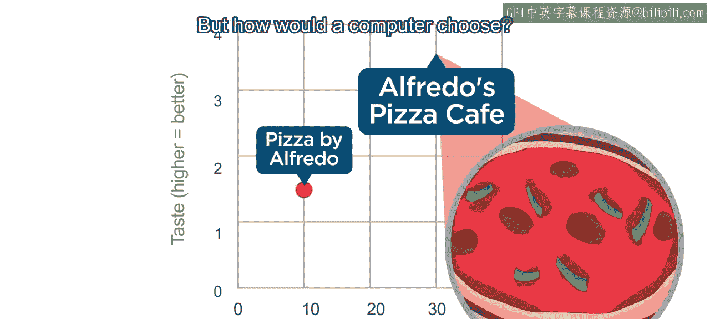
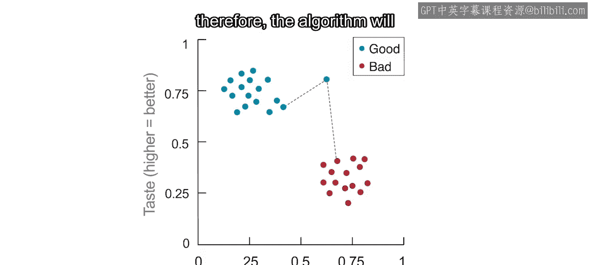
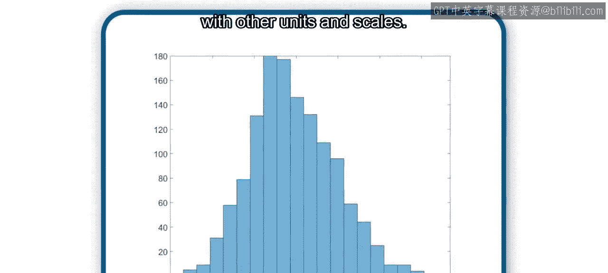
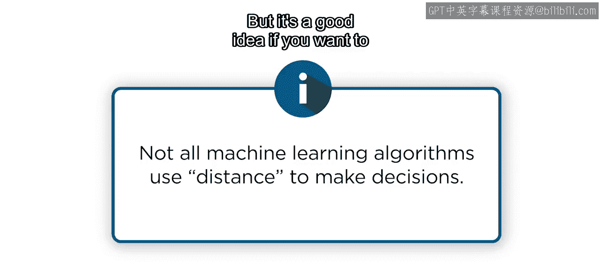
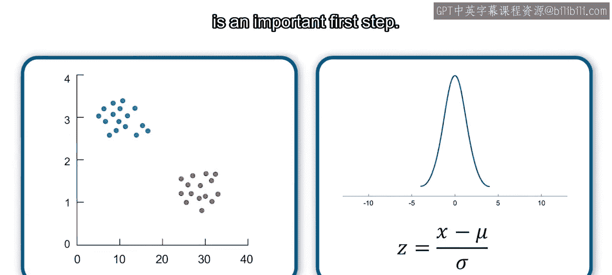

# Mathworks《实用数据科学与MATLAB（数据探索、特征工程、机器学习、毕业项目）｜Practical Data Science with MATLAB》 p63 23_标准化数据.zh_en [BV1Jr421w7wL_p63]

🎼。

Imagine you're trying to decide between two pizza places for delivery。

 Alfredo's Pizza Cafe and pizzaizza by Alfredo。

You can't make a decision so you want to have a computer make one for you。

Let's say you give the computer two pieces of information， taste。And delivery time。

The pizza from pizza by Alfredo will be delivered faster， but doesn't taste very good。

On the other hand， Alfredo's pizzaizz cafe will be delivered slower， but tastes better。

You might not mind waiting the extra delivery time for Tas or pizza， but how would a computer choose。

A computer only cares about the numbers。So to it， the graph actually looks like this。

Here the numbers are evenly spaced， so the x axis is now 10 times longer than the y axis。

This view makes it seem like the delivery time is much more important than taste。

 simply because the numbers for delivery time are larger than the numbers for taste。

To make sure the computer considers each variable as equally important。

 you'll need to normalize this data。Normalizing data is the process of transforming different variables to similar scales so they can be directly compared。

This is also sometimes referred to as standardizing data。

This can be a critical step in preparing your data for certain types of machine learning algorithms。

To illustrate one such algorithm， let's say you collected data from several pizza places and labeled them as good or bad。

Here's a scatter plotot of the two groups。You want to train a model to assign a new data point as either good or bad using the taste and delivery time values。

Some machine learning algorithms will make predictions based on the distance between points。

Such an algorithm would assign this data point to whichever group is closest to。But， remember。

The algorithm uses the numeric values， so its view is actually closer to this。

Because the taste values have a smaller range。The delivery time values will be much more important in determining the distance to a particular group。

Let's say the new place takes 25 minutes to deliver pizza。

It doesn't matter how good the pizza tastes， the algorithm will always assign it to the bad group because those data points are always closer。

Normalizing the data will prevent this problem by making sure each variable contributes equally to a distance calculation。

One common type of normalization is to scale the values between 0 and 1。

 such that the minimum becomes zero and the maximum becomes 1。

Notice that the two axes now have the same range， so they are correctly displayed as having the same length。

Now if the new data point has a high enough taste value， it will be closer to the blue data points。

 even though the delivery time is short。Therefore， the algorithm will assign it to the good group。

This type of normalization that scales the data between 0 and 1 is great for uniform distributions that have a well defined minimum and maximum。

But what about normal distributions？In this case， a better choice of normalization is called the Z score。

A Z score is calculated by taking any normal distribution denoted here by a variable x。

 and first subtracting the mean， often represented by the Greek letter mu。

This shifts the distribution so that the mean is 0。

Then the data is divided by the standard deviation denoted here by the letter Sigma。

 which shrinks or expands the range of the distribution to have a standard deviation of 1。

If you calculate a Z score for the data in the previous histogram。

 the new histogram will look the same， except now the values range from around negative3 to3。

This data can now be used in a machine learning algorithm that has to compare variables with other units and scale。

Note that not all machine learning algorithms use distance as a metric。

 some readily handled variables with different scales。In these cases。

 you don't have to normalize your data as it won't affect the results。

 but it's a good idea if you want to try out a variety of models。

As always， it will come down to your individual situation。

It's good practice to try multiple approaches and see what works best for your particular data set。

Understanding the basics of why and how normalization techniques are used is an important first step。

Next up， you'll see how to apply these techniques in MATLb。

