# Mathworks《实用数据科学与MATLAB（数据探索、特征工程、机器学习、毕业项目）｜Practical Data Science with MATLAB》 p65 25_平滑数据.zh_en [BV1Jr421w7wL_p65]

🎼。

A major part of data science is taking large amounts of information and finding the meaningful story hidden in the data。

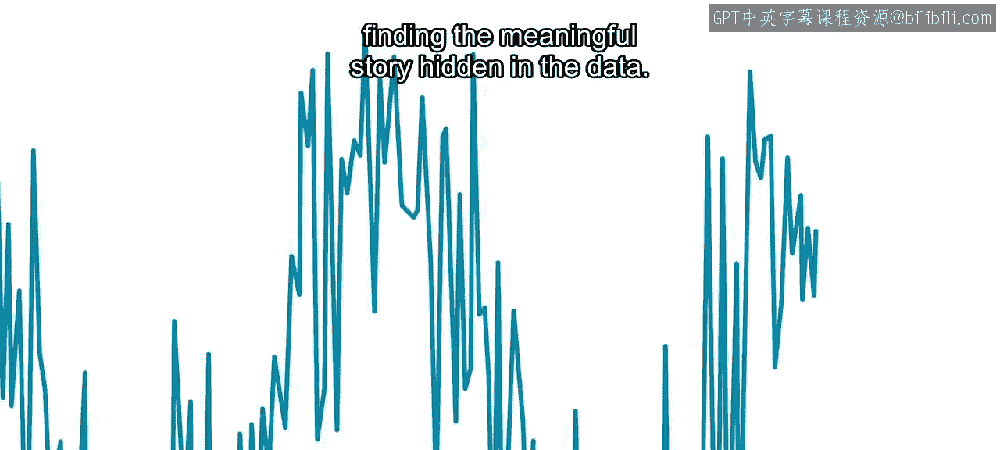

One technique that can help you in this is smoothing。

Smoothing data is the process of removing unwanted fluctuations or noise from your data to reveal underlying trends。

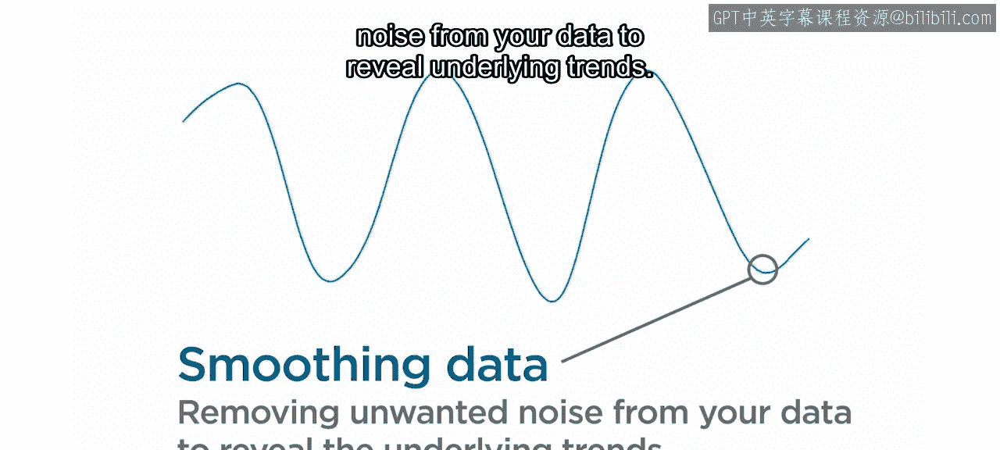

Recall when you were working with missing data， you removed missing values from a table of flight information that had the mean arrival delay for each minute of the entire month。

If you plot the first day's arrival delay values from this table。

You can see that the data is quite noisy。

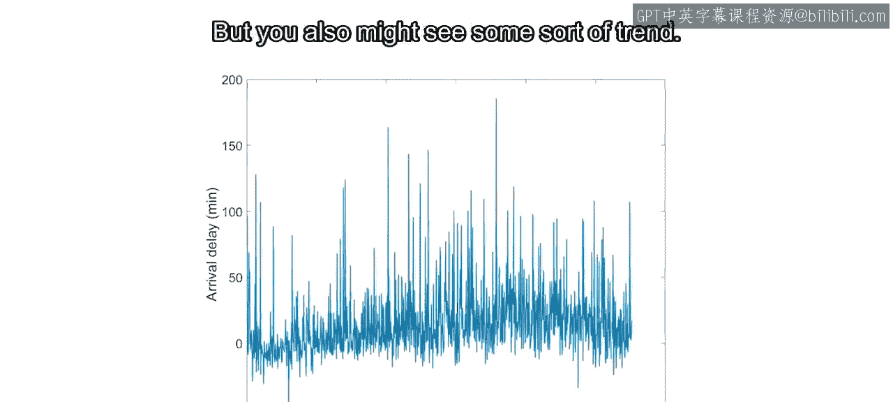

But you also might see some sort of trend。You can use smoothing to help answer a question。

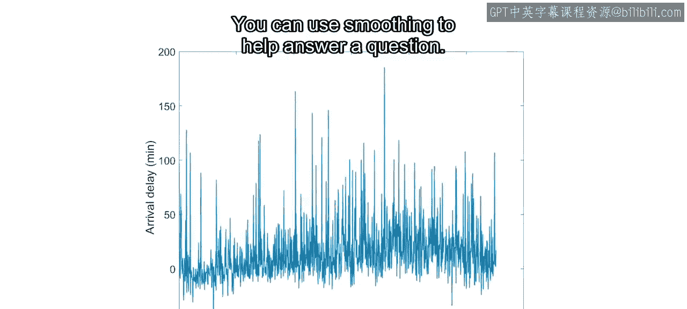

Is there a daily trend in the arrival delays？

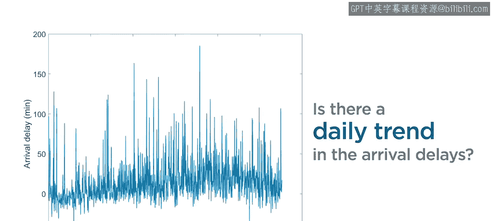

First， let's introduce some terminology。Smoothing should only be used for data that is indexed。

 that's to say data with a specific ordering to the data points。

A good example of index data is a signal that is indexed by time。

Each point in this signal has a corresponding time that defines the order of the data points。

The distinction between indexed and non indexed data is important because smoothing methods only process small chunks of data at a time。

These chunks are sometimes referred to as windows。The window will slide along the data。

 smoothing it point by point。Only the values inside the window are considered at any given time。

As the window advances， it leaves behind the smooth result。If this data were not indexed。

 then the data points could be in any particular order。

A sliding window would produce a completely different smoothing result。

 depending on how the data was shuffled。Also， note that the size of the window controls how smooth the result will be。

A shorter window will produce less smoothing。

While a longer window will produce more smoothing。

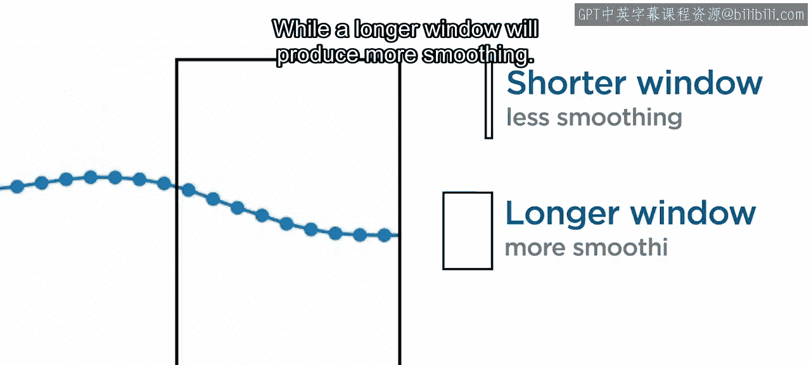

Let's zoom in on part of the signal to see how some different smoothing methods work。

Consider the point marked with a red square and the window encompassing three points on either side。

The most common type of smoothing is a moving average。

All the values inside the window are averaged together using the mean or median。

 and the center point is changed to the average value。

Another type of method calculates a local regression for the points inside the window。

This regression line is used to pick the new data point。

Other available options include robust methods that are less susceptible to outliers。

 as well as more advanced types of regression。

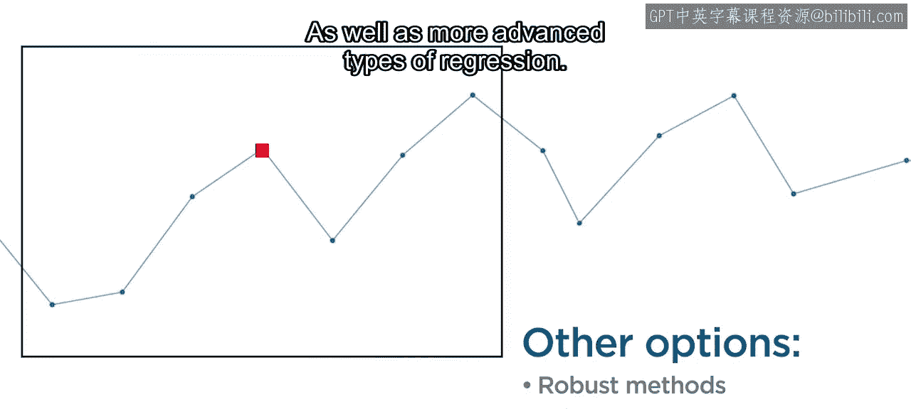

Returning to the flight's data， let's work with a table of mean arrival delays。

 which contains index data。Specifically， the delay values are indexed by the minute of month column。

The RA flight table is inappropriate for smoothing because there can be multiple flights that depart at the same time。

These plates can be in any order at the table， meaning that the data is not indexed。

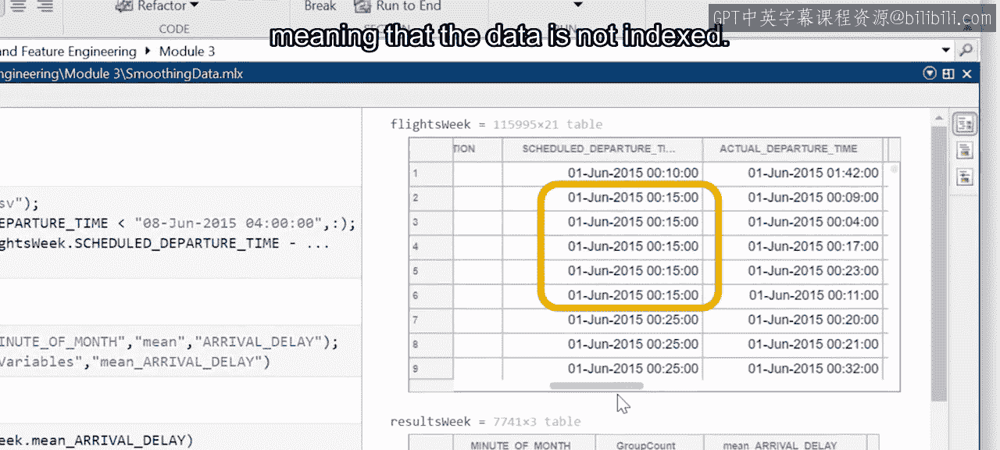

This is why the mean arrival delay for each minute was calculated。

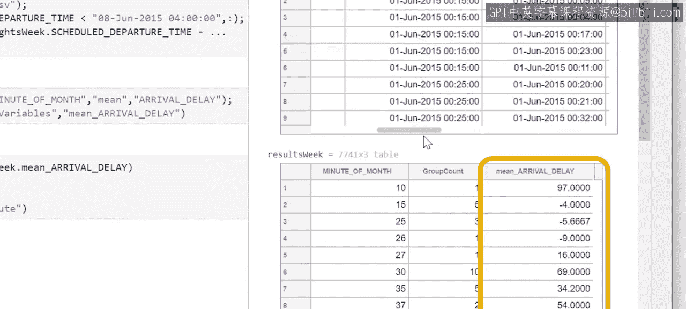

Consider just the first week of MeA arrival delays shown here。

You might be able to see seven groups of data that correspond to each day。

You might also be able to see a daily trend， but the signal is extremely noisy。

This noise includes potential outliers， with average delays greater than 400 minutes。

You could take the time to remove the outliers beforehand。

 but let's see if smoothing the data can account for these delays。

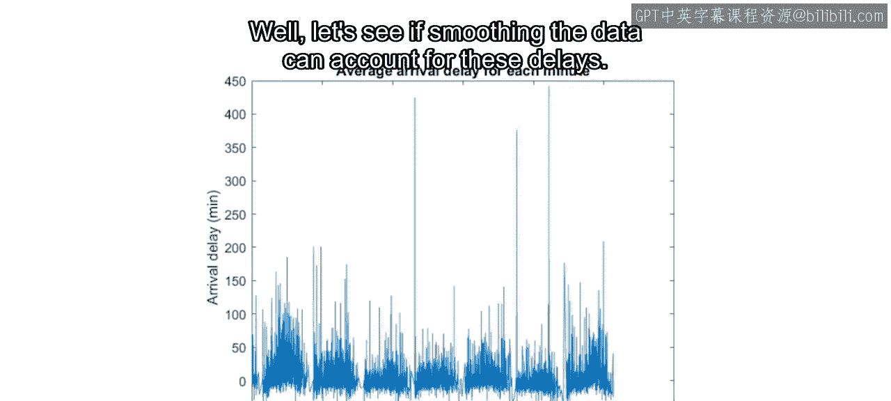

To explore some of the various smoothing methods and options， use a smooth data live editor task。

This task is similar to the one you saw earlier for handling missing data。

It's great for quickly exploring various methods and options。

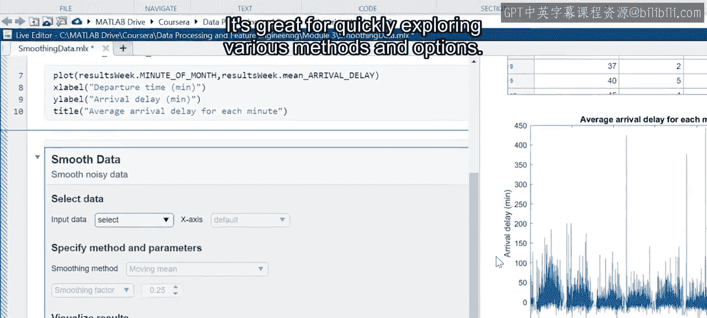

Select the Me arrival De column from the table as the input data。

Then select the minute of month column for the X axis。

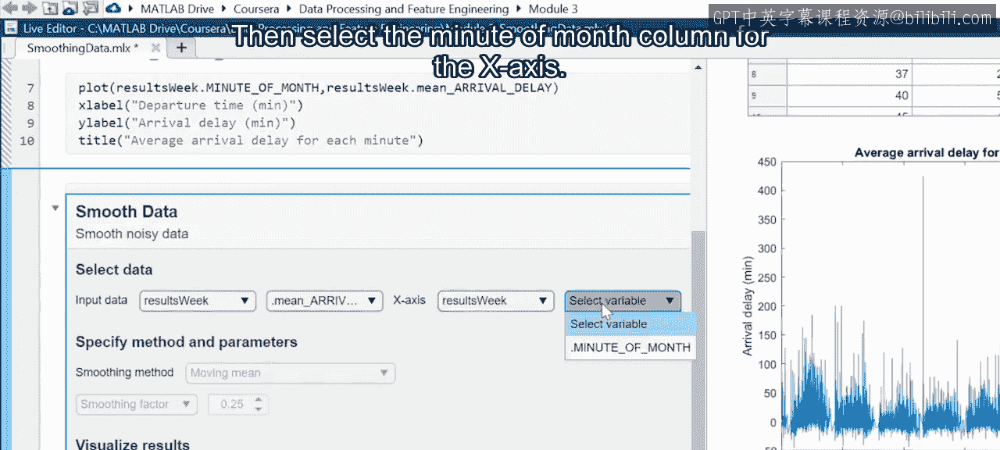

The live Ed task will display a visualization of the original and smooth data。

It looks like the default options didn't perform enough smoothing。

 so you can try making the window longer。You can do this by increasing the smoothing factor。

This factor is a number between 0 and1 that controls the size of the moving window。

Values near one use longer windows， while values near 0， use shorter windows。Change this value to 0。

75。Now you can clearly see a smooth curve inside the noisy original data。

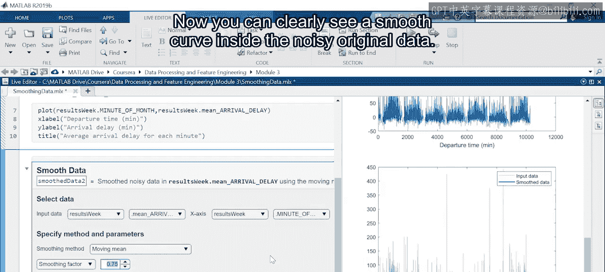

This also makes the daily trend more apparent。It looks like the average arrival delay increases throughout the day。

 then falls back down， although this trend is more pronounced on some days than others。

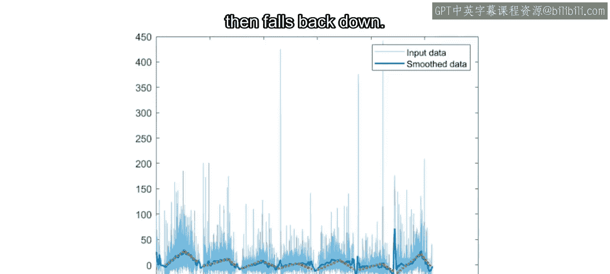

To definitively answer the question of whether arrival delays have a daily trend。

 let's try averaging all the days together。

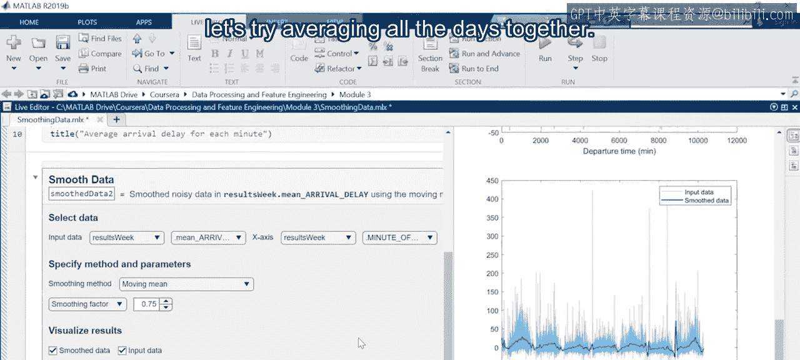

Instead of minute of month， create a minute of day variable in the Fs table。

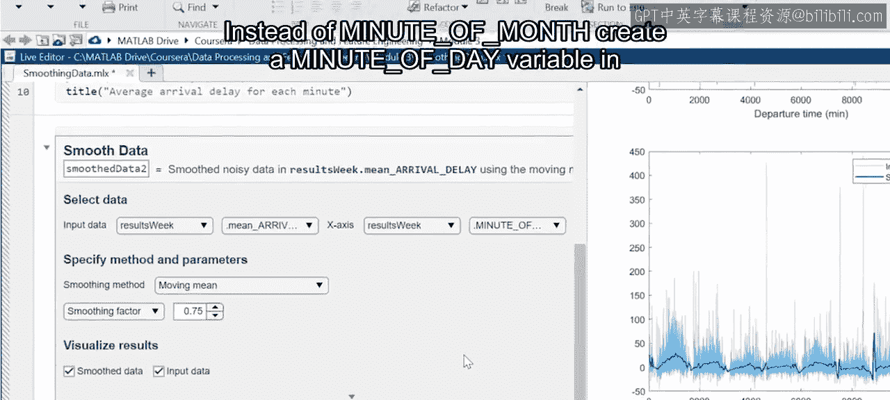

That has the minutes elapsed since midnight。

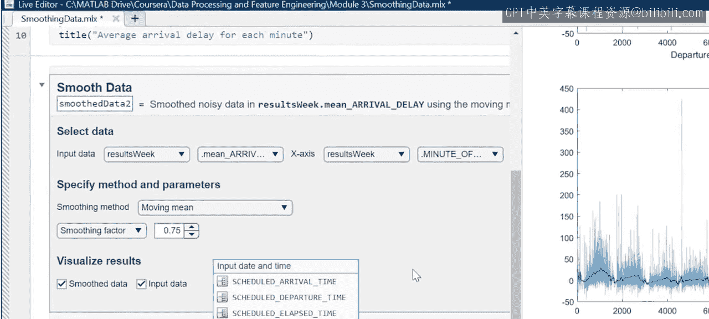

Then use group summary with minute of day as the grouping variable。

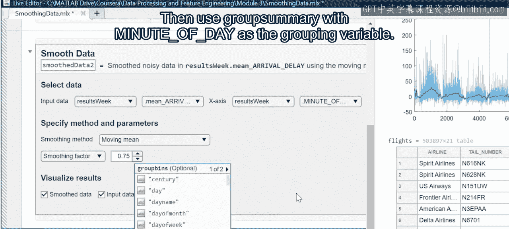

When you plot the result。You can see this signal is particularly noisy in the early morning。

 that's because there are only a few fls during this time。Most flights are scheduled after 6 a。

Since you're only concerned with the overall trend。

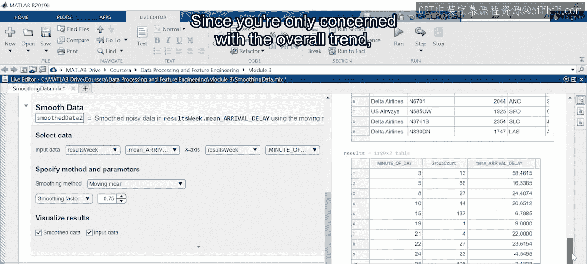

Remove the extra rows from the table so you're only considering the main part of the day。

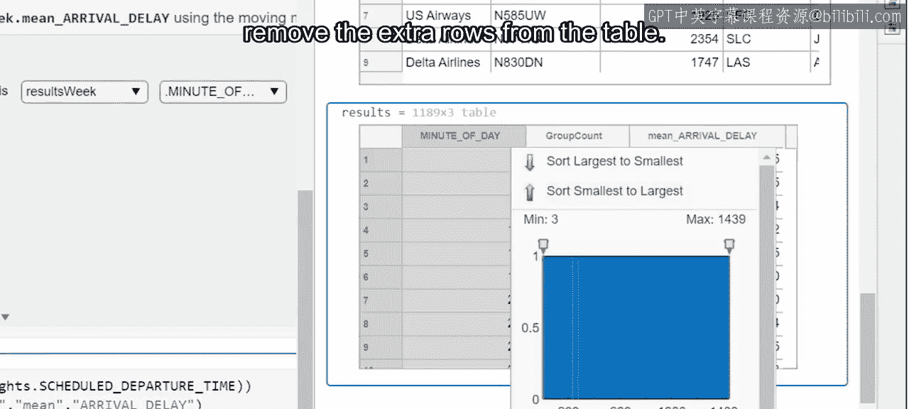

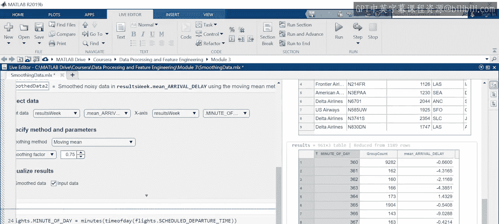

Then。Insert another smooth Data live task。

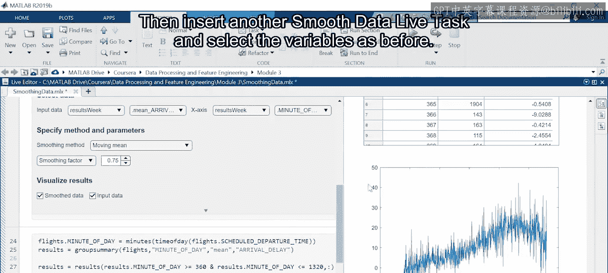

And select the variables as before。Again， the default options don't seem to perform enough smoothing。

Try increasing the smoothing factor again。Or perhaps selecting a different method from the drop down menu。

 such as local linear regression。It's helpful to try different methods to see what works well with your data。

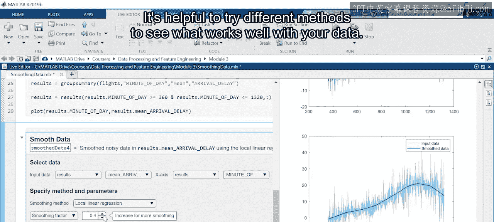

With these options， the underlying trend becomes clear。

The average delay increases throughout the day until it peaks around 1100 minutes。

 which is close to 6 pm。After that， the average delay decreases。

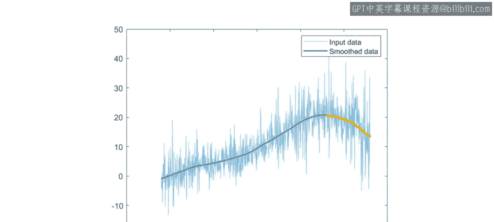

And that's it。 You've now shown that there's a distinct daily trend。To put this another way。

 you know that the time of day can predict at least to some degree， the amount of arrival delay。

To reproduce your analysis， remember you can generate the code used in the live task。

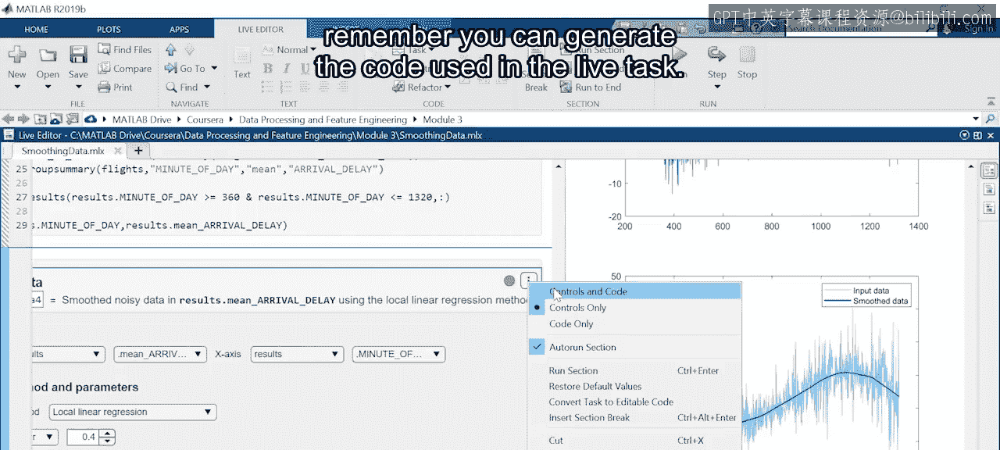

In this case， the actual smoothing operation is performed by the smooth data function。

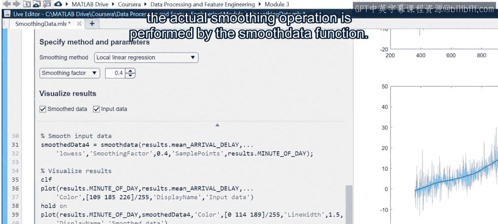

To recap， smoothing data is the process of removing unwanted noise from your data。

It can help you find hidden trends obscured by noise。

It requires the data to be indexed or ordered in some way because smoothing methods process data piece by piece。

Remember， there are a variety of methods to choose from。

 Try out different methods and choose one that works best for your data。Lastly。

 the smooth Data Live Edit task enables you to rapidly explore various methods and settings。

It also generates code that you can use to reproduce your steps。

Now it's your turn to practice smoothing data。

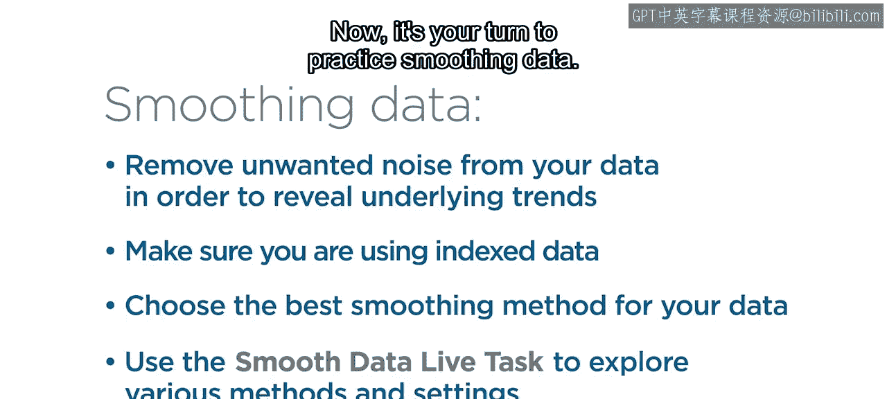

。