# Mathworks《实用数据科学与MATLAB（数据探索、特征工程、机器学习、毕业项目）｜Practical Data Science with MATLAB》 p66 26_模块3清理数据总结.zh_en [BV1Jr421w7wL_p66]

🎼，Good job， You've reached the end of module3。Before continuing to the quiz。

 let's take a few minutes to recap what you've learned so far。

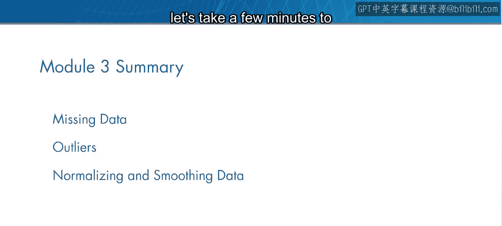

You've seen that raw data often contains irregularities and requires cleaning to prepare it for in depth analysis。

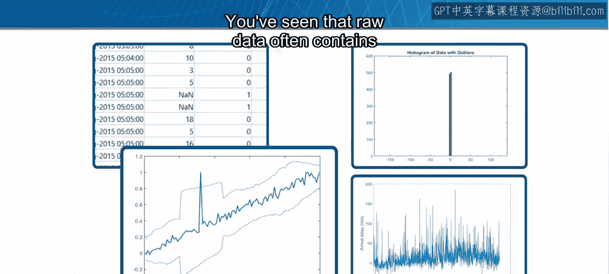

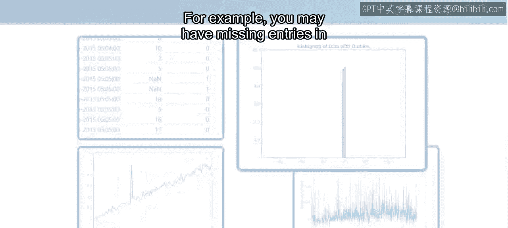

For example， you may have missing entries in your data。Or outlier data points that seem unlikely。

 given some overall trend。

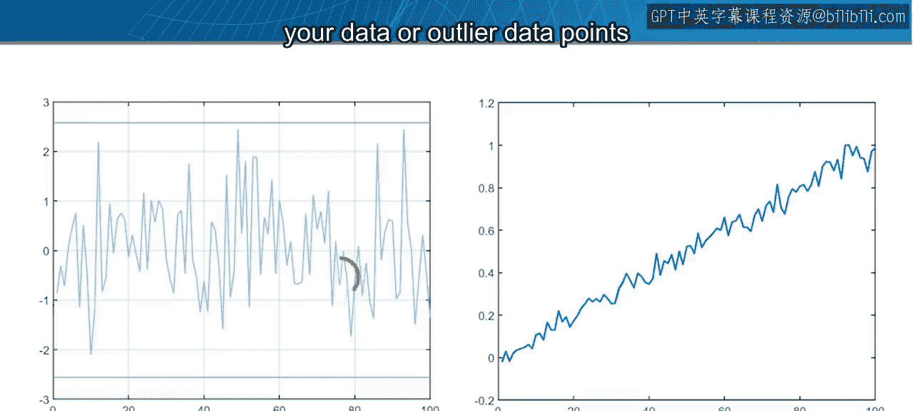

You saw several ways that missing entries and outliers can affect your analysis。

 from biasing statistical calculations to imposing poor scaling on visualizations。

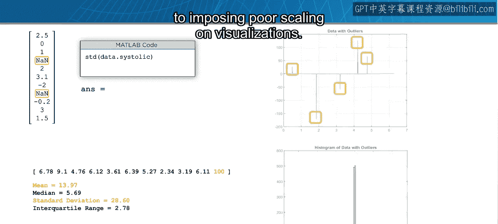

You also saw how noise and short term variations or poor scaling can obscure larger trends in your data。

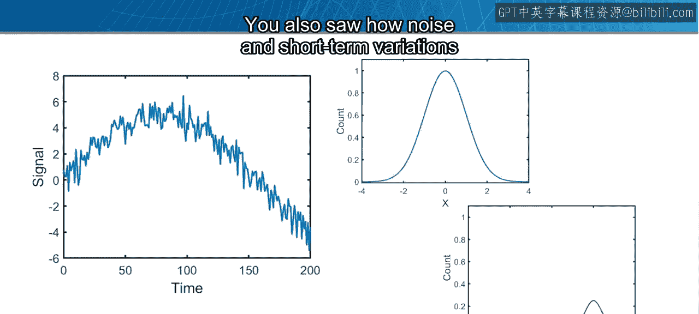

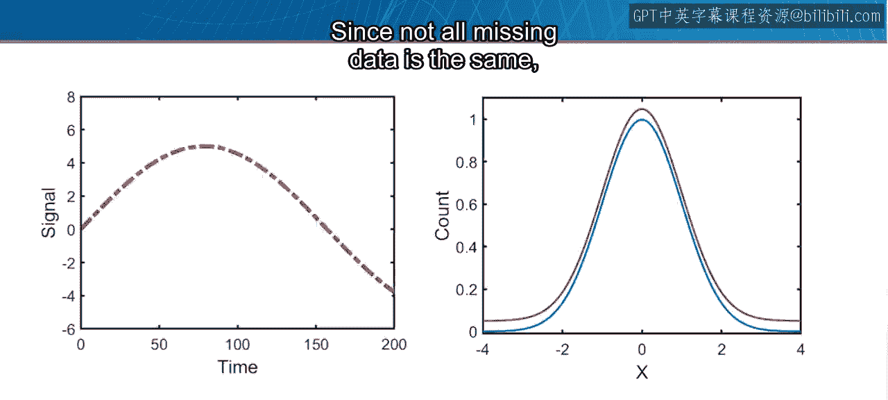

Since not all missing data is the same， the best approach to address it depends on the underlying cause as well as the questions you're trying to answer。

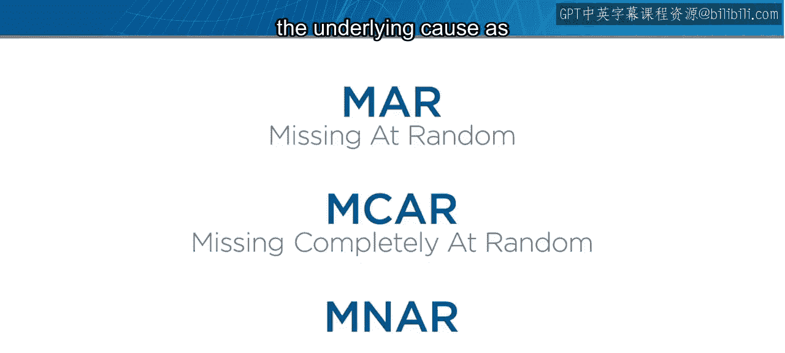

You've practiced identifying missing data as well as techniques to keep。

 remove or fill missing data as needed。

You also learn potential causes and methods for identifying outliers。

As there is no universal definition of what constitutes an outlier。

 you learn to use visualizations to aid your analysis and determine the best method to identify them。

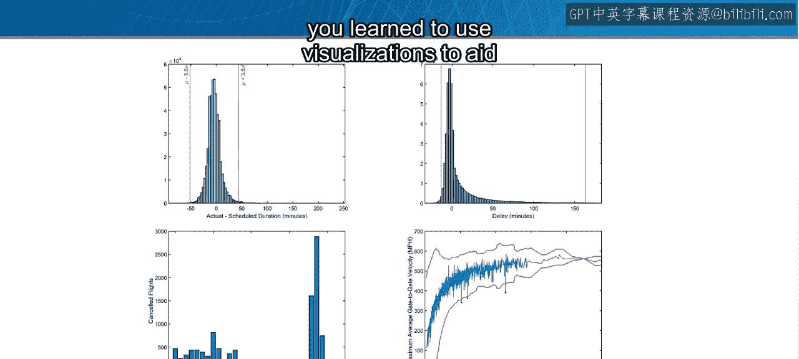

You saw that sometimes you want to remove outliers。

 while other times you want to extract them as points of interest。

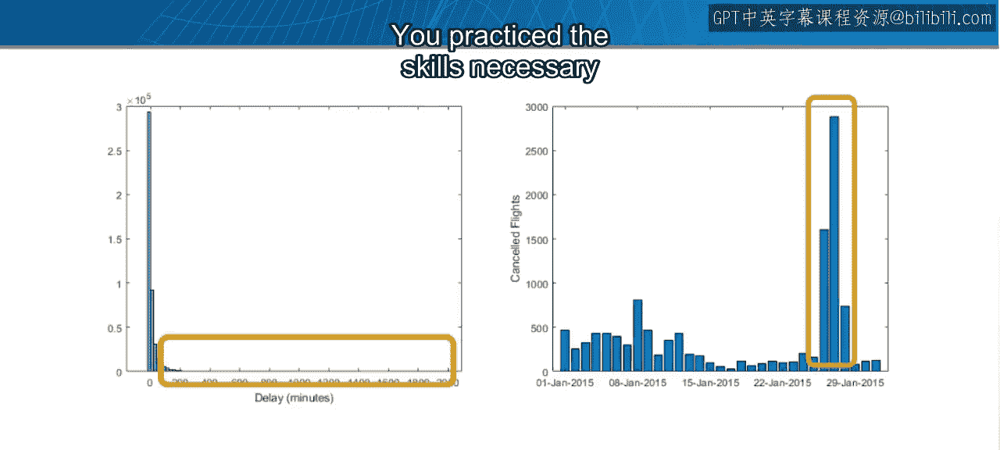

You practice the skills necessary to address both scenarios。

You also learned how to smooth and normalize data， which enabled you to discover trends and similarities that were previously hidden。

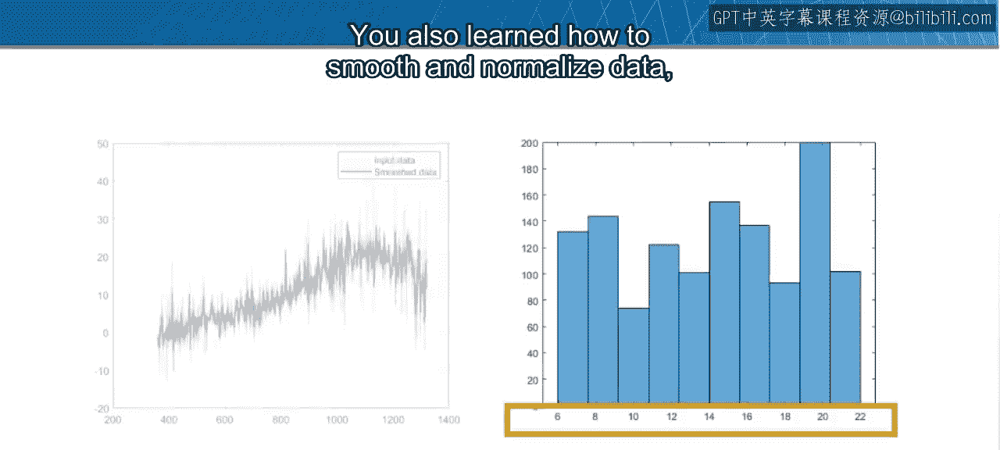

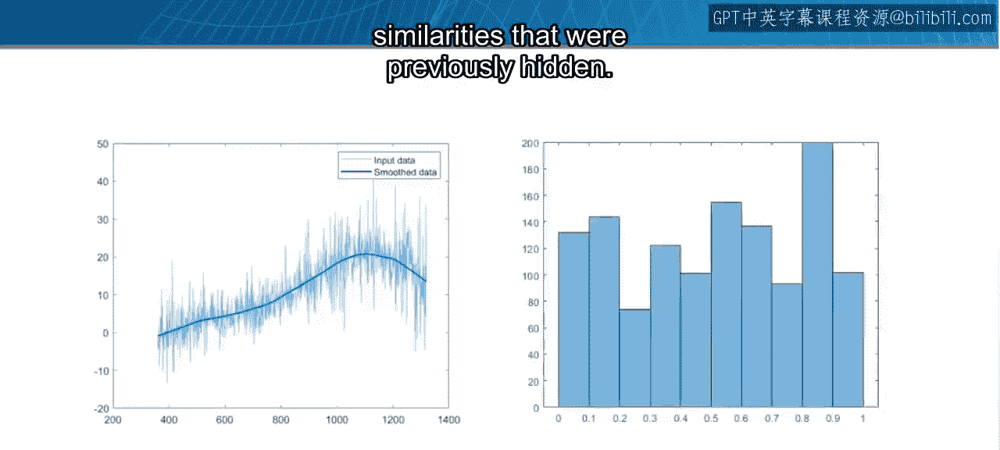

You finish the module with an example in which you combine the concepts you learn to determine if there was a relationship between flight volume and day of week。

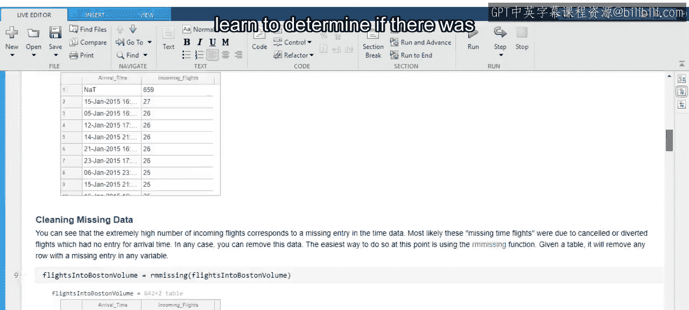

Remember， the approach you take to cleaning data depends on the data type。

 circumstances and the goals of your analysis Now it's time to test your knowledge by completing the module3 quiz。

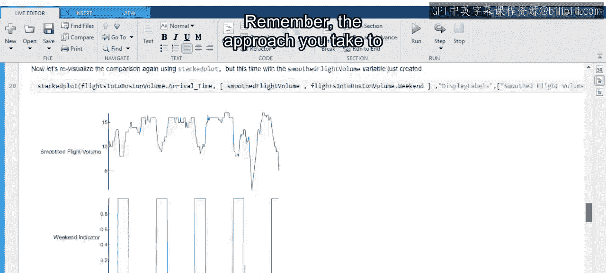

Refer back to the lessons or post a question in the form if you gets stuck。 Good luck。

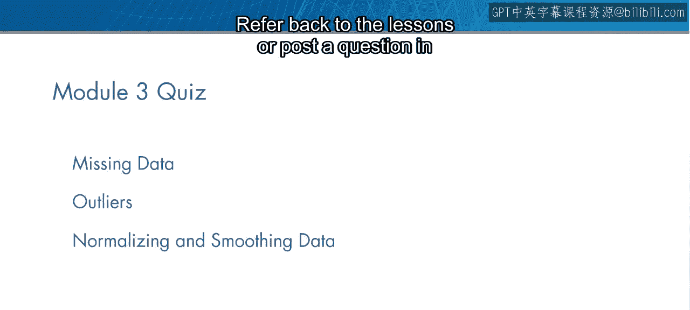