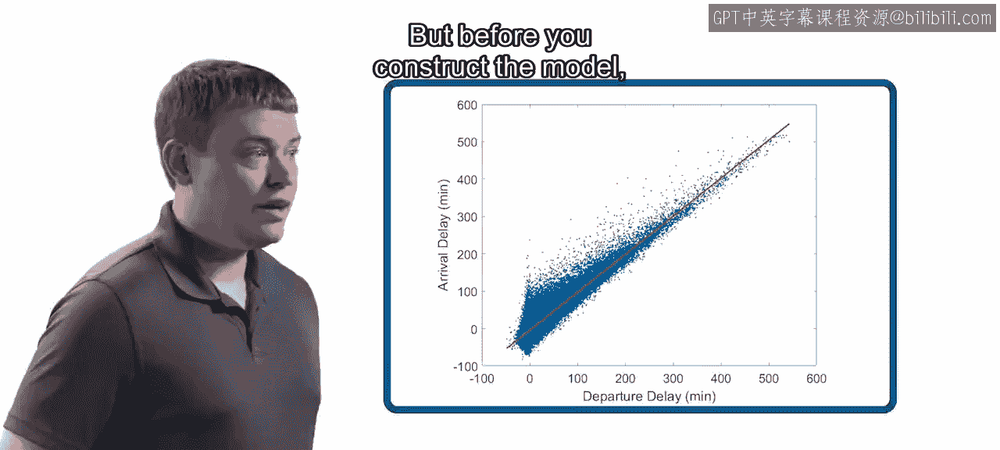
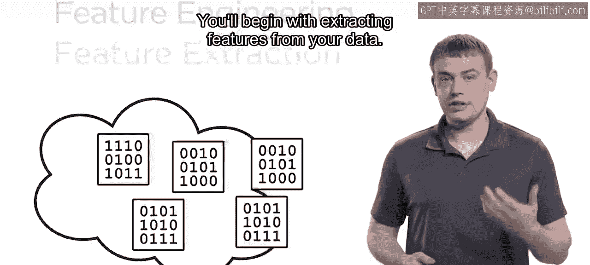
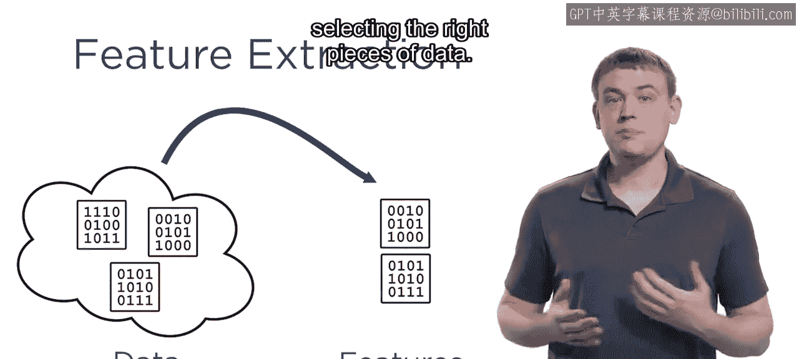
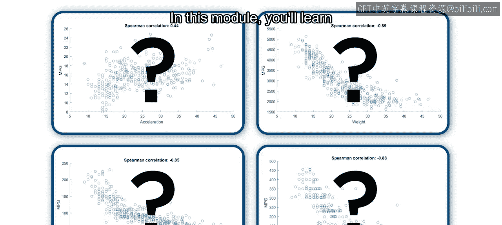
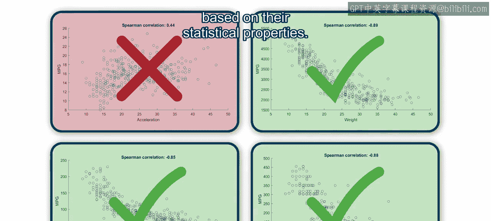
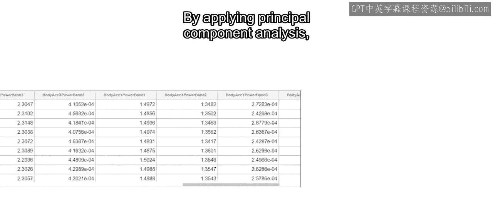
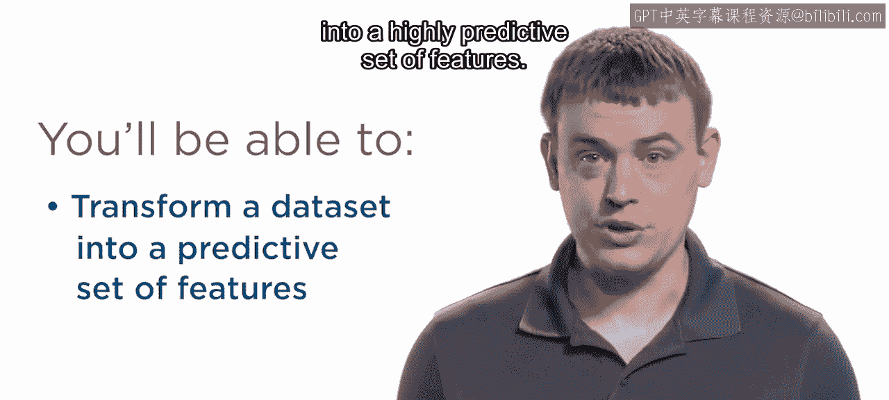

# Mathworks《实用数据科学与MATLAB（数据探索、特征工程、机器学习、毕业项目）｜Practical Data Science with MATLAB》 p67 27_模块4寻找重要特征介绍.zh_en [BV1Jr421w7wL_p67]

🎼。

Welcome back。Now that you have cleaned and organized your data。

 it's time to start thinking about how you want to use the data。

For example， you might wish to use the flight data to create a model that predicts arrival delays。

But before you construct the model， you will need to decide on the features that your model will use。

A feature is a piece of information in your data that is meaningful to the problem you're trying to solve。

It's what you'll use to teach or train your model to make predictions。

The process of transforming your data into features is called feature engineering。

It's a highly iterative process， and it is the focus of this module。

You'll begin with extracting features from your data。

This might be as simple as selecting the right pieces of data。

For example， the departure time for a flight might be a good feature to predict the arrival delay。

In other cases， extracting features will require more complex calculations and transformations of the data。

Another common method for generating features is through unsupervised learning。

You'll learn how to use unsupervised learning algorithms like clustering to uncover new features by finding hidden relationships and patterns in your data。

Once you have identified， engineered or extracted a set of features。

 you need to determine which ones will help your model make accurate predictions and which ones won't。

In this module， you'll learn several techniques for evaluating the relationship between features based on their statistical properties。

But as the amount of available data keeps growing and growing and growing。

 so does the number of potential features。By applying principal component analysis。

 you'll be able to extract the most predictive value from the fewest number of features。

 helping you tackle even the biggest data sets。

By the end of this module， you'll be able to transform a data set into a highly predictive set of features。

So let's get started with feature engineering。

