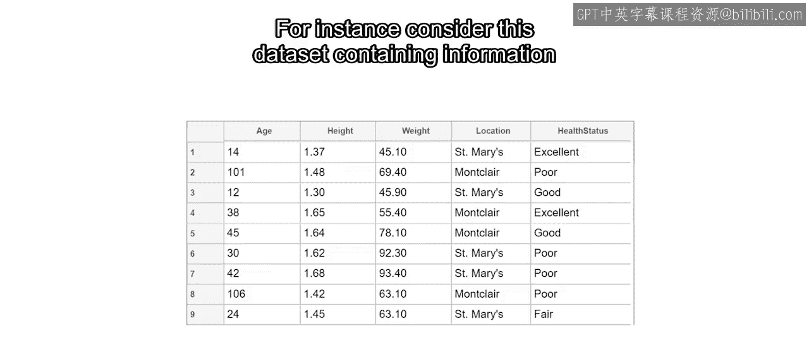
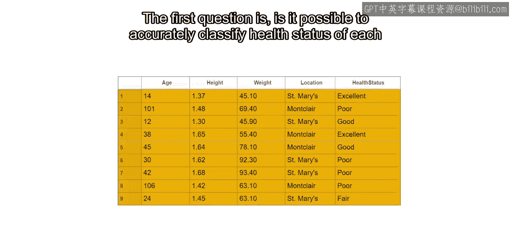
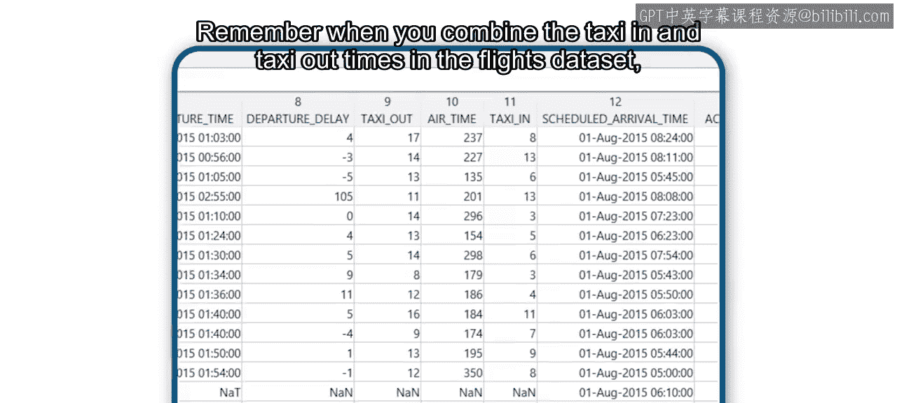
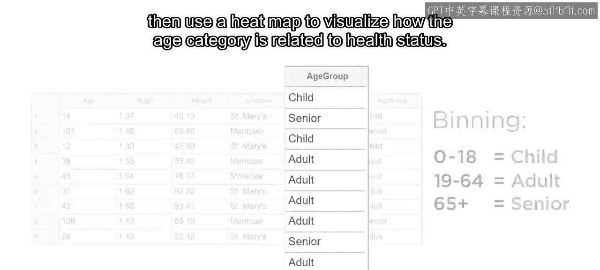
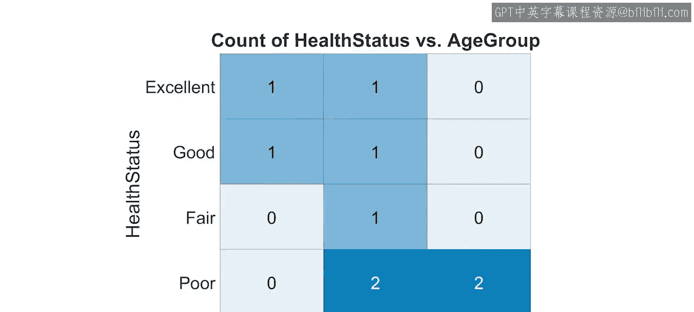
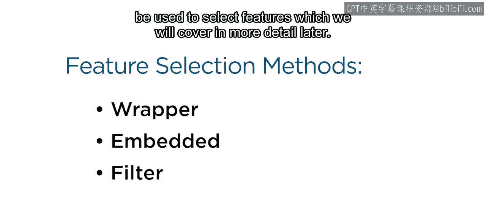
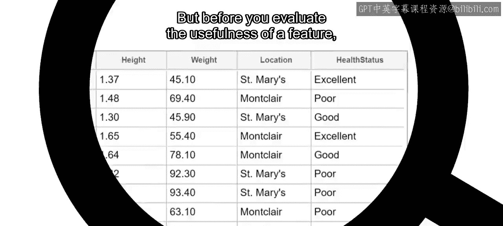
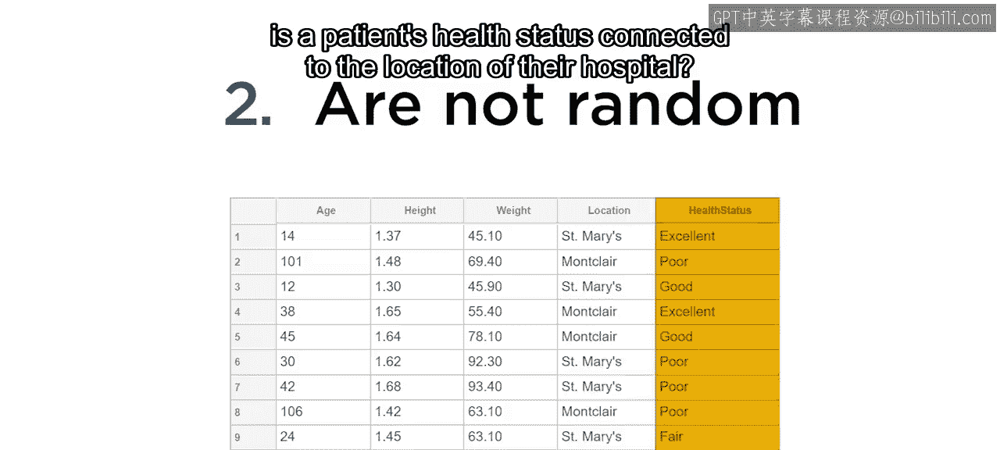
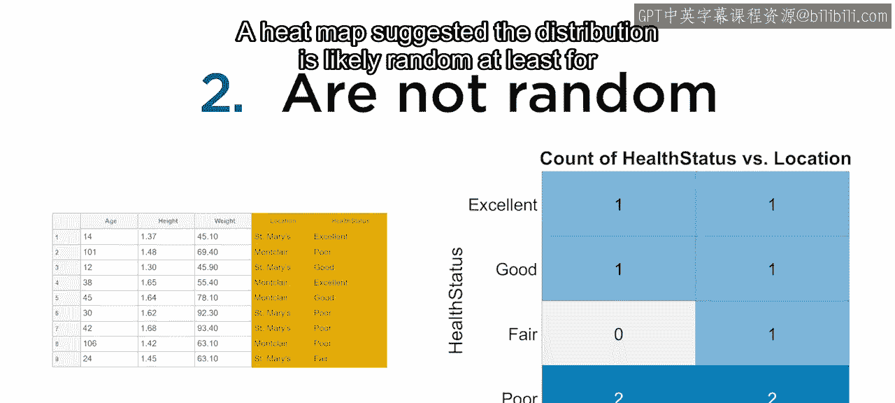
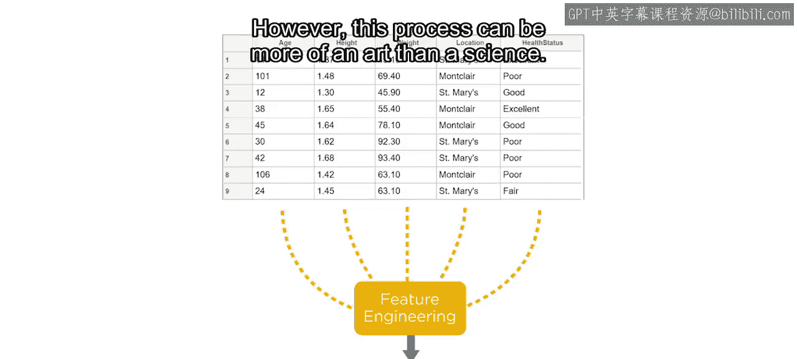

# Mathworks《实用数据科学与MATLAB（数据探索、特征工程、机器学习、毕业项目）｜Practical Data Science with MATLAB》 p68 28_特征工程介绍.zh_en [BV1Jr421w7wL_p68]

🎼，Feature engineering is an important step in preparing your data for predictive modeling。

A feature is a property of whatever you are trying to describe。

A collection of individual features forms a single observation。

 and a collection of individual observations forms a data set。

Your job as a data scientist is to then use these features as predictor variables in a model。

Such models are only as good as what you put into them。

So it is common to use feature engineering to uncover hidden trends in your data for the model to identify。

For instance， consider this data set containing information about hospital patients。

 which has a row for each person。

The first question is， is it possible to accurately classify health status of each individual from the original variables of age。

 height， weight， and location？

To start， you could just input the raw variables into a model and try to compare， for instance。

 health status with weight or height。However， a quick visualization shows that these variables by themselves are not good at predicting health status。

Because there is no clear correlation。So what can you do？Well。

 you can begin the process of feature engineering。You'll find that you can improve a model's predictive power by applying your domain knowledge to generate useful features。

Actually， you've probably already done this before。

Remember when you combine the taxi in and taxi out times in the flightlights data set。

 that was an example of feature engineering。

In this video， you will use the patient's data set to explore how to engineer features using domain knowledge。

😊，You'll find that there are plenty of features that are better predictors of health status than the original variables alone。

As you go through this process， you'll apply three general feature generation approaches。

These are transforming variables。Disortization。And summarizing groups。The first approach。

 transforming variables involves applying an equation to existing variables to create a new feature。

For instance， a person's body mass index or BM i for short。

Is the ratio of their weight divided by their height squared。

You can add this new feature to your table as a variable。

Visualizing BMI shows that it is indeed better correlated to patient' health status than either weight or height by itself。

The second approach， discretization， involves splitting data into groups using a numeric variable。

This can help because sometimes the important aspect of a variable is not its exact value。

 but the range in which it exists。For example， the age variable naturally lends itself to binning patients into three categories。

Child。Adult。And senior。You can then add this categorical variable as a new feature to the table。

And then use a heat map to visualize how the age category is related to health status。

Lastly， the third approach is to summarize groups within your data。For instance。

 how does a patient's weight compare to the rest of their age group。To find out。

 calculate the mean weight for each category。Then join this result to your table as a new variable。

You can then calculate the difference between each individual and average weight。

Each of these approaches could be applied to any data set。

 but the exact implementation relies on your knowledge about the data itself。Theoretically。

 you can generate an infinite number of new features， but only a limited few will actually be useful。

So how do you know when a feature is worth keeping？Well。

 there are some quantitative methods that can be used to select features which you will cover in more detail later。

But before you evaluate the usefulness of a feature。

 consider what you already know about your data and what it represents。

Here are some qualitative tests to help determine if a variable could be considered a useful feature。

First， useful features have variants if a variable is constant throughout the data。

 then it has no predictive power For instance， if there is a column for the patient's home state and all the patients happen to be from Florida。

 then that variable is not a useful feature。Second。

 useful features do not exhibit random behavior when compared to your response variable。For instance。

 is a patient's health status connected to the location of their hospital。

A heat map suggests that the distribution is likely random， at least for the small sample size。

And therefore， the location variable shouldn't be included as a feature in your model。Third。

 useful features contain unique information。If you made a new variable by converting the weight from kilograms to pounds。

 then it would be redundant and the variable would add no new information to your model。And lastly。

 the most useful features typically draw upon your intuition or domain knowledge。For example。

 earlier you calculated the BMI to better predict health status。However。

 you could have invented any other kind of index， such as dividing the patient's weight by the age squared。

 or perhaps an even more complex formula involving all three numeric variables。 However。

 what would such indexes even represent。This is where your domain knowledge is invaluable。

 helping you to engineer features that make sense。 In the end。

 remember that a predictive model is only as good as the features you put into it。

Therefore， it's beneficial to engineer useful features from your original data； however。

 this process can be more of an art than a science。

 so expect plenty of trial and error as you experiment。

