# Mathworks《实用数据科学与MATLAB（数据探索、特征工程、机器学习、毕业项目）｜Practical Data Science with MATLAB》 p69 29_无监督学习介绍.zh_en [BV1Jr421w7wL_p69]

🎼，When creating features， data scientists often start by looking for relationships in their data relationships enable them to predict the value of one variable based on the value of another variable。

Some relationships are easy to spot for example， what relationships do you notice in this plot？

There's a clear linear trend， which you could use to estimate a future value of y from a given value of x。

Here， acts as referred to as the predictor variable。And why is the response variable。In this example。

 the output data， which was known beforehand， was used to construct the model。

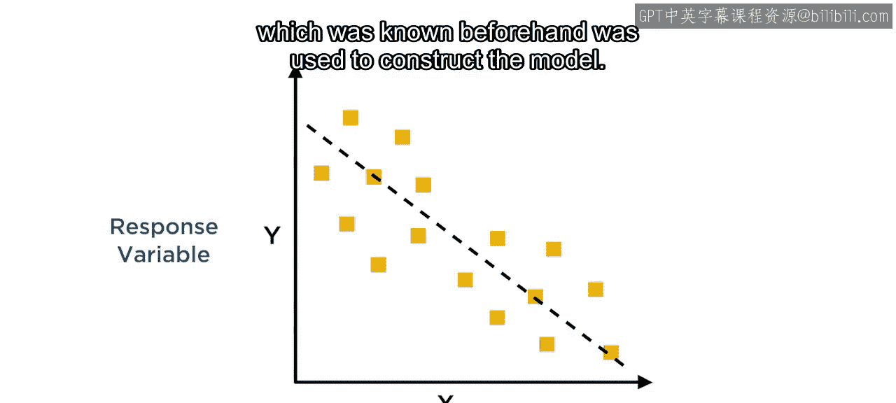

This technique is used in a branch of machine learning known as supervised learning。In other words。

 a known relationship is used to supervise or guide the creation of a model that can predict future responses from the input data。

However， you won't always have the output data beforehand。

 Does that mean you can't use machine learning。

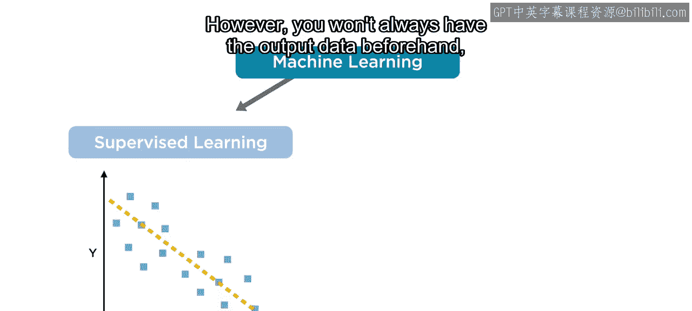

Well， let's take another look at the data set。

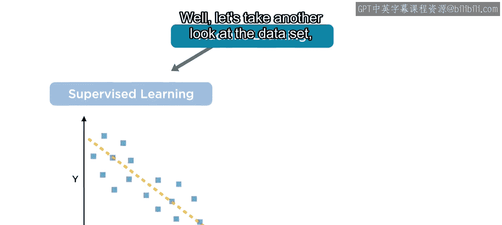

Do you see any other relationships in the data。Keep in mind that relationships are not exclusively trends。

 Relationships can also be similarities that may exhibit themselves as patterns or groupings。

It looks like the observations can be separated into two clusters。

There may be a unique characteristic or property that's causing these groups to form。

Having this grouping information may help you to better understand the data。

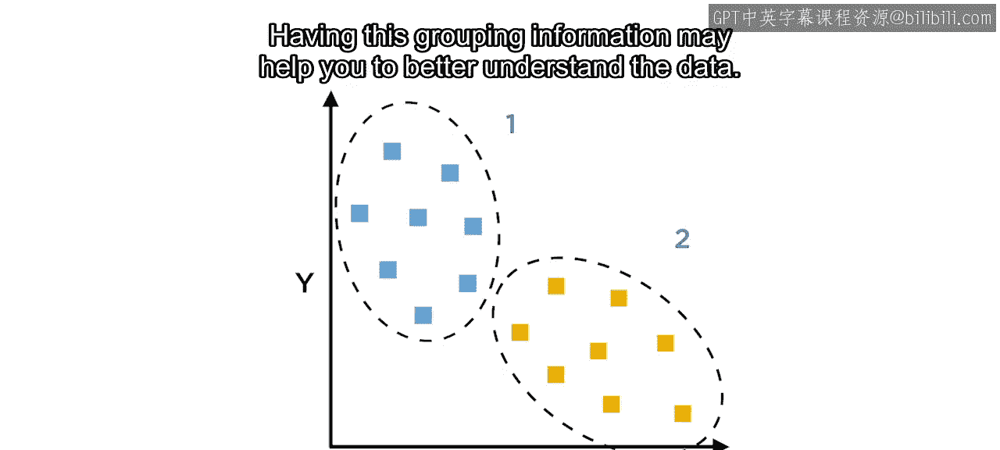

Because this information did not exist in the original data set。

 each observation's group number can be captured in a new feature。

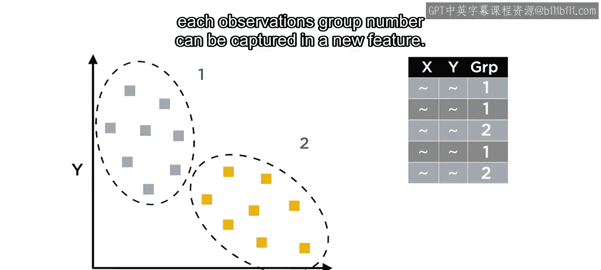

Techniques for identifying patterns or groupings in your data are used in a second branch of machine learning known as unsupervised learning。

In unsupervised learning， there is no response variable to compare results against。 Instead。

 relationships between input variables are used to define a structure for the data。

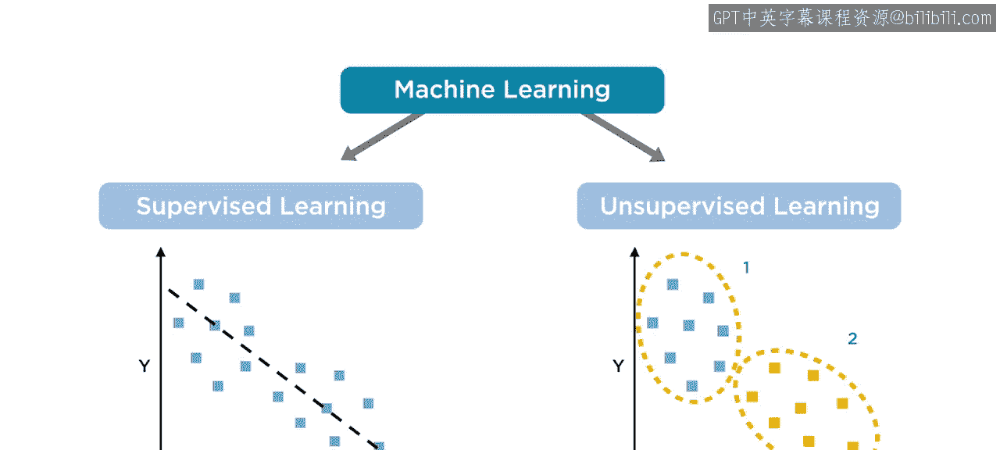

This technique is useful in exploring data when you're not sure what information it may contain。

One challenge with unsupervised learning is making sense of the groupings。

When the number of clusters are low or the size of the data set is small。

 it may be possible to use your domain knowledge to identify what the grouping characteristics are。

For example， if the plot contained car performance data， the clusters may be due to fuel type。

Or if it were output from a solar array， it could be day and night。For simple 2D examples like this。

 a single characteristic can be used to create the groups。

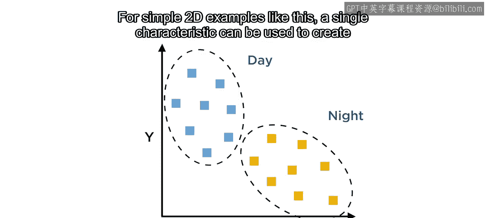

Generally， data scientists work with large multidimensional data sets。

Unsupervised learning will still identify groups in the data。

 but the common characteristics are often complex patterns that may not have a real world interpretation。

You will learn techniques for evaluating and selecting which features to include in your model later on。

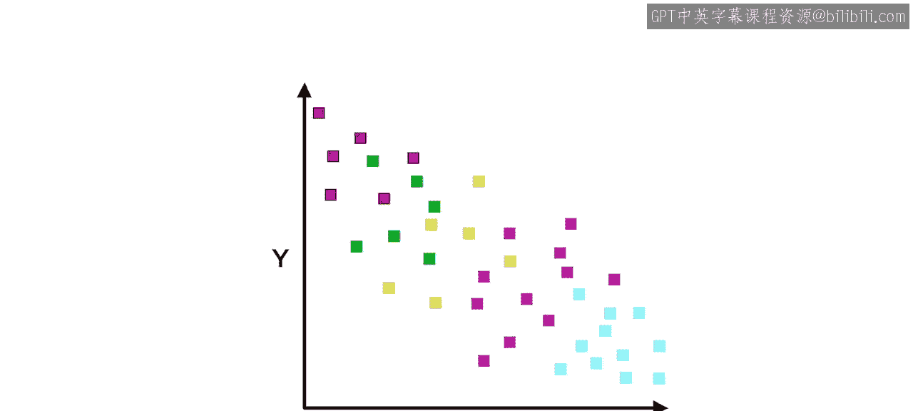

In summary， features enable you to identify relationships in your data those relationships ultimately help you create models that can predict response values based on the input values。

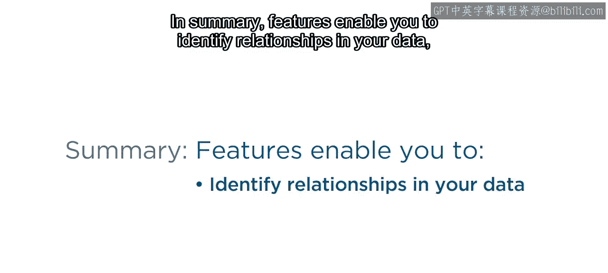

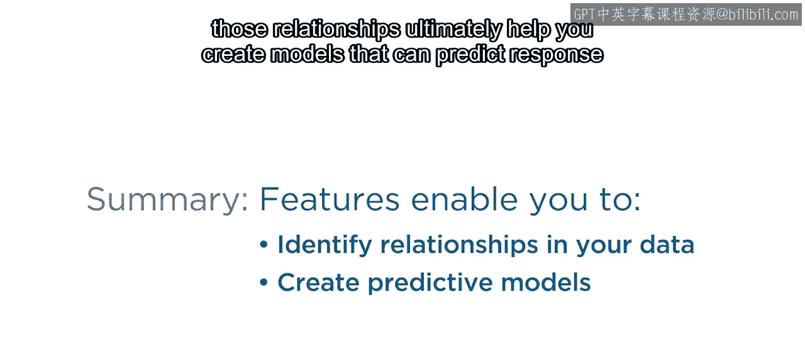

You can create these features in a number of ways。 You can use your domain knowledge to combine and transform existing variables。

 as you learned previously。

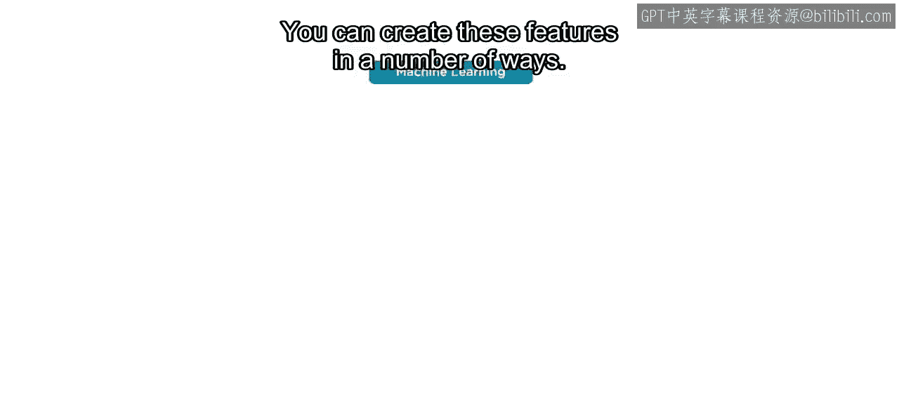

You can also use unsupervised learning to identify patterns and groupings in the data that you may not have known existed。

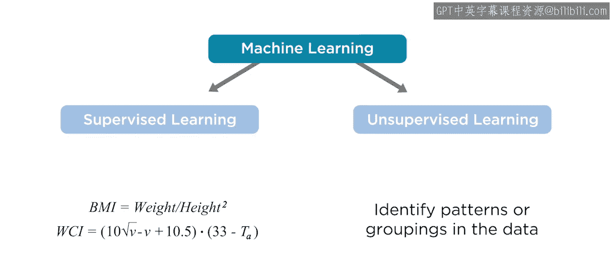

Next， you'll learn about some of the different techniques that can be used to find clusters in your data。

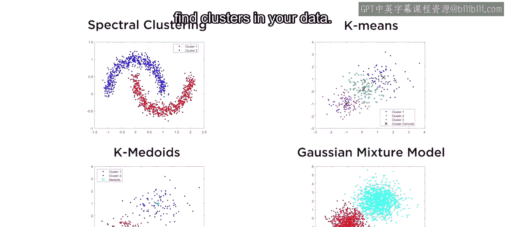

。